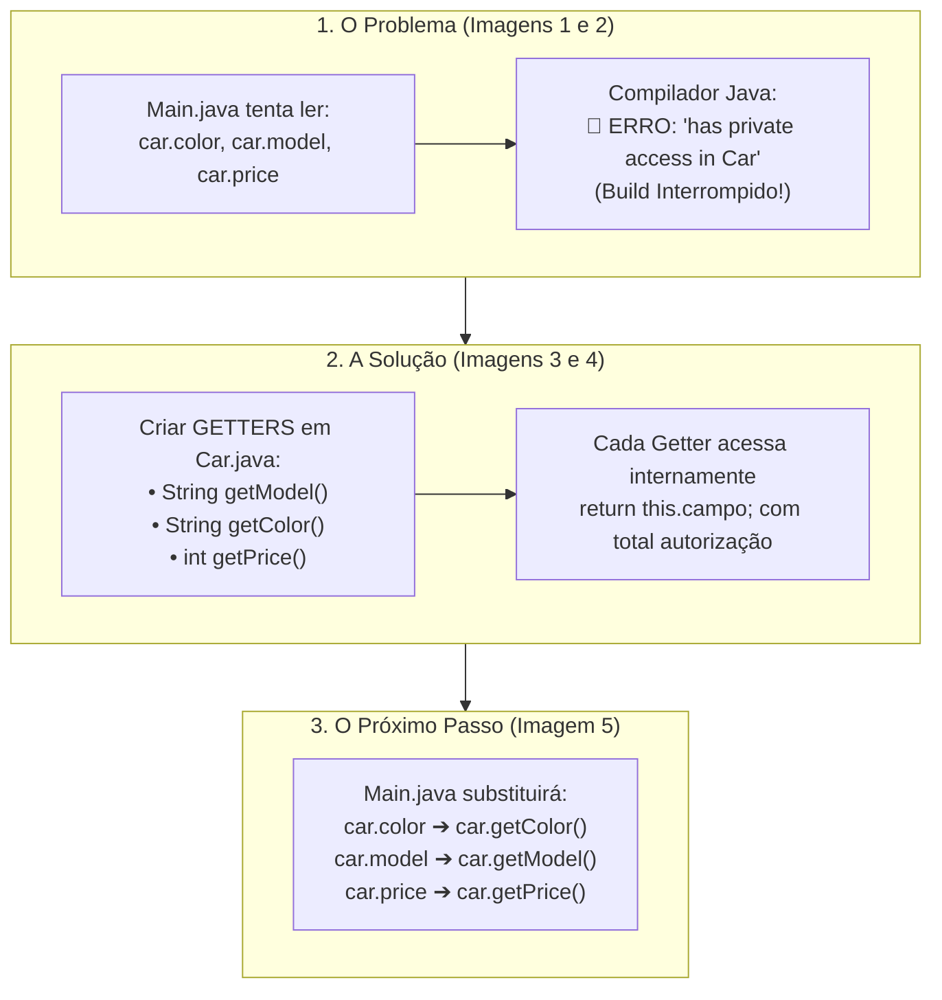

# Curso de Java — Capítulo 52 (Parte 3): Getters e Setters 🔐
## Os 3 Erros de Acesso Privado e a Construção dos Getters Passo a Passo

---

> [!IMPORTANT]
> **Para cópia no Google Docs:** Este documento foi especialmente elaborado de forma autossuficiente e detalhada. Todos os elementos visuais das telas do IntelliJ IDEA (linhas sublinhadas em vermelho, avisos do Build Output, cursores, seleções de texto e botões de execução) foram transcritos com rigor para que você possa copiar todo o conteúdo para o Google Docs sem necessitar das imagens originais.

---

### Links Rápidos dos Arquivos do Projeto no seu Computador
* Arquivo Principal de Execução: [`Main.java`](../../../src/main/java/com/mickaelgeronimo/mastery/core/concurrency/Main.java)
* Classe do Carro com os Novos Getters: [`Car.java`](../../../src/main/java/com/mickaelgeronimo/mastery/core/oop/Car.java)
* Pasta Raiz do Projeto: `JAVA APRENDER`
* Guia da Parte 1 (Conceito e Falha de Acesso Aberto): `explicacao_getters_and_setters_definicao_e_exemplo_sem_encapsulamento_capitulo52_parte1.md`
* Guia da Parte 2 (Demonstração da Adulteração e Blindagem `private`): `explicacao_getters_and_setters_vulnerabilidade_de_acesso_direto_e_blindagem_com_private_capitulo52_parte2.md`

---

## 1. O Que Está Acontecendo Aqui? (Visão Geral para Iniciantes Amadores)

Na aula anterior (Parte 2), o professor Bro Code blindou as variáveis `model`, `color` e `price` adicionando a palavra-chave **`private`** dentro de [`Car.java`](../../../src/main/java/com/mickaelgeronimo/mastery/core/oop/Car.java).

Nesta sequência de 5 imagens, acompanhamos o desenrolar dessa decisão:
1. **O Choque do Bloqueio:** O arquivo [`Main.java`](../../../src/main/java/com/mickaelgeronimo/mastery/core/concurrency/Main.java) tenta imprimir `car.color`, `car.model` e `car.price`. Como agora eles são privados, o IntelliJ marca tudo de vermelho (`🔴 3 erros`).
2. **A Prova Real no Compilador:** O autor clica no botão de executar (`▷`). O compilador Java interrompe tudo e cospe no painel inferior de compilação: `java: color has private access in Car`, `model has private access in Car`, `price has private access in Car`. O programa não roda!
3. **A Criação da Solução (Os GETTERS):** O autor volta para [`Car.java`](../../../src/main/java/com/mickaelgeronimo/mastery/core/oop/Car.java) e constrói métodos oficiais para leitura:
   * `getModel()` que devolve o texto do modelo.
   * `getColor()` que devolve o texto da cor.
   * `getPrice()` que devolve o número inteiro do preço.
4. **O Alinhamento dos Tipos:** Ele destaca que o tipo de retorno do Getter tem que ser idêntico ao tipo da variável (`int` para `price`, `String` para `model` e `color`).
5. **O Retorno ao Main:** Ele volta para [`Main.java`](../../../src/main/java/com/mickaelgeronimo/mastery/core/concurrency/Main.java), pronto para trocar o antigo acesso direto proibido pelos novos métodos Getters!



---

## 2. Analogia do Balcão de Farmácia: Por Que Getters São Necessários?

Pense na classe [`Car.java`](../../../src/main/java/com/mickaelgeronimo/mastery/core/oop/Car.java) como uma farmácia que guarda remédios controlados (as variáveis privadas `model`, `color`, `price`).

* **Acesso Direto Sem `private`:** Qualquer cliente da rua entra correndo até o depósito atrás do balcão, mexe nas gavetas e pega o remédio sozinho. (Bagunça e perigo total!).
* **Bloqueio com `private`:** O dono da farmácia tranca a porta do depósito com grade de ferro. Agora ninguém entra. Mas se ninguém entra, o cliente na recepção ([`Main.java`](../../../src/main/java/com/mickaelgeronimo/mastery/core/concurrency/Main.java)) não consegue remédio nenhum e começa a gritar: *"Não consigo pegar nada!"* (São os 3 erros de compilação!).
* **O que é o GETTER?** O Getter é o **atendente no balcão**. O cliente chega educadamente e pergunta: *"Atendente, você pode pegar o modelo do carro para mim?"* (`car.getModel()`). O atendente vai lá dentro do depósito privado (onde ele tem permissão total de acesso), pega a caixinha do modelo e entrega na mão do cliente com total segurança.

---

## 3. Dissecando as 5 Imagens da Aula Passo a Passo

---

### 📸 Imagem 1: Comentando o Corvette e os 3 Erros no Main (`media_1791401861371_ff7ec16e.png`)

#### O que se vê na interface do IntelliJ IDEA:
* **Árvore do Projeto:** Pastas `.idea`, `out`, `src` com os arquivos `Car` e `Main`.
* **Aba Ativa:** [`Main.java`](../../../src/main/java/com/mickaelgeronimo/mastery/core/concurrency/Main.java).
* **Canto Superior Direito:** Um badge vermelho com o texto **`🔴 3 v`**, indicando que a IDE detectou **3 erros críticos de sintaxe/compilação** no arquivo ativo.
* **Linhas no Editor:**
  ```java
   9        Car car = new Car("Charger", "Yellow", 10000);
  10
  11 💡    //car.model = "Corvette";
  12
  13        System.out.println(car.color + " " + car.model + " " + car.price);
  14    }
  15 }
  ```
* **Detalhes Visuais Relevantes:**
  * Na linha 11, o autor transformou a alteração indevida em comentário adicionando duas barras no início: `//car.model = "Corvette";`.
  * Na linha 13, as palavras **`color`**, **`model`** e **`price`** estão sublinhadas com ondas vermelhas de erro!
  * O cursor do mouse está posicionado logo abaixo da palavra `color`.
* **Significado:** Como o autor colocou `private` em [`Car.java`](../../../src/main/java/com/mickaelgeronimo/mastery/core/oop/Car.java), a classe [`Main.java`](../../../src/main/java/com/mickaelgeronimo/mastery/core/concurrency/Main.java) perdeu instantaneamente o direito de ler essas variáveis diretamente.

---

### 📸 Imagem 2: O Relatório de Erro no "Build Output" (`media_1791401873413_68cb5298.png`)

#### O que se vê na interface do IntelliJ IDEA:
* **Barra de Vídeo:** Timestamp `8:22:22 / 12:00:00`, capítulo `52. getters and setters >`.
* **Painel Inferior (Aba "Build Output"):**
  * Aba selecionada: `Build > Build Output`.
  * Tempo gasto no build: `MyFirstProject: 860 ms`.
  * Na lista à esquerda:
    * `Main.java src 3 errors`
    * `🔴 color has private access in Car`
    * `🔴 model has private access in Car`
    * `🔴 price has private access in Car`
  * No corpo principal do console (em letras vermelhas):
    ```text
    C:\Users\HP\IdeaProjects\MyFirstProject\src\Main.java:13:31
    java: color has private access in Car
    ```
* **Significado:** O compilador Java recusou a execução. A mensagem `java: color has private access in Car` significa literalmente: *"O atributo `color` tem nível de acesso PRIVADO na classe `Car`, portanto você não pode acessá-lo a partir da classe `Main`"*.

---

### 📸 Imagem 3: Criando o Primeiro Getter em [`Car.java`](../../../src/main/java/com/mickaelgeronimo/mastery/core/oop/Car.java) (`media_1791401942442_748675ed.png`)

#### O que se vê na interface do IntelliJ IDEA:
* **Aba Ativa:** [`Car.java`](../../../src/main/java/com/mickaelgeronimo/mastery/core/oop/Car.java) (selecionada em azul).
* **Trecho de Código no Editor:**
  ```java
   3        private String model;
   4        private String color;
   5        private int price;
   6
   7        Car(String model, String color, int price){
   8            this.model = model;
   9            this.color = color;
  10            this.price = price;
  11        }
  12
  13        String getModel(){
  14            return this.model;
  15        }
  16
  17        String getModel(){
  18            return this.model;
  19        }
  ```
* **Detalhes Visuais Relevantes:**
  * O autor acabou de escrever o método `getModel()` nas linhas 13-15.
  * Para agilizar, ele copiou e colou o bloco nas linhas 16-18.
  * A linha 16 está com sublinhado ondulado vermelho no nome `getModel()` porque o Java não permite dois métodos com o exato mesmo nome e parâmetros na mesma classe (método duplicado). O cursor está piscando na chave `{` da linha 16, no momento em que ele vai renomear para `getColor()`.

---

### 📸 Imagem 4: Todos os 3 Getters Concluídos e Seleção do Preço (`media_1791401957219_8d425090.png`)

#### O que se vê na interface do IntelliJ IDEA:
* **Aba Ativa:** [`Car.java`](../../../src/main/java/com/mickaelgeronimo/mastery/core/oop/Car.java).
* **Trecho Completo dos Getters (Linhas 13 a 21):**
  ```java
  13        String getModel(){
  14            return this.model;
  15        }
  16
  17        String getColor(){
  18            return this.color;
  19        }
  20
  21        int getPrice(){
  22            return this.price;
  23        }
  ```
* **Destaque Visual Importante do Autor:**
  * O autor dá um clique duplo e **seleciona/destaca em azul** a palavra `price` na linha 5: `private int price;`.
  * Em seguida, as palavras `this.price` (linha 10 e linha 22) e `price` (parâmetro) ficam realçadas em rosa/magenta no editor.
* **O Que o Autor Está Ensinando com Esse Destaque:**
  * Ele está chamando a atenção do aluno para o **tipo de dado**:
    * Para `model` (que é `String`), o Getter devolve `String getModel()`.
    * Para `color` (que é `String`), o Getter devolve `String getColor()`.
    * Para `price` (que é um número inteiro `int`), o Getter **PRECISA** devolver `int getPrice()`! Se você colocasse `String getPrice()`, o Java daria erro de incompatibilidade de tipos (`incompatible types: int cannot be converted to String`).

---

### 📸 Imagem 5: Voltando ao [`Main.java`](../../../src/main/java/com/mickaelgeronimo/mastery/core/concurrency/Main.java) para Chamar os Getters (`media_1791401968926_32c694c1.png`)

#### O que se vê na interface do IntelliJ IDEA:
* **Aba Ativa:** Volta para [`Main.java`](../../../src/main/java/com/mickaelgeronimo/mastery/core/concurrency/Main.java).
* **Limpeza do Código:** O comentário `//car.model = "Corvette";` foi completamente apagado.
* **Linhas no Editor:**
  ```java
   1    public class Main {
   2 ▷      public static void main(String[] args) {
   3 ▷
   4
   5            // They help protect object data and add rules for accessing or modif...
   6            // GETTERS = Methods that make a field READABLE.
   7            // SETTERS = Methods that make a field WRITEABLE.
   8
   9            Car car = new Car("Charger", "Yellow", 10000);
  10
  11            System.out.println(car.color + " " + car.model + " " + car.price);
  12        }
  13    }
  ```
* **Situação Atual na Tela:**
  * A linha 11 ainda mostra as variáveis `color`, `model` e `price` com sublinhados vermelhos (`🔴 3 erros` no topo).
  * O cursor de texto está piscando na linha 12, logo abaixo do `println`.
  * O autor está pronto para dar o próximo passo: trocar `car.color` por `car.getColor()`, `car.model` por `car.getModel()` e `car.price` por `car.getPrice()`!

---

## 4. O Código Completo e Atualizado dos Dois Arquivos

### Arquivo 1: [`Car.java`](../../../src/main/java/com/mickaelgeronimo/mastery/core/oop/Car.java) (Com os 3 Getters Implementados)

```java
 1 public class Car {
 2 
 3     private String model;
 4     private String color;
 5     private int price;
 6 
 7     Car(String model, String color, int price){
 8         this.model = model;
 9         this.color = color;
10         this.price = price;
11     }
12 
13     String getModel(){
14         return this.model;
15     }
16 
17     String getColor(){
18         return this.color;
19     }
20 
21     int getPrice(){
22         return this.price;
23     }
24 }
```

#### Tabela Linha por Linha de [`Car.java`](../../../src/main/java/com/mickaelgeronimo/mastery/core/oop/Car.java):

| Linha | Código Java | Explicação para Leigo Absoluto | O que sai no Console? |
| :---: | :--- | :--- | :--- |
| **1** | `public class Car {` | Declaração da classe molde do carro. | Nada |
| **2** | *(vazia)* | Separação visual. | Nada |
| **3** | `private String model;` | Variável privada do modelo. Trancada contra acesso externo direto. | Nada |
| **4** | `private String color;` | Variável privada da cor. Trancada contra acesso externo direto. | Nada |
| **5** | `private int price;` | Variável privada do preço (número inteiro). Trancada contra acesso externo direto. | Nada |
| **6** | *(vazia)* | Separação visual. | Nada |
| **7** | `Car(String model, String color, int price){` | Construtor da classe, recebe os 3 valores na hora da criação do objeto. | Nada |
| **8** | `this.model = model;` | Atribui o argumento recebido à variável interna do objeto. | Nada |
| **9** | `this.color = color;` | Atribui a cor recebida à variável interna do objeto. | Nada |
| **10** | `this.price = price;` | Atribui o preço recebido à variável interna do objeto. | Nada |
| **11** | `}` | Fecha o construtor. | Nada |
| **12** | *(vazia)* | Separação visual. | Nada |
| **13** | `String getModel(){` | **O Getter do Modelo:** Método que promete devolver um texto (`String`) e não recebe parâmetros `()`. | Nada |
| **14** | `return this.model;` | Pega o valor armazenado na variável privada `this.model` e **devolve** (`return`) para quem chamou. | Nada |
| **15** | `}` | Fecha o método `getModel()`. | Nada |
| **16** | *(vazia)* | Separação visual. | Nada |
| **17** | `String getColor(){` | **O Getter da Cor:** Método que promete devolver um texto (`String`). | Nada |
| **18** | `return this.color;` | Devolve o valor armazenado na variável privada `this.color`. | Nada |
| **19** | `}` | Fecha o método `getColor()`. | Nada |
| **20** | *(vazia)* | Separação visual. | Nada |
| **21** | `int getPrice(){` | **O Getter do Preço:** Método que promete devolver um número inteiro (`int`). | Nada |
| **22** | `return this.price;` | Devolve o valor armazenado na variável privada `this.price`. | Nada |
| **23** | `}` | Fecha o método `getPrice()`. | Nada |
| **24** | `}` | Fecha as chaves da classe `Car`. | Nada |

---

### Arquivo 2: [`Main.java`](../../../src/main/java/com/mickaelgeronimo/mastery/core/concurrency/Main.java) (Estado da Imagem 5)

```java
 1 public class Main {
 2     public static void main(String[] args) {
 3 
 4         // They help protect object data and add rules for accessing or modifying them.
 5         // GETTERS = Methods that make a field READABLE.
 6         // SETTERS = Methods that make a field WRITEABLE.
 7 
 8         Car car = new Car("Charger", "Yellow", 10000);
 9 
10         System.out.println(car.color + " " + car.model + " " + car.price);
11     }
12 }
```

#### Tabela Linha por Linha de [`Main.java`](../../../src/main/java/com/mickaelgeronimo/mastery/core/concurrency/Main.java):

| Linha | Código Java | Explicação para Leigo Absoluto | O que sai no Console? |
| :---: | :--- | :--- | :--- |
| **1** | `public class Main {` | Classe principal onde fica o método `main`. | Nada |
| **2** | `public static void main(String[] args) {` | Ponto de entrada do programa. | Nada |
| **3** | *(vazia)* | Espaço em branco. | Nada |
| **4** | `// They help protect...` | Comentário didático do autor sobre proteção de dados. | Nada |
| **5** | `// GETTERS = Methods that make a field READABLE.` | Comentário: *"Getters são métodos que tornam um campo LEGÍVEL"*. | Nada |
| **6** | `// SETTERS = Methods that make a field WRITEABLE.` | Comentário: *"Setters são métodos que tornam um campo GRAVÁVEL"*. | Nada |
| **7** | *(vazia)* | Espaço em branco. | Nada |
| **8** | `Car car = new Car("Charger", "Yellow", 10000);` | Instancia o objeto `car` na memória Heap passando `"Charger"`, `"Yellow"` e `10000`. | Nada |
| **9** | *(vazia)* | Espaço em branco. | Nada |
| **10** | `System.out.println(car.color + " " + car.model + " " + car.price);` | **Linha com Erro Ativo:** Tenta acessar diretamente `car.color`, `car.model` e `car.price`. Como todos são `private`, o Java bloqueia e emite os 3 erros de compilação. | 🛑 **NÃO RODA!** (`color has private access in Car`) |
| **11** | `}` | Fecha o bloco do `main`. | Nada |
| **12** | `}` | Fecha a classe `Main`. | Nada |

---

## 5. Anatomia de um Getter: As 4 Partes que Todo Iniciante Precisa Saber

Todo Getter segue um padrão rigoroso e universal no mundo Java (conhecido como convenção *JavaBeans*):

```java
   String     getModel   ( )   {  return this.model;  }
//   ▲           ▲        ▲                 ▲
//   │           │        │                 │
//  (1)         (2)      (3)               (4)
```

1. **Tipo de Retorno (`String`, `int`, etc.):** Declara ao Java o tipo de valor que esse método vai cuspir de volta. Se a variável é `String`, o retorno é `String`. Se a variável é `int`, o retorno é `int`.
2. **Nome do Método (`get` + Nome da Variável com Primeira Letra Maiúscula):**
   * Variável: `model` ➔ Getter: `getModel()`
   * Variável: `color` ➔ Getter: `getColor()`
   * Variável: `price` ➔ Getter: `getPrice()`
3. **Parênteses Vazios `()`:** Um Getter geralmente não precisa de nenhuma informação de fora para funcionar. Ele só precisa olhar para dentro do próprio objeto e devolver o que está guardado.
4. **Instrução `return this.campo;`:** Pega o valor armazenado na variável privada do objeto e devolve na mão de quem chamou a função.

---

## 6. O Que Acontecerá no Próximo Episódio?

Na Imagem 5, o autor deixou a linha 10 com os erros:
```java
System.out.println(car.color + " " + car.model + " " + car.price); // ❌ 3 ERROS!
```

O próximo passo óbvio que o autor fará será substituir o acesso proibido pelos métodos Getters recém-criados:
```java
System.out.println(car.getColor() + " " + car.getModel() + " " + car.getPrice()); // ✅ 100% PERMITIDO!
```

E quando ele fizer isso e clicar em executar (`▷`), o console finalmente voltará a imprimir com perfeição e 100% de segurança:
```text
Yellow Charger 10000
```
Com isso, os dados continuam totalmente protegidos por `private`, mas qualquer classe autorizada pode ler o que precisa através dos **Getters**!
