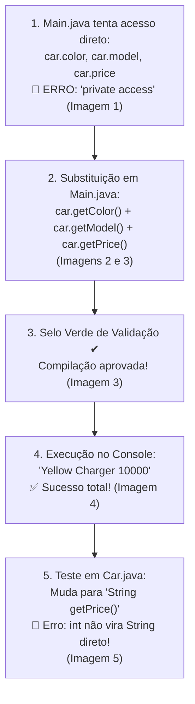

# Curso de Java — Capítulo 52 (Parte 4): Getters e Setters 🔐
## Substituição pelos Getters no `Main`, Execução com Sucesso e a Incompatibilidade de Tipos

---

> [!IMPORTANT]
> **Para cópia no Google Docs:** Este documento foi especialmente formatado de forma autossuficiente e detalhada. Todos os elementos visuais das telas do IntelliJ IDEA (linhas sublinhadas em vermelho, ícone de verificação verde, abas ativas, saídas no console e alertas do compilador) foram transcritos em texto descritivo para que você possa copiar e colar todo o conteúdo no seu Google Docs sem perder o contexto das imagens.

---

### Links Rápidos dos Arquivos do Projeto no seu Computador
* Arquivo Principal com os Getters Chamados: [`Main.java`](file:///c:/Users/mickel%201/Downloads/JAVA%20APRENDER/Main.java)
* Classe do Carro com Getters: [`Car.java`](file:///c:/Users/mickel%201/Downloads/JAVA%20APRENDER/Car.java)
* Pasta Raiz do Projeto: [`JAVA APRENDER`](file:///c:/Users/mickel%201/Downloads/JAVA%20APRENDER)
* Guia da Parte 1 (Conceito e Falha de Acesso Aberto): [`explicacao_getters_and_setters_definicao_e_exemplo_sem_encapsulamento_capitulo52_parte1.md`](file:///C:/Users/mickel%201/.gemini/antigravity/brain/d1dae54d-8acc-4142-bb62-6703a22b9afc/explicacao_getters_and_setters_definicao_e_exemplo_sem_encapsulamento_capitulo52_parte1.md)
* Guia da Parte 2 (Demonstração da Adulteração e Blindagem `private`): [`explicacao_getters_and_setters_vulnerabilidade_de_acesso_direto_e_blindagem_com_private_capitulo52_parte2.md`](file:///C:/Users/mickel%201/.gemini/antigravity/brain/d1dae54d-8acc-4142-bb62-6703a22b9afc/explicacao_getters_and_setters_vulnerabilidade_de_acesso_direto_e_blindagem_com_private_capitulo52_parte2.md)
* Guia da Parte 3 (Os 3 Erros de Compilação e Criação dos Getters): [`explicacao_getters_and_setters_os_3_erros_de_acesso_privado_e_criacao_dos_getters_capitulo52_parte3.md`](file:///C:/Users/mickel%201/.gemini/antigravity/brain/d1dae54d-8acc-4142-bb62-6703a22b9afc/explicacao_getters_and_setters_os_3_erros_de_acesso_privado_e_criacao_dos_getters_capitulo52_parte3.md)

---

## 1. O Que Está Acontecendo Aqui? (Visão Geral para Iniciantes Amadores)

Nas partes anteriores, vimos o problema e criamos as ferramentas:
* O problema: Variáveis `private` não deixam ninguém de fora ler nada diretamente (`car.color` dá erro).
* A ferramenta: Criamos dentro de [`Car.java`](file:///c:/Users/mickel%201/Downloads/JAVA%20APRENDER/Car.java) os métodos **Getters** (`getModel()`, `getColor()`, `getPrice()`).

Nesta sequência de 5 imagens, acompanhamos o clímax da solução:
1. **O Último Teste do Erro:** O autor re-executa o código com acesso direto para confirmar que ele continua quebrado (`java: color has private access in Car`).
2. **A Digitação da Cura:** Em [`Main.java`](file:///c:/Users/mickel%201/Downloads/JAVA%20APRENDER/Main.java), ele começa a trocar o acesso proibido pelas chamadas dos métodos Getters: `car.getColor()` e `car.getModel()`. Os erros vermelhos somem na mesma hora!
3. **A Validação Completa:** Ele finaliza com `car.getPrice()`. O editor IntelliJ exibe um ícone de verificação verde `✔` no canto superior direito: **zero erros de compilação!**
4. **A Vitória da Execução:** Ele aperta Play (`▷`). O console inferior imprime com perfeição: `Yellow Charger 10000`. O programa funciona 100% e os dados continuam protegidos com `private`!
5. **O Próximo Truque do Professor (Incompatibilidade de Tipos):** O autor volta para [`Car.java`](file:///c:/Users/mickel%201/Downloads/JAVA%20APRENDER/Car.java) e altera o Getter do preço de `int getPrice()` para `String getPrice()`. Como o preço original é um número inteiro (`int`), o Java imediatamente acusa um erro de tipo incompatível (`incompatible types: int cannot be converted to String`), demonstrando a regra de ouro dos tipos de retorno e preparando o terreno para a formatação de texto com cifrão (`$`).



---

## 2. Dúvida Crucial de Todo Iniciante: "Se o Resultado Foi Igual, Pra Que Todo Esse Trabalho?"

Um iniciante amador pode legitimamente pensar:
> *"Peraí! Na Parte 1 imprimiu `Yellow Charger 10000`. Agora na Parte 4 imprimiu `Yellow Charger 10000` exatamente igual! Pra que raios eu tive que colocar `private`, criar três métodos Getters e mudar o `println` todo?"*

Aqui está a resposta que diferencia um amador de um programador profissional:

1. **Blindagem contra Adulteração:** Sem o `private`, qualquer um podia digitar `car.model = "Corvette"` ou `car.price = -99999` e estragar o objeto (como vimos na Parte 2). Com o `private` e apenas os Getters, os dados se tornaram **SOMENTE LEITURA** (*Read-Only*). Ninguém no mundo consegue alterar o modelo, a cor ou o preço do carro depois que ele foi criado!
2. **O Poder de Transformar Dados na Saída:** Como o valor agora passa por dentro de uma função (`getPrice()`), você pode formatar o valor antes de entregar! Por exemplo: em vez de devolver o número cru `10000`, o Getter pode devolver o texto formatado `"$10,000.00"` ou converter milhas para quilômetros. É isso exatamente o que o professor começa a preparar na Imagem 5!

---

## 3. Dissecando as 5 Imagens Passo a Passo

---

### 📸 Imagem 1: Re-confirmando o Erro de Acesso no Main (`media_1791402013111_1c99e6e1.png`)

#### O que se vê na interface do IntelliJ IDEA:
* **Barra de Vídeo do YouTube:** Timestamp `8:23:52 / 12:00:00`, capítulo `52. getters and setters >`.
* **Aba Ativa:** [`Main.java`](file:///c:/Users/mickel%201/Downloads/JAVA%20APRENDER/Main.java).
* **Trecho de Código no Editor:**
  ```java
   9        Car car = new Car("Charger", "Yellow", 10000);
  10
  11        System.out.println(car.color + " " + car.model + " " + car.price);
  12    }
  13 }
  ```
* **Painel Inferior (Aba Build Output):**
  * Mensagem em destaque vermelho:
    ```text
    C:\Users\HP\IdeaProjects\MyFirstProject\src\Main.java:11:31
    java: color has private access in Car
    ```
* **Cursor do Mouse:** Posicionado no canto superior direito exatamente sobre o botão verde de execução com a dica flutuante: `Run 'Main.java' Shift+F10`.
* **Significado:** O professor aperta play para mostrar aos alunos que mesmo depois de apagar o comentário do Corvette, o programa continua recusando rodar porque a linha 11 tenta ler `car.color` diretamente.

---

### 📸 Imagem 2: Trocando pelos Getters no Meio da Digitação (`media_1791402032332_30038ea6.png`)

#### O que se vê na interface do IntelliJ IDEA:
* **Barra de Vídeo:** Timestamp `8:24:11 / 12:00:00`.
* **Aba Ativa:** [`Main.java`](file:///c:/Users/mickel%201/Downloads/JAVA%20APRENDER/Main.java).
* **Trecho no Editor (Linha 11):**
  ```java
  11    System.out.println(car.getColor() + " " + car.getModel() + " " + car.
  ```
* **Detalhes Visuais Relevantes:**
  * O autor substituiu `car.color` por `car.getColor()`. Note que a palavra `getColor()` ficou em fonte normal (branca/cinza), **sem nenhum sublinhado vermelho**! O Java reconheceu o método imediatamente!
  * O autor substituiu `car.model` por `car.getModel()`. Também **sem nenhum erro**!
  * Ele digitou `+ " " + car.` e o cursor está parado logo após o ponto final.
  * No canto superior direito, o badge vermelho mostra apenas **`🔴 1 v`** (apenas 1 erro pendente, que é a expressão incompleta `car.` que ele ainda está terminando de digitar).

---

### 📸 Imagem 3: A Linha 11 Completa e o Selo Verde de Aprovação (`media_1791402048451_0427d079.png`)

#### O que se vê na interface do IntelliJ IDEA:
* **Aba Ativa:** [`Main.java`](file:///c:/Users/mickel%201/Downloads/JAVA%20APRENDER/Main.java).
* **Trecho no Editor (Linha 11 Completa):**
  ```java
  11 💡  System.out.println(car.getColor() + " " + car.getModel() + " " + car.getPrice());
  ```
* **Detalhes Visuais de Alívio e Validação:**
  * Toda a linha agora usa os métodos Getters com seus parênteses:
    * `car.getColor()`
    * `car.getModel()`
    * `car.getPrice()`
  * **Canto Superior Direito do Editor:** O badge vermelho de erro desapareceu completamente! No lugar dele, surgiu um **ícone de verificação verde `✔`**!
  * Isso indica que a IDE compilou o arquivo em tempo real e não encontrou **nenhum erro de sintaxe, tipo ou privacidade**!
  * O cursor do mouse está sobre o botão Play verde (`▷ Current File`) pronto para o clique.

---

### 📸 Imagem 4: O Sucesso da Execução no Console (`media_1791402080169_10676ded.png`)

#### O que se vê na interface do IntelliJ IDEA:
* **Barra de Vídeo:** Timestamp `8:24:19 / 12:00:00`.
* **Painel Inferior (Aba Run - Main):**
  * Comando executado: `C:\Users\HP\.jdks\openjdk-23\bin\java.exe ...`
  * **Saída impressa em verde brilhante:**
    ```text
    Yellow Charger 10000
    ```
  * Linha de finalização: `Process finished with exit code 0`.
* **Significado:** O programa executou com perfeição absoluta!
  1. `car.getColor()` foi até a memória privada de `car`, pegou `"Yellow"` e devolveu.
  2. `car.getModel()` foi até a memória privada de `car`, pegou `"Charger"` e devolveu.
  3. `car.getPrice()` foi até a memória privada de `car`, pegou `10000` e devolveu.
  4. O `println` juntou tudo com espaços e imprimiu na tela.

---

### 📸 Imagem 5: A Mudança para `String getPrice()` e o Erro de Tipos (`media_1791402101140_08f761fe.png`)

#### O que se vê na interface do IntelliJ IDEA:
* **Aba Ativa:** O autor muda de aba e entra em [`Car.java`](file:///c:/Users/mickel%201/Downloads/JAVA%20APRENDER/Car.java).
* **Trecho de Código no Editor:**
  ```java
  19    String getPrice(){
  20        return this.price;
  21    }
  ```
* **O Detalhe Crítico na Linha 19 e 20:**
  * Na linha 19, o autor alterou o tipo de retorno: antes era `int getPrice()`, agora virou `String getPrice()`.
  * Na linha 20, a instrução **`return this.price;`** ganhou um **sublinhado ondulado vermelho** sob toda a expressão!
  * O cursor de texto está posicionado entre as palavras `return` e `this.price`.
* **Por Que Essa Linha Está com Erro Vermelho?**
  * A variável `this.price` foi declarada na linha 5 como `int` (número inteiro: `private int price;`).
  * O método `String getPrice()` assinou um contrato prometendo devolver um texto (`String`).
  * No Java, um número inteiro **não é automaticamente um texto**. O compilador dá o famoso erro:
    `error: incompatible types: int cannot be converted to String`
  * O autor fez essa modificação de propósito para mostrar aos alunos como um Getter pode retornar uma `String` formatada (por exemplo, concatenando um símbolo de dólar `$` na frente: `return "$" + this.price;`).

---

## 4. Análise Linha por Linha dos Códigos

### Arquivo 1: [`Main.java`](file:///c:/Users/mickel%201/Downloads/JAVA%20APRENDER/Main.java) (Código Funcionando Perfeitamente das Imagens 3 e 4)

```java
 1 public class Main {
 2     public static void main(String[] args) {
 3 
 4         // They help protect object data and add rules for accessing or modifying them.
 5         // GETTERS = Methods that make a field READABLE.
 6         // SETTERS = Methods that make a field WRITEABLE.
 7 
 8         Car car = new Car("Charger", "Yellow", 10000);
 9 
10         System.out.println(car.getColor() + " " + car.getModel() + " " + car.getPrice());
11     }
12 }
```

| Linha | Código em Java | O Que Faz Passo a Passo (Para Iniciantes) | O Que Sai no Console? |
| :---: | :--- | :--- | :--- |
| **1** | `public class Main {` | Início da classe executora `Main`. | Nada |
| **2** | `public static void main(String[] args) {` | Método principal onde o Java começa a rodar. | Nada |
| **3** | *(vazia)* | Espaço em branco para clareza visual. | Nada |
| **4** | `// They help protect...` | Comentário: *"Eles ajudam a proteger os dados do objeto e adicionam regras para acessá-los ou modificá-los."* | Nada |
| **5** | `// GETTERS = Methods...` | Comentário: *"GETTERS = Métodos que tornam um campo LEGÍVEL."* | Nada |
| **6** | `// SETTERS = Methods...` | Comentário: *"SETTERS = Métodos que tornam um campo GRAVÁVEL."* | Nada |
| **7** | *(vazia)* | Espaço em branco. | Nada |
| **8** | `Car car = new Car("Charger", "Yellow", 10000);` | Cria o objeto `car` na memória Heap, com `model = "Charger"`, `color = "Yellow"` e `price = 10000`. | Nada |
| **9** | *(vazia)* | Espaço em branco. | Nada |
| **10** | `System.out.println(car.getColor() + " " + car.getModel() + " " + car.getPrice());` | Chama `getColor()` (recebe `"Yellow"`), junta com espaço `" "`, chama `getModel()` (recebe `"Charger"`), junta com espaço `" "`, chama `getPrice()` (recebe `10000`) e cospe a frase completa no terminal! | `Yellow Charger 10000` |
| **11** | `}` | Fecha o método `main`. | Nada |
| **12** | `}` | Fecha a classe `Main`. | Nada |

---

### Arquivo 2: [`Car.java`](file:///c:/Users/mickel%201/Downloads/JAVA%20APRENDER/Car.java) (Com a Demonstração de Erro de Tipo da Imagem 5)

```java
 1 public class Car {
 2 
 3     private String model;
 4     private String color;
 5     private int price;
 6 
 7     Car(String model, String color, int price){
 8         this.model = model;
 9         this.color = color;
10         this.price = price;
11     }
12 
13     String getModel(){
14         return this.model;
15     }
16 
17     String getColor(){
18         return this.color;
19     }
20 
21     String getPrice(){
22         return this.price; // 🔴 ERRO: incompatible types: int cannot be converted to String
23     }
24 }
```

| Linha | Código em Java | Explicação Detalhada do Erro e dos Tipos | O Que Sai no Console? |
| :---: | :--- | :--- | :--- |
| **1** | `public class Car {` | Declaração da classe molde `Car`. | Nada |
| **2** | *(vazia)* | Organização estética. | Nada |
| **3** | `private String model;` | Atributo privado de texto para o modelo. | Nada |
| **4** | `private String color;` | Atributo privado de texto para a cor. | Nada |
| **5** | `private int price;` | Atributo privado numérico (`int`) para o preço. | Nada |
| **6** | *(vazia)* | Espaço em branco. | Nada |
| **7** | `Car(String model, String color, int price){` | Construtor recebendo modelo, cor e preço. | Nada |
| **8** | `this.model = model;` | Salva o modelo recebido no atributo interno. | Nada |
| **9** | `this.color = color;` | Salva a cor recebida no atributo interno. | Nada |
| **10** | `this.price = price;` | Salva o preço numérico recebido no atributo interno. | Nada |
| **11** | `}` | Fecha o construtor. | Nada |
| **12** | *(vazia)* | Espaço em branco. | Nada |
| **13** | `String getModel(){` | Getter do modelo: promete devolver texto (`String`). | Nada |
| **14** | `return this.model;` | Devolve o texto `"Charger"`. Válido! | Nada |
| **15** | `}` | Fecha `getModel()`. | Nada |
| **16** | *(vazia)* | Espaço em branco. | Nada |
| **17** | `String getColor(){` | Getter da cor: promete devolver texto (`String`). | Nada |
| **18** | `return this.color;` | Devolve o texto `"Yellow"`. Válido! | Nada |
| **19** | `}` | Fecha `getColor()`. | Nada |
| **20** | *(vazia)* | Espaço em branco. | Nada |
| **21** | `String getPrice(){` | **O Ponto de Atenção:** O autor declarou retorno `String`, mas `this.price` é `int`. | Nada |
| **22** | `return this.price;` | **Linha com Erro da Imagem 5:** Tenta devolver um número inteiro puro onde se esperava um texto. O compilador trava aqui! | 🛑 **ERRO DE COMPILAÇÃO** (`incompatible types`) |
| **23** | `}` | Fecha o método `getPrice()`. | Nada |
| **24** | `}` | Fecha a classe `Car`. | Nada |

---

## 5. Como o Autor Vai Resolver o Erro da Imagem 5 nas Próximas Cenas?

Por que o professor colocou `String getPrice()` se dava erro?
Porque ele quer mostrar o verdadeiro poder de um Getter!

Existem duas formas clássicas em Java de consertar esse método:

### Opção A (Formatação Básica com Concatenação de Cifrão):
```java
String getPrice(){
    return "$" + this.price; // O sinal de + junta a String "$" com o número 10000, virando a String "$10000"!
}
```
*Se fizermos isso, quando o `Main` rodar, o console imprimirá:*
```text
Yellow Charger $10000
```

### Opção B (Manter como `int` caso queira cálculos numéricos):
```java
int getPrice(){
    return this.price; // Retorna o número puro 10000
}
```

O autor escolheu propositalmente mostrar que um Getter não precisa ser apenas um "copia e cola" do atributo cru: ele pode enriquecer, mascarar ou formatar a informação antes de entregar para quem pediu!

---

## 6. Resumo das Saídas do Console Neste Bloco

| Momento do Código | Comando no Terminal | O Que Aparece na Tela? |
| :--- | :--- | :--- |
| **Imagem 1 (Acesso Direto Inválido)** | `javac Car.java Main.java` | 🛑 `java: color has private access in Car` |
| **Imagens 3 e 4 (Com Getters Corretos)** | `java Main` | ✅ **`Yellow Charger 10000`** |
| **Imagem 5 (Tipo String com Retorno int)** | `javac Car.java` | 🛑 `incompatible types: int cannot be converted to String` |
