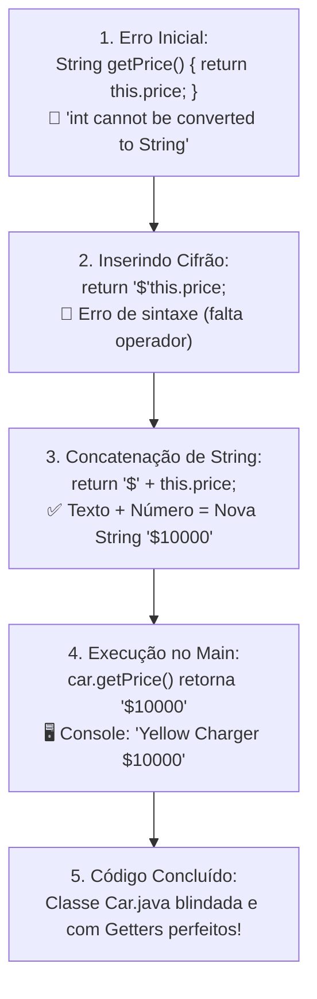

# Curso de Java — Capítulo 52 (Parte 5): Getters e Setters 🔐
## O Superpoder dos Getters: Formatação de Moeda com Cifrão (`"$" + this.price`) e Concatenação

---

> [!IMPORTANT]
> **Para cópia no Google Docs:** Este documento foi especialmente formatado de forma autossuficiente e detalhada. Todos os elementos visuais das telas do IntelliJ IDEA (linhas sublinhadas em vermelho durante a digitação, correção com o operador `+`, saídas do console e código final limpo) foram transcritos textualmente para que você possa copiar e colar todo o conteúdo no seu Google Docs sem perder nenhuma informação das imagens originais.

---

### Links Rápidos dos Arquivos do Projeto no seu Computador
* Arquivo Principal de Execução: [`Main.java`](file:///c:/Users/mickel%201/Downloads/JAVA%20APRENDER/Main.java)
* Classe do Carro com Getter Formatado: [`Car.java`](file:///c:/Users/mickel%201/Downloads/JAVA%20APRENDER/Car.java)
* Pasta Raiz do Projeto: [`JAVA APRENDER`](file:///c:/Users/mickel%201/Downloads/JAVA%20APRENDER)
* Guia da Parte 1 (Conceito e Falha de Acesso Aberto): [`explicacao_getters_and_setters_definicao_e_exemplo_sem_encapsulamento_capitulo52_parte1.md`](file:///C:/Users/mickel%201/.gemini/antigravity/brain/d1dae54d-8acc-4142-bb62-6703a22b9afc/explicacao_getters_and_setters_definicao_e_exemplo_sem_encapsulamento_capitulo52_parte1.md)
* Guia da Parte 2 (Demonstração da Adulteração e Blindagem `private`): [`explicacao_getters_and_setters_vulnerabilidade_de_acesso_direto_e_blindagem_com_private_capitulo52_parte2.md`](file:///C:/Users/mickel%201/.gemini/antigravity/brain/d1dae54d-8acc-4142-bb62-6703a22b9afc/explicacao_getters_and_setters_vulnerabilidade_de_acesso_direto_e_blindagem_com_private_capitulo52_parte2.md)
* Guia da Parte 3 (Os 3 Erros de Compilação e Criação dos Getters): [`explicacao_getters_and_setters_os_3_erros_de_acesso_privado_e_criacao_dos_getters_capitulo52_parte3.md`](file:///C:/Users/mickel%201/.gemini/antigravity/brain/d1dae54d-8acc-4142-bb62-6703a22b9afc/explicacao_getters_and_setters_os_3_erros_de_acesso_privado_e_criacao_dos_getters_capitulo52_parte3.md)
* Guia da Parte 4 (Substituição no Main e Erro de Tipos): [`explicacao_getters_and_setters_substituicao_pelos_getters_execucao_com_sucesso_e_incompatibilidade_de_tipos_capitulo52_parte4.md`](file:///C:/Users/mickel%201/.gemini/antigravity/brain/d1dae54d-8acc-4142-bb62-6703a22b9afc/explicacao_getters_and_setters_substituicao_pelos_getters_execucao_com_sucesso_e_incompatibilidade_de_tipos_capitulo52_parte4.md)

---

## 1. O Que Está Acontecendo Aqui? (Visão Geral para Iniciantes Amadores)

Na aula anterior (Parte 4), o professor Bro Code deixou um mistério no ar: ele trocou o método de `int getPrice()` para `String getPrice()`, gerando um erro vermelho em `return this.price;` porque um número inteiro puro (`int`) não pode ser devolvido onde se espera um texto (`String`).

Nesta sequência de 5 imagens, o autor revela o motivo genial por trás dessa mudança:
1. **O Erro Inicial de Tipos (Imagem 1):** O método `String getPrice()` está dando erro de compilação porque `this.price` é um `int`.
2. **O Início do Concerto (Imagem 2):** Ele digita `"$"` antes de `this.price` para adicionar o símbolo de dinheiro americano (cifrão).
3. **A Concatenação Mágica (Imagem 3):** Ele adiciona o sinal de `+`, formando `return "$" + this.price;`. Em Java, quando você soma um texto com um número, o número vira texto automaticamente! O erro desaparece na mesma hora!
4. **O Resultado no Console (Imagem 4):** Ele volta para [`Main.java`](file:///c:/Users/mickel%201/Downloads/JAVA%20APRENDER/Main.java), clica em Play (`▷`) e o console imprime: `Yellow Charger $10000` (com o cifrão perfeitamente grudado no valor!).
5. **A Revisão Geral de [`Car.java`](file:///c:/Users/mickel%201/Downloads/JAVA%20APRENDER/Car.java) (Imagem 5):** O autor exibe a classe finalizada e totalmente funcional, mostrando como os Getters deram controle total sobre a apresentação dos dados.



---

## 2. A Grande Lição: Por Que Isso É Arquitetura de Software Profissional?

Muitos iniciantes perguntam:
> *"Se eu queria mostrar o cifrão `$`, por que eu não criei a variável `price` logo como `String` lá no começo?"*

Imagine que você declarasse:
```java
private String price = "$10000"; // ❌ PÉSSIMA PRÁTICA!
```
Se a variável fosse um texto com cifrão dentro, pense nos desastres que aconteceriam:
* Você **não conseguiria somar impostos** (não dá para fazer `"$10000" * 1.1`).
* Você **não conseguiria dar 10% de desconto** (não dá para subtrair texto).
* Você **não conseguiria ordenar carros do mais barato para o mais caro** numericamente.

**A Solução Perfeita da Orientação a Objetos:**
* **Por dentro do carro (Memória):** O dado é guardado como um número puro e verdadeiro (`private int price = 10000;`). Dá para calcular, somar, dividir e aplicar juros à vontade.
* **Pelo Getter (Apresentação Externa):** Quando alguém de fora pede o preço apenas para ler ou exibir na tela, o Getter `getPrice()` pega o número `10000`, embrulha para presente com o cifrão `"$" + this.price` e entrega uma linda `String` pronta para o usuário ver!

---

## 3. Dissecando as 5 Imagens Passo a Passo

---

### 📸 Imagem 1: O Erro de Incompatibilidade de Tipos (`media_1791402641214_c2a7ec93.png`)

#### O que se vê na interface do IntelliJ IDEA:
* **Aba Ativa:** [`Car.java`](file:///c:/Users/mickel%201/Downloads/JAVA%20APRENDER/Car.java) (selecionada no topo do editor).
* **Canto Superior Direito:** Badge de erro: **`🔴 1 ⚠️ 3 v`** (1 erro crítico e 3 avisos).
* **Trecho de Código no Editor:**
  ```java
  19    String getPrice(){
  20        return this.price;
  21    }
  ```
* **O Detalhe Visual:**
  * Toda a expressão `return this.price;` está com uma onda sublinhada vermelha.
  * O cursor do mouse está piscando exatamente após a palavra `return ` na linha 20.
* **Causa do Erro:** O método declarou que devolveria `String`, mas `this.price` é do tipo `int`. O compilador Java se recusa a aceitar.

---

### 📸 Imagem 2: Digitando o Cifrão (`media_1791402658425_5857c2ab.png`)

#### O que se vê na interface do IntelliJ IDEA:
* **Aba Ativa:** [`Car.java`](file:///c:/Users/mickel%201/Downloads/JAVA%20APRENDER/Car.java).
* **Canto Superior Direito:** O contador de erros subiu temporariamente para **`🔴 2 ⚠️ 3 v`**.
* **Trecho de Código no Editor (Linha 20):**
  ```java
  20    return "$"this.price;
  ```
* **O Detalhe Visual:**
  * O autor digitou a String com o símbolo de dólar `"$"` logo após o `return`.
  * Como ele ainda não digitou o operador `+`, a palavra `this.price;` ficou sublinhada em vermelho porque o Java não entende dois valores encostados sem um operador no meio (erro de sintaxe).
  * O cursor de texto está posicionado logo após as aspas duplas de `"$"`.

---

### 📸 Imagem 3: Inserindo o Operador `+` e o Erro Desaparece (`media_1791402701048_e3bf6b77.png`)

#### O que se vê na interface do IntelliJ IDEA:
* **Barra de Vídeo do YouTube:** Timestamp `8:24:40 / 12:00:00`, capítulo `52. getters and setters >`.
* **Aba Ativa:** [`Car.java`](file:///c:/Users/mickel%201/Downloads/JAVA%20APRENDER/Car.java).
* **Linha 20 Corrigida:**
  ```java
  20 💡  return "$" + this.price;
  ```
* **A Mágica Visual:**
  * Os sublinhados vermelhos de erro sumiram completamente!
  * Há uma pequena lâmpada amarela 💡 ao lado da linha 20 (apenas sugestões de estilo da IDE).
  * O cursor do mouse está se movendo para a aba [`Main.java`](file:///c:/Users/mickel%201/Downloads/JAVA%20APRENDER/Main.java) para executar o teste.
* **O Que o Java Fez Internamente:**
  Ao ver `"$" + this.price`, o Java executa uma **coerção de tipos (concatenação)**:
  `"$" + 10000` ➔ `"$10000"`.
  Como o resultado final é uma `String`, ela bate 100% com o retorno declarado `String getPrice()`!

---

### 📸 Imagem 4: Executando o Programa com o Preço Formatado (`media_1791402712824_0b2cbff2.png`)

#### O que se vê na interface do IntelliJ IDEA:
* **Barra de Vídeo do YouTube:** Timestamp `8:24:49 / 12:00:00`.
* **Aba Ativa:** [`Main.java`](file:///c:/Users/mickel%201/Downloads/JAVA%20APRENDER/Main.java).
* **Trecho de Código no Editor:**
  ```java
  11 💡  System.out.println(car.getColor() + " " + car.getModel() + " " + car.getPrice());
  ```
* **Painel Inferior (Aba Run - Main):**
  * Comando executado: `C:\Users\HP\.jdks\openjdk-23\bin\java.exe ...`
  * **Texto impresso em verde brilhante:**
    ```text
    Yellow Charger $10000
    ```
  * Linha de término: `Process finished with exit code 0`.
* **Destaque do Autor:**
  * O autor selecionou a palavra `Yellow` com o mouse no console.
  * Repare na terceira palavra impressa: **`$10000`**!
  * O cifrão `$` apareceu automaticamente na tela sem que o arquivo [`Main.java`](file:///c:/Users/mickel%201/Downloads/JAVA%20APRENDER/Main.java) precisasse colocar cifrão em lugar nenhum! Quem cuidou da formatação foi o Getter dentro de [`Car.java`](file:///c:/Users/mickel%201/Downloads/JAVA%20APRENDER/Car.java)!

---

### 📸 Imagem 5: A Visão Geral e Limpa da Classe [`Car.java`](file:///c:/Users/mickel%201/Downloads/JAVA%20APRENDER/Car.java) (`media_1791402775733_127c728c.png`)

#### O que se vê na interface do IntelliJ IDEA:
* **Barra de Navegação Inferior:** `MyFirstProject > src > Car > getPrice`.
* **Canto Inferior Direito:** `20:22 LF UTF-8 4 spaces`.
* **Aba Ativa:** [`Car.java`](file:///c:/Users/mickel%201/Downloads/JAVA%20APRENDER/Car.java).
* **Trecho Completo Visível:**
  ```java
   7    Car(String model, String color, int price){
   8        this.model = model;
   9        this.color = color;
  10        this.price = price;
  11    }
  12
  13    String getModel(){
  14        return this.model;
  15    }
  16
  17    String getColor(){
  18        return this.color;
  19    }
  20
  21    String getPrice(){
  22        return "$" + this.price;
  23    }
  24 }
  ```
* **Significado:** O código está limpo, sem nenhum erro e totalmente padronizado. Todos os 3 Getters foram concluídos com sucesso.

---

## 4. Análise Linha por Linha dos Códigos

### Arquivo 1: [`Car.java`](file:///c:/Users/mickel%201/Downloads/JAVA%20APRENDER/Car.java) (Código Completo e Atualizado)

```java
 1 public class Car {
 2 
 3     private String model;
 4     private String color;
 5     private int price;
 6 
 7     Car(String model, String color, int price){
 8         this.model = model;
 9         this.color = color;
10         this.price = price;
11     }
12 
13     String getModel(){
14         return this.model;
15     }
16 
17     String getColor(){
18         return this.color;
19     }
20 
21     String getPrice(){
22         return "$" + this.price;
23     }
24 }
```

| Linha | Código em Java | Explicação Detalhada para Leigo Absoluto | O Que Sai no Console? |
| :---: | :--- | :--- | :--- |
| **1** | `public class Car {` | Declaração da classe molde `Car`. | Nada |
| **2** | *(vazia)* | Espaço em branco. | Nada |
| **3** | `private String model;` | Variável privada do modelo (blindada contra acessos de fora). | Nada |
| **4** | `private String color;` | Variável privada da cor (blindada contra acessos de fora). | Nada |
| **5** | `private int price;` | Variável privada do preço como **número inteiro puro (`int`)**. | Nada |
| **6** | *(vazia)* | Espaço em branco. | Nada |
| **7** | `Car(String model, String color, int price){` | Construtor da classe, recebe os valores iniciais na criação do objeto. | Nada |
| **8** | `this.model = model;` | Grava o modelo recebido no atributo interno `this.model`. | Nada |
| **9** | `this.color = color;` | Grava a cor recebida no atributo interno `this.color`. | Nada |
| **10** | `this.price = price;` | Grava o preço numérico recebido no atributo interno `this.price`. | Nada |
| **11** | `}` | Fecha o construtor. | Nada |
| **12** | *(vazia)* | Espaço em branco. | Nada |
| **13** | `String getModel(){` | Getter do modelo: promete devolver um texto (`String`). | Nada |
| **14** | `return this.model;` | Devolve o texto `"Charger"`. | Nada |
| **15** | `}` | Fecha o método `getModel()`. | Nada |
| **16** | *(vazia)* | Espaço em branco. | Nada |
| **17** | `String getColor(){` | Getter da cor: promete devolver um texto (`String`). | Nada |
| **18** | `return this.color;` | Devolve o texto `"Yellow"`. | Nada |
| **19** | `}` | Fecha o método `getColor()`. | Nada |
| **20** | *(vazia)* | Espaço em branco. | Nada |
| **21** | `String getPrice(){` | **O Getter Formatado:** Declara retorno `String` (texto) em vez de `int`. | Nada |
| **22** | `return "$" + this.price;` | **A Concatenação:** Junta o texto `"$"` com o número `10000`, resultando na String `"$10000"`, e entrega para quem chamou. | Nada |
| **23** | `}` | Fecha o método `getPrice()`. | Nada |
| **24** | `}` | Fecha a classe `Car`. | Nada |

---

### Arquivo 2: [`Main.java`](file:///c:/Users/mickel%201/Downloads/JAVA%20APRENDER/Main.java)

```java
 1 public class Main {
 2     public static void main(String[] args) {
 3 
 4         // They help protect object data and add rules for accessing or modifying them.
 5         // GETTERS = Methods that make a field READABLE.
 6         // SETTERS = Methods that make a field WRITEABLE.
 7 
 8         Car car = new Car("Charger", "Yellow", 10000);
 9 
10         System.out.println(car.getColor() + " " + car.getModel() + " " + car.getPrice());
11     }
12 }
```

| Linha | Código em Java | Explicação Passo a Passo | O Que Sai no Console? |
| :---: | :--- | :--- | :--- |
| **1** | `public class Main {` | Declaração da classe executora. | Nada |
| **2** | `public static void main(String[] args) {` | Ponto de partida do programa. | Nada |
| **3** | *(vazia)* | Espaço em branco. | Nada |
| **4** | `// They help protect...` | Comentário do autor. | Nada |
| **5** | `// GETTERS = Methods that make a field READABLE.` | Comentário lembrando o que são Getters. | Nada |
| **6** | `// SETTERS = Methods that make a field WRITEABLE.` | Comentário lembrando o que são Setters. | Nada |
| **7** | *(vazia)* | Espaço em branco. | Nada |
| **8** | `Car car = new Car("Charger", "Yellow", 10000);` | Instancia o carro na memória com o modelo `"Charger"`, a cor `"Yellow"` e o preço `10000`. | Nada |
| **9** | *(vazia)* | Espaço em branco. | Nada |
| **10** | `System.out.println(car.getColor() + " " + car.getModel() + " " + car.getPrice());` | Aciona `getColor()` (recebe `"Yellow"`), `getModel()` (recebe `"Charger"`) e `getPrice()` (recebe `"$10000"`). Imprime tudo na mesma linha. | `Yellow Charger $10000` |
| **11** | `}` | Fecha o método `main`. | Nada |
| **12** | `}` | Fecha a classe `Main`. | Nada |

---

## 5. Tabela Comparativa: As Etapas da Evolução do Preço

| Etapa da Aula | Código do Preço em `Car.java` | Chamada no `Main.java` | O que Imprime no Console? | Situação de Segurança |
| :--- | :--- | :--- | :--- | :--- |
| **Parte 1 (Sem Proteção)** | `int price;` | `car.price` | `10000` | ❌ Zero segurança (qualquer um altera) |
| **Parte 2 (Blindagem)** | `private int price;` | `car.price` | 🛑 *Erro de Compilação* | 🔒 Blindado, mas inacessível de fora |
| **Parte 4 (Getter Numérico)** | `int getPrice(){ return this.price; }` | `car.getPrice()` | `10000` | ✅ Seguro e legível |
| **Parte 5 (Getter com Formatação)** | `String getPrice(){ return "$" + this.price; }` | `car.getPrice()` | **`$10000`** | 🌟 Seguro, legível e **formatado profissionalmente** |

---

## 6. O Que Vem a Seguir? (Os SETTERS!)

Até este momento, completamos com maestria a primeira metade do título do capítulo: **GETTERS** (tornar variáveis privadas LEGÍVEIS de fora).

Mas e se precisarmos **alterar** a cor do carro depois de pintá-lo? Ou se o modelo mudar?
Como as variáveis são privadas, fazer `car.color = "Red"` continua expressamente proibido!

Nas próximas cenas, o autor entrará na segunda metade do capítulo: os **SETTERS** (`setColor()`, `setModel()`, `setPrice()`), mostrando como alterar atributos privados através de portas seguras com regras de validação!
