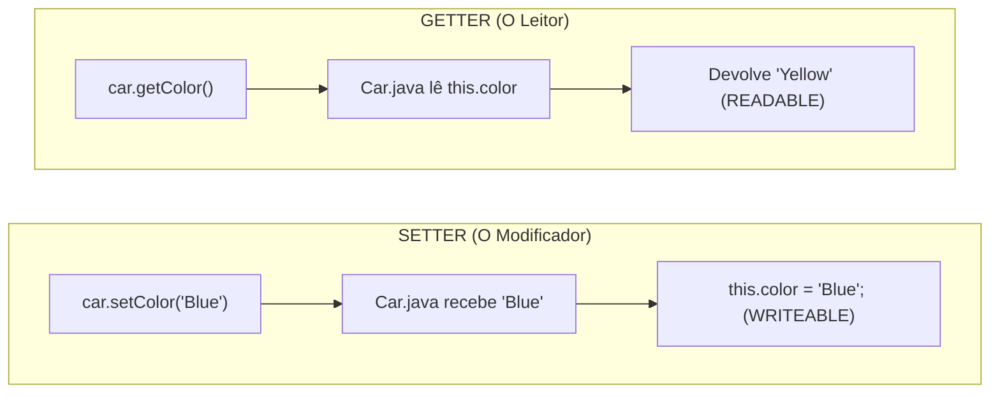

# Curso de Java — Capítulo 52 (Parte 6): Getters e Setters 🔐
## A Virada da Aula: Entrando nos SETTERS (`setColor` e `setPrice`)

---

> [!IMPORTANT]
> **Para cópia no Google Docs:** Este documento foi especialmente formatado de forma autossuficiente e detalhada. Todos os elementos visuais das telas do IntelliJ IDEA (posicionamento de cursores, comentários destacados, abas ativas, parâmetros de métodos e saídas no console) foram descritos com rigor para que você possa copiar e colar todo o conteúdo no seu Google Docs sem perder o contexto das imagens originais.

---

### Links Rápidos dos Arquivos do Projeto no seu Computador
* Arquivo Principal de Execução: [`Main.java`](file:///c:/Users/mickel%201/Downloads/JAVA%20APRENDER/Main.java)
* Classe do Carro com os Novos Setters: [`Car.java`](file:///c:/Users/mickel%201/Downloads/JAVA%20APRENDER/Car.java)
* Pasta Raiz do Projeto: [`JAVA APRENDER`](file:///c:/Users/mickel%201/Downloads/JAVA%20APRENDER)
* Guia da Parte 1 (Conceito e Falha de Acesso Aberto): [`explicacao_getters_and_setters_definicao_e_exemplo_sem_encapsulamento_capitulo52_parte1.md`](file:///C:/Users/mickel%201/.gemini/antigravity/brain/d1dae54d-8acc-4142-bb62-6703a22b9afc/explicacao_getters_and_setters_definicao_e_exemplo_sem_encapsulamento_capitulo52_parte1.md)
* Guia da Parte 2 (Demonstração da Adulteração e Blindagem `private`): [`explicacao_getters_and_setters_vulnerabilidade_de_acesso_direto_e_blindagem_com_private_capitulo52_parte2.md`](file:///C:/Users/mickel%201/.gemini/antigravity/brain/d1dae54d-8acc-4142-bb62-6703a22b9afc/explicacao_getters_and_setters_vulnerabilidade_de_acesso_direto_e_blindagem_com_private_capitulo52_parte2.md)
* Guia da Parte 3 (Os 3 Erros de Compilação e Criação dos Getters): [`explicacao_getters_and_setters_os_3_erros_de_acesso_privado_e_criacao_dos_getters_capitulo52_parte3.md`](file:///C:/Users/mickel%201/.gemini/antigravity/brain/d1dae54d-8acc-4142-bb62-6703a22b9afc/explicacao_getters_and_setters_os_3_erros_de_acesso_privado_e_criacao_dos_getters_capitulo52_parte3.md)
* Guia da Parte 4 (Substituição no Main e Erro de Tipos): [`explicacao_getters_and_setters_substituicao_pelos_getters_execucao_com_sucesso_e_incompatibilidade_de_tipos_capitulo52_parte4.md`](file:///C:/Users/mickel%201/.gemini/antigravity/brain/d1dae54d-8acc-4142-bb62-6703a22b9afc/explicacao_getters_and_setters_substituicao_pelos_getters_execucao_com_sucesso_e_incompatibilidade_de_tipos_capitulo52_parte4.md)
* Guia da Parte 5 (Formatação com Cifrão no Preço): [`explicacao_getters_and_setters_formatacao_com_cifrao_e_retorno_string_capitulo52_parte5.md`](file:///C:/Users/mickel%201/.gemini/antigravity/brain/d1dae54d-8acc-4142-bb62-6703a22b9afc/explicacao_getters_and_setters_formatacao_com_cifrao_e_retorno_string_capitulo52_parte5.md)

---

## 1. O Que Está Acontecendo Aqui? (Visão Geral para Iniciantes Amadores)

Nas cinco partes anteriores, dominamos completamente os **GETTERS**:
* Trancamos os atributos com `private` para impedir adulterações externas.
* Criamos métodos de leitura (`getModel()`, `getColor()`, `getPrice()`) para que o mundo externo possa ler os dados com segurança e formatação.

Mas agora surge a pergunta de um milhão de dólares:
> *"E se o dono do carro quiser pintar o carro de outra cor (por exemplo, de Amarelo para Azul)? E se o preço do carro aumentar com a inflação? Como fazemos para **ALTERAR** uma variável que é `private` se o Java proíbe fazer `car.color = "Blue"`?"*

A resposta oficial da Engenharia de Software são os **SETTERS**!
Nesta sequência de 5 imagens, o professor Bro Code inicia a construção dos Setters:
1. **O Foco no Comentário (Imagem 1):** No arquivo [`Main.java`](file:///c:/Users/mickel%201/Downloads/JAVA%20APRENDER/Main.java), ele posiciona o cursor na linha 7: `// SETTERS = Methods that make a field WRITEABLE.` (Setters são métodos que tornam um campo gravável/modificável).
2. **A Escolha do Alvo (Imagem 2):** Ele muda para [`Car.java`](file:///c:/Users/mickel%201/Downloads/JAVA%20APRENDER/Car.java) e foca na linha 4 (`private String color;`).
3. **A Estrutura do Primeiro Setter (Imagem 3):** Ele escreve a assinatura de `void setColor(String color){ ... }`.
4. **O Corpo do Setter da Cor (Imagem 4):** Ele preenche `this.color = color;`. Em seguida, foca na linha 19 (`getPrice`), preparando o próximo Setter.
5. **A Estrutura do Setter do Preço (Imagem 5):** Ele escreve `void setPrice(int price){ ... }`, mostrando que o parâmetro precisa ser um número inteiro (`int`) para combinar com o tipo do atributo original!



---

## 2. Analogia do Mundo Real: A Oficina de Pintura e o Segurança

Pense no carro como um veículo de luxo estacionado:

* **O Ataque Proibido (Acesso Direto):** Um desconhecido da rua chega com uma lata de spray de tinta e espirra tinta vermelha na lataria (`car.color = "Red"`). O Java não deixa isso acontecer porque a lataria tem alarme biométrico (`private`).
* **O Caminho Educado e Oficial (O SETTER):** O dono do carro leva o veículo até uma oficina autorizada ([`Car.java`](file:///c:/Users/mickel%201/Downloads/JAVA%20APRENDER/Car.java)) e diz ao mecânico: *"Mecânico, por favor, pinte este carro com esta cor aqui: 'Azul'"* (`car.setColor("Blue")`).
* **Por que o Setter é genial?** Porque dentro do método `setColor` a classe pode colocar **regras de segurança**! Por exemplo:
  * *"Se a cor for nula ou vazia, não pinta!"*
  * *"Se o novo preço for negativo (`-5000`), recusa a alteração!"*
  Com o Setter, o objeto nunca mais entra em estado inválido!

---

## 3. Dissecando as 5 Imagens Passo a Passo

---

### 📸 Imagem 1: Destacando a Definição de SETTER (`media_1791402809329_1b4e64cc.png`)

#### O que se vê na interface do IntelliJ IDEA:
* **Barra de Vídeo do YouTube:** Timestamp `8:25:08 / 12:00:00`, capítulo `52. getters and setters >`.
* **Aba Ativa:** [`Main.java`](file:///c:/Users/mickel%201/Downloads/JAVA%20APRENDER/Main.java).
* **Trecho de Código no Editor:**
  ```java
   5    // They help protect object data and add rules for accessing or modify
   6    // GETTERS = Methods that make a field READABLE.
   7 💡  // SETTERS = Methods that make a field WRITEABLE.
  ```
* **O Detalhe Visual:**
  * O cursor de texto em formato de barra vertical está piscando exatamente após a palavra `WRITEABLE.` na linha 7.
  * O cursor do mouse (em formato de I-beam) está parado na linha 8 logo abaixo.
* **O Que o Autor Está Explicando:**
  Ele está dizendo: *"Até agora vimos os Getters, que tornam as variáveis legíveis (READABLE). Agora vamos aprender os Setters, que são os métodos que tornam os campos graváveis (WRITEABLE) sem perder a segurança do encapsulamento!"*.

---

### 📸 Imagem 2: Selecionando o Atributo `color` em [`Car.java`](file:///c:/Users/mickel%201/Downloads/JAVA%20APRENDER/Car.java) (`media_1791402827441_7176f45c.png`)

#### O que se vê na interface do IntelliJ IDEA:
* **Barra de Vídeo do YouTube:** Timestamp `8:25:30 / 12:00:00`.
* **Aba Ativa:** Muda para [`Car.java`](file:///c:/Users/mickel%201/Downloads/JAVA%20APRENDER/Car.java).
* **Trecho de Código no Topo:**
  ```java
   3    private String model;
   4    private String color;
   5    private int price;
  ```
* **O Detalhe Visual:**
  * O cursor de texto está piscando na linha 4 bem no final de `private String color;`.
* **O Que o Autor Está Ensinando:**
  Ele escolhe a variável `color` para ser o primeiro exemplo de Setter porque mudar a cor de um carro é a alteração mais lógica e intuitiva para quem está começando a aprender programação.

---

### 📸 Imagem 3: Declarando a Assinatura de `setColor` (`media_1791402845047_d4f9d491.png`)

#### O que se vê na interface do IntelliJ IDEA:
* **Barra de Vídeo do YouTube:** Timestamp `8:25:51 / 12:00:00`.
* **Aba Ativa:** [`Car.java`](file:///c:/Users/mickel%201/Downloads/JAVA%20APRENDER/Car.java).
* **Novo Trecho Digitado (Linhas 23 a 25):**
  ```java
  23    void setColor(String color){
  24        
  25    }
  ```
* **O Detalhe Visual:**
  * O cursor está piscando no meio das chaves, na linha 24 vazia.
* **Análise da Assinatura do Método:**
  * **`void`**: O Setter não devolve nada na mão de quem chamou. Ele só executa a tarefa de guardar o valor.
  * **`setColor`**: Padrão universal JavaBeans (`set` + Nome da Variável com inicial maiúscula).
  * **`(String color)`**: Parâmetro obrigatório! Para mudar uma cor, quem chama o método **precisa fornecer a nova cor** entre os parênteses.

---

### 📸 Imagem 4: Preenchendo `this.color = color;` e Olhando para o Preço (`media_1791402856899_b66775b1.png`)

#### O que se vê na interface do IntelliJ IDEA:
* **Barra de Vídeo do YouTube:** Timestamp `8:26:01 / 12:00:00`.
* **Aba Ativa:** [`Car.java`](file:///c:/Users/mickel%201/Downloads/JAVA%20APRENDER/Car.java).
* **Trecho Completo de `setColor`:**
  ```java
  23    void setColor(String color){
  24        this.color = color;
  25    }
  ```
* **O Destaque Visual:**
  * Na linha 19, a palavra `getPrice` está **selecionada em azul** pelo autor.
* **O Que Está Acontecendo:**
  * O autor terminou o `setColor`. O comando `this.color = color;` pega o novo texto que veio pelo parâmetro `color` e salva dentro da variável privada do objeto `this.color`.
  * Em seguida, ele olha para o Getter do preço (`getPrice`) porque o próximo passo será criar o Setter correspondente: `setPrice`!

---

### 📸 Imagem 5: Criando o Setter do Preço (`setPrice`) (`media_1791402871677_c318bc57.png`)

#### O que se vê na interface do IntelliJ IDEA:
* **Aba Ativa:** [`Car.java`](file:///c:/Users/mickel%201/Downloads/JAVA%20APRENDER/Car.java).
* **Novo Trecho Digitado (Linhas 26 a 28):**
  ```java
  26    void setPrice(int price){
  27        
  28    }
  ```
* **O Detalhe Visual:**
  * O cursor está piscando na linha 27 vazia, dentro do corpo do novo método `setPrice`.
* **Atenção ao Tipo de Parâmetro:**
  * Note com extrema atenção: o parâmetro é **`int price`**!
  * Embora o Getter `getPrice()` estivesse devolvendo uma `String` formatada com cifrão (`"$" + this.price`), a variável interna original é um número inteiro (`private int price;`).
  * Portanto, quando alguém for alterar o preço pelo Setter, deve passar um número inteiro puro `int` (ex: `15000`), e não um texto com cifrão!

---

## 4. Tabela Anatômica: Getter vs Setter Lado a Lado

Aqui está o comparativo definitivo para nunca mais esquecer a diferença entre os dois:

| Critério | GETTER (Ex: `getColor`) | SETTER (Ex: `setColor`) |
| :--- | :--- | :--- |
| **Função Principal** | **LER** o valor do atributo (Read-Only) | **GRAVAR / MODIFICAR** o atributo (Write-Only) |
| **Tipo de Retorno** | O tipo do dado devolvido (`String`, `int`, etc.) | **Sempre `void`** (não devolve nada) |
| **Parâmetros `()`** | **Vazios `()`** (não precisa receber nada de fora) | **Obrigatório `(Tipo novoValor)`** |
| **Palavra Inicial** | Começa com **`get`** | Começa com **`set`** |
| **Comando Interno Típico** | `return this.campo;` | `this.campo = novoValor;` |

---

## 5. Código Completo e Atualizado dos Arquivos

### Arquivo 1: [`Car.java`](file:///c:/Users/mickel%201/Downloads/JAVA%20APRENDER/Car.java) (Com os Getters e os Primeiros Setters)

```java
 1 public class Car {
 2 
 3     private String model;
 4     private String color;
 5     private int price;
 6 
 7     Car(String model, String color, int price){
 8         this.model = model;
 9         this.color = color;
10         this.price = price;
11     }
12 
13     String getModel(){
14         return this.model;
15     }
16 
17     String getColor(){
18         return this.color;
19     }
20 
21     String getPrice(){
22         return "$" + this.price;
23     }
24 
25     void setColor(String color){
26         this.color = color;
27     }
28 
29     void setPrice(int price){
30         this.price = price;
31     }
32 }
```

#### Tabela Linha por Linha das Novidades em [`Car.java`](file:///c:/Users/mickel%201/Downloads/JAVA%20APRENDER/Car.java):

| Linha | Código em Java | Explicação Detalhada para Leigo Absoluto | O Que Sai no Console? |
| :---: | :--- | :--- | :--- |
| **25** | `void setColor(String color){` | **O Setter da Cor:** Método sem retorno (`void`) que aceita uma nova cor como texto (`String color`). | Nada |
| **26** | `this.color = color;` | Pega a nova cor recebida no parâmetro `color` e guarda na variável privada `this.color` do objeto. O valor antigo é substituído! | Nada |
| **27** | `}` | Fecha o método `setColor`. | Nada |
| **28** | *(vazia)* | Espaço em branco. | Nada |
| **29** | `void setPrice(int price){` | **O Setter do Preço:** Método sem retorno (`void`) que aceita um novo valor numérico (`int price`). | Nada |
| **30** | `this.price = price;` | Grava o novo preço na variável privada `this.price`. | Nada |
| **31** | `}` | Fecha o método `setPrice`. | Nada |
| **32** | `}` | Fecha a classe `Car`. | Nada |

---

### Arquivo 2: [`Main.java`](file:///c:/Users/mickel%201/Downloads/JAVA%20APRENDER/Main.java)

```java
 1 public class Main {
 2     public static void main(String[] args) {
 3 
 4         // They help protect object data and add rules for accessing or modifying them.
 5         // GETTERS = Methods that make a field READABLE.
 6         // SETTERS = Methods that make a field WRITEABLE.
 7 
 8         Car car = new Car("Charger", "Yellow", 10000);
 9 
10         System.out.println(car.getColor() + " " + car.getModel() + " " + car.getPrice());
11     }
12 }
```

| Linha | Código em Java | Explicação do Fluxo | O Que Sai no Console? |
| :---: | :--- | :--- | :--- |
| **8** | `Car car = new Car("Charger", "Yellow", 10000);` | Instancia o carro na memória com os dados iniciais. | Nada |
| **10** | `System.out.println(car.getColor() + " " + car.getModel() + " " + car.getPrice());` | Imprime os dados atuais usando os Getters. | `Yellow Charger $10000` |

---

## 6. O Que o Autor Fará nas Próximas Cenas?

Com os métodos `setColor` e `setPrice` criados dentro de [`Car.java`](file:///c:/Users/mickel%201/Downloads/JAVA%20APRENDER/Car.java), o autor agora poderá ir em [`Main.java`](file:///c:/Users/mickel%201/Downloads/JAVA%20APRENDER/Main.java) e testar a modificação oficial:
```java
car.setColor("Blue");
car.setPrice(15000);
```
E quando ele mandar imprimir novamente com os Getters:
```java
System.out.println(car.getColor() + " " + car.getModel() + " " + car.getPrice());
```
O console exibirá o carro com os novos dados alterados com sucesso:
```text
Blue Charger $15000
```
Isso completará o ciclo perfeito do **Encapsulamento**:
1. Atributos protegidos por chave (`private`).
2. Leitura controlada por **Getters**.
3. Alteração controlada por **Setters**.
