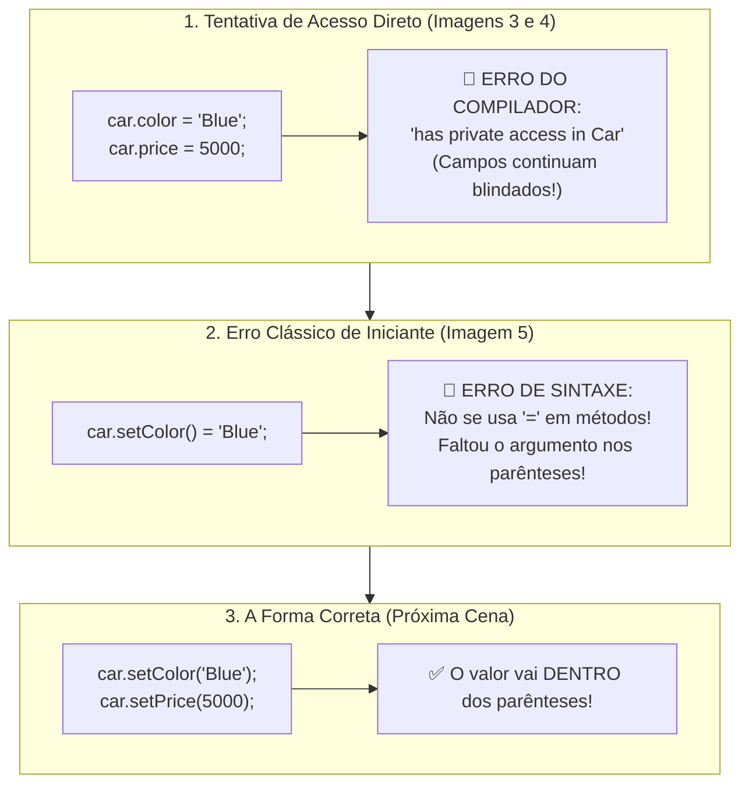

# Curso de Java — Capítulo 52 (Parte 7): Getters e Setters 🔐
## A Tentativa de Acesso Direto e o Erro Clássico de Iniciante no Setter (`car.setColor() = "Blue"`)

---

> [!IMPORTANT]
> **Para cópia no Google Docs:** Este documento foi especialmente formatado de forma autossuficiente e detalhada. Todos os elementos visuais das telas do IntelliJ IDEA (linhas sublinhadas em vermelho, relatórios do Build Output, mensagens de erro de sintaxe, cursores e abas ativas) foram transcritos textualmente para que você possa copiar e colar todo o conteúdo no seu Google Docs sem perder o contexto das imagens originais.

---

### Links Rápidos dos Arquivos do Projeto no seu Computador
* Arquivo Principal de Execução: [`Main.java`](../../../src/main/java/com/mickaelgeronimo/mastery/core/concurrency/Main.java)
* Classe do Carro com os Setters: [`Car.java`](../../../src/main/java/com/mickaelgeronimo/mastery/core/oop/Car.java)
* Pasta Raiz do Projeto: `JAVA APRENDER`
* Guia da Parte 1 (Conceito e Falha de Acesso Aberto): `explicacao_getters_and_setters_definicao_e_exemplo_sem_encapsulamento_capitulo52_parte1.md`
* Guia da Parte 2 (Demonstração da Adulteração e Blindagem `private`): `explicacao_getters_and_setters_vulnerabilidade_de_acesso_direto_e_blindagem_com_private_capitulo52_parte2.md`
* Guia da Parte 3 (Os 3 Erros de Compilação e Criação dos Getters): `explicacao_getters_and_setters_os_3_erros_de_acesso_privado_e_criacao_dos_getters_capitulo52_parte3.md`
* Guia da Parte 4 (Substituição no Main e Erro de Tipos): `explicacao_getters_and_setters_substituicao_pelos_getters_execucao_com_sucesso_e_incompatibilidade_de_tipos_capitulo52_parte4.md`
* Guia da Parte 5 (Formatação com Cifrão no Preço): `explicacao_getters_and_setters_formatacao_com_cifrao_e_retorno_string_capitulo52_parte5.md`
* Guia da Parte 6 (Introdução aos Setters `setColor` e `setPrice`): `explicacao_getters_and_setters_introducao_aos_setters_setcolor_e_setprice_capitulo52_parte6.md`

---

## 1. O Que Está Acontecendo Aqui? (Visão Geral para Iniciantes Amadores)

Nas partes anteriores, construímos as portas de entrada e saída da nossa classe:
* **Getters:** Para ler com segurança (`getModel()`, `getColor()`, `getPrice()`).
* **Setters:** Para alterar com segurança (`setColor(String color)`, `setPrice(int price)`).

Nesta sequência de 5 imagens, o professor Bro Code faz duas demonstrações didáticas brilhantes sobre **COMO NÃO USAR** e **COMO A CABEÇA DO INICIANTE SE CONFUNDE**:
1. **A Finalização dos Setters (Imagem 1):** Ele conclui o método `setPrice(int price)` em [`Car.java`](../../../src/main/java/com/mickaelgeronimo/mastery/core/oop/Car.java).
2. **A Volta ao Main (Imagem 2):** Ele se posiciona em [`Main.java`](../../../src/main/java/com/mickaelgeronimo/mastery/core/concurrency/Main.java) para demonstrar como mudar a cor e o preço do carro.
3. **O Erro Recorrente (Imagem 3):** O autor digita propositalmente:
   ```java
   car.color = "Blue";
   car.price = 5000;
   ```
   O IntelliJ imediatamente sublinha as duas linhas em vermelho (`🔴 2 erros`). Por quê? Porque criar os Setters **NÃO** abre as portas para o acesso direto! Os campos continuam sendo `private`!
4. **A Confirmação no Compilador (Imagem 4):** Ele aperta Play (`▷`) e o compilador barra a execução: `java: color has private access in Car` e `price has private access in Car`.
5. **O Erro Clássico de Todo Iniciante (Imagem 5):** O autor tenta corrigir, mas digita uma das maiores gafes que todo estudante comete:
   ```java
   car.setColor() = "Blue"; // ❌ ERRO BIZARRO DE SINTAXE!
   ```
   Ele tenta usar o sinal de igual `=` como se o método fosse uma variável! O IntelliJ grita com erro de sintaxe, preparando a explicação de que valores de métodos entram **dentro dos parênteses**!



---

## 2. Por Que `car.setColor() = "Blue"` É Um Erro em Java? (Analogia do Correio)

Imagine que você quer enviar uma carta com o endereço `"Blue"`:

* **Variável Comum:** É como uma caixa aberta na sua mesa. Você simplesmente joga a carta dentro: `caixa = "Blue";`.
* **Chamada de Método:** Um método é como uma **agência dos Correios com um funcionário** (`setColor`).
* **O Erro `car.setColor() = "Blue"`:** É como você ir até a agência com as mãos vazias `()`, e depois tentar colar a carta com fita adesiva na testa do atendente `= "Blue"`. O atendente vai olhar para você assustado e dizer: *"Ei! Não é assim que funciona! Você tem que me entregar a carta NA MINHA MÃO antes de eu começar o trabalho!"*.
* **A Forma Correta `car.setColor("Blue")`:** Você entra na agência e coloca a carta diretamente na mão do atendente, dentro dos parênteses: `setColor("Blue")`! O atendente pega o que está nos parênteses e despacha com segurança.

---

## 3. Dissecando as 5 Imagens Passo a Passo

---

### 📸 Imagem 1: Concluindo o Setter `setPrice` em [`Car.java`](../../../src/main/java/com/mickaelgeronimo/mastery/core/oop/Car.java) (`media_1791403030277_215e8420.png`)

#### O que se vê na interface do IntelliJ IDEA:
* **Aba Ativa:** [`Car.java`](../../../src/main/java/com/mickaelgeronimo/mastery/core/oop/Car.java).
* **Trecho Completo de `setPrice` (Linhas 26 a 28):**
  ```java
  26    void setPrice(int price){
  27        this.price = price;
  28    }
  ```
* **O Detalhe Visual:**
  * O parâmetro `price` na linha 26 está **selecionado em azul**: `int price)`.
  * Na linha 27, a palavra `price` da direita está com fundo branco/cinza de destaque de uso.
* **O Que o Autor Está Ensinando:**
  O método `setPrice` está pronto:
  1. Ele recebe o novo preço no parâmetro `int price`.
  2. Executa `this.price = price;`, sobrescrevendo o preço antigo armazenado na variável privada do objeto.

---

### 📸 Imagem 2: Retornando ao [`Main.java`](../../../src/main/java/com/mickaelgeronimo/mastery/core/concurrency/Main.java) (`media_1791403040660_197f7a39.png`)

#### O que se vê na interface do IntelliJ IDEA:
* **Aba Ativa:** Muda para [`Main.java`](../../../src/main/java/com/mickaelgeronimo/mastery/core/concurrency/Main.java).
* **Trecho de Código no Editor:**
  ```java
   8    Car car = new Car("Charger", "Yellow", 10000);
   9
  10    System.out.println(car.getColor() + " " + car.getModel() + " " + car.getPrice());
  ```
* **O Detalhe Visual:**
  * O cursor está posicionado no final da linha 8, logo após o ponto e vírgula de `10000);|`.
* **O Que o Autor Fará:**
  Ele vai apertar `Enter` para abrir espaço entre a criação do carro e a impressão no console, preparando-se para alterar a cor e o preço do veículo.

---

### 📸 Imagem 3: A Tentativa Proibida de Acesso Direto (`media_1791403056783_bd11c530.png`)

#### O que se vê na interface do IntelliJ IDEA:
* **Barra de Vídeo do YouTube:** Timestamp `8:26:39 / 12:00:00`.
* **Aba Ativa:** [`Main.java`](../../../src/main/java/com/mickaelgeronimo/mastery/core/concurrency/Main.java).
* **Canto Superior Direito:** Badge de erro: **`🔴 2 v`** (2 erros detectados).
* **Novas Linhas Digitadas (Linhas 11 e 12):**
  ```java
  11    car.color = "Blue";
  12 💡 car.price = 5000;
  ```
* **O Detalhe Visual:**
  * As palavras **`color`** (linha 11) e **`price`** (linha 12) estão com ondas sublinhadas vermelhas de erro!
* **A Lição do Professor:**
  Muitos alunos acham que depois de escrever métodos Setters na classe, as variáveis viram públicas magicamente. Essa imagem prova que **NÃO**! As variáveis continuam `private`. Tentar acessá-las com `car.color = ...` continua sendo um crime contra as regras do compilador!

---

### 📸 Imagem 4: O Bloqueio no "Build Output" (`media_1791403066647_8a6e6653.png`)

#### O que se vê na interface do IntelliJ IDEA:
* **Ação do Autor:** Clica no botão Play verde (`Run 'Main.java' Shift+F10`).
* **Painel Inferior (Aba Build Output):**
  * Tempo de build: `MyFirstProject: 816 ms`.
  * Árvore à esquerda:
    * `Main.java src 2 errors`
    * `🔴 color has private access in Car`
    * `🔴 price has private access in Car`
  * No corpo principal do console (em vermelho):
    ```text
    C:\Users\HP\IdeaProjects\MyFirstProject\src\Main.java:11:12
    java: color has private access in Car
    ```
* **Significado:** O compilador Java se recusa categoricamente a rodar o código. A barreira do encapsulamento está de pé e funcionando 100%!

---

### 📸 Imagem 5: O Erro Clássico de Sintaxe no Setter (`media_1791403080215_7b48c3b1.png`)

#### O que se vê na interface do IntelliJ IDEA:
* **Aba Ativa:** [`Main.java`](../../../src/main/java/com/mickaelgeronimo/mastery/core/concurrency/Main.java).
* **Trecho Modificado no Editor (Linha 11):**
  ```java
  11    car.setColor() = "Blue";
  12    car.price = 5000;
  ```
* **O Detalhe Crítico na Linha 11:**
  * O autor apagou `car.color = "Blue"` e tentou escrever:
    `car.setColor() = "Blue";`
  * O parêntese de fechamento `)` e o sinal de igual `=` estão marcados com destaque de **erro de sintaxe**!
* **Por Que o Java Não Aceita Isso?**
  1. `car.setColor()` é uma chamada de função (método).
  2. Um método não é uma caixinha de memória na qual você pode jogar um valor com o operador de atribuição `=`.
  3. Além disso, o método `setColor` foi declarado como `void setColor(String color)`. Ele **exige** que você passe o valor dentro dos parênteses: `car.setColor("Blue");`!
  4. O compilador acusa: `method setColor in class Car cannot be applied to given types; required: String, found: no arguments`.

---

## 4. Análise Linha por Linha dos Códigos

### Arquivo 1: [`Car.java`](../../../src/main/java/com/mickaelgeronimo/mastery/core/oop/Car.java) (Código Completo com Getters e Setters)

```java
 1 public class Car {
 2 
 3     private String model;
 4     private String color;
 5     private int price;
 6 
 7     Car(String model, String color, int price){
 8         this.model = model;
 9         this.color = color;
10         this.price = price;
11     }
12 
13     String getModel(){
14         return this.model;
15     }
16 
17     String getColor(){
18         return this.color;
19     }
20 
21     String getPrice(){
22         return "$" + this.price;
23     }
24 
25     void setColor(String color){
26         this.color = color;
27     }
28 
29     void setPrice(int price){
30         this.price = price;
31     }
32 }
```

| Linha | Código em Java | Explicação para Leigo Absoluto | O Que Sai no Console? |
| :---: | :--- | :--- | :--- |
| **25** | `void setColor(String color){` | Setter da cor: método que aceita o novo texto da cor. | Nada |
| **26** | `this.color = color;` | Grava a nova cor recebida no atributo interno do objeto. | Nada |
| **27** | `}` | Fecha `setColor`. | Nada |
| **28** | *(vazia)* | Espaço em branco. | Nada |
| **29** | `void setPrice(int price){` | **Setter do Preço Concluído:** Método sem retorno (`void`) que aceita um novo número inteiro (`int price`). | Nada |
| **30** | `this.price = price;` | Grava o novo preço numérico na variável privada `this.price`. | Nada |
| **31** | `}` | Fecha `setPrice`. | Nada |
| **32** | `}` | Fecha a classe `Car`. | Nada |

---

### Arquivo 2: [`Main.java`](../../../src/main/java/com/mickaelgeronimo/mastery/core/concurrency/Main.java) (O Arquivo com as Tentativas Didáticas)

```java
 1 public class Main {
 2     public static void main(String[] args) {
 3 
 4         // They help protect object data and add rules for accessing or modifying them.
 5         // GETTERS = Methods that make a field READABLE.
 6         // SETTERS = Methods that make a field WRITEABLE.
 7 
 8         Car car = new Car("Charger", "Yellow", 10000);
 9 
10         car.setColor() = "Blue"; // 🔴 ERRO DE SINTAXE!
11         car.price = 5000;        // 🔴 ERRO: price has private access in Car
12 
13         System.out.println(car.getColor() + " " + car.getModel() + " " + car.getPrice());
14     }
15 }
```

| Linha | Código em Java | O Que Acontece Passo a Passo | O Que Sai no Console? |
| :---: | :--- | :--- | :--- |
| **8** | `Car car = new Car("Charger", "Yellow", 10000);` | Cria o objeto carro na memória. | Nada |
| **10** | `car.setColor() = "Blue";` | **O Erro da Imagem 5:** Tenta usar `=` com um método vazio. O compilador não aceita! | 🛑 **ERRO DE SINTAXE** |
| **11** | `car.price = 5000;` | **O Erro da Imagem 3 e 4:** Tenta alterar diretamente um campo privado. | 🛑 **ERRO DE ACESSO PRIVADO** |
| **13** | `System.out.println(...)` | Impressão usando os Getters (não chega a rodar por causa dos erros acima). | Não executa |

---

## 5. Tabela Comparativa de Sintaxe: Como NUNCA Mais Errar!

| O Que Você Quer Fazer? | Código Errado ❌ | Código Correto ✅ | Por Que o Errado Falha? |
| :--- | :--- | :--- | :--- |
| **Mudar a Cor** | `car.color = "Blue";` | `car.setColor("Blue");` | `color` é `private` (acesso direto proibido). |
| **Mudar a Cor com Setter** | `car.setColor() = "Blue";` | `car.setColor("Blue");` | Métodos não aceitam `=`. O dado entra nos parênteses `()`. |
| **Mudar o Preço** | `car.price = 5000;` | `car.setPrice(5000);` | `price` é `private` (acesso direto proibido). |
| **Mudar o Preço com Setter** | `car.setPrice() = 5000;` | `car.setPrice(5000);` | O novo número deve ir dentro dos parênteses `(5000)`. |

---

## 6. O Que Acontecerá no Próximo Episódio?

Na próxima cena, o autor corrigirá a linha 10 e a linha 11 para a sintaxe oficial:
```java
car.setColor("Blue");
car.setPrice(5000);
```

E quando o programa rodar:
* `car.getColor()` retornará `"Blue"`.
* `car.getModel()` continuará `"Charger"`.
* `car.getPrice()` retornará `"$5000"`.
* O console finalmente imprimirá:
```text
Blue Charger $5000
```
Isso demonstrará a consagração total dos **Setters**: o objeto teve seus dados internos modificados com 100% de elegância, respeito ao encapsulamento e segurança do compilador!
