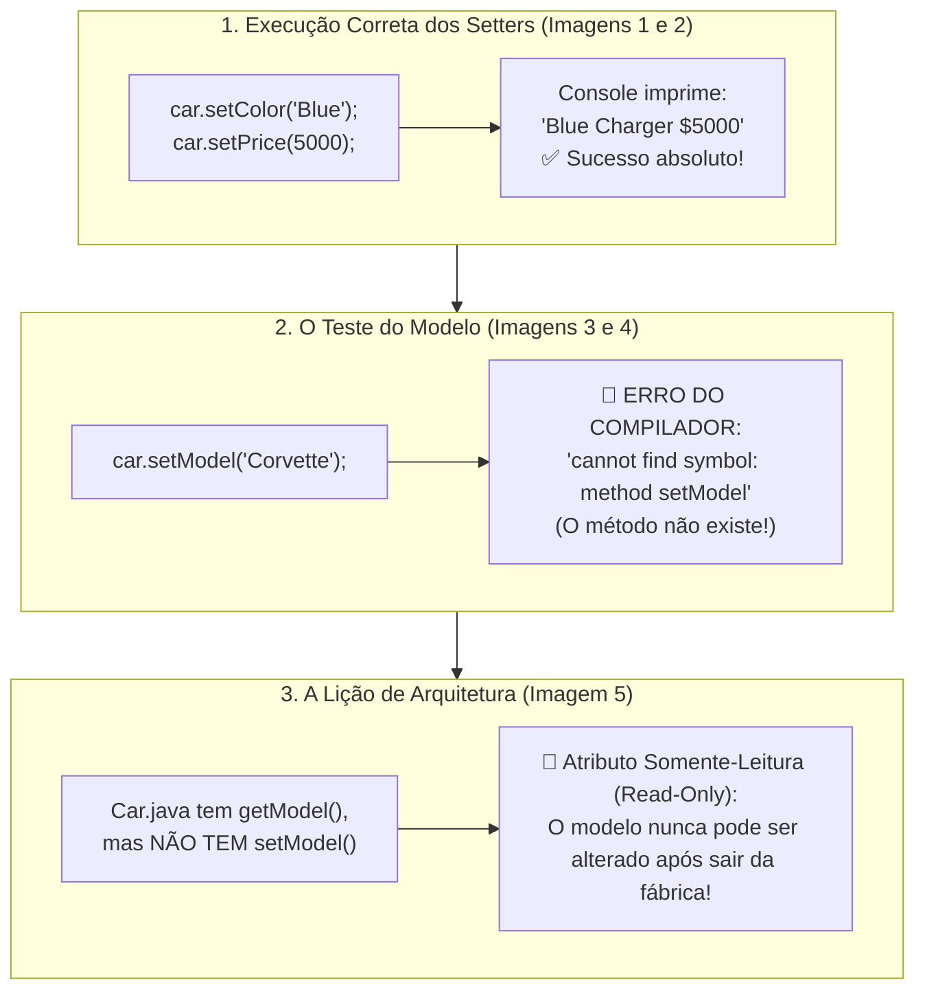

# Curso de Java — Capítulo 52 (Parte 8): Getters e Setters 🔐
## Execução dos Setters com Sucesso e o Poder dos Atributos Somente-Leitura (*Read-Only*)

---

> [!IMPORTANT]
> **Para cópia no Google Docs:** Este documento foi especialmente formatado de forma autossuficiente e detalhada. Todos os elementos visuais das telas do IntelliJ IDEA (linhas sublinhadas em vermelho, relatórios do Build Output, mensagens de erro do compilador, cursores e saídas no console) foram descritos textualmente com precisão para que você possa copiar e colar todo o conteúdo no seu Google Docs sem perder o contexto das imagens originais.

---

### Links Rápidos dos Arquivos do Projeto no seu Computador
* Arquivo Principal de Execução: [`Main.java`](file:///c:/Users/mickel%201/Downloads/JAVA%20APRENDER/Main.java)
* Classe do Carro com Getters e Setters: [`Car.java`](file:///c:/Users/mickel%201/Downloads/JAVA%20APRENDER/Car.java)
* Pasta Raiz do Projeto: [`JAVA APRENDER`](file:///c:/Users/mickel%201/Downloads/JAVA%20APRENDER)
* Guia da Parte 1 (Conceito e Falha de Acesso Aberto): [`explicacao_getters_and_setters_definicao_e_exemplo_sem_encapsulamento_capitulo52_parte1.md`](file:///C:/Users/mickel%201/.gemini/antigravity/brain/d1dae54d-8acc-4142-bb62-6703a22b9afc/explicacao_getters_and_setters_definicao_e_exemplo_sem_encapsulamento_capitulo52_parte1.md)
* Guia da Parte 2 (Demonstração da Adulteração e Blindagem `private`): [`explicacao_getters_and_setters_vulnerabilidade_de_acesso_direto_e_blindagem_com_private_capitulo52_parte2.md`](file:///C:/Users/mickel%201/.gemini/antigravity/brain/d1dae54d-8acc-4142-bb62-6703a22b9afc/explicacao_getters_and_setters_vulnerabilidade_de_acesso_direto_e_blindagem_com_private_capitulo52_parte2.md)
* Guia da Parte 3 (Os 3 Erros de Compilação e Criação dos Getters): [`explicacao_getters_and_setters_os_3_erros_de_acesso_privado_e_criacao_dos_getters_capitulo52_parte3.md`](file:///C:/Users/mickel%201/.gemini/antigravity/brain/d1dae54d-8acc-4142-bb62-6703a22b9afc/explicacao_getters_and_setters_os_3_erros_de_acesso_privado_e_criacao_dos_getters_capitulo52_parte3.md)
* Guia da Parte 4 (Substituição no Main e Erro de Tipos): [`explicacao_getters_and_setters_substituicao_pelos_getters_execucao_com_sucesso_e_incompatibilidade_de_tipos_capitulo52_parte4.md`](file:///C:/Users/mickel%201/.gemini/antigravity/brain/d1dae54d-8acc-4142-bb62-6703a22b9afc/explicacao_getters_and_setters_substituicao_pelos_getters_execucao_com_sucesso_e_incompatibilidade_de_tipos_capitulo52_parte4.md)
* Guia da Parte 5 (Formatação com Cifrão no Preço): [`explicacao_getters_and_setters_formatacao_com_cifrao_e_retorno_string_capitulo52_parte5.md`](file:///C:/Users/mickel%201/.gemini/antigravity/brain/d1dae54d-8acc-4142-bb62-6703a22b9afc/explicacao_getters_and_setters_formatacao_com_cifrao_e_retorno_string_capitulo52_parte5.md)
* Guia da Parte 6 (Introdução aos Setters `setColor` e `setPrice`): [`explicacao_getters_and_setters_introducao_aos_setters_setcolor_e_setprice_capitulo52_parte6.md`](file:///C:/Users/mickel%201/.gemini/antigravity/brain/d1dae54d-8acc-4142-bb62-6703a22b9afc/explicacao_getters_and_setters_introducao_aos_setters_setcolor_e_setprice_capitulo52_parte6.md)
* Guia da Parte 7 (O Erro de Atribuição com `=` no Setter): [`explicacao_getters_and_setters_tentativa_de_acesso_direto_e_o_erro_classico_de_atribuicao_no_setter_capitulo52_parte7.md`](file:///C:/Users/mickel%201/.gemini/antigravity/brain/d1dae54d-8acc-4142-bb62-6703a22b9afc/explicacao_getters_and_setters_tentativa_de_acesso_direto_e_o_erro_classico_de_atribuicao_no_setter_capitulo52_parte7.md)

---

## 1. O Que Está Acontecendo Aqui? (Visão Geral para Iniciantes Amadores)

Na aula anterior (Parte 7), o professor mostrou que tentar usar o sinal de igual `=` em uma chamada de método (`car.setColor() = "Blue";`) causa um erro bizarro de sintaxe em Java.

Nesta sequência de 5 imagens, acompanhamos o desfecho triunfal e a maior lição de arquitetura deste capítulo:
1. **A Sintaxe Correta do Setter (Imagem 1):** O autor passa o valor **dentro dos parênteses**: `car.setColor("Blue");` e começa a preencher `car.setPrice();`.
2. **A Execução Vitoriosa (Imagem 2):** Ele digita `car.setPrice(5000);` e aperta Play (`▷`). O console imprime com perfeição: `Blue Charger $5000`. O carro mudou de cor e de preço respeitando 100% o encapsulamento!
3. **A Provocação do Professor (Imagem 3):** Ele abre uma nova linha antes das alterações.
4. **O Teste do Impossível (Imagem 4):** Ele digita `car.setModel("Corvette");` e manda rodar. O compilador Java trava e solta: `cannot find symbol: method setModel(java.lang.String)`.
5. **A Grande Revelação (Imagem 5):** O autor volta para [`Car.java`](file:///c:/Users/mickel%201/Downloads/JAVA%20APRENDER/Car.java) e mostra que o método `setModel` **simplesmente não existe**! E ele não existe de propósito! Se você quer que uma informação seja **SOMENTE LEITURA** (*Read-Only*), basta você **NÃO CRIAR** o Setter dela!



---

## 2. A Filosofia dos Atributos Somente-Leitura (*Read-Only*)

Pense no mundo real:

* **O que PODE mudar em um carro?**
  * A cor pode mudar se você pintar (`setColor("Blue")`).
  * O preço pode mudar se você der um desconto (`setPrice(5000)`).
* **O que NÃO PODE mudar em um carro depois que ele foi fabricado?**
  * O modelo do carro! Um *Dodge Charger* nunca poderá acordar de manhã e virar um *Chevrolet Corvette*!
  * O número de chassi do carro nunca muda!
  * O ano de fabricação nunca muda!

**Como você programa isso em Java?**
1. Você declara a variável privada: `private String model;`.
2. Você recebe o valor no construtor para definir quem ele é ao nascer.
3. Você cria o **Getter** `getModel()` para que qualquer um possa saber qual é o modelo.
4. **E você NUNCA cria um Setter para ele!**

Ao não criar `setModel`, você transformou o modelo em uma rocha inquebrável. Ninguém no sistema inteiro conseguirá alterar o modelo do carro depois que ele foi instanciado!

---

## 3. Dissecando as 5 Imagens Passo a Passo

---

### 📸 Imagem 1: Passando Argumentos Dentro dos Parênteses (`media_1791403108516_cea676ca.png`)

#### O que se vê na interface do IntelliJ IDEA:
* **Barra de Vídeo do YouTube:** Timestamp `8:27:05 / 12:00:00`, capítulo `52. getters and setters >`.
* **Aba Ativa:** [`Main.java`](file:///c:/Users/mickel%201/Downloads/JAVA%20APRENDER/Main.java).
* **Trecho de Código no Editor:**
  ```java
  11    car.setColor("Blue");
  12    car.setPrice();
  ```
* **O Detalhe Visual:**
  * Na linha 11, o autor consertou o erro da aula anterior: `"Blue"` agora está **dentro dos parênteses**. Não há nenhum sublinhado vermelho! A linha é 100% válida!
  * Na linha 12, ele digitou `car.setPrice();` e o cursor está piscando dentro dos parênteses vazios `(|)`.
  * No canto superior direito, há o badge **`🔴 1 v`** porque o método `setPrice(int price)` exige que você forneça um número inteiro.

---

### 📸 Imagem 2: A Saída com Sucesso no Console (`media_1791403121047_9e52ff2a.png`)

#### O que se vê na interface do IntelliJ IDEA:
* **Aba Ativa:** [`Main.java`](file:///c:/Users/mickel%201/Downloads/JAVA%20APRENDER/Main.java).
* **Trecho Completo no Editor:**
  ```java
  12    car.setPrice(5000);
  13
  14    System.out.println(car.getColor() + " " + car.getModel() + " " + car.getPrice());
  ```
* **Painel Inferior (Aba Run - Main):**
  * Comando executado: `openjdk-23\bin\java.exe ...`
  * **Texto impresso em verde brilhante:**
    ```text
    Blue Charger $5000
    ```
  * Linha final: `Process finished with exit code 0`.
* **O Que Significa Este Resultado:**
  * A cor era `"Yellow"`, virou **`Blue`** através de `car.setColor("Blue")`.
  * O modelo era `"Charger"` e permaneceu **`Charger`**.
  * O preço era `10000`, virou **`5000`** através de `car.setPrice(5000)` e saiu formatado com cifrão **`$5000`** pelo Getter!
  * Os dados foram modificados e lidos com sucesso total!

---

### 📸 Imagem 3: Abrindo Espaço para o Modelo (`media_1791403136112_ca7bb2af.png`)

#### O que se vê na interface do IntelliJ IDEA:
* **Barra de Vídeo do YouTube:** Timestamp `8:27:27 / 12:00:00`.
* **Aba Ativa:** [`Main.java`](file:///c:/Users/mickel%201/Downloads/JAVA%20APRENDER/Main.java).
* **Trecho de Código no Editor:**
  ```java
   9    Car car = new Car("Charger", "Yellow", 10000);
  10
  11    |
  12    car.setColor("Blue");
  13    car.setPrice(5000);
  ```
* **O Detalhe Visual:**
  * O autor apertou `Enter` e posicionou o cursor na linha 11 vazia, preparando-se para fazer o teste que todo aluno curioso faria.

---

### 📸 Imagem 4: A Tentativa de `car.setModel("Corvette")` e o Erro do Compilador (`media_1791403152747_169ab708.png`)

#### O que se vê na interface do IntelliJ IDEA:
* **Barra de Vídeo do YouTube:** Timestamp `8:27:36 / 12:00:00`.
* **Aba Ativa:** [`Main.java`](file:///c:/Users/mickel%201/Downloads/JAVA%20APRENDER/Main.java).
* **Trecho Digitado no Editor:**
  ```java
  11 💡  car.setModel("Corvette");
  12     car.setColor("Blue");
  13     car.setPrice(5000);
  ```
  *(A palavra `setModel` está com onda sublinhada vermelha).*
* **Painel Inferior (Aba Build Output):**
  * Mensagem em destaque vermelho sangue:
    ```text
    C:\Users\HP\IdeaProjects\MyFirstProject\src\Main.java:11:12
    java: cannot find symbol
      symbol:   method setModel(java.lang.String)
      location: variable car of type Car
    ```
* **O Que o Compilador Está Dizendo:**
  *"Ei! Eu procurei dentro da classe `Car` por um método chamado `setModel` que receba um texto `String`, mas eu NÃO ENCONTREI esse método em lugar nenhum!"*.

---

### 📸 Imagem 5: A Prova dos Fatos Dentro de [`Car.java`](file:///c:/Users/mickel%201/Downloads/JAVA%20APRENDER/Car.java) (`media_1791403165939_c3dccff0.png`)

#### O que se vê na interface do IntelliJ IDEA:
* **Aba Ativa:** Muda para [`Car.java`](file:///c:/Users/mickel%201/Downloads/JAVA%20APRENDER/Car.java).
* **Trecho Visível de Métodos:**
  ```java
  13    String getModel(){
  14        return this.model;
  15    }
  16
  17    String getColor(){
  18        return this.color;
  19    }
  20
  21    String getPrice(){
  22        return "$" + this.price;
  23    }
  24
  25    void setColor(String color){
  26        this.color = color;
  27    }
  28
  29    void setPrice(int price){
  30        this.price = price;
  31    }
  ```
* **O Destaque Visual:**
  * O autor seleciona `setPrice` com o cursor na linha 26 e aponta para a classe inteira.
* **A Conclusão do Professor:**
  Ele diz aos alunos: *"Viram? Nós temos `setColor` e temos `setPrice`. Mas nós NUNCA criamos um `setModel`. E não criamos porque um carro não pode mudar de modelo! Se você não criar o Setter, ninguém conseguirá alterar o valor!"*.

---

## 4. Tabela de Permissões: O Poder do Encapsulamento

| Variável em `Car` | Modificador | Tem Getter? | Tem Setter? | Tipo de Acesso | O Que Significa na Prática? |
| :--- | :---: | :---: | :---: | :--- | :--- |
| `model` | `private` | ✅ Sim (`getModel`) | ❌ **NÃO** | **Somente Leitura (*Read-Only*)** | O modelo pode ser consultado por qualquer um, mas **nunca pode ser alterado** após a criação! |
| `color` | `private` | ✅ Sim (`getColor`) | ✅ **Sim (`setColor`)** | **Leitura e Gravação (*Read-Write*)** | A cor pode ser consultada e pode ser trocada quando o carro for repintado. |
| `price` | `private` | ✅ Sim (`getPrice`) | ✅ **Sim (`setPrice`)** | **Leitura e Gravação (*Read-Write*)** | O preço pode ser consultado (com `$`) e pode ser atualizado com novas promoções. |

---

## 5. Análise Linha por Linha dos Códigos

### Arquivo 1: [`Main.java`](file:///c:/Users/mickel%201/Downloads/JAVA%20APRENDER/Main.java) (Código Limpo e Funcional da Imagem 2)

```java
 1 public class Main {
 2     public static void main(String[] args) {
 3 
 4         // They help protect object data and add rules for accessing or modifying them.
 5         // GETTERS = Methods that make a field READABLE.
 6         // SETTERS = Methods that make a field WRITEABLE.
 7 
 8         Car car = new Car("Charger", "Yellow", 10000);
 9 
10         car.setColor("Blue");
11         car.setPrice(5000);
12 
13         System.out.println(car.getColor() + " " + car.getModel() + " " + car.getPrice());
14     }
15 }
```

| Linha | Código em Java | Explicação Passo a Passo | O Que Sai no Console? |
| :---: | :--- | :--- | :--- |
| **8** | `Car car = new Car("Charger", "Yellow", 10000);` | Nasce o carro na memória: modelo `"Charger"`, cor `"Yellow"`, preço `10000`. | Nada |
| **9** | *(vazia)* | Espaço em branco. | Nada |
| **10** | `car.setColor("Blue");` | **Uso Correto do Setter:** Chama o método `setColor` passando `"Blue"` como argumento. O carro é repintado internamente de azul! | Nada |
| **11** | `car.setPrice(5000);` | **Uso Correto do Setter:** Chama `setPrice` passando o número inteiro `5000`. O preço interno é atualizado! | Nada |
| **12** | *(vazia)* | Espaço em branco. | Nada |
| **13** | `System.out.println(...)` | Lê os dados atualizados com os Getters: `"Blue"`, `"Charger"` e `"$5000"`. | `Blue Charger $5000` |
| **14** | `}` | Fecha o `main`. | Nada |
| **15** | `}` | Fecha a classe `Main`. | Nada |

---

### Arquivo 2: [`Car.java`](file:///c:/Users/mickel%201/Downloads/JAVA%20APRENDER/Car.java) (A Classe do Carro)

```java
 1 public class Car {
 2 
 3     private String model;
 4     private String color;
 5     private int price;
 6 
 7     Car(String model, String color, int price){
 8         this.model = model;
 9         this.color = color;
10         this.price = price;
11     }
12 
13     String getModel(){
14         return this.model;
15     }
16 
17     String getColor(){
18         return this.color;
19     }
20 
21     String getPrice(){
22         return "$" + this.price;
23     }
24 
25     void setColor(String color){
26         this.color = color;
27     }
28 
29     void setPrice(int price){
30         this.price = price;
31     }
32 }
```

| Linha | Código em Java | Explicação do Papel Arquitetural | O Que Sai no Console? |
| :---: | :--- | :--- | :--- |
| **3** | `private String model;` | Atributo privado. Não possui Setter na classe, tornando-se **Read-Only**! | Nada |
| **4** | `private String color;` | Atributo privado. Possui Getter e Setter, tornando-se **Read-Write**! | Nada |
| **5** | `private int price;` | Atributo privado. Possui Getter e Setter, tornando-se **Read-Write**! | Nada |
| **13-15** | `String getModel() { ... }` | Permite que qualquer classe leia o modelo. | Nada |
| **25-27** | `void setColor(String color) { ... }` | Permite que classes externas alterem a cor com segurança. | Nada |
| **29-31** | `void setPrice(int price) { ... }` | Permite que classes externas alterem o preço com segurança. | Nada |

---

## 6. Resumo das Saídas do Console Neste Bloco

| Situação do Código | Comando de Execução | O Que Aparece no Terminal? |
| :--- | :--- | :--- |
| **Com `setColor("Blue")` e `setPrice(5000)`** | `java Main` | ✅ **`Blue Charger $5000`** |
| **Tentando `car.setModel("Corvette")`** | `javac Car.java Main.java` | 🛑 `cannot find symbol: method setModel(java.lang.String)` |
