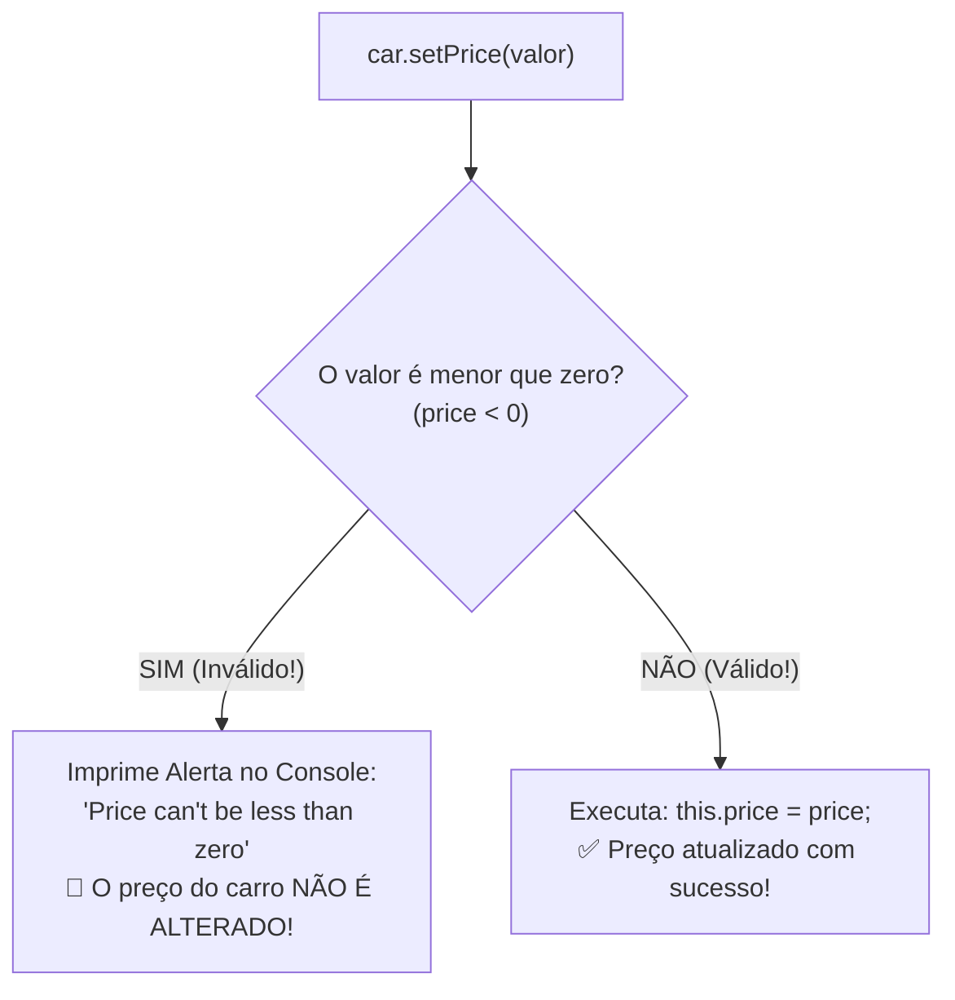

# Curso de Java — Capítulo 52 (Parte 9): Getters e Setters 🔐
## A Palavra-Chave `final` e as Regras de Validação nos Setters (`if/else`)

---

> [!IMPORTANT]
> **Para cópia no Google Docs:** Este documento foi especialmente elaborado de forma autossuficiente e detalhada. Todos os elementos visuais das telas do IntelliJ IDEA (edições em tempo real, abas ativas, inserção da palavra-chave `final`, criação de blocos condicionais de validação e saídas do console) foram transcritos textualmente com rigor para que você possa copiar e colar todo o conteúdo no seu Google Docs sem perder o contexto das imagens originais.

---

### Links Rápidos dos Arquivos do Projeto no seu Computador
* Arquivo Principal de Execução: [`Main.java`](file:///c:/Users/mickel%201/Downloads/JAVA%20APRENDER/Main.java)
* Classe do Carro com `final` e Validação: [`Car.java`](file:///c:/Users/mickel%201/Downloads/JAVA%20APRENDER/Car.java)
* Pasta Raiz do Projeto: [`JAVA APRENDER`](file:///c:/Users/mickel%201/Downloads/JAVA%20APRENDER)
* Guia da Parte 1 (Conceito e Falha de Acesso Aberto): [`explicacao_getters_and_setters_definicao_e_exemplo_sem_encapsulamento_capitulo52_parte1.md`](file:///C:/Users/mickel%201/.gemini/antigravity/brain/d1dae54d-8acc-4142-bb62-6703a22b9afc/explicacao_getters_and_setters_definicao_e_exemplo_sem_encapsulamento_capitulo52_parte1.md)
* Guia da Parte 2 (Demonstração da Adulteração e Blindagem `private`): [`explicacao_getters_and_setters_vulnerabilidade_de_acesso_direto_e_blindagem_com_private_capitulo52_parte2.md`](file:///C:/Users/mickel%201/.gemini/antigravity/brain/d1dae54d-8acc-4142-bb62-6703a22b9afc/explicacao_getters_and_setters_vulnerabilidade_de_acesso_direto_e_blindagem_com_private_capitulo52_parte2.md)
* Guia da Parte 3 (Os 3 Erros de Compilação e Criação dos Getters): [`explicacao_getters_and_setters_os_3_erros_de_acesso_privado_e_criacao_dos_getters_capitulo52_parte3.md`](file:///C:/Users/mickel%201/.gemini/antigravity/brain/d1dae54d-8acc-4142-bb62-6703a22b9afc/explicacao_getters_and_setters_os_3_erros_de_acesso_privado_e_criacao_dos_getters_capitulo52_parte3.md)
* Guia da Parte 4 (Substituição no Main e Erro de Tipos): [`explicacao_getters_and_setters_substituicao_pelos_getters_execucao_com_sucesso_e_incompatibilidade_de_tipos_capitulo52_parte4.md`](file:///C:/Users/mickel%201/.gemini/antigravity/brain/d1dae54d-8acc-4142-bb62-6703a22b9afc/explicacao_getters_and_setters_substituicao_pelos_getters_execucao_com_sucesso_e_incompatibilidade_de_tipos_capitulo52_parte4.md)
* Guia da Parte 5 (Formatação com Cifrão no Preço): [`explicacao_getters_and_setters_formatacao_com_cifrao_e_retorno_string_capitulo52_parte5.md`](file:///C:/Users/mickel%201/.gemini/antigravity/brain/d1dae54d-8acc-4142-bb62-6703a22b9afc/explicacao_getters_and_setters_formatacao_com_cifrao_e_retorno_string_capitulo52_parte5.md)
* Guia da Parte 6 (Introdução aos Setters `setColor` e `setPrice`): [`explicacao_getters_and_setters_introducao_aos_setters_setcolor_e_setprice_capitulo52_parte6.md`](file:///C:/Users/mickel%201/.gemini/antigravity/brain/d1dae54d-8acc-4142-bb62-6703a22b9afc/explicacao_getters_and_setters_introducao_aos_setters_setcolor_e_setprice_capitulo52_parte6.md)
* Guia da Parte 7 (O Erro de Atribuição com `=` no Setter): [`explicacao_getters_and_setters_tentativa_de_acesso_direto_e_o_erro_classico_de_atribuicao_no_setter_capitulo52_parte7.md`](file:///C:/Users/mickel%201/.gemini/antigravity/brain/d1dae54d-8acc-4142-bb62-6703a22b9afc/explicacao_getters_and_setters_tentativa_de_acesso_direto_e_o_erro_classico_de_atribuicao_no_setter_capitulo52_parte7.md)
* Guia da Parte 8 (Atributos Somente-Leitura): [`explicacao_getters_and_setters_execucao_dos_setters_e_o_poder_do_somente_leitura_read_only_capitulo52_parte8.md`](file:///C:/Users/mickel%201/.gemini/antigravity/brain/d1dae54d-8acc-4142-bb62-6703a22b9afc/explicacao_getters_and_setters_execucao_dos_setters_e_o_poder_do_somente_leitura_read_only_capitulo52_parte8.md)

---

## 1. O Que Está Acontecendo Aqui? (Visão Geral para Iniciantes Amadores)

Nesta sequência de 5 imagens, o professor Bro Code atinge o ponto mais alto e importante de todo o conceito de **Encapsulamento**:
1. **O Contraste do `setModel` (Imagens 1 e 2):** Ele cria o método `void setModel(String model)` para mostrar que, se quisermos permitir a mudança do modelo, basta criar o Setter. Ele roda o programa e o console imprime: `Blue Corvette $5000`!
2. **A Blindagem Absoluta com `final` (Imagem 3):** Para mostrar a alternativa profissional de impedir que o modelo seja alterado até mesmo dentro da própria classe, ele adiciona a palavra-chave **`final`**:
   ```java
   private final String model;
   ```
   Com `final`, o valor recebido no construtor fica gravado em pedra para sempre!
3. **O Coração do Encapsulamento: Regras de Validação (Imagens 4 e 5):**
   Lembra da definição no início do capítulo? *"Eles ajudam a proteger os dados do objeto e ADICIONAM REGRAS para acessá-los ou modificá-los"*.
   O professor finalmente mostra essas **regras** na prática!
   Dentro do método `setPrice(int price)`, ele coloca uma estrutura condicional `if/else`:
   * Se o preço for negativo (`price < 0`), o método rejeita e avisa: `"Price can't be less than zero"`.
   * Se o preço for válido (zero ou positivo), ele atualiza: `this.price = price;`.



---

## 2. Analogia do Mundo Real: A Catraca Inteligente da Loja

Pense no Setter com validação como o segurança e a máquina de cartão de uma loja:

* **Sem Validação (Acesso Direto ou Setter Bobo):** Um cliente chega e diz: *"Eu quero comprar este carro por menos 5 mil reais (`-5000`)"*. O sistema bobo aceita, o cliente leva o carro e a loja ainda tem que pagar 5 mil reais para o cliente! A empresa quebra em dois dias!
* **Com Validação no Setter (O Segurança Atento):** O cliente tenta passar `-5000`. O Setter analisa no `if(price < 0)` e diz: *"Opa, amigo! Você não pode colocar um preço menor que zero!"*. A transação é cancelada na hora, o preço antigo do carro permanece intacto e os dados do sistema ficam 100% protegidos contra erros humanos ou fraudes!

---

## 3. Dissecando as 5 Imagens Passo a Passo

---

### 📸 Imagem 1: Criando o Setter `setModel` em [`Car.java`](file:///c:/Users/mickel%201/Downloads/JAVA%20APRENDER/Car.java) (`media_1791403206775_fea9ce6d.png`)

#### O que se vê na interface do IntelliJ IDEA:
* **Aba Ativa:** [`Car.java`](file:///c:/Users/mickel%201/Downloads/JAVA%20APRENDER/Car.java).
* **Novo Trecho Digitado (Linhas 23 a 25):**
  ```java
  23    void setModel(String model){
  24        this.model = model;
  25    }
  ```
* **O Detalhe Visual:**
  * O autor posicionou o novo método logo acima de `setColor`.
  * O cursor de texto está piscando na linha 24 após o ponto e vírgula de `model;|`.
* **O Que o Autor Está Ensinando:**
  Ele diz: *"Se você quiser que o modelo do carro seja modificável, tudo o que você precisa fazer é escrever o método Setter `setModel`!"*.

---

### 📸 Imagem 2: Executando os 3 Setters no [`Main.java`](file:///c:/Users/mickel%201/Downloads/JAVA%20APRENDER/Main.java) (`media_1791403218336_5cf633d4.png`)

#### O que se vê na interface do IntelliJ IDEA:
* **Barra de Vídeo do YouTube:** Timestamp `8:28:06 / 12:00:00`, capítulo `52. getters and setters >`.
* **Aba Ativa:** [`Main.java`](file:///c:/Users/mickel%201/Downloads/JAVA%20APRENDER/Main.java).
* **Trecho no Editor:**
  ```java
  11    car.setModel("Corvette");
  12    car.setColor("Blue");
  13    car.setPrice(5000);
  ```
* **Painel Inferior (Aba Run - Main):**
  * Comando executado: `openjdk-23\bin\java.exe ...`
  * **Texto impresso em verde brilhante:**
    ```text
    Blue Corvette $5000
    ```
  * Linha final: `Process finished with exit code 0`.
* **Significado:** Agora que os três Setters existem, o carro que nasceu `"Charger"`, `"Yellow"`, `10000` foi completamente reconfigurado para `"Corvette"`, `"Blue"`, `$5000`!

---

### 📸 Imagem 3: A Palavra-Chave `final` em [`Car.java`](file:///c:/Users/mickel%201/Downloads/JAVA%20APRENDER/Car.java) (`media_1791403229486_883d7eed.png`)

#### O que se vê na interface do IntelliJ IDEA:
* **Aba Ativa:** Volta para [`Car.java`](file:///c:/Users/mickel%201/Downloads/JAVA%20APRENDER/Car.java).
* **Linha 3 Modificada:**
  ```java
  3    private final String model;
  ```
* **O Detalhe Visual:**
  * O autor inseriu a palavra-chave **`final`** entre `private` e `String`.
  * Ele apagou o método `setModel` das linhas de baixo.
* **O Que Significa `final` em uma Variável de Instância?**
  * Significa que uma vez que a variável recebe um valor dentro do construtor, **ela se torna imutável para o resto da vida daquele objeto**.
  * Se alguém tentar criar um `setModel` ou tentar reatribuir `this.model = "novo"`, o próprio compilador do Java gerará um erro fatal:
    `error: cannot assign a value to final variable model`.
  * Essa é a forma mais robusta e profissional de garantir que um atributo seja estritamente **Somente-Leitura (*Read-Only*)**!

---

### 📸 Imagem 4: Abrindo a Validação com `if(price < 0)` (`media_1791403247784_565e8670.png`)

#### O que se vê na interface do IntelliJ IDEA:
* **Barra de Vídeo do YouTube:** Timestamp `8:28:40 / 12:00:00`.
* **Aba Ativa:** [`Car.java`](file:///c:/Users/mickel%201/Downloads/JAVA%20APRENDER/Car.java).
* **Novo Trecho no Método `setPrice` (Linhas 26 a 29):**
  ```java
  26    void setPrice(int price){
  27        if(price < 0){
  28            System.out.println("Price can't be less than zero");
  29        }
  30    }
  ```
* **O Que o Autor Está Fazendo:**
  Ele começa a implementar uma regra de negócio real. Se o valor recebido pelo parâmetro `price` for menor que zero (`price < 0`), uma mensagem de erro educativa é exibida.

---

### 📸 Imagem 5: Completando a Validação com o Bloco `else` (`media_1791403262017_222e56de.png`)

#### O que se vê na interface do IntelliJ IDEA:
* **Barra de Vídeo do YouTube:** Timestamp `8:28:55 / 12:00:00`.
* **Aba Ativa:** [`Car.java`](file:///c:/Users/mickel%201/Downloads/JAVA%20APRENDER/Car.java).
* **Trecho Completo de `setPrice` (Linhas 26 a 33):**
  ```java
  26    void setPrice(int price){
  27        if(price < 0){
  28            System.out.println("Price can't be less than zero");
  29        }
  30        else{
  31            this.price = price;
  32        }
  33    }
  ```
* **O Detalhe Visual:**
  * O cursor do mouse está se movendo no topo da tela para clicar na aba [`Main.java`](file:///c:/Users/mickel%201/Downloads/JAVA%20APRENDER/Main.java).
* **A Lógica Perfeita do Método:**
  * Se `price < 0`: avisa que não pode e **NÃO ATUALIZA** `this.price`.
  * Se `price >= 0`: cai no `else` e grava o novo preço em `this.price = price;` com segurança total!

---

## 4. Análise Linha por Linha dos Códigos

### Arquivo 1: [`Car.java`](file:///c:/Users/mickel%201/Downloads/JAVA%20APRENDER/Car.java) (Código da Imagem 5)

```java
 1 public class Car {
 2 
 3     private final String model;
 4     private String color;
 5     private int price;
 6 
 7     Car(String model, String color, int price){
 8         this.model = model;
 9         this.color = color;
10         this.price = price;
11     }
12 
13     String getModel(){
14         return this.model;
15     }
16 
17     String getColor(){
18         return this.color;
19     }
20 
21     String getPrice(){
22         return "$" + this.price;
23     }
24 
25     void setColor(String color){
26         this.color = color;
27     }
28 
29     void setPrice(int price){
30         if(price < 0){
31             System.out.println("Price can't be less than zero");
32         }
33         else{
34             this.price = price;
35         }
36     }
37 }
```

| Linha | Código em Java | Explicação Detalhada para Iniciantes | O Que Sai no Console? |
| :---: | :--- | :--- | :--- |
| **3** | `private final String model;` | **Atributo Imutável (`final`):** Declarado como constante de instância. Depois do construtor, ninguém mais pode alterar! | Nada |
| **4** | `private String color;` | Atributo privado da cor. | Nada |
| **5** | `private int price;` | Atributo privado numérico do preço. | Nada |
| **29** | `void setPrice(int price){` | Setter do preço, recebe o novo valor sugerido. | Nada |
| **30** | `if(price < 0){` | **A Regra de Proteção:** Testa se o número recebido é negativo. | Nada |
| **31** | `System.out.println("Price can't be less than zero");` | Dispara o aviso caso alguém tente colocar preço negativo. | `"Price can't be less than zero"` (se for negativo) |
| **32** | `}` | Fecha o bloco do `if`. | Nada |
| **33** | `else{` | Caso o preço seja zero ou positivo (válido). | Nada |
| **34** | `this.price = price;` | Grava o novo preço válido na variável do objeto. | Nada |
| **35** | `}` | Fecha o bloco do `else`. | Nada |
| **36** | `}` | Fecha o método `setPrice`. | Nada |

---

### Arquivo 2: [`Main.java`](file:///c:/Users/mickel%201/Downloads/JAVA%20APRENDER/Main.java)

```java
 1 public class Main {
 2     public static void main(String[] args) {
 3 
 4         // They help protect object data and add rules for accessing or modifying them.
 5         // GETTERS = Methods that make a field READABLE.
 6         // SETTERS = Methods that make a field WRITEABLE.
 7 
 8         Car car = new Car("Charger", "Yellow", 10000);
 9 
10         car.setColor("Blue");
11         car.setPrice(5000);
12 
13         System.out.println(car.getColor() + " " + car.getModel() + " " + car.getPrice());
14     }
15 }
```

| Linha | Código em Java | Explicação do Fluxo | O Que Sai no Console? |
| :---: | :--- | :--- | :--- |
| **8** | `Car car = new Car("Charger", "Yellow", 10000);` | Instancia o carro inicial. | Nada |
| **10** | `car.setColor("Blue");` | Troca a cor para `"Blue"`. | Nada |
| **11** | `car.setPrice(5000);` | Como `5000 >= 0`, cai no `else` e atualiza o preço para `5000`. | Nada |
| **13** | `System.out.println(...)` | Imprime os dados atualizados. | `Blue Charger $5000` |

---

## 5. O Grande Teste que Virá a Seguir: O Preço Negativo

O que acontecerá se alguém chamar:
```java
car.setPrice(-5000);
```

Graças à nossa nova lógica do `if/else`:
1. O método entra em `setPrice(-5000)`.
2. A condição `if(-5000 < 0)` é **VERDADEIRA**!
3. O console imprime imediatamente:
   ```text
   Price can't be less than zero
   ```
4. O `else` é ignorado, logo `this.price` **continua valendo o preço antigo (10000)**!
5. Quando o `Main` mandar imprimir o carro, o preço não foi corrompido! O encapsulamento salvou o sistema!
