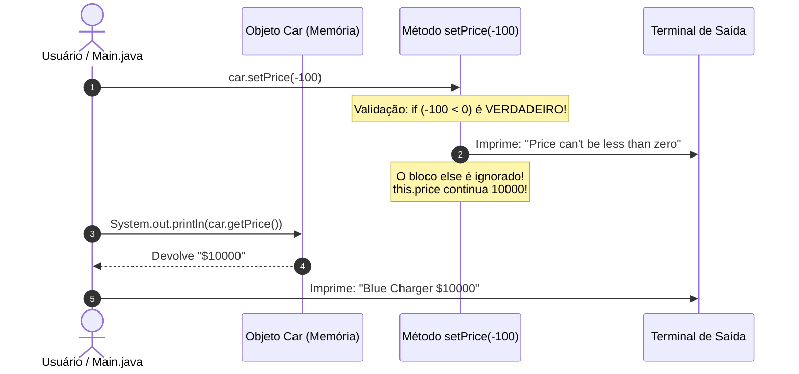

# Curso de Java — Capítulo 52 (Parte 10 - Conclusão): Getters e Setters 🔐
## O Teste da Regra de Validação com Preço Negativo e o Encerramento Triunfal do Encapsulamento

---

> [!IMPORTANT]
> **Para cópia no Google Docs:** Este documento foi especialmente formatado de forma autossuficiente e detalhada. Todos os elementos visuais das telas finais do IntelliJ IDEA (destaques de texto selecionado em azul, saídas no console em duas linhas, relatórios de execução e comentários de encerramento) foram descritos textualmente com rigor para que você possa copiar e colar todo o conteúdo no seu Google Docs sem perder o contexto das imagens originais.

---

### Links Rápidos dos Arquivos do Projeto no seu Computador
* Arquivo Principal de Testes Concluído: [`Main.java`](../../../src/main/java/com/mickaelgeronimo/mastery/core/concurrency/Main.java)
* Classe do Carro 100% Encapsulada: [`Car.java`](../../../src/main/java/com/mickaelgeronimo/mastery/core/oop/Car.java)
* Pasta Raiz do Projeto: `JAVA APRENDER`
* Guia da Parte 1 (Conceito Inicial e Acesso sem Proteção): `explicacao_getters_and_setters_definicao_e_exemplo_sem_encapsulamento_capitulo52_parte1.md`
* Guia da Parte 2 (Demonstração da Adulteração e Blindagem `private`): `explicacao_getters_and_setters_vulnerabilidade_de_acesso_direto_e_blindagem_com_private_capitulo52_parte2.md`
* Guia da Parte 3 (Os 3 Erros de Compilação e Criação dos Getters): `explicacao_getters_and_setters_os_3_erros_de_acesso_privado_e_criacao_dos_getters_capitulo52_parte3.md`
* Guia da Parte 4 (Substituição no Main e Erro de Tipos): `explicacao_getters_and_setters_substituicao_pelos_getters_execucao_com_sucesso_e_incompatibilidade_de_tipos_capitulo52_parte4.md`
* Guia da Parte 5 (Formatação com Cifrão no Preço): `explicacao_getters_and_setters_formatacao_com_cifrao_e_retorno_string_capitulo52_parte5.md`
* Guia da Parte 6 (Introdução aos Setters `setColor` e `setPrice`): `explicacao_getters_and_setters_introducao_aos_setters_setcolor_e_setprice_capitulo52_parte6.md`
* Guia da Parte 7 (O Erro de Atribuição com `=` no Setter): `explicacao_getters_and_setters_tentativa_de_acesso_direto_e_o_erro_classico_de_atribuicao_no_setter_capitulo52_parte7.md`
* Guia da Parte 8 (Atributos Somente-Leitura): `explicacao_getters_and_setters_execucao_dos_setters_e_o_poder_do_somente_leitura_read_only_capitulo52_parte8.md`
* Guia da Parte 9 (A Palavra-Chave `final` e Validação `if/else`): `explicacao_getters_and_setters_palavra_final_e_regras_de_validacao_no_setter_capitulo52_parte9.md`

---

## 1. O Que Está Acontecendo Aqui? (Visão Geral para Iniciantes Amadores)

Chegamos aos minutos finais do Capítulo 52! Nesta sequência de 4 imagens, o professor Bro Code amarra todas as pontas soltas da aula:
1. **O Teste da Trapaça (Imagem 1):** No arquivo [`Main.java`](../../../src/main/java/com/mickaelgeronimo/mastery/core/concurrency/Main.java), ele tenta sabotar o carro passando um preço negativo: `car.setPrice(-100);`.
2. **A Resposta do Console (Imagem 2):** Ao rodar o programa, a tela imprime **duas linhas**:
   * Linha 1: `Price can't be less than zero` (Aviso disparado pelo `if` do Setter!).
   * Linha 2: `Blue Charger $10000` (O preço do carro **NÃO** foi alterado para `-100`; ele continuou valendo `$10000` com segurança absoluta!).
3. **A Conexão com a Teoria (Imagem 3):** O autor seleciona no editor as palavras **`add rules`** no comentário inicial: *"Eles ajudam a proteger os dados do objeto e ADICIONAM REGRAS para acessá-los ou modificá-los"*. A regra acabou de ser comprovada na prática!
4. **O Encerramento e Recapitulação (Imagem 4):** Ele volta para [`Car.java`](../../../src/main/java/com/mickaelgeronimo/mastery/core/oop/Car.java) e seleciona em azul as três variáveis privadas (`private final String model;`, `private String color;`, `private int price;`), concluindo o capítulo com chave de ouro.



---

## 2. A Vitória Definitiva: Como o Setter Salvou o Negócio da Falência

Compare o que aconteceria nos dois cenários:

* **Cenário Sem Encapsulamento (Parte 1 e 2):**
  Se a variável fosse pública ou aberta (`car.price = -100;`), o sistema aceitaria silenciosamente o valor negativo. Se esse carro fosse para uma loja virtual, um cliente compraria o carro e o sistema transferiria 100 dólares da conta da loja para a conta do cliente!
* **Cenário Com Encapsulamento e Validação (Parte 10):**
  Ao chamar `car.setPrice(-100);`, o Setter intercepta o dado, avisa que o preço não pode ser menor que zero e **recusa** atualizar a variável. O carro permanece valendo `$10000`! O patrimônio e a consistência do sistema foram preservados.

---

## 3. Dissecando as 4 Imagens Passo a Passo

---

### 📸 Imagem 1: O Teste Malicioso com Preço Negativo (`media_1791403278079_469eb30b.png`)

#### O que se vê na interface do IntelliJ IDEA:
* **Barra de Vídeo do YouTube:** Timestamp `8:29:02 / 12:00:00`, capítulo `52. getters and setters >`.
* **Aba Ativa:** [`Main.java`](../../../src/main/java/com/mickaelgeronimo/mastery/core/concurrency/Main.java).
* **Trecho no Editor:**
  ```java
  11    car.setColor("Blue");
  12 💡 car.setPrice(-100);
  13
  14    System.out.println(car.getColor() + " " + car.getModel() + " " + car.getPrice());
  ```
* **O Detalhe Visual:**
  * Na linha 12, o autor digitou `-100` como argumento de `setPrice`.
  * O cursor do mouse está posicionado exatamente sobre o botão verde Play (`▷ Current File`) no topo superior direito da janela.
* **O Que o Autor Fará:**
  Ele vai apertar Play para ver se o Setter realmente consegue barrar uma entrada inválida.

---

### 📸 Imagem 2: O Console com a Mensagem de Defesa (`media_1791403287335_0897fef4.png`)

#### O que se vê na interface do IntelliJ IDEA:
* **Barra de Vídeo do YouTube:** Timestamp `8:29:05 / 12:00:00`.
* **Painel Inferior (Aba Run - Main):**
  * Comando executado: `openjdk-23\bin\java.exe ...`
  * **As duas linhas impressas em verde brilhante:**
    ```text
    Price can't be less than zero
    Blue Charger $10000
    ```
  * Linha final: `Process finished with exit code 0`.
* **Análise Profunda do Resultado:**
  1. **Linha 1 do Console (`Price can't be less than zero`):** Veio da linha 28 de [`Car.java`](../../../src/main/java/com/mickaelgeronimo/mastery/core/oop/Car.java) dentro do método `setPrice`. Como `-100 < 0`, o `if` disparou o alerta imediatamente!
  2. **Linha 2 do Console (`Blue Charger $10000`):** Veio da linha 14 de [`Main.java`](../../../src/main/java/com/mickaelgeronimo/mastery/core/concurrency/Main.java). Repare que a cor mudou para `Blue` com sucesso, o modelo continuou `Charger`, e o preço **permaneceu `$10000`**! Ele não virou `$-100`! A tentativa de sabotagem foi neutralizada!

---

### 📸 Imagem 3: Destacando a Frase Teórica "add rules" (`media_1791403306098_c6b7e5df.png`)

#### O que se vê na interface do IntelliJ IDEA:
* **Barra de Vídeo do YouTube:** Timestamp `8:29:18 / 12:00:00`.
* **Aba Ativa:** [`Main.java`](../../../src/main/java/com/mickaelgeronimo/mastery/core/concurrency/Main.java).
* **Trecho de Comentário Selecionado:**
  ```java
   5    // They help protect object data and add rules for accessing or modifying them.
  ```
* **O Destaque Visual:**
  * O autor usou o mouse para selecionar em azul as palavras exatas: **`add rules`**!
* **A Mensagem do Professor:**
  Ele diz aos alunos: *"Lembram quando eu escrevi no começo da aula que Getters e Setters servem para proteger os dados do objeto e ADICIONAR REGRAS para acessá-los ou modificá-los? Acabamos de ver isso com nossos próprios olhos! A regra que adicionamos foi: o preço não pode ser menor que zero!"*.

---

### 📸 Imagem 4: A Recapitulação Final da Classe [`Car.java`](../../../src/main/java/com/mickaelgeronimo/mastery/core/oop/Car.java) (`media_1791403319592_eada6098.png`)

#### O que se vê na interface do IntelliJ IDEA:
* **Aba Ativa:** Muda para [`Car.java`](../../../src/main/java/com/mickaelgeronimo/mastery/core/oop/Car.java).
* **As Três Linhas Selecionadas em Azul Escuro:**
  ```java
  3    private final String model;
  4    private String color;
  5    private int price;
  ```
* **O Que o Autor Faz Neste Momento de Encerramento:**
  Ele seleciona os três atributos com o mouse e faz o resumo supremo de todo o capítulo:
  * **`private`**: Assegura que ninguém de fora pode bisbilhotar ou alterar as variáveis diretamente.
  * **`final`**: Garante que o modelo é imutável após ser criado no construtor.
  * **`Getters`**: Fornecem acesso de leitura controlado, com o bônus de formatar os dados (como adicionar o `$`).
  * **`Setters`**: Fornecem acesso de escrita controlado, permitindo validar os dados com regras lógicas (`if/else`) antes de autorizar qualquer modificação.

---

## 4. O Código Final e Completo do Capítulo 52

### Arquivo 1: [`Car.java`](../../../src/main/java/com/mickaelgeronimo/mastery/core/oop/Car.java) (Obra-Prima do Encapsulamento)

```java
 1 public class Car {
 2 
 3     private final String model;
 4     private String color;
 5     private int price;
 6 
 7     Car(String model, String color, int price){
 8         this.model = model;
 9         this.color = color;
10         this.price = price;
11     }
12 
13     String getModel(){
14         return this.model;
15     }
16 
17     String getColor(){
18         return this.color;
19     }
20 
21     String getPrice(){
22         return "$" + this.price;
23     }
24 
25     void setColor(String color){
26         this.color = color;
27     }
28 
29     void setPrice(int price){
30         if(price < 0){
31             System.out.println("Price can't be less than zero");
32         }
33         else{
34             this.price = price;
35         }
36     }
37 }
```

#### Tabela Linha por Linha de [`Car.java`](../../../src/main/java/com/mickaelgeronimo/mastery/core/oop/Car.java):

| Linha | Código em Java | Explicação Detalhada para Leigo Absoluto | O Que Sai no Console? |
| :---: | :--- | :--- | :--- |
| **1** | `public class Car {` | Molde do objeto carro. | Nada |
| **3** | `private final String model;` | Modelo protegido com `private` e gravado em pedra com `final`. | Nada |
| **4** | `private String color;` | Cor protegida com `private`. | Nada |
| **5** | `private int price;` | Preço numérico protegido com `private`. | Nada |
| **7-11**| `Car(...) { ... }` | Construtor que recebe os dados de fábrica e inicializa o carro. | Nada |
| **13-15**| `String getModel() { return this.model; }` | Getter do modelo: leitura somente (*Read-Only*). | Nada |
| **17-19**| `String getColor() { return this.color; }` | Getter da cor: leitura da cor atual. | Nada |
| **21-23**| `String getPrice() { return "$" + this.price; }` | Getter do preço: formata com cifrão e entrega como texto. | Nada |
| **25-27**| `void setColor(String color) { this.color = color; }` | Setter da cor: atualiza a cor do carro para a nova cor informada. | Nada |
| **29** | `void setPrice(int price){` | Setter do preço: recebe o novo valor sugerido. | Nada |
| **30** | `if(price < 0){` | Testa se o valor recebido é inválido (negativo). | Nada |
| **31** | `System.out.println("Price can't be less than zero");` | Imprime a bronca de segurança no console se o valor for negativo. | `Price can't be less than zero` (quando acionado) |
| **32** | `}` | Fecha o `if`. | Nada |
| **33** | `else{` | Ramo seguro: acionado quando o preço é maior ou igual a zero. | Nada |
| **34** | `this.price = price;` | Atualiza a variável interna com o preço válido. | Nada |
| **35** | `}` | Fecha o `else`. | Nada |
| **36** | `}` | Fecha o método `setPrice`. | Nada |
| **37** | `}` | Fecha a classe `Car`. | Nada |

---

### Arquivo 2: [`Main.java`](../../../src/main/java/com/mickaelgeronimo/mastery/core/concurrency/Main.java) (Arquivo de Testes e Demonstração)

```java
 1 public class Main {
 2     public static void main(String[] args) {
 3 
 4         // They help protect object data and add rules for accessing or modifying them.
 5         // GETTERS = Methods that make a field READABLE.
 6         // SETTERS = Methods that make a field WRITEABLE.
 7 
 8         Car car = new Car("Charger", "Yellow", 10000);
 9 
10         car.setColor("Blue");
11         car.setPrice(-100);
12 
13         System.out.println(car.getColor() + " " + car.getModel() + " " + car.getPrice());
14     }
15 }
```

| Linha | Código em Java | Explicação do Fluxo | O Que Sai no Console? |
| :---: | :--- | :--- | :--- |
| **8** | `Car car = new Car("Charger", "Yellow", 10000);` | Cria o carro com modelo `"Charger"`, cor `"Yellow"` e preço `10000`. | Nada |
| **10** | `car.setColor("Blue");` | Pinta o carro de `"Blue"` com sucesso. | Nada |
| **11** | `car.setPrice(-100);` | Tenta colocar `-100`. O Setter rejeita e imprime a bronca! | `Price can't be less than zero` |
| **13** | `System.out.println(...)` | Consulta os Getters: cor é `"Blue"`, modelo é `"Charger"`, preço continuou `"$10000"`. | `Blue Charger $10000` |

---

## 5. Resumo Supremo: Os 4 Mandamentos do Encapsulamento em Java

```
┌────────────────────────────────────────────────────────────────────────┐
│                        ENCAPSULAMENTO EM JAVA                          │
├────────────────────────────────────────────────────────────────────────┤
│ 1. Tranque as portas com 'private':                                    │
│    Nenhum atributo deve ser acessível diretamente de fora.             │
│                                                                        │
│ 2. Use 'final' para constantes de fábrica:                             │
│    Se o dado não pode mudar nunca mais, use 'private final'.           │
│                                                                        │
│ 3. Crie GETTERS para dar visibilidade:                                 │
│    Métodos públicos que devolvem o valor (e podem formatar como '$').  │
│                                                                        │
│ 4. Crie SETTERS para dar controle com validação:                       │
│    Métodos públicos que recebem novos valores e usam 'if/else'         │
│    para impedir dados podres de entrar no seu objeto!                  │
└────────────────────────────────────────────────────────────────────────┘
```

---

## 6. O Que o Console Exibiu ao Todo

```text
Price can't be less than zero
Blue Charger $10000
Process finished with exit code 0
```

Com isso, o **Capítulo 52 (`getters and setters 🔐`)** está 100% concluído, dominado e pronto para o seu Google Docs! 🎉
