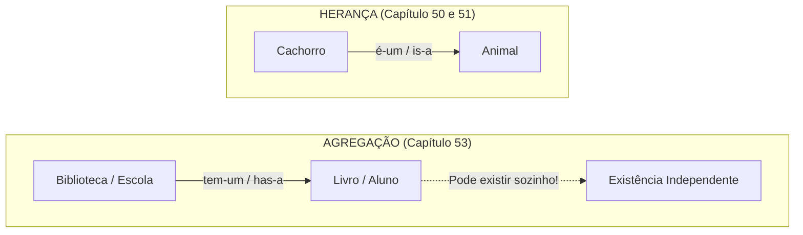

# Curso de Java — Capítulo 53 (Parte 1): Agregação 🏫
## Introdução Conceitual, o Relacionamento *"has-a"* (*tem-um*) e a Existência Independente

---

> [!IMPORTANT]
> **Para cópia no Google Docs:** Este documento foi especialmente elaborado de forma autossuficiente e detalhada. Todos os elementos visuais da tela do IntelliJ IDEA (árvore do projeto limpa, aba única ativa, posicionamento do cursor e linhas de comentários conceituais) foram descritos textualmente com rigor para que você possa copiar e colar todo o conteúdo no seu Google Docs sem perder o contexto da imagem original.

---

### Links Rápidos dos Arquivos do Projeto no seu Computador
* Arquivo Principal com a Definição: [`Main.java`](../../../src/main/java/com/mickaelgeronimo/mastery/core/concurrency/Main.java)
* Pasta Raiz do Projeto: `JAVA APRENDER`
* Guia de Conclusão do Capítulo Anterior (Capítulo 52 - Parte 10: Getters e Setters): `explicacao_getters_and_setters_teste_de_validacao_regras_de_negocio_e_conclusao_capitulo52_parte10.md`

---

## 1. Bem-vindo ao Capítulo 53: Agregação 🏫 (`aggregation`)

Entramos em um novo e importantíssimo capítulo da Orientação a Objetos em Java!

Nas aulas passadas, você aprendeu:
* Como criar classes e instanciar objetos (`new`).
* Como herdar características usando **Herança** (`extends`).
* Como proteger dados usando **Encapsulamento** (`private`, `getters` e `setters`).

Agora, o professor Bro Code começa a ensinar **COMO OS OBJETOS SE CONECTAM E SE RELACIONAM ENTRE SI**.

Nesta primeira imagem de abertura do capítulo:
1. **Limpeza do Projeto:** O arquivo [`Car.java`](../../../src/main/java/com/mickaelgeronimo/mastery/core/oop/Car.java) do capítulo anterior foi apagado. Na pasta `src`, existe apenas o arquivo [`Main.java`](../../../src/main/java/com/mickaelgeronimo/mastery/core/concurrency/Main.java).
2. **O Conceito em Destaque:** O autor não digitou código executável ainda. Ele escreveu três linhas de comentário fundamentais que resumem a teoria de **Agregação**.

```text
// Aggregation = Represents a "has-a" relationship between objects.
//               One object contains another object as part of its structure,
//               but the contained object/s can exist independently.
```

**Tradução direta e simples para iniciantes:**
> *"Agregação = Representa um relacionamento do tipo 'TEM-UM' ('has-a') entre objetos.*
> *Um objeto contém outro objeto como parte da sua estrutura,*
> *mas o(s) objeto(s) que estão dentro dele podem existir de forma INDEPENDENTE."*



---

## 2. A Diferença Crucial: *"is-a"* (*é-um*) vs *"has-a"* (*tem-um*)

Para entender programação orientada a objetos de verdade, você só precisa memorizar duas perguntas em inglês que os arquitetos de software fazem todos os dias:

### 1. Relacionamento *"is-a"* (*É-UM*) ➔ Herança (`extends`)
* Um Cachorro **É-UM** Animal? **Sim!** Então `Dog extends Animal`.
* Um Carro **É-UM** Veículo? **Sim!** Então `Car extends Vehicle`.
* Um Aluno **É-UMA** Escola? **NÃO!** Aluno não é escola! Então Aluno **NÃO HERDA** de Escola!

### 2. Relacionamento *"has-a"* (*TEM-UM*) ➔ Agregação / Composição
* Uma Escola **TEM-UM** Aluno? **Sim!**
* Uma Biblioteca **TEM-UM** Livro? **Sim!**
* Um Carro **TEM-UM** Motor? **Sim!**
* Um Restaurante **TEM-UM** Chefe de Cozinha? **Sim!**

Quando um objeto **TEM** outro objeto guardado dentro de uma variável, chamamos isso de **Associação**. E quando o objeto de dentro pode viver sozinho, chamamos de **AGREGAÇÃO**!

---

## 3. O Detalhe de Ouro: Por Que "Existência Independente"?

Observe atentamente a terceira linha escrita pelo autor:
> *"but the contained object/s can exist independently"*
> *(mas o(s) objeto(s) contido(s) podem existir de forma independente)*

Esse é o teste infalível para saber se algo é uma **Agregação**:

### 🏫 Exemplo 1: Escola e Alunos (O Emoji do Vídeo!)
* Imagine uma Escola (`School`) que tem 500 Alunos (`Student`).
* O objeto `School` tem uma lista ou um array de objetos `Student`.
* **Agora imagine que a Escola faliu, fechou as portas ou foi demolida:**
  * Os alunos deixam de existir? Morrem junto com o prédio? **CLARO QUE NÃO!**
  * Os alunos continuam vivos, vão para casa, estudam sozinhos ou se matriculam em outra escola!
  * **Conclusão:** Os alunos existem de forma **independente** da escola. Isso é **Agregação**!

### 📚 Exemplo 2: Biblioteca e Livros
* Uma Biblioteca (`Library`) guarda 10.000 Livros (`Book`).
* Se a biblioteca pegar fogo e for destruída:
  * Um livro que você pegou emprestado e está na sua estante em casa continua existindo perfeitamente!
  * **Conclusão:** O Livro não morre só porque a Biblioteca deixou de existir. Isso é **Agregação**!

### 💔 E o que NÃO seria independente? (Composição Forte)
* Pense em um **Humano** e um **Coração**. Se o corpo humano for destruído, o coração não sai andando sozinho pela rua vivendo a vida dele. O coração depende 100% da vida daquele corpo. Quando o ciclo de vida depende 100% do pai, chamamos de **Composição**.
* Na **Agregação**, os objetos são parceiros independentes!

---

## 4. Dissecando a Imagem da Aula Passo a Passo (`media_1791403422684_c42ae300.png`)

### O que se vê na interface do IntelliJ IDEA:
* **Árvore de Projeto à Esquerda:**
  * Projeto: `MyFirstProject`
  * Pastas: `.idea`, `out`, `src`
  * Arquivos dentro de `src`: Apenas [`Main.java`](../../../src/main/java/com/mickaelgeronimo/mastery/core/concurrency/Main.java) (o arquivo `Car.java` foi removido para iniciar o novo capítulo limpo).
* **Aba Ativa no Editor:** [`Main.java`](../../../src/main/java/com/mickaelgeronimo/mastery/core/concurrency/Main.java) (única aba aberta).
* **Código no Editor (Linhas 1 a 10):**
  ```java
   1    public class Main {
   2 ▷      public static void main(String[] args) {
   3 ▷
   4
   5            // Aggregation = Represents a "has-a" relationship between objects.
   6            //               One object contains another object as part of its structure,
   7            //               but the contained object/s can exist independently.
   8
   9        }
  10    }
  ```
* **Posição do Cursor:** O cursor de texto vertical está piscando na linha 5 exatamente entre a letra `a` e a primeira aspa de `"has-a"`:
  `// Aggregation = Represents a|"has-a" relationship between objects.`
* **Barra de Status Inferior:** `5:38 LF UTF-8 4 spaces`.
* **Painel Inferior:** O painel de execução (Run) está recolhido/fechado, pois o autor ainda não executou nenhum comando; ele está apenas preparando a mente do aluno para os conceitos teóricos.

---

## 5. Análise Linha por Linha do Arquivo [`Main.java`](../../../src/main/java/com/mickaelgeronimo/mastery/core/concurrency/Main.java)

```java
 1 public class Main {
 2     public static void main(String[] args) {
 3 
 4 
 5         // Aggregation = Represents a "has-a" relationship between objects.
 6         //               One object contains another object as part of its structure,
 7         //               but the contained object/s can exist independently.
 8 
 9     }
10 }
```

| Linha | Código / Comentário | Explicação Detalhada para Leigo Absoluto | O Que Sai no Console? |
| :---: | :--- | :--- | :--- |
| **1** | `public class Main {` | Declaração da classe principal do projeto Java. | Nada |
| **2** | `public static void main(String[] args) {` | Método principal onde o programa começará a ser executado quando clicarmos em rodar. | Nada |
| **3** | *(linha vazia)* | Espaçamento para legibilidade. | Nada |
| **4** | *(linha vazia)* | Espaçamento para separar a assinatura do método dos comentários. | Nada |
| **5** | `// Aggregation = Represents a "has-a"...` | Comentário conceitual: *"Agregação representa uma relação do tipo 'TEM-UM' entre objetos"*. | Nada |
| **6** | `// One object contains another...` | Comentário conceitual: *"Um objeto contém outro objeto como parte de sua estrutura interna..."*. | Nada |
| **7** | `// but the contained object/s can...` | Comentário conceitual: *"...mas o(s) objeto(s) contidos podem existir de forma totalmente independente"*. | Nada |
| **8** | *(linha vazia)* | Espaço em branco reservado para onde o autor digitará o código prático. | Nada |
| **9** | `}` | Fecha o bloco do método `main`. | Nada |
| **10** | `}` | Fecha o bloco da classe `Main`. | Nada |

---

## 6. O Que o Autor Fará nas Próximas Cenas?

Para demonstrar a Agregação na prática em Java, o professor Bro Code criará **pelo menos duas classes separadas**:
1. Uma classe para representar o **objeto menor / contido** (por exemplo, `Book` com título e número de páginas, ou `Student` com nome e matrícula).
2. Uma classe para representar o **objeto maior / agregador** (por exemplo, `Library` ou `School`), que terá uma variável ou array para guardar os objetos menores dentro de si.
3. No [`Main.java`](../../../src/main/java/com/mickaelgeronimo/mastery/core/concurrency/Main.java), ele instanciará os objetos menores primeiro de forma independente, e depois passará esses objetos para dentro do objeto maior através do construtor ou de um método!

Isso provará com código real que os objetos menores nascem fora e continuam existindo mesmo se o objeto maior for descartado!
