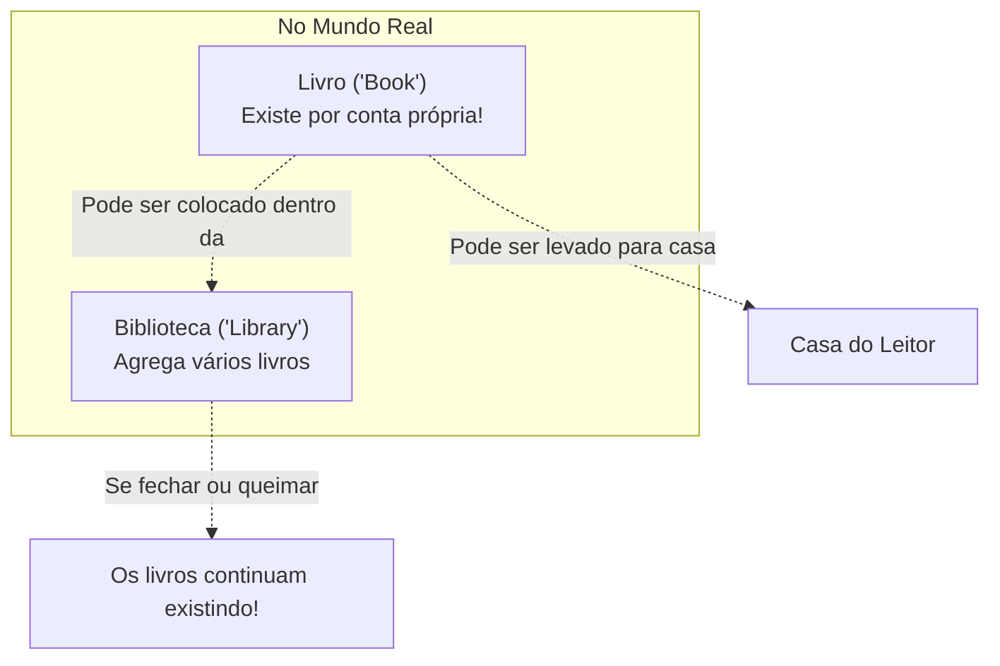
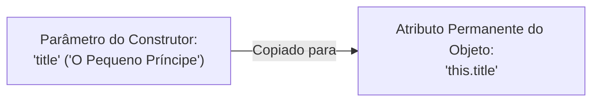

# Curso de Java — Capítulo 53 (Parte 2): Agregação 🏫
## Criação da Classe Independente `Book`, Atributos, Construtor com `this` e o Método `displayInfo()`

---

> [!IMPORTANT]
> **Para cópia no Google Docs:** Este documento foi especialmente estruturado para ser 100% autossuficiente e visualmente descritivo. Todas as 5 imagens capturadas do vídeo do Bro Code (janela modal de criação de classe, árvore do projeto, abas do editor, cursor e linhas de código em digitação) estão detalhadamente reconstituídas em texto. Você pode copiar e colar este material diretamente no seu Google Docs sem perder nenhuma informação.

---

### Links Rápidos dos Arquivos do Projeto no seu Computador
* Classe do Livro: `Book.java`
* Classe da Biblioteca: `Library.java`
* Arquivo Principal: [`Main.java`](../../../src/main/java/com/mickaelgeronimo/mastery/core/concurrency/Main.java)
* Pasta Raiz do Projeto: `JAVA APRENDER`
* Parte Anterior (Capítulo 53 - Parte 1: Conceito Teórico): `explicacao_agregacao_definicao_relacionamento_has_a_e_existencia_independente_capitulo53_parte1.md`

---

## 1. Reconstituição Detalhada das 5 Telas da IDE IntelliJ IDEA

Abaixo está o registro exato do que aconteceu na tela do professor ao longo da sequência de imagens:

```
+----------------------------------------------------------------------------------------------------+
|                                    SEQUÊNCIA DE TELAS NO VÍDEO                                      |
+----------------------------------------------------------------------------------------------------+
| IMAGEM 1: Tela inicial com Main.java aberto. O cursor pisca na linha 5 sobre o comentário          |
|           "// Aggregation = Represents a 'has-a' relationship between objects."                    |
|                                                                                                    |
| IMAGEM 2: Criação do novo arquivo no IntelliJ.                                                      |
|           • Modal suspensa: "New Java Class"                                                       |
|           • Texto digitado: "B" (com a opção 'Class' selecionada na cor azul)                      |
|           • Legenda gigante no vídeo: "Book"                                                       |
|                                                                                                    |
| IMAGEM 3: Zoom no cabeçalho das abas do editor.                                                    |
|           • Abas visíveis: [Main.java] | [Book.java (ativa)] | [Library.java]                      |
|           • Linha 1 de Book.java: "public class Book {"                                            |
|                                                                                                    |
| IMAGEM 4: Definição dos atributos e casca do construtor em Book.java.                              |
|           • Atributos digitados: String title; e int pages;                                        |
|           • Construtor vazio: Book(){ }                                                            |
|           • Cursor posicionado exatamente entre os parênteses: Book(|){                            |
|                                                                                                    |
| IMAGEM 5: Construtor finalizado e digitação do método displayInfo().                               |
|           • Construtor preenchido: Book(String title, int pages){ ... }                            |
|           • Linha 12: "return this.title + " " + this.pages"                                       |
|           • Erro de sintaxe em tempo real: Cobrinha vermelha sob o cursor na linha 12              |
|             porque o professor ainda está digitando e não colocou o ponto e vírgula (;).           |
+----------------------------------------------------------------------------------------------------+
```

---

## 2. Por Que Começamos Criando a Classe `Book` (Livro)?

Na aula anterior, aprendemos a regra de ouro da **Agregação**:
> *"Um objeto contém outro objeto como parte da sua estrutura, **mas o objeto contido pode existir independentemente**."*



* Uma biblioteca (**`Library`**) possui livros (**`Book`**).
* Mas o livro **não precisa** de uma biblioteca para existir. Ele pode ser impresso, vendido numa livraria, guardado na sua mochila ou lido debaixo de uma árvore.
* Por isso, na programação orientada a objetos, **começamos modelando a entidade independente (`Book`)**. Depois que o livro estiver pronto, criaremos a biblioteca que vai guardar e gerenciar uma coleção desses livros!

---

## 3. O Código Completo de `Book.java`

Aqui está o código completo da classe `Book.java` que criamos no seu computador:

```java
public class Book {

    String title;
    int pages;

    Book(String title, int pages){
        this.title = title;
        this.pages = pages;
    }

    String displayInfo(){
        return this.title + " " + this.pages;
    }

}
```

---

## 4. Explicação Linha por Linha para Iniciantes Amadores

Vamos dissecar cada linha como se você estivesse vendo Java pela primeira vez. Não se preocupe se achar muita coisa: a Orientação a Objetos repete esses mesmos padrões sempre!

| Linha | Código em `Book.java` | Para que serve? O que significa? (Explicação Amigável) |
| :---: | :--- | :--- |
| **01** | `public class Book {` | **A Certidão de Criação do Molde:** Avisa ao Java: *"Crie uma fôrma chamada `Book` (Livro)"*. Qualquer arquivo do nosso projeto poderá ver e usar essa fôrma (`public`). A chave `{` abre a receita do bolo. |
| **02** | *(linha em branco)* | Espaço visual para deixar o código limpo e fácil de ler. |
| **03** | `    String title;` | **Atributo 1 (Título):** Todo livro no mundo precisa de um título (nome). Criamos uma gaveta na memória do tipo texto (`String`) chamada `title`. Repare que não demos valor fixo ainda; cada livro terá o seu próprio título! |
| **04** | `    int pages;` | **Atributo 2 (Páginas):** Todo livro tem uma quantidade de páginas. Criamos uma gaveta na memória do tipo número inteiro (`int`) chamada `pages`. |
| **05** | *(linha em branco)* | Espaço em branco para separar os atributos do construtor. |
| **06** | `    Book(String title, int pages){` | **O Construtor (Ritual de Nascimento):** Tem exatamente o mesmo nome da classe (`Book`). É a função que roda no momento exato em que você digita `new Book(...)`. Ele exige que, ao nascer, você informe duas coisas: um texto (`title`) e um número (`pages`). |
| **07** | `        this.title = title;` | **A Placa de Posse do Objeto:** `this.title` significa: *"O atributo `title` DESTE objeto que está nascendo agora"*. O `= title` significa: *"Receba o texto que o usuário acabou de digitar entre parênteses"*. Sem o `this`, o Java ficaria confuso sobre qual `title` é qual! |
| **08** | `        this.pages = pages;` | **Guardando as Páginas:** O mesmo processo: *"Pegue o número de páginas que o usuário digitou e guarde no atributo `pages` DESTE livro que acabou de nascer"*. |
| **09** | `    }` | **Fechamento do Construtor:** Encerra a lógica de nascimento do livro. A partir daqui, o objeto livro está pronto e com as gavetas cheias na memória. |
| **10** | *(linha em branco)* | Espaço para separar o construtor dos métodos normais. |
| **11** | `    String displayInfo(){` | **O Método de Exibição:** Um método é uma ação que o livro sabe fazer. O nome dele é `displayInfo` (*exibir informações*). O `String` antes do nome avisa: *"Eu não vou imprimir direto na tela; eu vou DEVOLVER um texto pronto para quem me chamar"*. Os parênteses vazios `()` indicam que ele não precisa de nenhuma informação de fora para funcionar. |
| **12** | `        return this.title + " " + this.pages;` | **A Montagem do Texto (Concatenação):** A palavra `return` joga o resultado para fora do método. Ele junta: o título do livro (`this.title`) + um espaço em branco no meio (`" "`) + o número de páginas (`this.pages`). O Java é inteligente e converte o número `int` para texto automaticamente ao usar o sinal `+`! |
| **13** | `    }` | **Fechamento do Método:** Encerra o método `displayInfo()`. |
| **14** | `}` | **Fechamento da Classe:** Encerra o molde `Book`. |

---

## 5. Detalhes Cruciais das Telas

### A) A Janela "New Java Class" (Imagem 2)
Quando você quer criar um novo tipo de objeto no IntelliJ IDEA:
1. Você clica com o botão direito na pasta `src` -> `New` -> `Java Class`.
2. O IntelliJ abre uma caixinha preta flutuante.
3. Você digita o nome com a **primeira letra maiúscula** (Convenção CamelCase: `Book`, `Library`, `Car`, `Student`).
4. Pressiona `Enter` e o IntelliJ cria o arquivo `.java` com a casca inicial pronta (`public class Book { }`).

```
+-----------------------------------+
| New Java Class                    |
| B|                                |
|  [C] Class            (selecionado)|
|  (I) Interface                    |
|  (R) Record                       |
|  (E) Enum                         |
+-----------------------------------+
```

---

### B) A Função Vital da Palavra-Chave `this` (Imagens 4 e 5)

Imagine que você tem dois gêmeos chamados `title`.
* Um é o atributo da classe (lá em cima na linha 3: `String title;`).
* O outro é o parâmetro temporário do construtor (na linha 6: `Book(String title, ...)`).

Se você escrevesse apenas:
```java
title = title; // O Java não sabe se você está guardando na classe ou na variável local!
```
Isso causaria o que chamamos de *Shadowing* (a variável local faz sombra sobre o atributo da classe e nada é salvo).

Para resolver isso, usamos o **`this`**:
```java
this.title = title;
// ^^^^         ^^^^
// ||||         Variável temporária que veio entre os parênteses
// Atributo permanente do objeto gravado na memória
```



---

### C) Por Que Havia uma Cobrinha Vermelha na Imagem 5?

Na Imagem 5, na linha 12, você vê uma ondulação vermelha (*red squiggly line*) bem debaixo do cursor, logo após `this.pages`:
```java
return this.title + " " + this.pages|
                                    ~ (erro: esperava ';')
```
**O que significa?**
* Em Java, **toda instrução deve terminar obrigatoriamente com ponto e vírgula (`;`)**.
* O professor Bro Code tirou a foto da tela enquanto ainda estava digitando a linha de código!
* Se você tentar compilar o código enquanto falta o ponto e vírgula, o compilador do Java (`javac`) rejeita o arquivo imediatamente com a seguinte mensagem de erro:

```text
Book.java:12: error: ';' expected
        return this.title + " " + this.pages
                                            ^
1 error
```
Assim que você adiciona o ponto e vírgula `;` no final da linha 12, o erro desaparece instantaneamente e o código se torna 100% válido.

---

## 6. O Que Sai no Console Neste Momento?

### Teste 1: Executando o Projeto Como Está Agora
Se abrirmos o terminal e rodarmos o comando para compilar e executar o [`Main.java`](../../../src/main/java/com/mickaelgeronimo/mastery/core/concurrency/Main.java):

```bash
javac Book.java Library.java Main.java
java Main
```

**Saída Exata no Console:**
```text
(Nenhuma saída é exibida. O terminal fica em branco e volta para o prompt de comando).
```

**Por que não sai nada?**
Porque o método `main` dentro de [`Main.java`](../../../src/main/java/com/mickaelgeronimo/mastery/core/concurrency/Main.java) ainda contém apenas comentários explicativos. Nós construímos o molde do livro (`Book.java`), mas ainda não fabricamos nenhum livro de verdade dentro do `main` com `new Book(...)` e nem mandamos imprimir com `System.out.println()`.

---

### Teste 2: O Que o Método `displayInfo()` Vai Produzir Quando Usarmos? (Demonstração Prévia)

Para você entender o que esse método `displayInfo()` faz nos bastidores, veja o que acontece se criarmos um livro de teste no `main`:

```java
Book book1 = new Book("Harry Potter", 223);
System.out.println(book1.displayInfo());
```

1. O construtor roda: guarda `"Harry Potter"` em `this.title` e `223` em `this.pages`.
2. O método `displayInfo()` junta as partes:
   `"Harry Potter"` + `" "` + `223`
3. Ele devolve o texto: `"Harry Potter 223"`.
4. O `System.out.println()` imprime na tela do console:

```text
Harry Potter 223
```

---

## 7. Resumo da Ópera (Para Guardar na Mente)

1. **Agregação** começa criando o objeto que tem vida própria. Criamos a classe `Book.java`.
2. O livro possui duas características: título (`String title`) e total de páginas (`int pages`).
3. O construtor `Book(String title, int pages)` recebe esses dados de fora e os grava na memória do livro usando a palavra-chave **`this`**.
4. O método `displayInfo()` retorna uma frase unindo o título e o número de páginas.
5. Também já deixamos criado o arquivo `Library.java` vazio no seu computador, exatamente como o professor fez, aguardando os próximos passos onde conectaremos a biblioteca aos livros!
