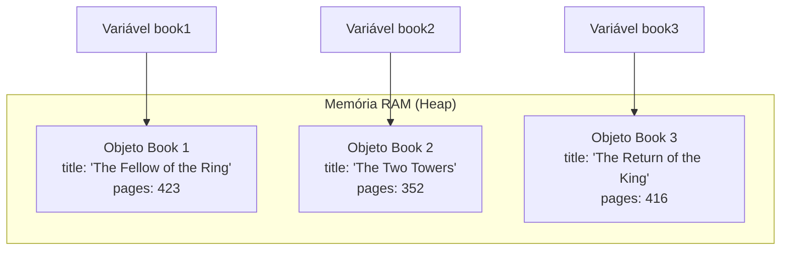
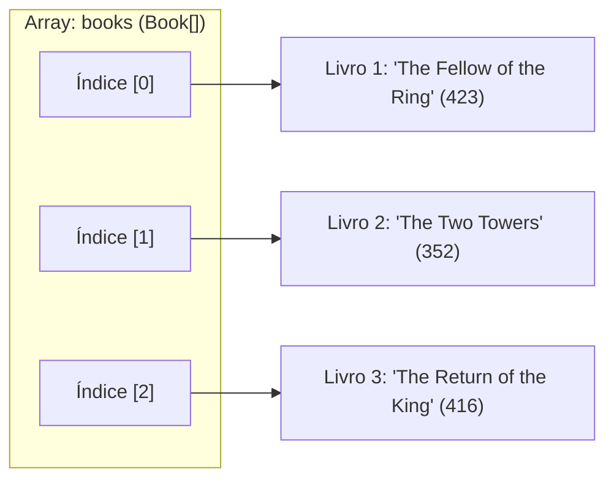

# Curso de Java — Capítulo 53 (Parte 3): Agregação 🏫
## O Erro do Construtor Vazio, Instanciação dos Livros, Array de Objetos (`Book[]`) e Teste do `displayInfo()`

---

> [!IMPORTANT]
> **Para cópia no Google Docs:** Este documento foi estruturado de maneira 100% autossuficiente e rica em detalhes visuais. Todas as 5 imagens capturadas do vídeo do Bro Code (o erro de compilação do construtor sem argumentos, a correção com os 3 livros da trilogia *O Senhor dos Anéis*, a montagem do array de objetos e o console de execução em verde) foram minuciosamente descritas em texto para que você possa copiar e colar tudo no seu Google Docs sem perder o contexto da aula original.

---

### Links Rápidos dos Arquivos do Projeto no seu Computador
* Arquivo Principal Executado: [`Main.java`](../../../src/main/java/com/mickaelgeronimo/mastery/core/concurrency/Main.java)
* Classe do Livro Atualizada: `Book.java`
* Classe da Biblioteca (Pronta para os próximos passos): `Library.java`
* Pasta Raiz do Projeto: `JAVA APRENDER`
* Parte Anterior (Capítulo 53 - Parte 2: Criação da Classe Book): `explicacao_agregacao_criacao_da_classe_book_atributos_construtor_e_displayinfo_capitulo53_parte2.md`

---

## 1. Reconstituição Detalhada das 5 Telas da IDE IntelliJ IDEA

Abaixo está o registro cronológico exato do que aconteceu na tela do professor ao longo das 5 capturas:

```
+----------------------------------------------------------------------------------------------------+
|                                    SEQUÊNCIA DE TELAS NO VÍDEO                                      |
+----------------------------------------------------------------------------------------------------+
| IMAGEM 1: Tentativa de instanciar sem argumentos em Main.java.                                      |
|           • Linha 9 digitada: "Book book1 = new Book();"                                           |
|           • ERRO DE COMPILAÇÃO VISÍVEL: Cobrinha vermelha sob "Book()" e ícone de lâmpada/erro      |
|             vermelho na calha esquerda (gutter).                                                   |
|           • Motivo: A classe Book exige (String title, int pages). Não existe Book() vazio!        |
|           • Indicador de problemas no topo direito: 1 erro vermelho [ 1 ].                         |
|                                                                                                    |
| IMAGEM 2: Correção da linha 9 e adição do segundo livro (linha 10).                                 |
|           • Linha 9:  Book book1 = new Book("The Fellow of the Ring", 423);                        |
|           • Linha 10: Book book2 = new Book("The Two Towers", 352);                                |
|           • O erro vermelho sumiu completamente! Código válido. Cursor no fim da linha 10.         |
|                                                                                                    |
| IMAGEM 3: Criação do terceiro livro e do Array de Livros (Timestamp: 8:33:10).                     |
|           • Linha 11: Book book3 = new Book("The Return of the King", 416);                        |
|           • Linha 12: (em branco)                                                                  |
|           • Linha 13: Book[] books = {book1, book2, book3};                                        |
|           • Cursor na linha 14 aguardando o próximo comando.                                       |
|                                                                                                    |
| IMAGEM 4: Chamada do método de exibição no console (Timestamp: 8:33:21).                           |
|           • Linha 15: System.out.println(book1.displayInfo());                                     |
|           • Cursor posicionado dentro dos parênteses de displayInfo().                             |
|                                                                                                    |
| IMAGEM 5: Execução do programa e saída no terminal (Timestamp: 8:33:24).                           |
|           • Painel inferior aberto: Run > Main                                                     |
|           • Linha de comando: C:\Users\HP\.jdks\openjdk-23\bin\java.exe ...                        |
|           • Texto impresso em verde no console:                                                    |
|             The Fellow of the Ring (423) pages                                                     |
|           • Mensagem de conclusão: Process finished with exit code 0                               |
+----------------------------------------------------------------------------------------------------+
```

---

## 2. O Grande Ensinamento da Imagem 1: Por Que `new Book()` Deu Erro?

Na **Imagem 1**, o professor digitou:
```java
Book book1 = new Book(); // ❌ ERRO DE COMPILAÇÃO!
```

E o IntelliJ sublinhou `Book()` com uma linha ondulada vermelha e colocou uma lâmpada vermelha na lateral.

```
       calha (gutter)
          |
Linha 9: [💡!]  Book book1 = new Book();
                                 ~~~~~~
                                 (Erro: construtor não encontrado)
```

### A Explicação "Para Lezado / Iniciante":
No Java, existe uma regra sagrada sobre construtores:
1. Se você **NÃO cria** nenhum construtor na sua classe, o Java cria um "construtor invisível e vazio" para você nos bastidores: `Book() { }`.
2. Mas, se você **CRIA** um construtor personalizado (como nós fizemos na Parte 2: `Book(String title, int pages)`), o Java diz:
   > *"Opa! O programador definiu uma regra clara: para um livro nascer, é OBRIGATÓRIO informar um título e um número de páginas. Por causa disso, eu destruo o construtor vazio padrão!"*

Se tentássemos rodar o código com `new Book()`, o compilador `javac` cuspiria este erro no terminal:

```text
Main.java:9: error: constructor Book in class Book cannot be applied to given types;
        Book book1 = new Book();
                     ^
  required: String,int
  found:    no arguments
  reason: actual and formal argument lists differ in length
1 error
```

**Tradução do erro:**
> *"Ei, programador! O construtor `Book` exige um `String` e um `int` (`required: String,int`), mas você não me passou argumento nenhum (`found: no arguments`). Não sei como fabricar um livro sem nome e sem páginas!"*

---

## 3. A Correção: Fabricando os 3 Livros de "O Senhor dos Anéis" (Imagens 2 e 3)

Para consertar o erro, o professor passou os dados exigidos pelo construtor de cada livro:

```java
Book book1 = new Book("The Fellow of the Ring", 423);
Book book2 = new Book("The Two Towers", 352);
Book book3 = new Book("The Return of the King", 416);
```

*(Curiosidade: O professor digitou `"The Fellow of the Ring"` abreviando o clássico `"The Fellowship of the Ring"` / "A Sociedade do Anel")*.

### O Que Acontece na Memória do Computador?
Foram criados 3 objetos independentes flutuando na memória RAM (memória Heap):



> [!NOTE]
> **Conexão com a Agregação:**
> Repare que esses 3 livros foram criados **antes** de qualquer biblioteca existir!
> Eles estão vivos, prontos, ocupando espaço na memória. Isso é a prova viva da frase da aula 1:
> *"the contained object/s can exist independently"* (os objetos contidos podem existir de forma independente).

---

## 4. O Que É o Array de Livros? (Linha 13 da Imagem 3)

Na linha 13, o autor escreveu:
```java
Book[] books = {book1, book2, book3};
```

### O que isso significa para um iniciante?
* `Book`: É o tipo de dado (não é `int`, nem `String`, é o molde `Book`).
* `[]`: Os colchetes significam **ARRAY** (uma prateleira / lista de tamanho fixo).
* `books`: É o nome da variável que segura a prateleira.
* `{book1, book2, book3}`: São os 3 livros que colocamos dentro dessa prateleira, nas posições `[0]`, `[1]` e `[2]`.



**Por que o professor criou esse array?**
Porque uma biblioteca (`Library`) guarda uma coleção de livros! Nos próximos passos, vamos entregar esse array `books` para a biblioteca agregar dentro dela!

---

## 5. O Teste de Exibição e o Ajuste do `displayInfo()` (Imagens 4 e 5)

Na **Imagem 4**, o professor chamou:
```java
System.out.println(book1.displayInfo());
```

E na **Imagem 5**, o console exibiu:
```text
The Fellow of the Ring (423) pages
```

### Como a Frase Foi Montada?
Para o texto sair exatamente no formato `The Fellow of the Ring (423) pages`, a linha 12 dentro de `Book.java` junta as peças com parênteses em volta do número:

```java
String displayInfo(){
    return this.title + " (" + this.pages + ") pages";
}
```

Vamos acompanhar a matemática dos textos (concatenação):
1. `this.title` vale `"The Fellow of the Ring"`.
2. Junta com `" ("` ➔ `"The Fellow of the Ring ("`.
3. Junta com `this.pages` (`423`) ➔ `"The Fellow of the Ring (423"`.
4. Junta com `") pages"` ➔ `"The Fellow of the Ring (423) pages"`.
5. O `return` entrega essa frase completa para o `System.out.println()`.
6. O `println` cospe o texto na tela preta do console!

---

## 6. O Código Completo dos Arquivos Atualizados no seu Computador

### Arquivo 1: [`Main.java`](../../../src/main/java/com/mickaelgeronimo/mastery/core/concurrency/Main.java)

```java
public class Main {
    public static void main(String[] args) {

        // Aggregation = Represents a "has-a" relationship between objects.
        //               One object contains another object as part of its structure,
        //               but the contained object/s can exist independently.

        Book book1 = new Book("The Fellow of the Ring", 423);
        Book book2 = new Book("The Two Towers", 352);
        Book book3 = new Book("The Return of the King", 416);

        Book[] books = {book1, book2, book3};

        System.out.println(book1.displayInfo());

    }
}
```

---

### Arquivo 2: `Book.java`

```java
public class Book {

    String title;
    int pages;

    Book(String title, int pages){
        this.title = title;
        this.pages = pages;
    }

    String displayInfo(){
        return this.title + " (" + this.pages + ") pages";
    }

}
```

---

## 7. Explicação Linha por Linha de `Main.java` (Tabela Completa)

| Linha | Código em `Main.java` | O Que Significa na Prática? (Passo a Passo) |
| :---: | :--- | :--- |
| **01** | `public class Main {` | Abertura da classe principal do projeto (`Main`). |
| **02** | `    public static void main(String[] args) {` | Abertura do ponto de entrada do programa. O Java começa a ler e executar o código a partir daqui. |
| **03** | *(linha em branco)* | Organização visual. |
| **04** | `        // Aggregation = Represents a "has-a" relationship between objects.` | Comentário lembrando que agregação é a relação "tem-um" (uma biblioteca *tem* livros). |
| **05** | `        //               One object contains another object as part of its structure,` | Comentário lembrando que um objeto guarda outro dentro de si. |
| **06** | `        //               but the contained object/s can exist independently.` | Comentário chave: os objetos guardados têm existência própria e independente. |
| **07** | *(linha em branco)* | Organização visual. |
| **08** | `        Book book1 = new Book("The Fellow of the Ring", 423);` | **Criação do Livro 1:** Reserva espaço na memória para o primeiro livro com título *"The Fellow of the Ring"* e `423` páginas, guardando a referência na variável `book1`. |
| **09** | `        Book book2 = new Book("The Two Towers", 352);` | **Criação do Livro 2:** Cria o segundo livro com título *"The Two Towers"* e `352` páginas na variável `book2`. |
| **10** | `        Book book3 = new Book("The Return of the King", 416);` | **Criação do Livro 3:** Cria o terceiro livro com título *"The Return of the King"* e `416` páginas na variável `book3`. |
| **11** | *(linha em branco)* | Organização visual. |
| **12** | `        Book[] books = {book1, book2, book3};` | **Criação do Array:** Agrupa os três livros criados dentro de uma única prateleira de livros chamada `books`. |
| **13** | *(linha em branco)* | Organização visual. |
| **14** | `        System.out.println(book1.displayInfo());` | **Impressão:** Chama o método `displayInfo()` apenas do `book1`, recebe o texto formatado e imprime no console. |
| **15** | *(linha em branco)* | Organização visual. |
| **16** | `    }` | Fechamento do método `main`. Fim da execução. |
| **17** | `}` | Fechamento da classe `Main`. |

---

## 8. O Que Sai no Console? (Resultado Real dos Testes)

Ao compilar e executar o código no terminal com:
```bash
javac Book.java Library.java Main.java
java Main
```

### Saída Exata Impressa no Console:
```text
The Fellow of the Ring (423) pages
```

### Por Que Saiu Apenas Uma Linha?
Porque na linha 15 de [`Main.java`](../../../src/main/java/com/mickaelgeronimo/mastery/core/concurrency/Main.java), o autor chamou apenas `System.out.println(book1.displayInfo())`.
* Os livros `book2` e `book3` foram criados na memória e colocados no array `books`, mas ainda não mandamos imprimi-los!
* O array `books` já está pronto na memória aguardando a classe `Library`, que entrará em ação nos próximos passos do capítulo para agregar todos os livros juntos!
