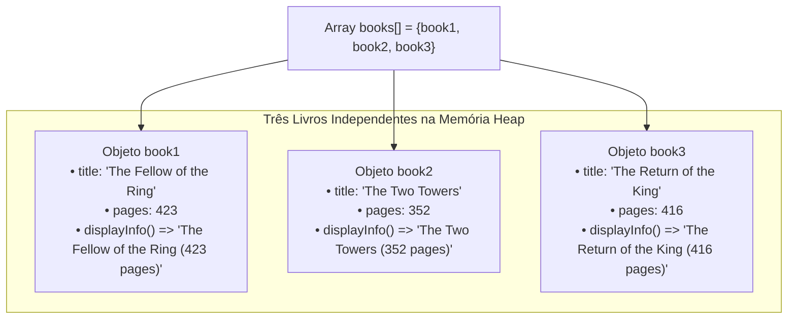

# Curso de Java — Capítulo 53 (Parte 4): Agregação 🏫
## Refinamento de Formatação no `Book.java`, Realce de Variáveis na IDE e Teste Individual dos 3 Livros

---

> [!IMPORTANT]
> **Para cópia no Google Docs:** Este documento foi desenvolvido com riqueza de detalhes contextuais e visuais. Todas as 4 imagens enviadas (o ajuste do método `displayInfo()` em `Book.java`, a seleção com mouse no console do IntelliJ, o realce automático das referências de variáveis no editor e as saídas individuais de cada livro da trilogia) estão completamente reconstituídas em texto. Você pode copiar e colar este material diretamente para o seu Google Docs sem perder nenhuma informação das capturas originais.

---

### Links Rápidos dos Arquivos do Projeto no seu Computador
* Classe do Livro com Formatação Refinada: `Book.java`
* Arquivo Principal de Testes: [`Main.java`](../../../src/main/java/com/mickaelgeronimo/mastery/core/concurrency/Main.java)
* Classe da Biblioteca (Pronta para agregação): `Library.java`
* Pasta Raiz do Projeto: `JAVA APRENDER`
* Parte Anterior (Capítulo 53 - Parte 3: Construtor e Array de Livros): `explicacao_agregacao_instanciacao_dos_livros_array_de_objetos_e_teste_de_displayinfo_capitulo53_parte3.md`

---

## 1. Reconstituição Detalhada das 4 Telas da IDE IntelliJ IDEA

Abaixo está o registro cronológico exato do que aconteceu na tela do professor ao longo das 4 capturas:

```
+----------------------------------------------------------------------------------------------------+
|                                    SEQUÊNCIA DE TELAS NO VÍDEO                                      |
+----------------------------------------------------------------------------------------------------+
| IMAGEM 1: Retorno à aba Book.java para refinamento da linha 12.                                    |
|           • O professor abre a aba Book.java.                                                      |
|           • Ajuste na linha 12:                                                                    |
|             return this.title + " (" + this.pages + " pages)";                                     |
|           • A palavra "pages" foi movida para DENTRO dos parênteses junto com o número!            |
|           • Cursor posicionado no meio da string: + " |pages)";                                    |
|                                                                                                    |
| IMAGEM 2: Reexecução de Main.java com book1 (Timestamp: 8:33:38).                                  |
|           • Aba ativa: Main.java.                                                                  |
|           • Console inferior exibe:                                                                |
|             The Fellow of the Ring (423 pages)                                                     |
|           • DESTAQUE COM MOUSE: O professor selecionou "(423 pages)" com o cursor do mouse         |
|             (aparece com fundo retangular azul) para chamar atenção para a nova formatação.        |
|                                                                                                    |
| IMAGEM 3: Teste do segundo livro book2 (Timestamp: 8:33:42).                                       |
|           • O professor alterou o println para: System.out.println(book2.displayInfo());           |
|           • REALCE DA IDE: O IntelliJ destaca a palavra "book2" em cinza/roxo na linha 10          |
|             (declaração) e na linha 13 (dentro do array books).                                    |
|           • Console inferior exibe em verde:                                                       |
|             The Two Towers (352 pages)                                                             |
|                                                                                                    |
| IMAGEM 4: Teste do terceiro livro book3 (Timestamp: 8:33:42 / segundos seguintes).                |
|           • O professor alterou o println para: System.out.println(book3.displayInfo());           |
|           • REALCE DA IDE: O IntelliJ agora destaca "book3" na linha 11 e na linha 13.             |
|           • Console inferior exibe em verde:                                                       |
|             The Return of the King (416 pages)                                                     |
+----------------------------------------------------------------------------------------------------+
```

---

## 2. O Refinamento da Linha 12: O Olho de Programador para Detalhes (Imagem 1)

Na Parte 3, quando rodamos o primeiro teste, o console havia impresso:
```text
The Fellow of the Ring (423) pages   <-- Estava assim!
```

Repare como a palavra `pages` ficava de fora dos parênteses, parecendo uma sobra solta.
O professor Bro Code percebeu isso e, como todo bom desenvolvedor, voltou ao arquivo `Book.java` para deixar o texto mais bonito e natural:

```
Antes:  return this.title + " (" + this.pages + ") pages";  ==> (423) pages
Depois: return this.title + " (" + this.pages + " pages)";  ==> (423 pages)
```


Na **Imagem 2**, o professor faz questão de passar o mouse por cima de `(423 pages)` no terminal (ficando com aquele retângulo azul de seleção) para mostrar aos alunos: *"Vejam como agora ficou muito melhor formatado!"*.

---

## 3. O Recurso Visual do IntelliJ: Realce Automático de Referências (Imagens 3 e 4)

Ao olhar para as imagens 3 e 4, você nota algo interessante no editor de código:
* Na **Imagem 3**, a palavra `book2` está com uma caixinha de fundo cinza/roxo na linha 10 (`Book book2 = ...`) e também na linha 13 (`{book1, book2, book3}`).
* Na **Imagem 4**, a mesma coisa acontece com a palavra `book3` na linha 11 e na linha 13.

### O que é isso? (Explicação para Iniciantes)
O IntelliJ IDEA é uma IDE inteligente. Quando você clica com o cursor sobre o nome de uma variável ou altera uma chamada de método:
1. O IntelliJ rastreia o projeto em tempo real.
2. Ele "acende uma lâmpada" em todos os lugares onde aquela variável é mencionada.
3. Isso serve para que você nunca se perca: você sabe exatamente de onde veio aquele livro e em quais listas ou arrays ele está sendo guardado!

---

## 4. O Teste Individual dos 3 Livros: A Prova da Autonomia de Cada Objeto

O professor testou um livro de cada vez chamando `displayInfo()`:

```java
// Teste 1 (Imagem 2):
System.out.println(book1.displayInfo()); // Saída: The Fellow of the Ring (423 pages)

// Teste 2 (Imagem 3):
System.out.println(book2.displayInfo()); // Saída: The Two Towers (352 pages)

// Teste 3 (Imagem 4):
System.out.println(book3.displayInfo()); // Saída: The Return of the King (416 pages)
```

### O Que Isso Ensina Sobre Orientação a Objetos e Agregação?
Cada um dos três livros é uma entidade independente que vive na memória do computador.



1. **Mesma Fôrma, Dados Diferentes:** Todos os três vieram da mesma classe `Book.java` e possuem exatamente o mesmo método `displayInfo()`.
2. **O Segredo do `this`:** Quando você chama `book1.displayInfo()`, a palavra `this` dentro do método busca o título do livro 1. Quando chama `book2.displayInfo()`, o `this` busca o título do livro 2. Não há confusão ou mistura de dados entre eles!
3. **Existência Prévia:** Os livros já existem, já funcionam perfeitamente e têm suas informações prontas **mesmo antes de criarmos a Biblioteca (`Library`)**! Isso é o coração da **Agregação**.

---

## 5. Código-Fonte Atual dos Arquivos no Seu Computador

### Arquivo 1: `Book.java` (Com a Formatação Nova)

```java
public class Book {

    String title;
    int pages;

    Book(String title, int pages){
        this.title = title;
        this.pages = pages;
    }

    String displayInfo(){
        return this.title + " (" + this.pages + " pages)";
    }

}
```

---

### Arquivo 2: [`Main.java`](../../../src/main/java/com/mickaelgeronimo/mastery/core/concurrency/Main.java) (Com o Array e o Teste de Exibição)

```java
public class Main {
    public static void main(String[] args) {

        // Aggregation = Represents a "has-a" relationship between objects.
        //               One object contains another object as part of its structure,
        //               but the contained object/s can exist independently.

        Book book1 = new Book("The Fellow of the Ring", 423);
        Book book2 = new Book("The Two Towers", 352);
        Book book3 = new Book("The Return of the King", 416);

        Book[] books = {book1, book2, book3};

        System.out.println(book3.displayInfo());

    }
}
```

---

## 6. Explicação Linha por Linha de `Book.java` (Tabela Detalhada)

| Linha | Código em `Book.java` | O Que Faz? (Explicação Simples) |
| :---: | :--- | :--- |
| **01** | `public class Book {` | Declara a classe pública `Book`. |
| **02** | *(linha em branco)* | Espaçamento estético. |
| **03** | `    String title;` | Variável de texto que armazenará o título da obra. |
| **04** | `    int pages;` | Variável numérica inteira que guardará a contagem de páginas. |
| **05** | *(linha em branco)* | Espaçamento estético. |
| **06** | `    Book(String title, int pages){` | Construtor que recebe obrigatoriamente um título e um número de páginas ao instanciar o livro com `new`. |
| **07** | `        this.title = title;` | Grava o título recebido na gaveta permanente `title` deste livro. |
| **08** | `        this.pages = pages;` | Grava o total de páginas na gaveta permanente `pages` deste livro. |
| **09** | `    }` | Fim do construtor. |
| **10** | *(linha em branco)* | Espaçamento estético. |
| **11** | `    String displayInfo(){` | Declaração do método que retorna uma `String` com os dados do livro. |
| **12** | `        return this.title + " (" + this.pages + " pages)";` | **A linha refinada:** Monta e devolve a frase com o título e as páginas dentro dos parênteses no formato `Título (N pages)`. |
| **13** | `    }` | Fim do método `displayInfo()`. |
| **14** | *(linha em branco)* | Espaçamento estético. |
| **15** | `}` | Fim da classe `Book`. |

---

## 7. O Que Saiu no Console em Cada Imagem do Vídeo

Aqui está a correspondência exata entre o código testado e o que foi impresso no terminal do IntelliJ IDEA:

### Teste da Imagem 2 (com `book1.displayInfo()`):
```text
The Fellow of the Ring (423 pages)
```

### Teste da Imagem 3 (com `book2.displayInfo()`):
```text
The Two Towers (352 pages)
```

### Teste da Imagem 4 (com `book3.displayInfo()`):
```text
The Return of the King (416 pages)
```

---

## 8. O Que Esperar dos Próximos Passos?

Agora que os 3 livros estão fabricados, testados e agrupados dentro do array `Book[] books`:
* Chegou a hora do professor abrir a aba `Library.java`!
* Vamos definir a classe da Biblioteca, seus atributos (como nome da biblioteca e o array de livros que ela agrega), seu construtor e um método da biblioteca que consiga listar todos os seus livros de uma só vez!
