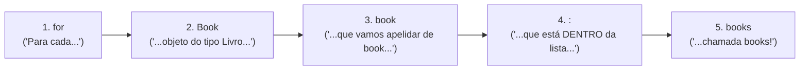
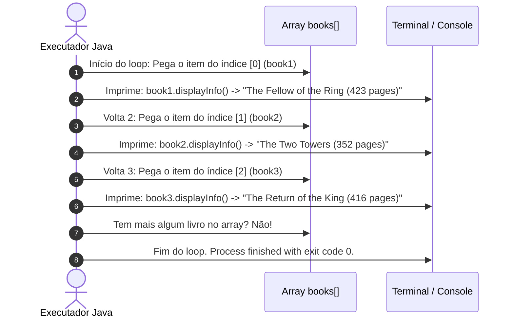

# Curso de Java — Capítulo 53 (Parte 5): Agregação 🏫
## O Loop `for-each` (*Enhanced For Loop*), Iteração no Array de Livros e Impressão Completa no Console

---

> [!IMPORTANT]
> **Para cópia no Google Docs:** Este documento foi estruturado para ser 100% autossuficiente e visualmente descritivo. Todas as 4 imagens da sequência enviada (a digitação do laço `for-each` em `Main.java`, a execução no terminal do IntelliJ e a seleção em bloco com mouse sobre as 3 saídas de texto) estão transcritas e contextualizadas em detalhes para cópia direta no seu Google Docs sem necessidade de imagens externas.

---

### Links Rápidos dos Arquivos do Projeto no seu Computador
* Arquivo Principal com o Loop: [`Main.java`](file:///c:/Users/mickel%201/Downloads/JAVA%20APRENDER/Main.java)
* Classe do Livro: [`Book.java`](file:///c:/Users/mickel%201/Downloads/JAVA%20APRENDER/Book.java)
* Classe da Biblioteca: [`Library.java`](file:///c:/Users/mickel%201/Downloads/JAVA%20APRENDER/Library.java)
* Pasta Raiz do Projeto: [`JAVA APRENDER`](file:///c:/Users/mickel%201/Downloads/JAVA%20APRENDER)
* Parte Anterior (Capítulo 53 - Parte 4: Refinamento de Strings e Testes Individuais): [`explicacao_agregacao_ajuste_de_formatacao_e_teste_individual_dos_tres_livros_capitulo53_parte4.md`](file:///C:/Users/mickel%201/.gemini/antigravity/brain/d1dae54d-8acc-4142-bb62-6703a22b9afc/explicacao_agregacao_ajuste_de_formatacao_e_teste_individual_dos_tres_livros_capitulo53_parte4.md)

---

## 1. Reconstituição Detalhada das 4 Telas da IDE IntelliJ IDEA

Abaixo está o registro cronológico exato do que aconteceu na tela do professor ao longo das 4 capturas:

```
+----------------------------------------------------------------------------------------------------+
|                                    SEQUÊNCIA DE TELAS NO VÍDEO                                      |
+----------------------------------------------------------------------------------------------------+
| IMAGEM 1: Substituição do println individual pelo laço for-each em Main.java.                      |
|           • O professor apaga a linha única "System.out.println(book3.displayInfo());".             |
|           • Digita o laço de repetição (linhas 15 a 17):                                           |
|               for(Book book : books){                                                              |
|                   System.out.println(book.displayInfo());                                          |
|               }                                                                                    |
|           • Ícone de lâmpada amarela na calha (gutter) da linha 16.                                |
|           • Cursor posicionado dentro dos parênteses vazios de displayInfo().                      |
|                                                                                                    |
| IMAGENS 2 e 3: Execução do programa no terminal Run > Main (Timestamp: 8:34:14).                   |
|           • O professor clica no botão verde Play (Run).                                           |
|           • O terminal inferior se abre e exibe todas as 3 obras impressas de uma só vez em verde:  |
|               The Fellow of the Ring (423 pages)                                                   |
|               The Two Towers (352 pages)                                                           |
|               The Return of the King (416 pages)                                                   |
|           • Cursor do terminal piscando ao final da terceira linha.                                |
|                                                                                                    |
| IMAGEM 4: Seleção em bloco das 3 linhas com o mouse no console.                                    |
|           • O professor clica e arrasta o mouse sobre as 3 linhas do console:                      |
|             Todas as 3 linhas ganham fundo azul de seleção para enfatizar aos alunos               |
|             como o laço percorreu todo o array e exibiu o acervo completo automaticamente.         |
+----------------------------------------------------------------------------------------------------+
```

---

## 2. O Problema das Chamadas Manuais e a Solução: O Loop `for-each`

Na Parte 4, o professor precisou testar cada livro manualmente:
* Primeiro escreveu `book1.displayInfo()`, rodou e viu a saída.
* Depois apagou o `1`, colocou `book2.displayInfo()`, rodou e viu a saída.
* Depois apagou o `2`, colocou `book3.displayInfo()`, rodou e viu a saída.

### A Pergunta que Todo Programador Faz:
> *"E se a nossa biblioteca tivesse 5.000 livros? Nós teríamos que escrever 5.000 linhas de `System.out.println` à mão?"*

**Claro que não!** É exatamente para isso que serve o laço de repetição **`for-each`** (*Enhanced For Loop* ou *laço 'para cada'*).

---

## 3. Anatomia do `for(Book book : books)` (Para Iniciantes Amadores)

Vamos destrinchar cada palavra desta linha mágica:

```java
for (Book book : books)
// ^   ^    ^  ^   ^
// 1   2    3  4   5
```



1. **`for`**: Palavra reservada do Java que inicia uma estrutura de repetição.
2. **`Book`**: O tipo dos itens guardados no array. Como nossa prateleira só tem livros, o tipo é `Book`.
3. **`book`**: O nome de uma variável temporária (um "crachá" ou "apelido") que o Java vai usar para segurar um livro por vez a cada volta do laço.
4. **`:` (dois pontos)**: Significa **"DENTRO DE"** (*in*).
5. **`books`**: O array que criamos na linha 13, contendo os 3 livros `{book1, book2, book3}`.

**Como ler essa linha em português claro:**
> *"Java, pegue a prateleira `books`. Para CADA livro (`book`) que você encontrar lá dentro, execute o bloco de código que está entre as chaves `{ }`!"*

---

## 4. O Que Acontece Passo a Passo na Memória (Tabela de Iterações)

Veja como o computador trabalha nos bastidores durante a execução:



| Volta (Iteração) | O que a variável temporária `book` segura? | Método Chamado | O que o Console Imprime? |
| :---: | :--- | :--- | :--- |
| **1ª Volta** | Aponta para `book1` (`"The Fellow of the Ring"`, `423`) | `book.displayInfo()` | `The Fellow of the Ring (423 pages)` |
| **2ª Volta** | Aponta para `book2` (`"The Two Towers"`, `352`) | `book.displayInfo()` | `The Two Towers (352 pages)` |
| **3ª Volta** | Aponta para `book3` (`"The Return of the King"`, `416`) | `book.displayInfo()` | `The Return of the King (416 pages)` |

---

## 5. Código Completo de `Main.java` no seu Computador

Aqui está o código exato que está salvo e funcionando no seu arquivo [`Main.java`](file:///c:/Users/mickel%201/Downloads/JAVA%20APRENDER/Main.java):

```java
public class Main {
    public static void main(String[] args) {

        // Aggregation = Represents a "has-a" relationship between objects.
        //               One object contains another object as part of its structure,
        //               but the contained object/s can exist independently.

        Book book1 = new Book("The Fellow of the Ring", 423);
        Book book2 = new Book("The Two Towers", 352);
        Book book3 = new Book("The Return of the King", 416);

        Book[] books = {book1, book2, book3};

        for(Book book : books){
            System.out.println(book.displayInfo());
        }

    }
}
```

---

## 6. Explicação Linha por Linha de `Main.java`

| Linha | Código em `Main.java` | Significado Detalhado |
| :---: | :--- | :--- |
| **01** | `public class Main {` | Declaração da classe principal `Main`. |
| **02** | `    public static void main(String[] args) {` | Método principal de execução (`main`). |
| **03** | *(linha em branco)* | Organização do código. |
| **04** | `        // Aggregation = Represents a "has-a" relationship between objects.` | Comentário teórico: Agregação é o relacionamento "tem-um". |
| **05** | `        //               One object contains another object as part of its structure,` | Comentário teórico: Um objeto contém outro como parte de si. |
| **06** | `        //               but the contained object/s can exist independently.` | Comentário teórico: Os objetos contidos existem independentemente. |
| **07** | *(linha em branco)* | Organização do código. |
| **08** | `        Book book1 = new Book("The Fellow of the Ring", 423);` | Cria o primeiro objeto `Book` na memória Heap. |
| **09** | `        Book book2 = new Book("The Two Towers", 352);` | Cria o segundo objeto `Book` na memória Heap. |
| **10** | `        Book book3 = new Book("The Return of the King", 416);` | Cria o terceiro objeto `Book` na memória Heap. |
| **11** | *(linha em branco)* | Organização do código. |
| **12** | `        Book[] books = {book1, book2, book3};` | Agrupa as referências dos 3 livros no array `books`. |
| **13** | *(linha em branco)* | Organização do código. |
| **14** | *(linha em branco)* | Organização do código. |
| **15** | `        for(Book book : books){` | **Início do Laço for-each:** Percorre automaticamente o array `books` do início ao fim, atribuindo um livro por vez à variável `book`. |
| **16** | `            System.out.println(book.displayInfo());` | **Impressão:** Chama o método `displayInfo()` do livro da vez e joga a linha de texto no console. |
| **17** | `        }` | **Fim do Laço:** Se ainda houver livros no array, volta para a linha 15; se o array acabou, sai do laço. |
| **18** | *(linha em branco)* | Organização do código. |
| **19** | `    }` | Fim do método `main`. |
| **20** | `}` | Fim da classe `Main`. |

---

## 7. Saída Exata no Console

Ao compilar e executar o código com:
```bash
javac Book.java Library.java Main.java
java Main
```

### O que sai no terminal (idêntico às Imagens 2, 3 e 4):
```text
The Fellow of the Ring (423 pages)
The Two Towers (352 pages)
The Return of the King (416 pages)
```

> [!TIP]
> **O Gesto do Professor na Imagem 4:**
> Na Imagem 4, o professor seleciona com o mouse as 3 linhas de saída no terminal (ficando com o fundo azul). Ele faz isso para destacar visualmente aos alunos o poder da automação: com apenas 3 linhas de código no loop, você consegue exibir centenas ou milhares de itens sem repetir código (*Princípio DRY - Don't Repeat Yourself*).

---

## 8. A Conexão com o Próximo Passo: Por Que Fizemos Esse Loop no `main`?

Você deve estar se perguntando:
> *"Mas cadê a Biblioteca (`Library`)? O capítulo não era sobre Agregação?"*

Aqui está o "pulo do gato" da didática do Bro Code:
1. Primeiro, ele provou que os livros funcionam sozinhos e que o array funciona sozinho (existência independente).
2. Agora que você já sabe como o loop `for-each` percorre os livros, o professor vai **PEGAR ESSE EXATO LOOP E COLOCAR DENTRO DA CLASSE [`Library`](file:///c:/Users/mickel%201/Downloads/JAVA%20APRENDER/Library.java)**!
3. A biblioteca receberá os livros e terá o seu próprio método para exibir o seu catálogo. Isso concretizará com perfeição o conceito de **Agregação**:
   * A Biblioteca tem livros (`Library has-a Book[]`).
   * A Biblioteca exibe os livros que foram agregados a ela!
