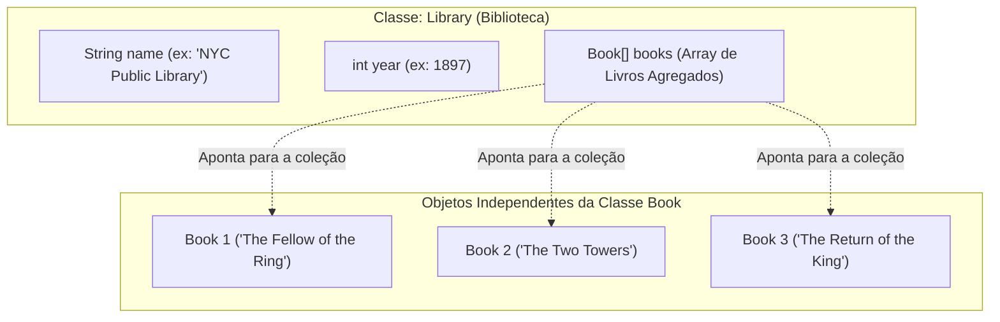

# Curso de Java — Capítulo 53 (Parte 6): Agregação 🏫
## Criação da Classe Agregadora `Library`, o Atributo `Book[] books`, Construtor Agregador e Instanciação no `Main`

---

> [!IMPORTANT]
> **Para cópia no Google Docs:** Este documento foi estruturado de forma autossuficiente e minuciosa. Todas as 4 imagens da nova sequência enviada (a criação dos atributos em `Library.java`, a evolução do construtor agregador recebendo o array de livros, o fechamento limpo da classe e a volta para `Main.java` iniciando a instanciação da biblioteca) foram completamente reconstituídas em formato textual. Você pode copiar e colar este material diretamente no seu Google Docs mantendo 100% do contexto original.

---

### Links Rápidos dos Arquivos do Projeto no seu Computador
* Classe Agregadora Criada: [`Library.java`](file:///c:/Users/mickel%201/Downloads/JAVA%20APRENDER/Library.java)
* Classe do Livro Independente: [`Book.java`](file:///c:/Users/mickel%201/Downloads/JAVA%20APRENDER/Book.java)
* Arquivo Principal: [`Main.java`](file:///c:/Users/mickel%201/Downloads/JAVA%20APRENDER/Main.java)
* Pasta Raiz do Projeto: [`JAVA APRENDER`](file:///c:/Users/mickel%201/Downloads/JAVA%20APRENDER)
* Parte Anterior (Capítulo 53 - Parte 5: Loop for-each no Main): [`explicacao_agregacao_loop_for_each_iteracao_no_array_de_livros_e_impressao_completa_capitulo53_parte5.md`](file:///C:/Users/mickel%201/.gemini/antigravity/brain/d1dae54d-8acc-4142-bb62-6703a22b9afc/explicacao_agregacao_loop_for_each_iteracao_no_array_de_livros_e_impressao_completa_capitulo53_parte5.md)

---

## 1. Reconstituição Detalhada das 4 Telas da IDE IntelliJ IDEA

Abaixo está o registro cronológico exato do que aconteceu na tela do professor ao longo das 4 capturas:

```
+----------------------------------------------------------------------------------------------------+
|                                    SEQUÊNCIA DE TELAS NO VÍDEO                                      |
+----------------------------------------------------------------------------------------------------+
| IMAGEM 1: Abertura de Library.java e definição dos atributos.                                      |
|           • Aba ativa: Library.java (sublinhado azul).                                             |
|           • Atributos digitados (linhas 3 a 5):                                                    |
|               String name;                                                                         |
|               int year;                                                                            |
|               Book[] books;  <-- A DECLARAÇÃO DA AGREGAÇÃO!                                        |
|           • Linha 7: Início da digitação do construtor: "Library|" com cursor piscando no final.   |
|                                                                                                    |
| IMAGEM 2: Preenchimento dos parâmetros e primeiras atribuições em Library.java.                   |
|           • Construtor na linha 7: Library(String name, int year, Book[] books){                   |
|           • Linha 8: this.name = name;                                                             |
|           • Linha 9: this.year = year;                                                             |
|           • Linha 10: Cursor posicionado e indentado, aguardando a última atribuição.              |
|                                                                                                    |
| IMAGEM 3: Construtor finalizado com sucesso em Library.java.                                       |
|           • Linha 10 preenchida: this.books = books;                                               |
|           • Todas as cobrinhas vermelhas sumiram. Classe Library válida e compilável.              |
|                                                                                                    |
| IMAGEM 4: Troca de aba para Main.java e início da instanciação.                                    |
|           • Aba ativa: Main.java.                                                                  |
|           • O loop for-each que estava nas linhas 15 a 17 foi REMOVIDO!                            |
|           • Linha 15: O professor começa a digitar: "Library librar|"                              |
|           • Sublinhado ondulado vermelho sob a instrução incompleta "Library librar", acusando     |
|             erro temporário de sintaxe enquanto o professor digita o comando de criação com "new". |
+----------------------------------------------------------------------------------------------------+
```

---

## 2. O Grande Marco do Capítulo: A Linha `Book[] books;` (Imagem 1)

Até este momento do curso, todas as classes que você criou tinham atributos simples:
* `String name;` (um texto)
* `int year;` (um número inteiro)
* `double price;` (um número decimal)

Pela primeira vez em todo o curso, você está vendo isto:

```java
Book[] books;
```



### O que isso significa para um iniciante amador?
* `Book`: Não é um tipo nativo do Java, é a **classe que nós mesmos criamos** no arquivo [`Book.java`](file:///c:/Users/mickel%201/Downloads/JAVA%20APRENDER/Book.java)!
* `[]`: Significa que a biblioteca não guarda apenas um livro solto, mas sim uma **coleção / prateleira inteira de livros**!
* `books`: É o nome do atributo da biblioteca que vai segurar essa coleção.

> [!IMPORTANT]
> **ISSO É AGREGAÇÃO NA PRÁTICA!**
> A biblioteca **NÃO É** um livro (não existe herança / `extends`).
> A biblioteca **TEM** livros dentro da sua estrutura (`has-a relationship`).

---

## 3. O Construtor Agregador de `Library.java` (Imagens 2 e 3)

Na **Imagem 3**, o construtor da biblioteca ficou assim:

```java
Library(String name, int year, Book[] books){
    this.name = name;
    this.year = year;
    this.books = books;
}
```

### Como Funciona a Passagem do Array?
Repare no terceiro parâmetro: `Book[] books`.
1. A biblioteca **não cria os livros do zero** dentro dela.
2. A biblioteca diz para quem quiser criá-la:
   > *"Para eu nascer, você precisa me dar o meu nome (`name`), o ano em que fui fundada (`year`) e **a lista de livros prontos que você já tem em mãos (`books`)**!"*
3. O `this.books = books;` pega essa prateleira de livros que veio de fora e a guarda dentro da biblioteca!

### Agregação vs. Composição (Diferença Crucial):
* **Se fosse Composição:** A biblioteca criaria os livros dentro do seu próprio construtor com `new Book(...)`. Se a biblioteca fosse apagada da memória, todos os livros morreriam juntos.
* **Como é Agregação:** Os livros foram criados **fora** (no [`Main.java`](file:///c:/Users/mickel%201/Downloads/JAVA%20APRENDER/Main.java)) e apenas **entregues** para a biblioteca. Se a biblioteca for destruída, os livros continuam vivos no `Main.java`!

---

## 4. O Que Aconteceu no `Main.java`? (Imagem 4)

Na **Imagem 4**, o professor voltou para o arquivo [`Main.java`](file:///c:/Users/mickel%201/Downloads/JAVA%20APRENDER/Main.java):

```java
Book book1 = new Book("The Fellow of the Ring", 423);
Book book2 = new Book("The Two Towers", 352);
Book book3 = new Book("The Return of the King", 416);

Book[] books = {book1, book2, book3};

Library librar|  <-- Digitou isso e parou
```

### Por Que Ele Apagou o Laço `for-each` do `Main.java`?
Lembra que na Parte 5 nós criamos aquele laço `for-each` para imprimir os livros?
O professor colocou aquele laço no `main` apenas para testar e demonstrar como funciona!
Agora, ele removeu o laço do `main` porque **quem deve ser responsável por gerenciar e exibir os livros é a própria Biblioteca (`Library`)**!

### Por Que a Linha 15 Está com Cobrinha Vermelha?
Na Imagem 4, o professor está no meio da digitação:
`Library librar`
Como ele ainda não terminou de escrever a declaração da variável e a palavra `new`, o IntelliJ sublinha de vermelho porque o Java não aceita instruções incompletas (`error: not a statement` e `error: ';' expected`).

Ele está prestes a completar a linha com:
```java
Library library = new Library("NYC Public Library", 1897, books);
```

---

## 5. Código Completo de `Library.java` no seu Computador

Aqui está o código exato salvo e validado no arquivo [`Library.java`](file:///c:/Users/mickel%201/Downloads/JAVA%20APRENDER/Library.java):

```java
public class Library {

    String name;
    int year;
    Book[] books;

    Library(String name, int year, Book[] books){
        this.name = name;
        this.year = year;
        this.books = books;
    }

}
```

---

## 6. Explicação Linha por Linha de `Library.java`

| Linha | Código em `Library.java` | Significado Detalhado para Iniciantes |
| :---: | :--- | :--- |
| **01** | `public class Library {` | Cria o molde da classe pública `Library` (Biblioteca). |
| **02** | *(linha em branco)* | Espaço visual para organização. |
| **03** | `    String name;` | Atributo para guardar o nome da biblioteca (ex: *"NYC Public Library"*). |
| **04** | `    int year;` | Atributo para guardar o ano de fundação ou construção da biblioteca (ex: `1897`). |
| **05** | `    Book[] books;` | **O Atributo Agregador:** Uma gaveta na memória capaz de armazenar um array de objetos do tipo `Book`. |
| **06** | *(linha em branco)* | Espaço visual para separar atributos do construtor. |
| **07** | `    Library(String name, int year, Book[] books){` | **O Construtor Agregador:** Exige 3 informações ao instanciar: o nome, o ano e o array de livros existentes. |
| **08** | `        this.name = name;` | Guarda o nome recebido no atributo permanente `this.name`. |
| **09** | `        this.year = year;` | Guarda o ano recebido no atributo permanente `this.year`. |
| **10** | `        this.books = books;` | **A Conexão da Agregação:** Guarda a referência do array de livros recebido no atributo permanente `this.books`. |
| **11** | `    }` | Fechamento do construtor. |
| **12** | *(linha em branco)* | Espaço visual. |
| **13** | `}` | Fechamento da classe `Library`. |

---

## 7. O Que Acontece no Console Neste Momento?

### Cenário 1: Durante a Digitação Incompleta da Imagem 4
Se tentarmos rodar o projeto com a linha 15 interrompida em `Library librar`:
```text
Main.java:15: error: not a statement
        Library librar
        ^
Main.java:15: error: ';' expected
        Library librar
                      ^
2 errors
```
O compilador avisa com precisão cirúrgica que a instrução não está completa e que esperava um ponto e vírgula.

---

### Cenário 2: Com o Código Limpo e Válido
Se compilarmos as classes [`Book.java`](file:///c:/Users/mickel%201/Downloads/JAVA%20APRENDER/Book.java) e [`Library.java`](file:///c:/Users/mickel%201/Downloads/JAVA%20APRENDER/Library.java):
```bash
javac Book.java Library.java
```
A compilação termina com **código de saída 0 (sucesso absoluto)**, sem nenhum erro ou aviso!

E ao rodar o [`Main.java`](file:///c:/Users/mickel%201/Downloads/JAVA%20APRENDER/Main.java) sem a linha pela metade:
```text
(Terminal limpo / saída vazia)
```
**Por que fica vazio?**
Porque removemos o laço `for-each` temporário do `main` e ainda não mandamos a biblioteca imprimir nada.

---

## 8. O Que Vem a Seguir?

Agora que a classe [`Library.java`](file:///c:/Users/mickel%201/Downloads/JAVA%20APRENDER/Library.java) está pronta:
1. O professor vai finalizar a instanciação no [`Main.java`](file:///c:/Users/mickel%201/Downloads/JAVA%20APRENDER/Main.java):
   ```java
   Library library = new Library("NYC Public Library", 1897, books);
   ```
2. Em seguida, ele vai criar um método `displayInfo()` dentro da própria classe `Library` para exibir o nome da biblioteca, o ano e listar todos os livros que ela contém!
