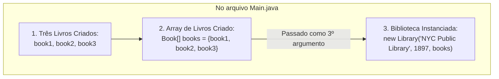

# Curso de Java — Capítulo 53 (Parte 7): Agregação 🏫
## O Erro de Argumentos Faltantes, a Conexão do Array `books` e o Início do `displayInfo()` na `Library`

---

> [!IMPORTANT]
> **Para cópia no Google Docs:** Este documento foi especialmente planejado para ser autossuficiente e detalhado. Todas as 4 novas telas do vídeo do Bro Code (o erro de construtor em `Main.java`, a seleção em azul destacando o array de livros, a inspeção em `Book.java` e a criação do método `displayInfo()` em `Library.java`) foram integralmente descritas em texto. Você pode copiar e colar este material diretamente no seu Google Docs sem perder o contexto visual.

---

### Links Rápidos dos Arquivos do Projeto no seu Computador
* Classe Agregadora Atualizada com `displayInfo()`: `Library.java`
* Arquivo Principal com a Biblioteca Instanciada: [`Main.java`](../../../src/main/java/com/mickaelgeronimo/mastery/core/concurrency/Main.java)
* Classe do Livro Independente: `Book.java`
* Pasta Raiz do Projeto: `JAVA APRENDER`
* Parte Anterior (Capítulo 53 - Parte 6: Atributo Book[] books e Construtor): `explicacao_agregacao_criacao_da_classe_library_atributos_construtor_agregador_e_instanciacao_no_main_capitulo53_parte6.md`

---

## 1. Reconstituição Detalhada das 4 Telas da IDE IntelliJ IDEA

Abaixo está o registro cronológico exato do que aconteceu na tela do professor ao longo das 4 capturas:

```
+----------------------------------------------------------------------------------------------------+
|                                    SEQUÊNCIA DE TELAS NO VÍDEO                                      |
+----------------------------------------------------------------------------------------------------+
| IMAGEM 1: Tentativa de instanciar a Library apenas com o nome.                                     |
|           • Arquivo ativo: Main.java.                                                              |
|           • Linha 15 digitada:                                                                     |
|               Library library = new Library("NYC Public Library");                                 |
|           • ERRO DE COMPILAÇÃO VISÍVEL: Cobrinha ondulada vermelha sob ("NYC Public Library").     |
|             O construtor Library exige 3 argumentos: (String, int, Book[]). Passar apenas 1 é erro!|
|           • Contador no canto superior direito: 1 erro vermelho.                                   |
|                                                                                                    |
| IMAGEM 2: Adição do ano e destaque no array de livros (Timestamp: 8:36:11).                        |
|           • Linha 15 atualizada:                                                                   |
|               Library library = new Library("NYC Public Library", 1897, );                         |
|           • Erro na vírgula esperando o 3º argumento.                                              |
|           • DESTAQUE COM MOUSE: O professor seleciona a palavra "books" na linha 13                |
|             (Book[] books = ...) com fundo azul para mostrar de onde virá o 3º argumento!          |
|                                                                                                    |
| IMAGEM 3: Inspeção rápida da classe Book.java.                                                     |
|           • O professor clica na aba Book.java.                                                    |
|           • Mostra o método String displayInfo() que já formata os dados individuais de cada livro.|
|                                                                                                    |
| IMAGEM 4: Criação do displayInfo() dentro de Library.java (Timestamp: 8:36:58).                    |
|           • O professor clica na aba Library.java.                                                 |
|           • Cria o método de exibição da biblioteca (linhas 13 a 15):                              |
|               void displayInfo(){                                                                  |
|                   System.out.printf("The " + this.year + " " + this.name);                         |
|               }                                                                                    |
|           • Cursor posicionado logo após this.name);.                                              |
+----------------------------------------------------------------------------------------------------+
```

---

## 2. O Erro da Imagem 1: Por Que Passar Só o Nome Não Funciona?

Na **Imagem 1**, o professor escreveu:
```java
Library library = new Library("NYC Public Library"); // ❌ ERRO DE COMPILAÇÃO!
```

E o IntelliJ imediatamente sublinhou a chamada em vermelho:
```
Linha 15: Library library = new Library("NYC Public Library");
                                       ~~~~~~~~~~~~~~~~~~~~~
                                       (Erro: argumentos insuficientes)
```

### O Que o Compilador `javac` Diz nos Bastidores:
```text
Main.java:15: error: constructor Library in class Library cannot be applied to given types;
        Library library = new Library("NYC Public Library");
                          ^
  required: String,int,Book[]
  found:    String
  reason: actual and formal argument lists differ in length
1 error
```

### A Explicação "Para Lezado / Iniciante":
Lembra do contrato que nós mesmos assinamos na Parte 6 dentro de `Library.java`?
Lá nós escrevemos:
```java
Library(String name, int year, Book[] books)
```
Isso é uma lei para o Java! Você disse ao computador:
> *"Uma biblioteca NÃO PODE NASCER a menos que você me entregue 3 coisas nesta ordem: o nome dela (`String`), o ano em que foi construída (`int`), e a coleção de livros que ela vai guardar (`Book[]`)."*

Ao passar apenas `"NYC Public Library"`, você entregou só 1 coisa das 3 exigidas. O Java trava a compilação na hora!

---

## 3. A Conexão da Agregação: A Imagem 2 e o Retângulo Azul

Na **Imagem 2**, o professor dá o segundo passo:
```java
Library library = new Library("NYC Public Library", 1897, |);
```
Agora ele passou o nome (`"NYC Public Library"`) e o ano (`1897`).
Mas ainda falta o terceiro argumento após a vírgula!

### O Gesto Didático do Professor:
O professor passa o mouse e **seleciona a palavra `books` na linha 13** (deixando-a com aquele fundo retangular azul brilhante).

```
Linha 13: Book[] [books] = {book1, book2, book3};
                     ^^^ (Selecionado em azul pelo professor)
                     |||
                     VVV
Linha 15: Library library = new Library("NYC Public Library", 1897, books);
```



**O que o professor está ensinando sem precisar falar mil palavras?**
Ele está mostrando:
> *"Vejam, alunos! Aquele array `books` que criamos ali em cima, solto no `main`, é exatamente a prateleira que a biblioteca precisa receber para completar a agregação!"*

---

## 4. A Visita a `Book.java` (Imagem 3) e o Novo Método em `Library.java` (Imagem 4)

Na **Imagem 3**, o professor abre `Book.java` para relembrar que cada livro sabe exibir a si mesmo:
```java
String displayInfo(){
    return this.title + " (" + this.pages + " pages)";
}
```

E na **Imagem 4**, ele abre `Library.java` e começa a criar o método de exibição **da própria Biblioteca**:

```java
void displayInfo(){
    System.out.printf("The " + this.year + " " + this.name);
}
```

### Por Que a Biblioteca Precisa do Seu Próprio `displayInfo()`?
* O `displayInfo()` do **`Book`** exibe informações de **um livro** (Título e páginas).
* O `displayInfo()` da **`Library`** exibe informações da **instituição** (Ano de fundação e Nome da biblioteca) e, logo em seguida, listará todos os livros que pertencem a ela!

---

## 5. Código Completo dos Arquivos Atualizados no seu Computador

### Arquivo 1: `Library.java`

```java
public class Library {

    String name;
    int year;
    Book[] books;

    Library(String name, int year, Book[] books){
        this.name = name;
        this.year = year;
        this.books = books;
    }

    void displayInfo(){
        System.out.printf("The " + this.year + " " + this.name);
    }

}
```

---

### Arquivo 2: [`Main.java`](../../../src/main/java/com/mickaelgeronimo/mastery/core/concurrency/Main.java)

```java
public class Main {
    public static void main(String[] args) {

        // Aggregation = Represents a "has-a" relationship between objects.
        //               One object contains another object as part of its structure,
        //               but the contained object/s can exist independently.

        Book book1 = new Book("The Fellow of the Ring", 423);
        Book book2 = new Book("The Two Towers", 352);
        Book book3 = new Book("The Return of the King", 416);

        Book[] books = {book1, book2, book3};

        Library library = new Library("NYC Public Library", 1897, books);

    }
}
```

---

## 6. Explicação Linha por Linha de `Library.java`

| Linha | Código em `Library.java` | Para Que Serve? (Passo a Passo) |
| :---: | :--- | :--- |
| **01** | `public class Library {` | Declara a classe pública `Library`. |
| **02** | *(linha em branco)* | Espaçamento estético. |
| **03** | `    String name;` | Atributo para armazenar o nome da biblioteca. |
| **04** | `    int year;` | Atributo para armazenar o ano de fundação. |
| **05** | `    Book[] books;` | Atributo agregador que armazena a coleção de objetos `Book`. |
| **06** | *(linha em branco)* | Espaçamento estético. |
| **07** | `    Library(String name, int year, Book[] books){` | Construtor que exige os 3 dados para que a biblioteca possa nascer. |
| **08** | `        this.name = name;` | Grava o nome na memória deste objeto. |
| **09** | `        this.year = year;` | Grava o ano na memória deste objeto. |
| **10** | `        this.books = books;` | Grava a referência do array de livros recebido. |
| **11** | `    }` | Fim do construtor. |
| **12** | *(linha em branco)* | Espaçamento estético. |
| **13** | `    void displayInfo(){` | Declara o método de exibição da biblioteca. Retorna `void` porque imprime direto no console. |
| **14** | `        System.out.printf("The " + this.year + " " + this.name);` | Imprime o cabeçalho da biblioteca juntando o ano e o nome (ex: *"The 1897 NYC Public Library"*). |
| **15** | `    }` | Fim do método `displayInfo()`. |
| **16** | *(linha em branco)* | Espaçamento estético. |
| **17** | `}` | Fim da classe `Library`. |

---

## 7. O Que Acontece no Console Neste Momento?

### Cenário 1: Durante a Falta de Argumentos (Imagens 1 e 2)
Se tentarmos rodar o programa com a linha interrompida ou incompleta:
```text
Main.java:15: error: constructor Library in class Library cannot be applied to given types;
  required: String,int,Book[]
  found:    String
1 error
```
O programa não roda enquanto todos os 3 argumentos não forem fornecidos.

---

### Cenário 2: Com a Instanciação Completa (`Main.java` Atual)
Compilando e rodando o código atual:
```bash
javac Book.java Library.java Main.java
java Main
```

**Saída no Console:**
```text
(Terminal limpo / saída vazia)
```
**Por que não sai nada ainda?**
Porque no [`Main.java`](../../../src/main/java/com/mickaelgeronimo/mastery/core/concurrency/Main.java), nós instanciamos a biblioteca com sucesso (`Library library = new Library(...)`), mas ainda não chamamos `library.displayInfo()`.

---

### Demonstração Prévia: O Que o `displayInfo()` da Biblioteca Produzirá?
Se adicionarmos a chamada `library.displayInfo();` no `main`, a linha 14 de `Library.java` imprimirá:

```text
The 1897 NYC Public Library
```

---

## 8. O Que Esperar do Próximo Passo?

O professor acabou de criar a primeira linha do `displayInfo()` da biblioteca.
O próximo passo lógico é:
1. Pular uma linha após `"The 1897 NYC Public Library"`.
2. Adicionar aquele laço `for-each` que aprendemos na Parte 5 **DENTRO** do método `displayInfo()` da biblioteca!
3. Chamar `library.displayInfo()` no [`Main.java`](../../../src/main/java/com/mickaelgeronimo/mastery/core/concurrency/Main.java) para ver a mágica da Agregação completa acontecer!
