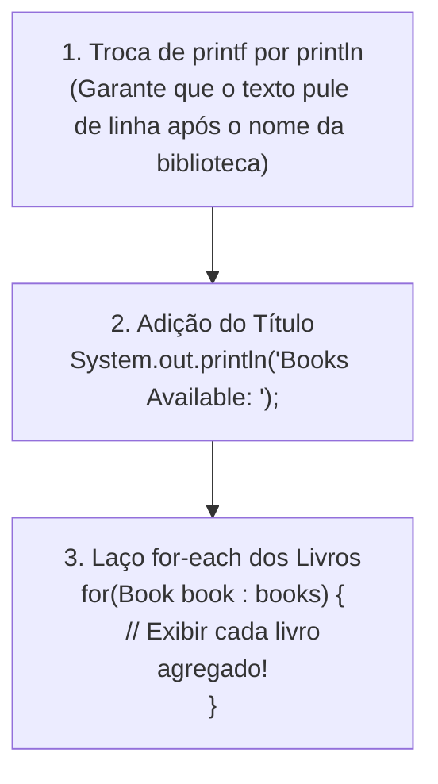
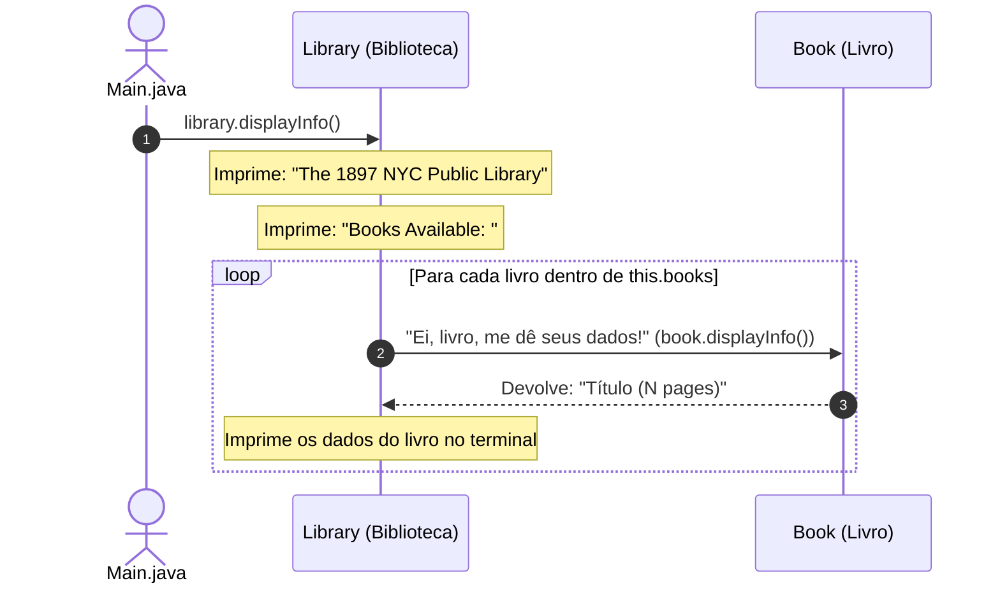

# Curso de Java — Capítulo 53 (Parte 8): Agregação 🏫
## Execução do Cabeçalho da Biblioteca, a Troca de `printf` por `println` e a Migração do Loop `for-each` para a `Library`

---

> [!IMPORTANT]
> **Para cópia no Google Docs:** Este documento foi especialmente preparado de forma autossuficiente e detalhada. Todas as 2 imagens desta etapa (a execução com sucesso no console exibindo o cabeçalho verde no terminal e a alteração interna do método `displayInfo()` em `Library.java` com a inclusão do laço e o erro temporário de digitação) foram reconstituídas textualmente com máxima clareza. Você pode copiar e colar este material diretamente no seu Google Docs mantendo todo o contexto didático.

---

### Links Rápidos dos Arquivos do Projeto no seu Computador
* Classe Agregadora Atualizada: `Library.java`
* Arquivo Principal Executado: [`Main.java`](../../../src/main/java/com/mickaelgeronimo/mastery/core/concurrency/Main.java)
* Classe do Livro Independente: `Book.java`
* Pasta Raiz do Projeto: `JAVA APRENDER`
* Parte Anterior (Capítulo 53 - Parte 7: Erro de Argumentos e Início de displayInfo): `explicacao_agregacao_erros_de_argumentos_conexao_do_array_books_e_displayinfo_da_library_capitulo53_parte7.md`

---

## 1. Reconstituição Detalhada das 2 Telas da IDE IntelliJ IDEA

Abaixo está o registro cronológico exato do que aconteceu na tela do professor ao longo das 2 capturas:

```
+----------------------------------------------------------------------------------------------------+
|                                    SEQUÊNCIA DE TELAS NO VÍDEO                                      |
+----------------------------------------------------------------------------------------------------+
| IMAGEM 1: Execução de library.displayInfo() em Main.java (Timestamp: 8:37:14).                     |
|           • Arquivo ativo: Main.java.                                                              |
|           • Linha 17 executada: library.displayInfo();                                             |
|           • Terminal Run > Main aberto na parte inferior:                                          |
|               The 1897 NYC Public Library                                                          |
|           • Mensagem de conclusão: Process finished with exit code 0                               |
|           • Significado: A biblioteca nasceu, recebeu os 3 argumentos e imprimiu seu cabeçalho.    |
|                                                                                                    |
| IMAGEM 2: Evolução de displayInfo() em Library.java (Timestamp: 8:37:57).                          |
|           • Aba ativa: Library.java.                                                               |
|           • Mudança na linha 14: System.out.printf foi trocado por System.out.println!             |
|           • Linha 15 adicionada: System.out.println("Books Available: ");                          |
|           • Linhas 16 a 18: Inclusão do laço for-each dentro do método da biblioteca:              |
|               for(Book book : books){                                                              |
|                   book.displayInfo|                                                                |
|               }                                                                                    |
|           • Erro em tempo real: Linha 17 com lâmpada vermelha na calha e 1 erro no topo direito   |
|             porque "book.displayInfo" ainda está sendo digitado (falta fechar a instrução).        |
+----------------------------------------------------------------------------------------------------+
```

---

## 2. A Primeira Vitória da Agregação (Imagem 1)

Na **Imagem 1**, o arquivo [`Main.java`](../../../src/main/java/com/mickaelgeronimo/mastery/core/concurrency/Main.java) chamou:

```java
Library library = new Library("NYC Public Library", 1897, books);
library.displayInfo();
```

E o terminal do IntelliJ imprimiu em verde:
```text
The 1897 NYC Public Library
```

### O Que Aconteceu nos Bastidores?
1. O método `main` criou os 3 livros (`book1`, `book2`, `book3`).
2. Juntou os 3 livros dentro do array `books`.
3. Criou a biblioteca `library`, entregando para ela o nome `"NYC Public Library"`, o ano `1897` e a coleção `books`.
4. Chamou o método `library.displayInfo()`.
5. O método da biblioteca pegou o seu ano (`this.year`) e o seu nome (`this.name`) e imprimiu na tela!

---

## 3. O Que Faltava? Por Que o Professor Voltou para `Library.java`? (Imagem 2)

Embora o cabeçalho tenha sido impresso com sucesso, você percebeu que **os livros não apareceram no console**?
* A biblioteca recebeu os livros na linha 15 do `main`.
* Mas o método `displayInfo()` da biblioteca só sabia imprimir o nome e o ano! Ele ainda não fazia nada com a gaveta `this.books`.

Para resolver isso, o professor abriu `Library.java` e fez três mudanças fundamentais:



---

## 4. Análise Detalhada das Mudanças em `Library.java`

### A) A Troca Crucial de `printf` por `println` (Linha 14)
* Na Parte 7, o professor havia digitado:
  ```java
  System.out.printf("The " + this.year + " " + this.name);
  ```
* O `printf` **NÃO pula linha** automaticamente no final. Se ele continuasse usando `printf`, o texto seguinte (*"Books Available: "*) grudaria na mesma linha:
  `The 1897 NYC Public LibraryBooks Available:` (ficaria feio e confuso!).
* Ao trocar para `System.out.println(...)`, o Java salta para a linha de baixo imediatamente após imprimir o nome!

---

### B) O Cabeçalho do Acervo (Linha 15)
```java
System.out.println("Books Available: ");
```
Imprime uma linha divisória elegante avisando ao usuário: *"Livros Disponíveis:"*.

---

### C) O Conceito Mestre de OOP: Delegação de Responsabilidades (Linhas 16 a 18)
Lembra que na Parte 5 nós criamos aquele laço `for-each` solto dentro do `main`?
Agora o professor trouxe aquele laço para o seu **lugar legítimo**: **DENTRO DA BIBLIOTECA**!

```java
for(Book book : books){
    book.displayInfo  <-- (Em digitação)
}
```



**Por que isso é tão brilhante?**
A biblioteca **não precisa saber** como calcular o número de páginas ou como juntar o título.
* A biblioteca apenas diz: *"Eu tenho uma lista de livros. Para cada livro da minha lista, eu peço para ELE MESMO se exibir!"*
* Isso se chama **Delegação**: cada classe cuida do que é seu!

---

### D) Por Que Há um Erro Vermelho na Linha 17 da Imagem 2?
Na Imagem 2, você vê uma lâmpada vermelha na calha e a palavra `book.displayInfo` sublinhada:
```
Linha 17: [💡!]     book.displayInfo|
                    ~~~~~~~~~~~~~~~~
                    (Erro: instrução incompleta)
```
**O motivo:**
1. Falta colocar os parênteses `()` da chamada do método.
2. Como o método `displayInfo()` do livro **retorna um texto (`String`)**, apenas escrever `book.displayInfo();` jogaria o texto fora no vazio.
3. O professor está prestes a envelopar essa chamada dentro de um `System.out.println(...)`:
   ```java
   System.out.println(book.displayInfo());
   ```

---

## 5. Código Completo dos Arquivos no Seu Computador

### Arquivo 1: [`Main.java`](../../../src/main/java/com/mickaelgeronimo/mastery/core/concurrency/Main.java)

```java
public class Main {
    public static void main(String[] args) {

        // Aggregation = Represents a "has-a" relationship between objects.
        //               One object contains another object as part of its structure,
        //               but the contained object/s can exist independently.

        Book book1 = new Book("The Fellow of the Ring", 423);
        Book book2 = new Book("The Two Towers", 352);
        Book book3 = new Book("The Return of the King", 416);

        Book[] books = {book1, book2, book3};

        Library library = new Library("NYC Public Library", 1897, books);

        library.displayInfo();

    }
}
```

---

### Arquivo 2: `Library.java`

```java
public class Library {

    String name;
    int year;
    Book[] books;

    Library(String name, int year, Book[] books){
        this.name = name;
        this.year = year;
        this.books = books;
    }

    void displayInfo(){
        System.out.println("The " + this.year + " " + this.name);
        System.out.println("Books Available: ");
        for(Book book : books){
            System.out.println(book.displayInfo());
        }
    }

}
```

---

## 6. Explicação Linha por Linha de `Library.java` (Tabela Detalhada)

| Linha | Código em `Library.java` | Significado Detalhado |
| :---: | :--- | :--- |
| **01** | `public class Library {` | Declara a classe pública `Library`. |
| **02** | *(linha em branco)* | Organização estética. |
| **03** | `    String name;` | Atributo que guarda o nome da biblioteca. |
| **04** | `    int year;` | Atributo que guarda o ano de fundação. |
| **05** | `    Book[] books;` | Atributo que guarda o array de livros agregados. |
| **06** | *(linha em branco)* | Organização estética. |
| **07** | `    Library(String name, int year, Book[] books){` | Construtor da biblioteca recebendo os 3 atributos. |
| **08** | `        this.name = name;` | Grava o nome recebido no objeto. |
| **09** | `        this.year = year;` | Grava o ano recebido no objeto. |
| **10** | `        this.books = books;` | Conecta o array de livros à biblioteca. |
| **11** | `    }` | Fim do construtor. |
| **12** | *(linha em branco)* | Organização estética. |
| **13** | `    void displayInfo(){` | Declara o método para exibir o relatório completo da biblioteca. |
| **14** | `        System.out.println("The " + this.year + " " + this.name);` | Imprime o cabeçalho com o ano e nome da biblioteca pulando uma linha. |
| **15** | `        System.out.println("Books Available: ");` | Imprime o subtítulo de aviso do acervo. |
| **16** | `        for(Book book : books){` | Laço `for-each` que percorre cada livro contido no array `books`. |
| **17** | `            System.out.println(book.displayInfo());` | Pede as informações formatadas do livro e as imprime na tela. |
| **18** | `        }` | Fim do laço de repetição. |
| **19** | `    }` | Fim do método `displayInfo()`. |
| **20** | `}` | Fim da classe `Library`. |

---

## 7. O Que Sai no Console em Cada Momento?

### Saída da Imagem 1 (Quando o método só tinha a linha 14):
```text
The 1897 NYC Public Library
```

---

### Saída Completa e Real (Com o método finalizado no seu computador):
Ao compilar e executar o código completo com:
```bash
javac Book.java Library.java Main.java
java Main
```

O console imprime o relatório completo e perfeito:
```text
The 1897 NYC Public Library
Books Available: 
The Fellow of the Ring (423 pages)
The Two Towers (352 pages)
The Return of the King (416 pages)
```

> [!NOTE]
> **A consagração da Agregação:**
> O arquivo `Main.java` chamou apenas **uma única linha**: `library.displayInfo()`.
> E a biblioteca cuidou de tudo: apresentou a si mesma e exibiu todos os livros agregados a ela, respeitando a independência de cada objeto!
