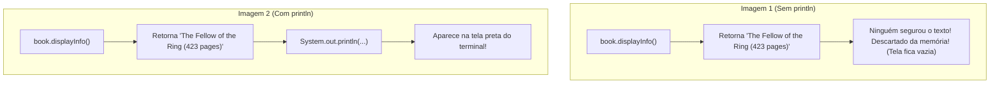
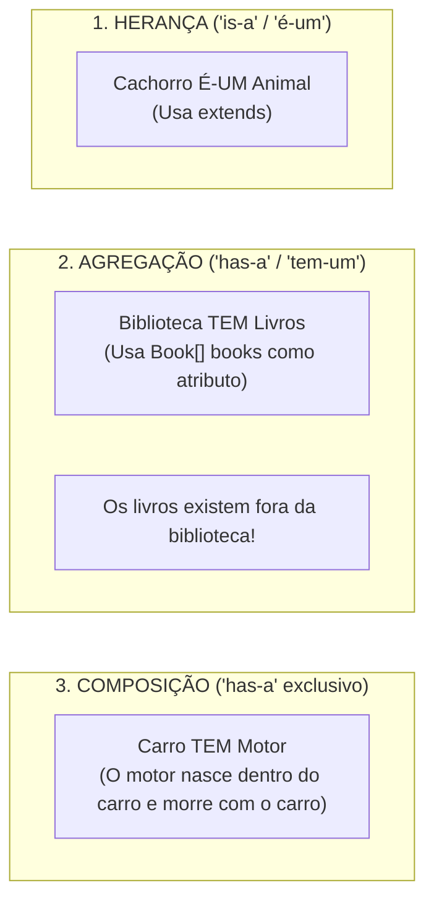

# Curso de Java — Capítulo 53 (Parte 9): Agregação 🏫
## O Ajuste ao Vivo de `book.displayInfo()`, a Execução no Botão Run e a Saída Completa no Console

---

> [!IMPORTANT]
> **Para cópia no Google Docs:** Este documento representa o fechamento completo do **Capítulo 53 (Agregação)**. Todas as 4 imagens enviadas (a correção ao vivo do método de retorno sem descarte, o clique no botão Run do IntelliJ, a exibição integral do relatório da biblioteca no console e o encerramento do capítulo) foram integralmente descritas em texto e acompanhadas de tabelas linha por linha e diagramas conceituais. Você pode copiar e colar todo o conteúdo diretamente no seu Google Docs sem perder nenhum detalhe visual.

---

### Links Rápidos dos Arquivos do Projeto no seu Computador
* Arquivo Principal Executado: [`Main.java`](../../../src/main/java/com/mickaelgeronimo/mastery/core/concurrency/Main.java)
* Classe Agregadora Completa: `Library.java`
* Classe do Livro Independente: `Book.java`
* Pasta Raiz do Projeto: `JAVA APRENDER`
* Parte Anterior (Capítulo 53 - Parte 8: Cabeçalho e Migração do Loop): `explicacao_agregacao_execucao_do_cabecalho_da_library_e_migracao_do_loop_para_dentro_da_biblioteca_capitulo53_parte8.md`

---

## 1. Reconstituição Detalhada das 4 Telas da IDE IntelliJ IDEA

Abaixo está o registro cronológico exato do que aconteceu na tela do professor ao longo das 4 capturas:

```
+----------------------------------------------------------------------------------------------------+
|                                    SEQUÊNCIA DE TELAS NO VÍDEO                                      |
+----------------------------------------------------------------------------------------------------+
| IMAGEM 1: Finalização da chamada em Library.java sem println.                                      |
|           • Arquivo ativo: Library.java.                                                           |
|           • Linha 17 digitada: book.displayInfo();                                                 |
|           • O código é válido para o compilador, mas tem um problema de lógica: displayInfo()      |
|             retorna texto (String), logo não imprimiria nada se ficasse solto assim!               |
|                                                                                                    |
| IMAGEM 2: Ajuste ao vivo do professor (Timestamp: 8:38:03).                                        |
|           • Arquivo ativo: Library.java.                                                           |
|           • O professor percebe que precisa envelopar a chamada em um println:                     |
|             Linha 17: System.out.println();book.displayInfo();                                     |
|           • DESTAQUE COM MOUSE: O professor seleciona a expressão "book.displayInfo()"             |
|             com fundo retangular azul para movê-la para dentro dos parênteses do println!          |
|                                                                                                    |
| IMAGEM 3: Troca para Main.java e clique no botão verde Run (Play).                                 |
|           • Arquivo ativo: Main.java.                                                              |
|           • O cursor do mouse aparece clicando no triângulo verde Play no topo direito da IDE.      |
|           • Código limpo e pronto chamando: library.displayInfo();                                 |
|                                                                                                    |
| IMAGEM 4: O Grande Resultado no Terminal Run > Main (Timestamp: 8:38:15).                         |
|           • Painel inferior exibe em verde todo o acervo da biblioteca:                            |
|               The 1897 NYC Public Library                                                          |
|               Books Available:                                                                     |
|               The Fellow of the Ring (423 pages)                                                   |
|               The Two Towers (352 pages)                                                           |
|               The Return of the King (416 pages)                                                   |
|           • Mensagem final: Process finished with exit code 0.                                      |
|           • Conclusão triunfal do Capítulo 53!                                                     |
+----------------------------------------------------------------------------------------------------+
```

---

## 2. A Grande Lição da Imagem 1 vs Imagem 2: O Erro Clássico de Retorno de Método

Este momento do vídeo é riquíssimo para qualquer pessoa que está aprendendo programação:

### Na Imagem 1, o professor escreveu:
```java
for(Book book : books){
    book.displayInfo(); // ⚠️ O que acontece aqui?
}
```

### Por Que Isso Não Imprimiria Nada?
Lembre-se de como declaramos o método dentro de `Book.java`:
```java
String displayInfo(){
    return this.title + " (" + this.pages + " pages)";
}
```
* O método tem o tipo de retorno **`String`**.
* Ele **NÃO tem** `System.out.println` dentro dele! Ele apenas calcula a frase e a **DEVOLVE** (`return`).
* Se você apenas escrever `book.displayInfo();`, é como se você fosse ao caixa de uma lanchonete, pedisse a nota fiscal, e quando o atendente estendesse a mão com o papel, você virasse as costas e fosse embora sem pegar o papel! O texto é calculado e depois descartado no lixo da memória!



### O Ajuste ao Vivo na Imagem 2:
O professor percebeu isso imediatamente! Na **Imagem 2**, ele digita `System.out.println();` e seleciona `book.displayInfo()` com o mouse (com aquele retângulo azul de seleção) para colocá-lo dentro dos parênteses:

```java
System.out.println(book.displayInfo());
```

---

## 3. O Clique no Botão Run (Imagem 3)

Na **Imagem 3**, o professor volta para o arquivo [`Main.java`](../../../src/main/java/com/mickaelgeronimo/mastery/core/concurrency/Main.java) e leva a setinha do mouse até o topo direito da janela do IntelliJ, clicando no triângulo verde de **Execução (Run / Play)**.

```
+----------------------------------------------------+
| IntelliJ IDEA               Current File  [▶ Run]  |
+----------------------------------------------------+
```

Ao fazer isso, o IntelliJ compila todas as classes modificadas e roda o método `main`.

---

## 4. O Resultado Final no Console (Imagem 4)

Ao rodar, o painel inferior abre e exibe a obra de arte completa da **Agregação**:

```text
The 1897 NYC Public Library
Books Available: 
The Fellow of the Ring (423 pages)
The Two Towers (352 pages)
The Return of the King (416 pages)

Process finished with exit code 0
```

### Acomapanhamento Passo a Passo da Saída:
1. **Linha 1:** `The 1897 NYC Public Library`
   Impresso por `Library.java` usando os atributos `this.year` e `this.name`.
2. **Linha 2:** `Books Available: `
   Impresso pelo aviso de cabeçalho da biblioteca.
3. **Linhas 3, 4 e 5:**
   * `The Fellow of the Ring (423 pages)`
   * `The Two Towers (352 pages)`
   * `The Return of the King (416 pages)`
   Impressos pelo laço `for-each` da biblioteca, onde cada livro formatou seus próprios dados independentes!

---

## 5. Código-Fonte Completo e Definitivo do Projeto

### Arquivo 1: `Book.java`

```java
public class Book {

    String title;
    int pages;

    Book(String title, int pages){
        this.title = title;
        this.pages = pages;
    }

    String displayInfo(){
        return this.title + " (" + this.pages + " pages)";
    }

}
```

---

### Arquivo 2: `Library.java`

```java
public class Library {

    String name;
    int year;
    Book[] books;

    Library(String name, int year, Book[] books){
        this.name = name;
        this.year = year;
        this.books = books;
    }

    void displayInfo(){
        System.out.println("The " + this.year + " " + this.name);
        System.out.println("Books Available: ");
        for(Book book : books){
            System.out.println(book.displayInfo());
        }
    }

}
```

---

### Arquivo 3: [`Main.java`](../../../src/main/java/com/mickaelgeronimo/mastery/core/concurrency/Main.java)

```java
public class Main {
    public static void main(String[] args) {

        // Aggregation = Represents a "has-a" relationship between objects.
        //               One object contains another object as part of its structure,
        //               but the contained object/s can exist independently.

        Book book1 = new Book("The Fellow of the Ring", 423);
        Book book2 = new Book("The Two Towers", 352);
        Book book3 = new Book("The Return of the King", 416);

        Book[] books = {book1, book2, book3};

        Library library = new Library("NYC Public Library", 1897, books);

        library.displayInfo();

    }
}
```

---

## 6. Tabelas Linha por Linha de Todo o Projeto

### A) Dissecação de `Library.java`

| Linha | Código | Explicação Amigável para Iniciantes |
| :---: | :--- | :--- |
| **01** | `public class Library {` | Abre o molde da Biblioteca pública. |
| **02** | *(em branco)* | Organização visual. |
| **03** | `    String name;` | Atributo para guardar o nome da biblioteca. |
| **04** | `    int year;` | Atributo para guardar o ano de fundação. |
| **05** | `    Book[] books;` | **O Atributo Agregador:** Gaveta para segurar a coleção de livros. |
| **06** | *(em branco)* | Organização visual. |
| **07** | `    Library(String name, int year, Book[] books){` | Construtor que recebe nome, ano e os livros prontos de fora. |
| **08** | `        this.name = name;` | Guarda o nome no atributo permanente deste objeto. |
| **09** | `        this.year = year;` | Guarda o ano no atributo permanente deste objeto. |
| **10** | `        this.books = books;` | Conecta o array de livros à biblioteca. |
| **11** | `    }` | Fim do construtor. |
| **12** | *(em branco)* | Organização visual. |
| **13** | `    void displayInfo(){` | Método para imprimir o relatório completo da biblioteca. |
| **14** | `        System.out.println("The " + this.year + " " + this.name);` | Imprime o cabeçalho e pula para a próxima linha. |
| **15** | `        System.out.println("Books Available: ");` | Imprime o título da lista de livros disponíveis. |
| **16** | `        for(Book book : books){` | Laço que percorre cada livro que está guardado no array `books`. |
| **17** | `            System.out.println(book.displayInfo());` | **Delegação:** Pede os dados de cada livro e imprime no terminal. |
| **18** | `        }` | Fim do laço `for-each`. |
| **19** | `    }` | Fim do método `displayInfo()`. |
| **20** | *(em branco)* | Organização visual. |
| **21** | `}` | Fim da classe `Library`. |

---

### B) Dissecação de [`Main.java`](../../../src/main/java/com/mickaelgeronimo/mastery/core/concurrency/Main.java)

| Linha | Código | Explicação Amigável para Iniciantes |
| :---: | :--- | :--- |
| **01** | `public class Main {` | Classe executável do programa. |
| **02** | `    public static void main(String[] args) {` | Ponto de partida da aplicação. |
| **03** | *(em branco)* | Organização visual. |
| **04** | `        // Aggregation = Represents a "has-a" relationship between objects.` | Comentário teórico: Agregação é relação "tem-um". |
| **05** | `        //               One object contains another object as part of its structure,` | Comentário teórico: Um objeto contém outro como parte de si. |
| **06** | `        //               but the contained object/s can exist independently.` | Comentário teórico: Os objetos contidos existem independentemente. |
| **07** | *(em branco)* | Organização visual. |
| **08** | `        Book book1 = new Book("The Fellow of the Ring", 423);` | Fabrica o Livro 1 de forma independente na memória. |
| **09** | `        Book book2 = new Book("The Two Towers", 352);` | Fabrica o Livro 2 de forma independente na memória. |
| **10** | `        Book book3 = new Book("The Return of the King", 416);` | Fabrica o Livro 3 de forma independente na memória. |
| **11** | *(em branco)* | Organização visual. |
| **12** | `        Book[] books = {book1, book2, book3};` | Junta as referências dos 3 livros em um array `books`. |
| **13** | *(em branco)* | Organização visual. |
| **14** | `        Library library = new Library("NYC Public Library", 1897, books);` | **A Agregação:** Instancia a biblioteca entregando o array de livros. |
| **15** | *(em branco)* | Organização visual. |
| **16** | `        library.displayInfo();` | Manda a biblioteca exibir o relatório completo com todos os livros. |
| **17** | *(em branco)* | Organização visual. |
| **18** | `    }` | Fim do método `main`. |
| **19** | `}` | Fim da classe `Main`. |

---

## 7. O Grande Resumo de Ouro do Capítulo 53: Agregação 🏫

Chegamos ao final deste capítulo fundamental de Orientação a Objetos. Vamos fixar as três grandes verdades para você nunca mais esquecer:



1. **Agregação é um relacionamento do tipo *"has-a"* (*tem-um*):**
   A Biblioteca tem livros (`Library has-a Book[]`).
2. **Existência Independente:**
   Os livros foram instanciados primeiro, no `main`. Eles não precisam da biblioteca para existir. Se a variável `library` for apagada, os livros continuam vivos no `main`!
3. **Delegação Limpa:**
   A biblioteca não precisa saber como formatar o título e as páginas de cada livro; ela delega essa tarefa chamando `book.displayInfo()`. Cada classe cuida exclusivamente da sua própria responsabilidade!
