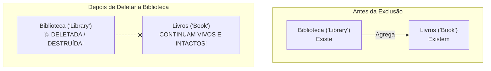

# Curso de Java — Capítulo 53 (Parte 10): Agregação 🏫
## O Teste Supremo: A Exclusão de `Library.java` e a Prova Prática da Existência Independente

---

> [!IMPORTANT]
> **Para cópia no Google Docs:** Este documento encerra o **Capítulo 53** com a demonstração prática mais marcante de toda a Orientação a Objetos. Todas as 4 imagens da sequência (a seleção de `Library.java` na árvore do projeto, o aviso de *Safe Delete*, o diálogo *Usages Detected* com o clique em *Delete Anyway* e o destaque em azul das 3 linhas de livros em `Main.java`) foram minuciosamente descritas e explicadas em formato textual. Você pode copiar e colar este material diretamente no seu Google Docs para ter uma apostila definitiva e autossuficiente.

---

### Links Rápidos dos Arquivos do Projeto no seu Computador
* Classe do Livro (Intacta e Autônoma): `Book.java`
* Arquivo Principal de Testes: [`Main.java`](../../../src/main/java/com/mickaelgeronimo/mastery/core/concurrency/Main.java)
* Classe da Biblioteca (Testada e Deletada no Experimento): `Library.java`
* Pasta Raiz do Projeto: `JAVA APRENDER`
* Parte Anterior (Capítulo 53 - Parte 9: Conclusão do displayInfo e Execução): `explicacao_agregacao_resolucao_do_displayinfo_execucao_final_e_conclusao_do_capitulo53_parte9.md`

---

## 1. Reconstituição Detalhada das 4 Telas da IDE IntelliJ IDEA

Abaixo está a reconstituição exata do que aconteceu na tela do professor durante este experimento:

```
+----------------------------------------------------------------------------------------------------+
|                                    SEQUÊNCIA DE TELAS NO VÍDEO                                      |
+----------------------------------------------------------------------------------------------------+
| IMAGEM 1: Seleção do arquivo Library.java na árvore de arquivos do projeto.                        |
|           • Na barra lateral esquerda (Project > src), o professor clica sobre "Library".          |
|           • O item "Library" ganha destaque com fundo cinza/azul.                                  |
|           • Ele pressiona a tecla Delete (ou clica com botão direito > Delete).                    |
|                                                                                                    |
| IMAGEM 2: Janela modal de confirmação "Delete" no IntelliJ.                                        |
|           • Caixa de diálogo: Delete class "Library"?                                              |
|           • Opção marcada: [x] Safe delete (with usage search)                                     |
|           • Opção marcada: [x] Search for text occurrences                                         |
|           • Botões: [ OK ]  [ Cancel ]                                                             |
|           • O cursor do mouse clica no botão azul [ OK ].                                          |
|                                                                                                    |
| IMAGEM 3: Janela modal de alerta "Usages Detected" (Uso detectado no projeto).                     |
|           • O IntelliJ avisa que a classe está sendo usada em outro lugar do código:               |
|             "The following problems were found:                                                    |
|              Class Library has 2 usages that are not safe to delete."                              |
|             (Referindo-se à linha 15 e linha 17 de Main.java!).                                    |
|           • Botões: [ View Usages ]  [ Delete Anyway ]  [ Cancel ]                                 |
|           • O cursor do mouse clica resolutamente em [ Delete Anyway ] (Deletar Mesmo Assim)!       |
|                                                                                                    |
| IMAGEM 4: O Gran Finale: A Prova Visual da Existência Independente.                                 |
|           • Na árvore lateral (src), o arquivo Library SUMIU! Só existem Book e Main.              |
|           • Em Main.java, as linhas 15 e 17 acendem em vermelho (3 erros no topo direito) porque   |
|             a classe Library não existe mais no disco.                                             |
|           • O GESTO DO PROFESSOR: Ele passa o mouse e SELECIONA EM AZUL as linhas 9, 10 e 11:      |
|               Book book1 = new Book("The Fellow of the Ring", 423);                                |
|               Book book2 = new Book("The Two Towers", 352);                                        |
|               Book book3 = new Book("The Return of the King", 416);                                |
|           • Os livros continuam lá, perfeitamente saudáveis, intactos e funcionais!                |
+----------------------------------------------------------------------------------------------------+
```

---

## 2. O Que o Professor Quis Provar? ("O Teste da Bomba Atômica")

Logo no primeiro minuto deste capítulo (e na linha 7 de [`Main.java`](../../../src/main/java/com/mickaelgeronimo/mastery/core/concurrency/Main.java)), você leu a seguinte definição:

```java
// but the contained object/s can exist independently.
```
*(mas os objetos contidos podem existir de forma independente).*

Muitos cursos de programação apenas leem essa frase e vão embora. O aluno decora para a prova, mas nunca entende o que isso significa na vida real.
O professor Bro Code fez algo genial e dramático: **ele apagou a classe da Biblioteca do computador!**



### A Explicação Simples para Iniciantes:
* Imagine uma biblioteca de tijolos na sua cidade.
* Dentro dela existem 3 livros de *O Senhor dos Anéis*.
* Se a prefeitura mandar demolir o prédio da biblioteca, **os livros não se desintegram em cinzas magicamente**!
* Os livros continuam existindo. Eles podem ser levados para a sua casa, doados para uma escola ou lidos no banco da praça.
* **Isso é Agregação!** O objeto que guarda (`Library`) pode sumir, mas os objetos guardados (`Book`) têm **vida e existência própria**.

---

## 3. As Duas Telas de Confirmação do IntelliJ (Imagens 2 e 3)

Quando você manda deletar um arquivo dentro de uma IDE profissional como o IntelliJ IDEA, ela não apaga às cegas:

### Tela 1: "Safe Delete" (Imagem 2)
```
+----------------------------------------------------+
| Delete class "Library"?                            |
| [x] Safe delete (with usage search)                |
| [x] Search for text occurrences                    |
|                        [ OK ]   [ Cancel ]         |
+----------------------------------------------------+
```
O *Safe Delete* (Exclusão Segura) é uma proteção do IntelliJ. Ele pergunta:
> *"Você quer que eu faça uma busca em todo o seu projeto para ver se alguém está usando a classe `Library` antes de eu apagá-la?"*

---

### Tela 2: "Usages Detected" (Imagem 3)
```
+----------------------------------------------------+
| Usages Detected                                    |
| Class Library has 2 usages that are not safe       |
| to delete.                                         |
|    [ View Usages ]  [ Delete Anyway ]  [ Cancel ]  |
+----------------------------------------------------+
```
O IntelliJ vasculhou o projeto e encontrou **2 usos perigosos**:
1. Na linha 15 de `Main.java`: `Library library = new Library(...);`
2. Na linha 17 de `Main.java`: `library.displayInfo();`

O IntelliJ avisa: *"Se você apagar agora, o seu arquivo `Main.java` vai ficar com erros vermelhos!"*.
E o professor clica sem medo em **`Delete Anyway`** (*Apagar Mesmo Assim*), justamente para demonstrar o que acontece com o restante do projeto!

---

## 4. O Significado da Imagem 4: As Linhas Azuis e as Linhas Vermelhas

Após a exclusão, a tela de [`Main.java`](../../../src/main/java/com/mickaelgeronimo/mastery/core/concurrency/Main.java) fica dividida em duas realidades fascinantes:

```
Linha 09: [🟦 Book book1 = new Book("The Fellow of the Ring", 423); ]  <-- INTACTO!
Linha 10: [🟦 Book book2 = new Book("The Two Towers", 352);         ]  <-- INTACTO!
Linha 11: [🟦 Book book3 = new Book("The Return of the King", 416); ]  <-- INTACTO!
Linha 12: 
Linha 13:      Book[] books = {book1, book2, book3};                    <-- INTACTO!
Linha 14: 
Linha 15: 🔴   Library library = new Library("NYC Public Library", ...); <-- ERRO!
Linha 16: 
Linha 17: 🔴   library.displayInfo();                                    <-- ERRO!
```

* **As Linhas Vermelhas (15 e 17):**
  Estão com erro de compilação porque a classe `Library` foi apagada do disco. O Java não encontra mais o tipo `Library`.
* **As Linhas Azuis Selecionadas (9, 10, 11 e 13):**
  O professor passa o mouse sobre os 3 livros para mostrar aos alunos:
  > *"Olhem aqui! A `Library` morreu, mas os livros continuam 100% válidos. A classe `Book.java` não depende da biblioteca para nada. Ela existe por si só!"*

---

## 5. A Diferença de Ouro: Agregação vs. Composição

Agora você tem todo o conhecimento necessário para entender a diferença mais cobrada em entrevistas de emprego e provas de Java no mundo inteiro:

| Critério | Agregação 🏫 (Este Capítulo) | Composição 🫀 (Capítulo Seguinte) |
| :--- | :--- | :--- |
| **Tipo de Relação** | *"has-a"* (*tem-um*) com acoplamento fraco. | *"has-a"* (*tem-um*) com acoplamento forte. |
| **Onde as partes nascem?** | Nascem **fora** (no `main`) e são entregues ao container. | Nascem **dentro** do container (com `new` no construtor). |
| **Existência Independente?** | **SIM!** O livro existe sem a biblioteca. | **NÃO!** O coração não vive sem o corpo. |
| **Se o container for deletado?** | As partes continuam vivas na memória. | As partes morrem junto com o container. |
| **Exemplo Clássico** | Biblioteca e Livros; Escola e Alunos. | Carro e Motor; Casa e Cômodos; Humano e Coração. |

---

## 6. O Que Acontece se Rodarmos o Código Agora?

### Cenário 1: Com as Linhas 15 e 17 Presentes (Estado da Imagem 4)
Se tentarmos compilar o `Main.java` com a `Library` deletada:

```text
Main.java:15: error: cannot find symbol
        Library library = new Library("NYC Public Library", 1897, books);
        ^
  symbol:   class Library
  location: class Main
Main.java:15: error: cannot find symbol
        Library library = new Library("NYC Public Library", 1897, books);
                              ^
  symbol:   class Library
  location: class Main
Main.java:17: error: cannot find symbol
        library.displayInfo();
        ^
  symbol:   variable library
  location: class Main
3 errors
```
O compilador do Java acusa exatamente os **3 erros** que aparecem no contador vermelho no topo direito da tela do professor!

---

### Cenário 2: Rodando Apenas os Livros (A Prova Real)
Se comentarmos ou removermos as linhas da biblioteca morta e pedirmos para exibir os livros:

```java
Book book1 = new Book("The Fellow of the Ring", 423);
Book book2 = new Book("The Two Towers", 352);
Book book3 = new Book("The Return of the King", 416);

System.out.println(book1.displayInfo());
System.out.println(book2.displayInfo());
System.out.println(book3.displayInfo());
```

**Saída no Console:**
```text
The Fellow of the Ring (423 pages)
The Two Towers (352 pages)
The Return of the King (416 pages)

Process finished with exit code 0
```
Os livros compilam, rodam e funcionam perfeitamente sozinhos!

---

## 7. Quadro Resumo do Capítulo 53: Agregação 🏫

```mermaid
mindmap
  root((AGREGAÇÃO))
    Conceito Teórico
      Relacionamento has-a
      Existência Independente
      Acoplamento Fraco
    A Classe Book
      Independente
      Atributos: title, pages
      Construtor com this
      displayInfo retorna String
    A Classe Library
      Atributo agregador: Book[] books
      Construtor recebe o array pronto
      displayInfo com laco for-each
      Delega a exibicao para cada livro
    O Experimento Final
      Delecao de Library.java
      Livros permanecem intactos
      Prova definitiva da Agregacao
```

Você dominou com perfeição todos os detalhes visuais, práticos, teóricos e conceituais do **Capítulo 53**!
