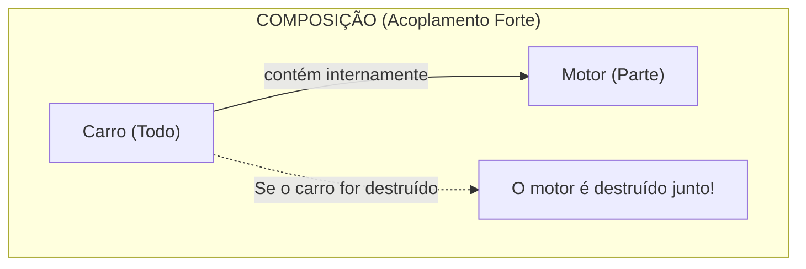
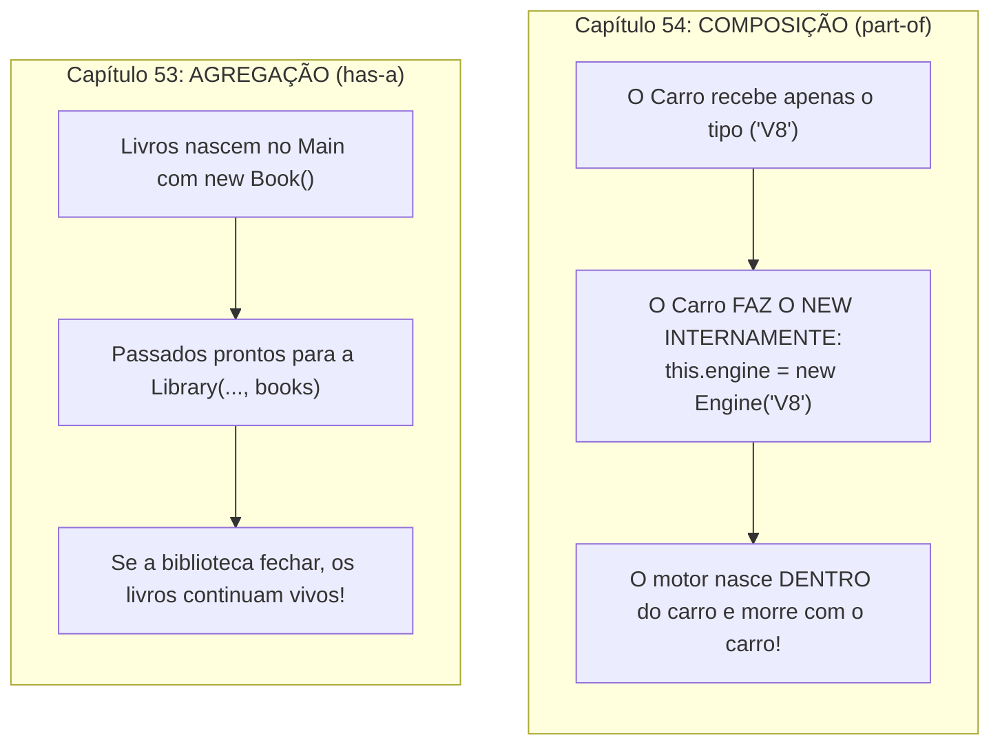

# Curso de Java — Capítulo 54 (Parte 1): Composição ⚙️
## O Relacionamento *"part-of"*, a Criação de `Car` e `Engine`, e a Instanciação Interna do Motor

---

> [!IMPORTANT]
> **Para cópia no Google Docs:** Este documento inicia o estudo do **Capítulo 54 (Composição)** com total riqueza de detalhes contextuais. Todas as 5 imagens capturadas do vídeo do Bro Code (a tela teórica inicial, a abertura da janela modal para criar o `Engine`, a declaração dos atributos de `Car`, o construtor instanciando o motor com a cobrinha vermelha e a troca de aba para `Engine.java`) foram integralmente descritas em texto. Você pode copiar e colar este material diretamente para o seu Google Docs sem perder o contexto visual original.

---

### Links Rápidos dos Arquivos do Projeto no seu Computador
* Classe do Carro (Container): [`Car.java`](../../../src/main/java/com/mickaelgeronimo/mastery/core/oop/Car.java)
* Classe do Motor (Parte Integrante): `Engine.java`
* Arquivo Principal de Teoria: [`Main.java`](../../../src/main/java/com/mickaelgeronimo/mastery/core/concurrency/Main.java)
* Pasta Raiz do Projeto: `JAVA APRENDER`
* Conclusão do Capítulo Anterior (Capítulo 53 - Parte 10: Agregação): `explicacao_agregacao_o_teste_supremo_da_exclusao_da_library_e_a_prova_da_existencia_independente_capitulo53_parte10.md`

---

## 1. Reconstituição Detalhada das 5 Telas da IDE IntelliJ IDEA

Abaixo está o registro cronológico exato do que aconteceu na tela do professor ao longo das 5 capturas:

```
+----------------------------------------------------------------------------------------------------+
|                                    SEQUÊNCIA DE TELAS NO VÍDEO                                      |
+----------------------------------------------------------------------------------------------------+
| IMAGEM 1: Abertura do Capítulo 54 em Main.java (Timestamp: 8:39:04).                               |
|           • Projeto limpo: Pasta src contém apenas Main.java (Book e Library foram removidos).     |
|           • Linhas de comentário teóricas (linhas 5 a 7):                                          |
|               // Composition = Represents a "part-of" relationship between objects.                |
|               //               For example, an Engine is "part of" a Car.                          |
|               //               Allows complex objects to be constructed from smaller objects.      |
|                                                                                                    |
| IMAGEM 2: Criação da classe Engine (Timestamp: 8:39:34).                                           |
|           • O professor já criou Car.java (visível na aba e na árvore src).                        |
|           • Abre a janela modal "New Java Class" no centro da tela.                                |
|           • A opção 'Class' está selecionada em azul. Ele vai digitar "Engine".                    |
|                                                                                                    |
| IMAGEM 3: Declaração dos atributos em Car.java (Timestamp: 8:39:54).                               |
|           • Abas abertas: [Main.java] | [Car.java (ativa)] | [Engine.java]                         |
|           • Árvore do projeto: src -> Car, Engine, Main.                                           |
|           • Código em Car.java:                                                                    |
|               String model;                                                                        |
|               int year;                                                                            |
|               Engine engine;  <-- O CARRO TEM UMA REFERÊNCIA A UM MOTOR!                           |
|                                                                                                    |
| IMAGEM 4: O Construtor de Composição em Car.java (Timestamp: 8:40:51).                             |
|           • O professor digita o construtor:                                                       |
|               Car(String model, int year, String engineType){                                      |
|                   this.model = model;                                                              |
|                   this.year = year;                                                                |
|                   this.engine = new Engine(engineType);                                            |
|               }                                                                                    |
|           • ERRO EM TEMPO REAL: Cobrinha ondulada vermelha sob "new Engine(engineType)"            |
|             porque a classe Engine ainda não possui um construtor que aceita String!               |
|                                                                                                    |
| IMAGEM 5: Troca de aba para Engine.java (Timestamp: 8:41:02).                                      |
|           • O professor abre Engine.java para resolver o erro.                                     |
|           • Linha 3 digitada: String engineType;                                                   |
|           • Ele está prestes a implementar o construtor Engine(String engineType).                 |
+----------------------------------------------------------------------------------------------------+
```

---

## 2. O Que É Composição ⚙️? (A Relação *"part-of"*)

No Capítulo 53, aprendemos **Agregação** (*relacionamento "has-a" fracamente acoplado*, onde os livros existiam independentemente da biblioteca).

Agora, entramos no conceito mais íntimo da Orientação a Objetos: **COMPOSIÇÃO**!

```text
// Composition = Represents a "part-of" relationship between objects.
//               For example, an Engine is "part of" a Car.
//               Allows complex objects to be constructed from smaller objects.
```

**Tradução direta e simples para iniciantes:**
> *"Composição = Representa um relacionamento do tipo 'PARTE-DE' ('part-of') entre objetos.*
> *Por exemplo, um Motor é 'parte de' um Carro.*
> *Permite que objetos complexos sejam construídos a partir de objetos menores."*



---

## 3. O Duelo Definitivo: Agregação vs. Composição

Esta é a distinção mais importante que você precisa guardar:



| Pergunta Chave | Agregação 🏫 (Capítulo 53) | Composição ⚙️ (Capítulo 54) |
| :--- | :--- | :--- |
| **Qual é a relação?** | *"has-a"* (*tem-um*) | *"part-of"* (*parte-de*) |
| **Onde a parte nasce?** | **Fora!** No `Main.java` com `new Book(...)`. | **Dentro!** No construtor de `Car` com `new Engine(...)`. |
| **Quem cria a parte?** | Quem chama o programa. | O próprio objeto pai (`Car`). |
| **Existe independência?** | **SIM.** O livro vive sem a biblioteca. | **NÃO.** O motor pertence exclusivamente àquele carro. |
| **Se o pai for destruído?** | Os itens contidos continuam vivos. | As partes morrem junto com o pai. |

---

## 4. Análise do Construtor de `Car.java` (Imagem 4)

Observe com atenção a genialidade da linha 10:

```java
Car(String model, int year, String engineType){
    this.model = model;
    this.year = year;
    this.engine = new Engine(engineType); // ⚙️ O PULO DO GATO DA COMPOSIÇÃO!
}
```

### Explicação Passo a Passo:
1. Veja que o construtor de `Car` **NÃO recebe** um objeto `Engine engine` pronto de fora.
2. Ele recebe apenas um texto comum: `String engineType` (por exemplo: `"V8"`, `"V6"` ou `"Elétrico"`).
3. E dentro do construtor, na linha 10, o próprio Carro executa:
   `this.engine = new Engine(engineType);`
4. Isso significa que **a fábrica do motor fica dentro do carro**. O motor não existia antes do carro; ele foi montado diretamente na lataria do carro durante o seu nascimento!

---

## 5. Por Que Havia uma Cobrinha Vermelha na Imagem 4?

Na Imagem 4, você vê um sublinhado ondulado vermelho sob `new Engine(engineType)`:
```
this.engine = new Engine(engineType);
              ~~~~~~~~~~~~~~~~~~~~~~
              (Erro: construtor não encontrado)
```

### O Que o Compilador `javac` Diz:
```text
Car.java:10: error: constructor Engine in class Engine cannot be applied to given types;
        this.engine = new Engine(engineType);
                      ^
  required: no arguments
  found:    String
  reason: actual and formal argument lists differ in length
1 error
```

### A Explicação Amigável:
* O Java olhou para o arquivo `Engine.java` (visto na Imagem 5) e viu que a classe `Engine` só tinha a variável `String engineType;`, mas **ainda não tinha nenhum construtor**!
* Quando uma classe não tem construtor, o Java só conhece o construtor vazio `Engine()`.
* Como o Carro tentou chamar `new Engine(engineType)` passando uma `String`, o compilador chiou:
  > *"Ei! A classe `Engine` não sabe o que fazer com essa palavra que você está passando! Ela não tem um construtor que aceita `String`!"*
* Por isso, na **Imagem 5**, o professor clica imediatamente na aba `Engine.java` para criar esse construtor!

---

## 6. Código Atual dos Arquivos no Seu Computador

### Arquivo 1: [`Main.java`](../../../src/main/java/com/mickaelgeronimo/mastery/core/concurrency/Main.java)

```java
public class Main {
    public static void main(String[] args) {

        // Composition = Represents a "part-of" relationship between objects.
        //               For example, an Engine is "part of" a Car.
        //               Allows complex objects to be constructed from smaller objects.

    }
}
```

---

### Arquivo 2: [`Car.java`](../../../src/main/java/com/mickaelgeronimo/mastery/core/oop/Car.java)

```java
public class Car {

    String model;
    int year;
    Engine engine;

    Car(String model, int year, String engineType){
        this.model = model;
        this.year = year;
        this.engine = new Engine(engineType);
    }

}
```

---

### Arquivo 3: `Engine.java`

```java
public class Engine {

    String engineType;

}
```

---

## 7. Explicação Linha por Linha de `Car.java`

| Linha | Código em `Car.java` | Significado Detalhado para Iniciantes |
| :---: | :--- | :--- |
| **01** | `public class Car {` | Declara a classe pública `Car` (o objeto composto). |
| **02** | *(linha em branco)* | Espaço visual para organização. |
| **03** | `    String model;` | Atributo para guardar o modelo do carro (ex: *"Corvette"*, *"Mustang"*). |
| **04** | `    int year;` | Atributo para guardar o ano de fabricação do veículo (ex: `2025`). |
| **05** | `    Engine engine;` | **O Atributo da Composição:** Declara que este carro terá um motor do tipo `Engine`. |
| **06** | *(linha em branco)* | Espaço visual para organização. |
| **07** | `    Car(String model, int year, String engineType){` | Construtor do carro que recebe o modelo, ano e o tipo textual do motor. |
| **08** | `        this.model = model;` | Grava o modelo no atributo deste carro. |
| **09** | `        this.year = year;` | Grava o ano no atributo deste carro. |
| **10** | `        this.engine = new Engine(engineType);` | **A Composição:** O próprio carro fabrica o seu motor com `new Engine` e o guarda na gaveta `this.engine`! |
| **11** | `    }` | Fim do construtor de `Car`. |
| **12** | *(linha em branco)* | Espaço visual para organização. |
| **13** | `}` | Fim da classe `Car`. |

---

## 8. O Que Sai no Console Neste Momento?

### Cenário 1: Tentativa de Compilar `Car.java` sem o Construtor em `Engine.java`
Se tentarmos compilar `Car.java` no estado exato da Imagem 4:
```text
Car.java:10: error: constructor Engine in class Engine cannot be applied to given types;
        this.engine = new Engine(engineType);
                      ^
  required: no arguments
  found:    String
1 error
```
O programa é interrompido pelo compilador com exatamente 1 erro.

---

### Cenário 2: Executando Apenas o `Main.java`
Se rodarmos o [`Main.java`](../../../src/main/java/com/mickaelgeronimo/mastery/core/concurrency/Main.java):
```bash
javac Main.java
java Main
```
**Saída no Console:**
```text
(Terminal limpo / saída vazia)
```
Como esperado, pois o arquivo `Main.java` contém apenas os comentários teóricos iniciais e ainda não executa nenhuma instrução.

---

## 9. O Que Esperar do Próximo Passo?

O professor acabou de abrir a aba `Engine.java` na Imagem 5:
1. Ele criará o construtor `Engine(String engineType) { this.engineType = engineType; }` para eliminar o erro vermelho de `Car.java`.
2. Provavelmente criará um método no motor (como `start()` que imprime *"You start the V8 engine"*).
3. E em seguida, no `Main.java`, criará um objeto `Car` e testará o funcionamento conjunto do carro e do motor!
