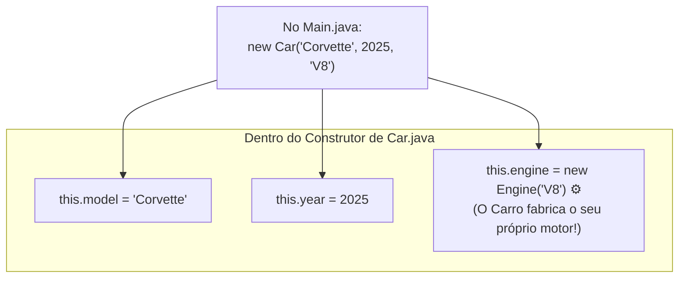

# Curso de Java — Capítulo 54 (Parte 2): Composição ⚙️
## O Construtor de `Engine`, a Resolução do Erro em `Car.java`, a Instanciação do Carro e o Mistério de `car.engine`

---

> [!IMPORTANT]
> **Para cópia no Google Docs:** Este documento foi estruturado de forma autossuficiente e rica em detalhes visuais. Todas as 5 imagens capturadas do vídeo do Bro Code (a criação do construtor em `Engine.java`, os ajustes em `Car.java` com o desaparecimento da cobrinha vermelha, a instanciação do Corvette em `Main.java` e a preparação para clicar no botão verde Run) foram minuciosamente transcritas em texto. Você pode copiar e colar este material diretamente no seu Google Docs sem perder nenhuma informação visual.

---

### Links Rápidos dos Arquivos do Projeto no seu Computador
* Classe do Motor Atualizada: `Engine.java`
* Classe do Carro (Composição Concluída): [`Car.java`](../../../src/main/java/com/mickaelgeronimo/mastery/core/oop/Car.java)
* Arquivo Principal Executável: [`Main.java`](../../../src/main/java/com/mickaelgeronimo/mastery/core/concurrency/Main.java)
* Pasta Raiz do Projeto: `JAVA APRENDER`
* Parte Anterior (Capítulo 54 - Parte 1: Introdução à Composição): `explicacao_composicao_definicao_part_of_criacao_de_car_e_engine_e_instanciacao_interna_capitulo54_parte1.md`

---

## 1. Reconstituição Detalhada das 5 Telas da IDE IntelliJ IDEA

Abaixo está o registro cronológico exato do que aconteceu na tela do professor ao longo das 5 capturas:

```
+----------------------------------------------------------------------------------------------------+
|                                    SEQUÊNCIA DE TELAS NO VÍDEO                                      |
+----------------------------------------------------------------------------------------------------+
| IMAGEM 1: Criação do Construtor em Engine.java.                                                    |
|           • Arquivo ativo: Engine.java.                                                            |
|           • O professor simplificou o atributo para: String type;                                  |
|           • Adicionou o construtor (linhas 5 a 7):                                                 |
|               Engine(String type){                                                                 |
|                   this.type = type;                                                                |
|               }                                                                                    |
|           • Cursor na linha 6 após o ponto e vírgula.                                              |
|                                                                                                    |
| IMAGEM 2: Ajuste do parâmetro no construtor de Car.java.                                           |
|           • Arquivo ativo: Car.java.                                                               |
|           • O professor testa mudar temporariamente o parâmetro para "String type"                 |
|             e "this.engine = new Engine(type);", com a palavra "type" selecionada em cinza/azul.   |
|                                                                                                    |
| IMAGEM 3: Decisão final em Car.java: Parâmetro engineType mantido e ERRO ELIMINADO!                |
|           • Construtor final de Car.java:                                                          |
|               Car(String model, int year, String engineType){                                      |
|                   this.model = model;                                                              |
|                   this.year = year;                                                                |
|                   this.engine = new Engine(engineType);                                            |
|               }                                                                                    |
|           • O PULO DO GATO VISUAL: A cobrinha vermelha sob "new Engine(engineType)" SUMIU!          |
|             Como Engine.java agora aceita uma String, o código compila com perfeição!              |
|                                                                                                    |
| IMAGEM 4: Instanciação do Carro no Main.java.                                                      |
|           • Arquivo ativo: Main.java.                                                              |
|           • Linha 9 digitada:                                                                      |
|               Car car = new Car("Corvette", 2025, "V8");                                           |
|           • Linha 11: Início da impressão com System.out.println(car.model);                       |
|                                                                                                    |
| IMAGEM 5: As Três Impressões e a Preparação para o Run (Timestamp: 8:42:43).                       |
|           • Linhas de impressão completadas (linhas 11 a 13):                                      |
|               System.out.println(car.model);                                                       |
|               System.out.println(car.year);                                                        |
|               System.out.println(car.engine);  <-- O GRANDE MISTÉRIO!                              |
|           • O cursor do mouse está pairando exatamente sobre o botão verde Play (Run) no topo      |
|             direito da IDE, prestes a executar a aplicação.                                        |
+----------------------------------------------------------------------------------------------------+
```

---

## 2. A Resolução do Erro: Por Que a Linha Vermelha Sumiu na Imagem 3?

Na Parte 1, o arquivo [`Car.java`](../../../src/main/java/com/mickaelgeronimo/mastery/core/oop/Car.java) estava com um sublinhado ondulado vermelho acusando erro:
```
this.engine = new Engine(engineType);
              ~~~~~~~~~~~~~~~~~~~~~~
              (Erro: Não existe construtor Engine que aceite String)
```

Na **Imagem 1**, o professor entrou em `Engine.java` e construiu o ritual de nascimento do motor:

```java
public class Engine {

    String type;

    Engine(String type){
        this.type = type;
    }
}
```

* Ao fazer isso, o Java aprendeu: *"Toda vez que alguém chamar `new Engine(...)`, essa pessoa deve me entregar um texto (`String type`), que eu guardarei no atributo `this.type`"*.
* Quando o professor voltou para [`Car.java`](../../../src/main/java/com/mickaelgeronimo/mastery/core/oop/Car.java) (Imagem 3), o compilador conferiu:
  * `engineType` é uma `String`? **Sim!**
  * O construtor `Engine` aceita uma `String`? **Sim!**
* **Resultado:** O erro desapareceu no mesmo segundo! A classe `Car` agora consegue dar à luz ao motor sem nenhum impedimento!

---

## 3. A Beleza da Composição no `Main.java` (Imagem 4)

Observe como o carro é criado no arquivo [`Main.java`](../../../src/main/java/com/mickaelgeronimo/mastery/core/concurrency/Main.java):

```java
Car car = new Car("Corvette", 2025, "V8");
```



### O Contraste Impressionante com a Agregação:
* **Na Agregação (Capítulo 53):** O `main` tinha que fabricar todos os livros primeiro com `new Book(...)`, colocá-los num array, e só depois passar o array para a biblioteca.
* **Na Composição (Capítulo 54):** O `main` **não precisa saber fabricar motores**! O `main` apenas diz: *"Eu quero um Corvette 2025 com motor V8"*. O próprio Carro, dentro da sua própria fábrica interna, faz `new Engine("V8")`!

---

## 4. O Grande Mistério da Imagem 5: O Que Sai ao Imprimir `car.engine`?

Na Imagem 5, o professor escreveu três linhas de impressão:

```java
System.out.println(car.model);
System.out.println(car.year);
System.out.println(car.engine);
```

### O Que Acontece com Cada Linha?
1. **`System.out.println(car.model);`**
   * `car.model` guarda o texto `"Corvette"`.
   * Imprime no terminal: **`Corvette`**.
2. **`System.out.println(car.year);`**
   * `car.year` guarda o número `2025`.
   * Imprime no terminal: **`2025`**.
3. **`System.out.println(car.engine);`** ⚠️ **AQUI ESTÁ A PEGADINHA!**
   * Você esperava que imprimisse `"V8"`, não é?
   * Mas **NÃO SAI "V8"**!
   * No console, sai algo como: **`Engine@36baf30c`**!

```
Corvette
2025
Engine@36baf30c   <-- Por que isso acontece?!
```

### A Explicação Amigável para Iniciantes:
* `car.model` é uma palavra (`String`). O Java sabe ler palavras.
* `car.year` é um número (`int`). O Java sabe ler números.
* Mas `car.engine` **é um objeto complexo inteiro**, que mora na memória RAM!
* Quando você manda o `System.out.println` imprimir um objeto inteiro sem especificar qual atributo você quer ver, o Java não adivinha. Ele simplesmente imprime a **etiqueta de correio da memória** daquele objeto:
  `NomeDaClasse` + `@` + `código_hexadecimal_da_memória` ➔ `Engine@36baf30c`.

```mermaid
flowchart LR
    PRINT["System.out.println(car.engine)"]
    MEMORIA["Objeto Engine na Memória RAM\n(Contém: type = 'V8')"]
    SAIDA["Imprime o endereço do objeto:\n'Engine@36baf30c'"]

    PRINT -->|Aponta para o objeto inteiro| MEMORIA
    MEMORIA -->|Sem toString() configurado| SAIDA
```

> [!NOTE]
> **Como ver o tipo do motor de verdade?**
> Para ver a palavra `"V8"`, você precisaria navegar até a gaveta interna do motor:
> `car.engine.type`!
> O professor Bro Code colocou `car.engine` de propósito na linha 13 para demonstrar esse comportamento aos alunos antes de avançar!

---

## 5. Código-Fonte Completo dos Três Arquivos no Seu Computador

### Arquivo 1: `Engine.java`

```java
public class Engine {

    String type;

    Engine(String type){
        this.type = type;
    }
}
```

---

### Arquivo 2: [`Car.java`](../../../src/main/java/com/mickaelgeronimo/mastery/core/oop/Car.java)

```java
public class Car {

    String model;
    int year;
    Engine engine;

    Car(String model, int year, String engineType){
        this.model = model;
        this.year = year;
        this.engine = new Engine(engineType);
    }

}
```

---

### Arquivo 3: [`Main.java`](../../../src/main/java/com/mickaelgeronimo/mastery/core/concurrency/Main.java)

```java
public class Main {
    public static void main(String[] args) {

        // Composition = Represents a "part-of" relationship between objects.
        //               For example, an Engine is "part of" a Car.
        //               Allows complex objects to be constructed from smaller objects.

        Car car = new Car("Corvette", 2025, "V8");

        System.out.println(car.model);
        System.out.println(car.year);
        System.out.println(car.engine);

    }
}
```

---

## 6. Explicação Linha por Linha de `Engine.java` e `Main.java`

### A) Dissecação de `Engine.java`

| Linha | Código | Explicação Amigável |
| :---: | :--- | :--- |
| **01** | `public class Engine {` | Molde da classe `Engine` (Motor). |
| **02** | *(em branco)* | Organização visual. |
| **03** | `    String type;` | Atributo que armazena a descrição do motor (ex: *"V8"*). |
| **04** | *(em branco)* | Organização visual. |
| **05** | `    Engine(String type){` | Construtor do motor que exige receber o seu tipo textual. |
| **06** | `        this.type = type;` | Grava o tipo recebido no atributo permanente `this.type` deste motor. |
| **07** | `    }` | Fim do construtor. |
| **08** | `}` | Fim da classe `Engine`. |

---

### B) Dissecação de [`Main.java`](../../../src/main/java/com/mickaelgeronimo/mastery/core/concurrency/Main.java)

| Linha | Código | Explicação Amigável |
| :---: | :--- | :--- |
| **01** | `public class Main {` | Abertura da classe principal executável. |
| **02** | `    public static void main(String[] args) {` | Ponto de partida do programa Java. |
| **03** | *(em branco)* | Organização visual. |
| **04** | `        // Composition = Represents a "part-of" relationship between objects.` | Comentário: Composição representa relação "parte-de". |
| **05** | `        //               For example, an Engine is "part of" a Car.` | Comentário: O motor é parte do carro. |
| **06** | `        //               Allows complex objects to be constructed from smaller objects.` | Comentário: Constrói objetos grandes a partir de menores. |
| **07** | *(em branco)* | Organização visual. |
| **08** | *(em branco)* | Organização visual. |
| **09** | `        Car car = new Car("Corvette", 2025, "V8");` | **Instanciação com Composição:** Cria o Corvette 2025 e o próprio carro cria internamente o seu motor V8. |
| **10** | *(em branco)* | Organização visual. |
| **11** | `        System.out.println(car.model);` | Imprime o modelo do carro (*"Corvette"*). |
| **12** | `        System.out.println(car.year);` | Imprime o ano de fabricação (*2025*). |
| **13** | `        System.out.println(car.engine);` | Imprime a referência de memória do objeto motor (`Engine@hash`). |
| **14** | *(em branco)* | Organização visual. |
| **15** | `    }` | Fim do método `main`. |
| **16** | `}` | Fim da classe `Main`. |

---

## 7. O Que Sai no Console ao Executar o Código?

Compilando e executando no seu computador via terminal:
```bash
javac Car.java Engine.java Main.java
java Main
```

### Saída Exata Impressa no Console:
```text
Corvette
2025
Engine@36baf30c
```
*(Nota: Os caracteres após o `@` representam o endereço na memória RAM gerado pela máquina virtual Java e podem variar a cada execução, como `Engine@1b6d3586` ou similar).*

---

## 8. O Que Esperar do Próximo Passo?

Agora que o professor executou o código e viu `Engine@...` na terceira linha:
1. Ele explicará aos alunos por que saiu esse endereço de memória em vez de `"V8"`.
2. Em seguida, ele demonstrará como acessar o atributo interno usando o ponto: `car.engine.type`!
3. E também poderá adicionar métodos de ação ao motor (como `engine.start()` imprimindo *"You start the V8 engine"*).
