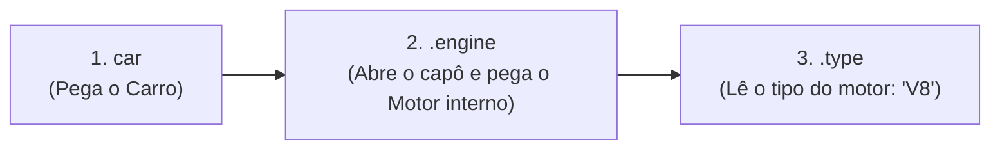
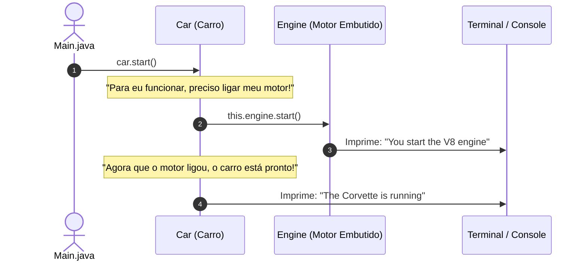

# Curso de Java — Capítulo 54 (Parte 3): Composição ⚙️
## O Acesso com Ponto Duplo (`car.engine.type`), os Métodos `start()` e a Execução Completa

---

> [!IMPORTANT]
> **Para cópia no Google Docs:** Este documento foi estruturado de forma 100% autossuficiente e rica em detalhes visuais. Todas as 5 imagens capturadas do vídeo do Bro Code (a saída real do endereço de memória no terminal, a correção usando o ponto duplo `car.engine.type`, a criação do método `start()` em `Engine.java`, a delegação em `Car.java` e a chamada final em `Main.java`) foram minuciosamente descritas e explicadas em formato textual. Você pode copiar e colar este material diretamente no seu Google Docs sem perder nenhum detalhe visual.

---

### Links Rápidos dos Arquivos do Projeto no seu Computador
* Classe do Motor com `start()`: [`Engine.java`](file:///c:/Users/mickel%201/Downloads/JAVA%20APRENDER/Engine.java)
* Classe do Carro com Delegação de Partida: [`Car.java`](file:///c:/Users/mickel%201/Downloads/JAVA%20APRENDER/Car.java)
* Arquivo Principal Executado: [`Main.java`](file:///c:/Users/mickel%201/Downloads/JAVA%20APRENDER/Main.java)
* Pasta Raiz do Projeto: [`JAVA APRENDER`](file:///c:/Users/mickel%201/Downloads/JAVA%20APRENDER)
* Parte Anterior (Capítulo 54 - Parte 2: Construtor de Engine e Instanciação): [`explicacao_composicao_construtor_do_engine_resolucao_do_erro_instanciacao_do_car_e_o_misterio_do_car_engine_capitulo54_parte2.md`](file:///C:/Users/mickel%201/.gemini/antigravity/brain/d1dae54d-8acc-4142-bb62-6703a22b9afc/explicacao_composicao_construtor_do_engine_resolucao_do_erro_instanciacao_do_car_e_o_misterio_do_car_engine_capitulo54_parte2.md)

---

## 1. Reconstituição Detalhada das 5 Telas da IDE IntelliJ IDEA

Abaixo está o registro cronológico exato do que aconteceu na tela do professor ao longo das 5 capturas:

```
+----------------------------------------------------------------------------------------------------+
|                                    SEQUÊNCIA DE TELAS NO VÍDEO                                      |
+----------------------------------------------------------------------------------------------------+
| IMAGEM 1: A Saída da Execução com o Endereço de Memória no Terminal.                               |
|           • Arquivo ativo: Main.java.                                                              |
|           • Terminal inferior Run > Main exibe:                                                    |
|               Corvette                                                                             |
|               2025                                                                                 |
|               Engine@5f184fc6                                                                      |
|           • O professor seleciona a palavra "Corvette" com fundo azul com o cursor do mouse.       |
|           • Foco da aula: Mostrar aos alunos por que a 3ª linha imprimiu a referência de memória!  |
|                                                                                                    |
| IMAGEM 2: Ajuste da Linha 13 para Acessar o Atributo do Motor.                                     |
|           • Arquivo ativo: Main.java.                                                              |
|           • O professor ajusta a linha 13 de car.engine para:                                      |
|               System.out.println(car.engine.type);                                                 |
|           • O cursor do mouse está posicionado sobre o botão verde Play (Run) no topo direito.     |
|                                                                                                    |
| IMAGEM 3: Criação do Método start() em Engine.java (Timestamp: 8:43:50).                           |
|           • Arquivo ativo: Engine.java.                                                            |
|           • O professor adiciona o método de partida do motor (linhas 9 a 11):                     |
|               void start(){                                                                        |
|                   System.out.println("You start the " + this.type + " engine");                    |
|               }                                                                                    |
|                                                                                                    |
| IMAGEM 4: Implementação da Partida no Carro com Delegação em Car.java.                             |
|           • Arquivo ativo: Car.java.                                                               |
|           • O professor adiciona o método start() no carro (linhas 13 a 16):                       |
|               void start(){                                                                        |
|                   this.engine.start();                                                             |
|                   System.out.println("The " + this.model + " is running");                         |
|               }                                                                                    |
|           • O carro liga o motor internamente e depois avisa que o veículo está em movimento!      |
|                                                                                                    |
| IMAGEM 5: Chamada de car.start() em Main.java.                                                     |
|           • Arquivo ativo: Main.java.                                                              |
|           • Adicionada a linha 15: car.start();                                                    |
|           • O código está completo e pronto para ser executado!                                    |
+----------------------------------------------------------------------------------------------------+
```

---

## 2. A Solução do Mistério: O Operador Ponto Duplo (`car.engine.type`) (Imagens 1 e 2)

Na **Imagem 1**, o console imprimiu:
```text
Corvette
2025
Engine@5f184fc6
```

### O Que Aconteceu?
Como vimos na Parte 2, `car.engine` é um **objeto inteiro**, não uma palavra.
Para ver o texto que está guardado dentro do motor, precisamos dar **dois passos**:

```java
System.out.println(car.engine.type);
//                  ^     ^     ^
//                  1     2     3
```



1. **`car`**: Entra no objeto do Carro.
2. **`.engine`**: Acessa a peça do motor que está embutida dentro do carro.
3. **`.type`**: Lê a etiqueta de texto que está gravada dentro daquele motor (`"V8"`).

Na **Imagem 2**, ao rodar com `car.engine.type`, o terminal agora imprime perfeitamente:
```text
Corvette
2025
V8
```

---

## 3. Adicionando Comportamento ao Motor em `Engine.java` (Imagem 3)

Um motor não serve apenas para guardar o tipo `"V8"`; um motor serve para **ligar e funcionar**!
Na **Imagem 3**, o professor adicionou o método `start()` dentro de [`Engine.java`](file:///c:/Users/mickel%201/Downloads/JAVA%20APRENDER/Engine.java):

```java
void start(){
    System.out.println("You start the " + this.type + " engine");
}
```

* Quando esse método for chamado para um motor V8, ele imprimirá no terminal:
  `You start the V8 engine` (*Você dá a partida no motor V8*).

---

## 4. O Coração da Composição: A Delegação em `Car.java` (Imagem 4)

Aqui está o momento mais brilhante de todo o capítulo! Veja como o método `start()` foi implementado dentro de [`Car.java`](file:///c:/Users/mickel%201/Downloads/JAVA%20APRENDER/Car.java):

```java
void start(){
    this.engine.start();
    System.out.println("The " + this.model + " is running");
}
```



### Por Que Isso É Tão Importante para um Iniciante?
Quando você entra no seu carro e gira a chave (ou aperta o botão Start):
1. **Você não encosta no motor com as mãos.** Você interage com o **Carro** (`car.start()`).
2. O **Carro** se comunica internamente com o **Motor** que faz parte dele (`this.engine.start()`).
3. O motor ruge (`"You start the V8 engine"`).
4. O carro avisa no painel que o veículo está pronto para andar (`"The Corvette is running"`).

**Isso é Composição na sua forma mais pura:** Uma máquina complexa (`Car`) é formada por peças menores (`Engine`), e o carro controla o ciclo de vida e o funcionamento de suas próprias peças!

---

## 5. Código-Fonte Definitivo dos Três Arquivos no Seu Computador

### Arquivo 1: [`Engine.java`](file:///c:/Users/mickel%201/Downloads/JAVA%20APRENDER/Engine.java)

```java
public class Engine {

    String type;

    Engine(String type){
        this.type = type;
    }

    void start(){
        System.out.println("You start the " + this.type + " engine");
    }

}
```

---

### Arquivo 2: [`Car.java`](file:///c:/Users/mickel%201/Downloads/JAVA%20APRENDER/Car.java)

```java
public class Car {

    String model;
    int year;
    Engine engine;

    Car(String model, int year, String engineType){
        this.model = model;
        this.year = year;
        this.engine = new Engine(engineType);
    }

    void start(){
        this.engine.start();
        System.out.println("The " + this.model + " is running");
    }

}
```

---

### Arquivo 3: [`Main.java`](file:///c:/Users/mickel%201/Downloads/JAVA%20APRENDER/Main.java)

```java
public class Main {
    public static void main(String[] args) {

        // Composition = Represents a "part-of" relationship between objects.
        //               For example, an Engine is "part of" a Car.
        //               Allows complex objects to be constructed from smaller objects.

        Car car = new Car("Corvette", 2025, "V8");

        System.out.println(car.model);
        System.out.println(car.year);
        System.out.println(car.engine.type);

        car.start();

    }
}
```

---

## 6. Tabelas Linha por Linha de Todo o Projeto

### A) Dissecação de [`Engine.java`](file:///c:/Users/mickel%201/Downloads/JAVA%20APRENDER/Engine.java)

| Linha | Código | Explicação Amigável |
| :---: | :--- | :--- |
| **01** | `public class Engine {` | Molde da classe `Engine`. |
| **02** | *(em branco)* | Organização visual. |
| **03** | `    String type;` | Atributo para guardar o tipo do motor (*"V8"*). |
| **04** | *(em branco)* | Organização visual. |
| **05** | `    Engine(String type){` | Construtor do motor. |
| **06** | `        this.type = type;` | Grava o tipo no motor. |
| **07** | `    }` | Fim do construtor. |
| **08** | *(em branco)* | Organização visual. |
| **09** | `    void start(){` | Método de partida do motor. |
| **10** | `        System.out.println("You start the " + this.type + " engine");` | Imprime a mensagem de acionamento do motor no console. |
| **11** | `    }` | Fim do método `start()`. |
| **12** | *(em branco)* | Organização visual. |
| **13** | `}` | Fim da classe `Engine`. |

---

### B) Dissecação de [`Car.java`](file:///c:/Users/mickel%201/Downloads/JAVA%20APRENDER/Car.java)

| Linha | Código | Explicação Amigável |
| :---: | :--- | :--- |
| **01** | `public class Car {` | Molde da classe `Car`. |
| **02** | *(em branco)* | Organização visual. |
| **03** | `    String model;` | Atributo modelo do carro (*"Corvette"*). |
| **04** | `    int year;` | Atributo ano do carro (*2025*). |
| **05** | `    Engine engine;` | Atributo objeto que guarda o motor. |
| **06** | *(em branco)* | Organização visual. |
| **07** | `    Car(String model, int year, String engineType){` | Construtor do carro. |
| **08** | `        this.model = model;` | Grava o modelo. |
| **09** | `        this.year = year;` | Grava o ano. |
| **10** | `        this.engine = new Engine(engineType);` | **Composição:** O carro cria o seu motor internamente com `new Engine`. |
| **11** | `    }` | Fim do construtor. |
| **12** | *(em branco)* | Organização visual. |
| **13** | `    void start(){` | Método para dar a partida no carro. |
| **14** | `        this.engine.start();` | **Delegação:** O carro aciona o motor interno. |
| **15** | `        System.out.println("The " + this.model + " is running");` | Imprime que o carro está funcionando. |
| **16** | `    }` | Fim do método `start()`. |
| **17** | *(em branco)* | Organização visual. |
| **18** | `}` | Fim da classe `Car`. |

---

### C) Dissecação de [`Main.java`](file:///c:/Users/mickel%201/Downloads/JAVA%20APRENDER/Main.java)

| Linha | Código | Explicação Amigável |
| :---: | :--- | :--- |
| **01** | `public class Main {` | Classe executável principal. |
| **02** | `    public static void main(String[] args) {` | Método principal `main`. |
| **03** | *(em branco)* | Organização visual. |
| **04** | `        // Composition = Represents a "part-of" relationship between objects.` | Comentário teórico: Composição é relação "parte-de". |
| **05** | `        //               For example, an Engine is "part of" a Car.` | Comentário teórico: Motor é parte do carro. |
| **06** | `        //               Allows complex objects to be constructed from smaller objects.` | Comentário teórico: Cria objetos complexos a partir de menores. |
| **07** | *(em branco)* | Organização visual. |
| **08** | *(em branco)* | Organização visual. |
| **09** | `        Car car = new Car("Corvette", 2025, "V8");` | Instancia o carro passando modelo, ano e tipo do motor. |
| **10** | *(em branco)* | Organização visual. |
| **11** | `        System.out.println(car.model);` | Imprime: `Corvette`. |
| **12** | `        System.out.println(car.year);` | Imprime: `2025`. |
| **13** | `        System.out.println(car.engine.type);` | Acessa com ponto duplo e imprime: `V8`. |
| **14** | *(em branco)* | Organização visual. |
| **15** | `        car.start();` | Chama a partida do carro, que por sua vez liga o motor. |
| **16** | *(em branco)* | Organização visual. |
| **17** | `    }` | Fim do método `main`. |
| **18** | `}` | Fim da classe `Main`. |

---

## 7. Saída Exata e Completa no Console

Ao compilar e executar o código final no terminal:
```bash
javac Engine.java Car.java Main.java
java Main
```

### O que sai no terminal linha por linha:
```text
Corvette
2025
V8
You start the V8 engine
The Corvette is running
```

### Explicação de cada linha da saída:
1. `Corvette`: Impresso pela linha 11 (`car.model`).
2. `2025`: Impresso pela linha 12 (`car.year`).
3. `V8`: Impresso pela linha 13 (`car.engine.type`).
4. `You start the V8 engine`: Impresso pela linha 14 de `Car.java`, que chamou `this.engine.start()`.
5. `The Corvette is running`: Impresso pela linha 15 de `Car.java`.
