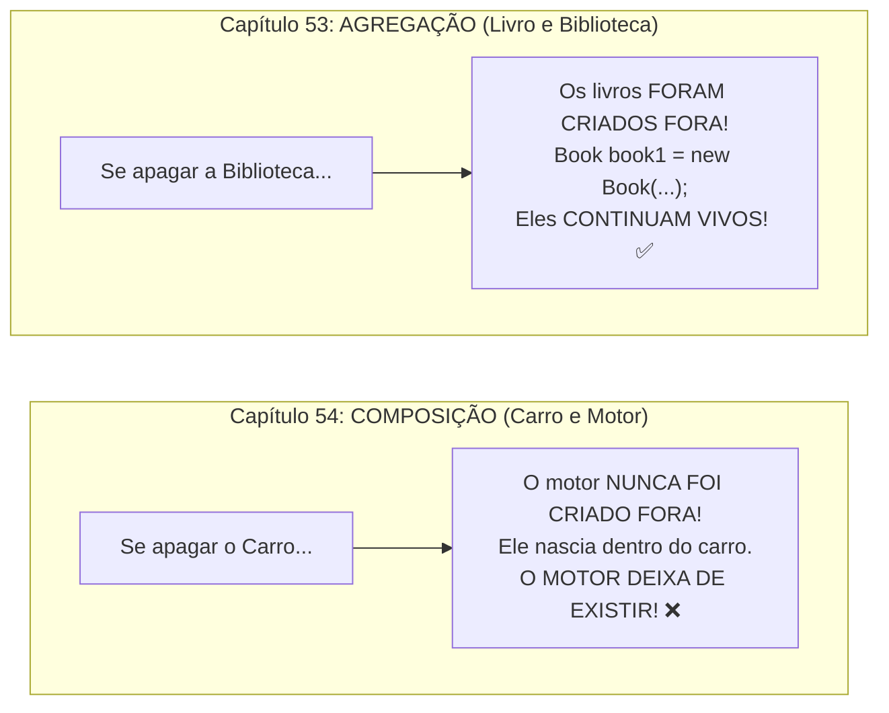

# Curso de Java — Capítulo 54 (Parte 4): Composição ⚙️
## A Execução Vitoriosa no Console, o Experimento de Exclusão do Carro e o Erro `cannot find symbol: variable car`

---

> [!IMPORTANT]
> **Para cópia no Google Docs:** Este documento traz a conclusão conceitual mais profunda do **Capítulo 54 (Composição)**. Todas as 5 imagens capturadas do vídeo do Bro Code (a saída verde completa com as 5 linhas no terminal, a exclusão da linha do carro, os erros vermelhos em cascata na IDE, a tentativa de imprimir `car.engine` sem carro e o painel *Build Output* com o erro do compilador) foram integralmente transcritas em texto. Você pode copiar e colar este material diretamente no seu Google Docs mantendo 100% da fidelidade e do contexto didático.

---

### Links Rápidos dos Arquivos do Projeto no seu Computador
* Arquivo Principal: [`Main.java`](../../../src/main/java/com/mickaelgeronimo/mastery/core/concurrency/Main.java)
* Classe do Carro (Container): [`Car.java`](../../../src/main/java/com/mickaelgeronimo/mastery/core/oop/Car.java)
* Classe do Motor (Parte Integrante): `Engine.java`
* Pasta Raiz do Projeto: `JAVA APRENDER`
* Parte Anterior (Capítulo 54 - Parte 3: Ponto Duplo e Métodos start): `explicacao_composicao_acesso_ao_atributo_interno_metodos_start_e_execucao_completa_capitulo54_parte3.md`

---

## 1. Reconstituição Detalhada das 5 Telas da IDE IntelliJ IDEA

Abaixo está o registro cronológico exato do que aconteceu na tela do professor ao longo das 5 capturas:

```
+----------------------------------------------------------------------------------------------------+
|                                    SEQUÊNCIA DE TELAS NO VÍDEO                                      |
+----------------------------------------------------------------------------------------------------+
| IMAGEM 1: A Saída Perfeita no Terminal Run > Main.                                                 |
|           • Terminal inferior exibe as 5 linhas verdes em ordem de execução:                       |
|               Corvette                                                                             |
|               2025                                                                                 |
|               V8                                                                                   |
|               You start the V8 engine                                                              |
|               The Corvette is running                                                              |
|           • Mensagem de conclusão: Process finished with exit code 0.                              |
|           • O professor celebra o funcionamento completo da Composição!                            |
|                                                                                                    |
| IMAGEM 2: O Código Completo e Saudável em Main.java (Timestamp: 8:44:47).                          |
|           • Linha 9: Car car = new Car("Corvette", 2025, "V8");                                    |
|           • Linhas 11 a 15: Os 3 printlns e a chamada car.start();                                 |
|           • Nenhuma cobrinha vermelha, código 100% verde e válido.                                 |
|                                                                                                    |
| IMAGEM 3: O Experimento da Composição: O Professor Apaga a Linha 9! (Timestamp: 8:44:53).          |
|           • A linha "Car car = new Car(...)" FOI DELETADA!                                         |
|           • EFEITO EM CASCATA: As 4 linhas abaixo acendem com a palavra "car" em VERMELHO!        |
|           • O professor seleciona com fundo azul as linhas que tentam imprimir "car.model" e       |
|             "car.year" para mostrar aos alunos o estrago!                                          |
|           • Contador no topo direito: 4 erros vermelhos.                                           |
|                                                                                                    |
| IMAGEM 4: Reduzindo o Código para o Teste Essencial: Apenas "car.engine".                          |
|           • O professor apaga quase tudo e deixa apenas uma linha:                                 |
|               System.out.println(car.engine);                                                      |
|           • A palavra "car" continua sublinhada de vermelho. Contador: 1 erro vermelho.            |
|                                                                                                    |
| IMAGEM 5: A Execução da Falha e o Painel Build Output (Timestamp: 8:44:58).                        |
|           • O professor clica no botão verde Play (Run) no topo direito.                           |
|           • A compilação é abortada e abre o painel Build > Build Output em vermelho:              |
|               C:\Users\HP\IdeaProjects\MyFirstProject\src\Main.java:9:28                           |
|               java: cannot find symbol                                                             |
|                 symbol:   variable car                                                             |
|                 location: class Main                                                               |
+----------------------------------------------------------------------------------------------------+
```

---

## 2. A Vitória da Primeira Metade: As 5 Linhas de Saída (Imagens 1 e 2)

Na **Imagem 1**, o console executou o programa completo e entregou um resultado impecável:

```text
Corvette
2025
V8
You start the V8 engine
The Corvette is running
```

### O Que Cada Linha Representa:
1. **`Corvette`**: O atributo direto `car.model`.
2. **`2025`**: O atributo direto `car.year`.
3. **`V8`**: O atributo interno do motor acessado via ponto duplo: `car.engine.type`.
4. **`You start the V8 engine`**: A ação do motor (`this.engine.start()`), disparada por dentro do carro.
5. **`The Corvette is running`**: A ação do carro confirmando que o veículo está funcionando.

---

## 3. O Experimento da Segunda Metade: O Que Acontece Sem o Carro? (Imagens 3 a 5)

No Capítulo 53 (**Agregação**), o professor fez um teste famoso: **ele apagou a Biblioteca**, e nós vimos que **os Livros continuaram existindo** e funcionando sozinhos no `main`.

Agora, no Capítulo 54 (**Composição**), o professor fez o teste inverso:
> *"Será que o Motor (`Engine`) consegue existir sozinho sem o Carro (`Car`)?"*

Na **Imagem 3 e 4**, ele foi até o `Main.java` e **apagou a linha que criava o carro**:

```java
// O professor APAGOU isto:
// Car car = new Car("Corvette", 2025, "V8");

// E deixou apenas isto:
System.out.println(car.engine); // ❌ ERRO!
```



### A Explicação Amigável para Iniciantes:
* Você já viu alguém andando na rua carregando apenas um motor V8 nas mãos para ir trabalhar? **Não!**
* Um motor de carro nasce dentro da carcaça do carro.
* Como o nosso código colocou a criação do motor **DENTRO** do construtor de [`Car.java`](../../../src/main/java/com/mickaelgeronimo/mastery/core/oop/Car.java) (`this.engine = new Engine(engineType);`):
  * Se você **não instancia o Carro**, o motor **NUNCA É FABRICADO**!
  * Você não pode nem sequer tentar escrever `car.engine`, porque a própria palavra `car` não existe!

---

## 4. Dissecação do Erro no Painel *Build Output* (Imagem 5)

Ao clicar no botão Play (Run) na Imagem 5, o IntelliJ não conseguiu rodar o programa e abriu a aba vermelha de **Build Output**:

```text
C:\Users\HP\IdeaProjects\MyFirstProject\src\Main.java:9:28
java: cannot find symbol
  symbol:   variable car
  location: class Main
```

### O Que Esse Erro Significa em Português Claro?
* **`java: cannot find symbol`**: *"Java: Não consigo encontrar o símbolo"*. O Java encontrou uma palavra no seu código que ele não faz a menor ideia do que seja.
* **`symbol: variable car`**: O símbolo desconhecido é a variável chamada `car`.
* **`location: class Main`**: O erro aconteceu dentro da classe `Main`, na linha 9, coluna 28.

**O diálogo do compilador com você:**
> *"Ei, programador! Você me mandou entrar em `car.engine`. Mas quem é esse tal de `car`? Você não declarou nenhuma variável `car` aqui no `main`! Como eu posso pegar o motor de um carro que sequer existe?!"*

---

## 5. Código-Fonte Comparativo de `Main.java`

### Versão 1: O Código Saudável e Completo (Imagens 1 e 2)

```java
public class Main {
    public static void main(String[] args) {

        // Composition = Represents a "part-of" relationship between objects.
        //               For example, an Engine is "part of" a Car.
        //               Allows complex objects to be constructed from smaller objects.

        Car car = new Car("Corvette", 2025, "V8");

        System.out.println(car.model);
        System.out.println(car.year);
        System.out.println(car.engine.type);

        car.start();

    }
}
```

---

### Versão 2: O Código do Teste de Falha (Imagens 4 e 5)

```java
public class Main {
    public static void main(String[] args) {

        // Composition = Represents a "part-of" relationship between objects.
        //               For example, an Engine is "part of" a Car.
        //               Allows complex objects to be constructed from smaller objects.

        System.out.println(car.engine); // ERRO: variable car not found!

    }
}
```

---

## 6. Tabelas Linha por Linha de `Main.java`

### Tabela da Versão Completa (Que Roda com Sucesso):

| Linha | Código | Explicação Detalhada |
| :---: | :--- | :--- |
| **01** | `public class Main {` | Declaração da classe executável. |
| **02** | `    public static void main(String[] args) {` | Ponto de partida do programa. |
| **03** | *(em branco)* | Organização visual. |
| **04** | `        // Composition = Represents a "part-of" relationship between objects.` | Definição teórica: Composição é a relação "parte-de". |
| **05** | `        //               For example, an Engine is "part of" a Car.` | Exemplo: O motor é parte do carro. |
| **06** | `        //               Allows complex objects to be constructed from smaller objects.` | Função: Permite criar objetos complexos a partir de peças menores. |
| **07** | *(em branco)* | Organização visual. |
| **08** | *(em branco)* | Organização visual. |
| **09** | `        Car car = new Car("Corvette", 2025, "V8");` | **Nascimento da Composição:** Instancia o Carro, e o Carro instancia o seu Motor V8 internamente. |
| **10** | *(em branco)* | Organização visual. |
| **11** | `        System.out.println(car.model);` | Imprime: `Corvette`. |
| **12** | `        System.out.println(car.year);` | Imprime: `2025`. |
| **13** | `        System.out.println(car.engine.type);` | Acessa com ponto duplo e imprime: `V8`. |
| **14** | *(em branco)* | Organização visual. |
| **15** | `        car.start();` | Aciona a partida do carro (que por sua vez aciona a partida do motor). |
| **16** | `    }` | Fim do método `main`. |
| **17** | `}` | Fim da classe `Main`. |

---

## 7. O Que Sai no Console em Cada Momento?

### Momento 1: Execução com Sucesso (Imagem 1)
```text
Corvette
2025
V8
You start the V8 engine
The Corvette is running

Process finished with exit code 0
```

---

### Momento 2: Tentativa de Execução sem o Carro (Imagem 5)
```text
java: cannot find symbol
  symbol:   variable car
  location: class Main
```
*(A compilação falha imediatamente e nada é executado).*

---

## 8. Conclusão Final do Capítulo 54: Composição ⚙️

Com este teste final, você aprendeu na prática a maior lição de arquitetura de software:
1. **Agregação (Capítulo 53):** Use quando os objetos forem independentes (uma Biblioteca tem Livros, mas os Livros sobrevivem se a biblioteca fechar).
2. **Composição (Capítulo 54):** Use quando uma parte for vital e inseparável do todo (um Carro tem um Motor; se você não tiver o Carro, o Motor sequer chega a nascer no seu sistema).
3. **Delegação:** Objetos compostos delegam o trabalho para suas peças internas (`car.start()` chama `this.engine.start()`), mantendo o código limpo, organizado e modular!
