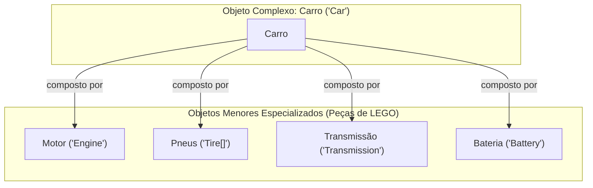
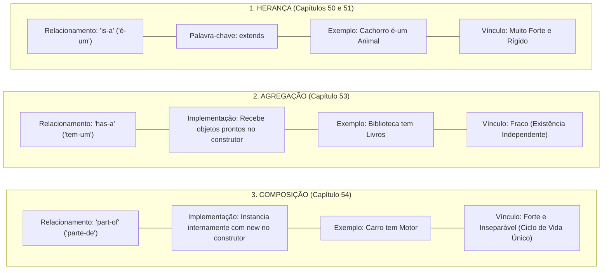

# Curso de Java — Capítulo 54 (Parte 5): Composição ⚙️
## O Fechamento Filosófico: O Destaque em *"complex objects"* e a Conclusão Definitiva do Capítulo

---

> [!IMPORTANT]
> **Para cópia no Google Docs:** Este documento consolida o fechamento supremo do **Capítulo 54 (Composição)**. A imagem capturada no momento exato em que o professor Bro Code seleciona com o mouse a expressão *"complex objects"* foi integralmente descrita e analisada pedagogicamente. Você pode copiar e colar este material diretamente para o seu Google Docs para ter em mãos o guia definitivo de como os maiores arquitetos de software do mundo modelam sistemas orientados a objetos.

---

### Links Rápidos dos Arquivos do Projeto no seu Computador
* Arquivo Principal Executado: [`Main.java`](../../../src/main/java/com/mickaelgeronimo/mastery/core/concurrency/Main.java)
* Classe do Carro (Objeto Complexo): [`Car.java`](../../../src/main/java/com/mickaelgeronimo/mastery/core/oop/Car.java)
* Classe do Motor (Objeto Menor Componente): `Engine.java`
* Pasta Raiz do Projeto: `JAVA APRENDER`
* Parte Anterior (Capítulo 54 - Parte 4: O Teste de Erro sem o Carro): `explicacao_composicao_execucao_bem_sucedida_o_teste_de_inexistencia_do_car_e_o_erro_cannot_find_symbol_capitulo54_parte4.md`

---

## 1. Reconstituição Detalhada da Tela da IDE IntelliJ IDEA

Abaixo está o registro exato do que aconteceu na tela do professor neste fechamento:

```
+----------------------------------------------------------------------------------------------------+
|                                    SEQUÊNCIA DE TELAS NO VÍDEO                                      |
+----------------------------------------------------------------------------------------------------+
| IMAGEM: O Destaque Filosófico na Linha 7 em Main.java (Timestamp: 8:45:09).                       |
|           • Arquivo ativo: Main.java.                                                              |
|           • O código foi totalmente restaurado para a versão completa e perfeita.                 |
|           • O GESTO DO PROFESSOR: Ele volta com o cursor do mouse até os comentários do topo da    |
|             classe e seleciona com fundo retangular azul a expressão:                              |
|                                                                                                    |
|               // Allows [complex objects] to be constructed from smaller objects.                  |
|                         ^^^^^^^^^^^^^^^^^                                                          |
|                         (Selecionado em azul pelo professor!)                                      |
|                                                                                                    |
|           • Código visível abaixo (linhas 9 a 15):                                                 |
|               Car car = new Car("Corvette", 2025, "V8");                                           |
|               System.out.println(car.model);                                                       |
|               System.out.println(car.year);                                                        |
|               System.out.println(car.engine.type);                                                 |
|               car.start();                                                                         |
|                                                                                                    |
|           • Barra inferior do YouTube: 8:45:09 / 12:00:00 no capítulo "54.composition ⚙️".        |
+----------------------------------------------------------------------------------------------------+
```

---

## 2. Por Que o Professor Destacou a Frase *"complex objects"*?

No início da aula, você leu a linha 7:
```java
// Allows complex objects to be constructed from smaller objects.
```
*(Permite que objetos complexos sejam construídos a partir de objetos menores).*

Agora que você viu o código nascer, dar erro, ser corrigido, rodar e ser testado, o professor seleciona com o mouse as palavras **`complex objects`** para cravar na sua mente o **Propósito Maior da Composição**:



### O Erro Comum do Programador Amador:
Quando um iniciante amador precisa programar um Carro, ele comete o erro clássico de criar uma **Classe Monstro** (*God Class*):
* Cria 300 variáveis dentro da mesma classe: `model`, `year`, `engineType`, `engineHorsepower`, `engineCylinders`, `wheelSize`, `wheelPressure`, `radioVolume`, `radioFrequency`, etc.
* O código vira uma maçaroca impossível de ler, testar ou consertar!

### A Sabedoria da Composição:
A Composição ensina você a pensar como um engenheiro do mundo real:
1. O **Motor** (`Engine`) cuida apenas do tipo, da ignição e da cavalaria.
2. A **Roda** (`Wheel`) cuida apenas da calibragem e do aro.
3. O **Carro** (`Car`) é apenas o **objeto complexo** que junta essas peças menores!

---

## 3. A Regra de Ouro da Engenharia de Software: *"Prefira Composição à Herança"*

Existe uma frase famosa no livro mais importante da história da programação (*Design Patterns*, da Gang of Four - GoF):
> **"Favor object composition over class inheritance."**
> *(Prefira a composição de objetos à herança de classes).*

### Por que essa frase existe?
* **Na Herança (`extends`):**
  * O acoplamento é rígido e inflexível.
  * Se a classe pai mudar uma linha, você pode quebrar 50 classes filhas espalhadas pelo seu sistema.
  * Um Carro não pode herdar de Motor (um Carro *não é um* Motor!).
* **Na Composição:**
  * O acoplamento é limpo e modular.
  * O Carro simplesmente possui uma gaveta para o Motor.
  * Você monta seus programas como quem monta blocos de LEGO!

---

## 4. Código-Fonte Completo e Definitivo dos Três Arquivos

### Arquivo 1: [`Main.java`](../../../src/main/java/com/mickaelgeronimo/mastery/core/concurrency/Main.java)

```java
public class Main {
    public static void main(String[] args) {

        // Composition = Represents a "part-of" relationship between objects.
        //               For example, an Engine is "part of" a Car.
        //               Allows complex objects to be constructed from smaller objects.

        Car car = new Car("Corvette", 2025, "V8");

        System.out.println(car.model);
        System.out.println(car.year);
        System.out.println(car.engine.type);

        car.start();

    }
}
```

---

### Arquivo 2: [`Car.java`](../../../src/main/java/com/mickaelgeronimo/mastery/core/oop/Car.java)

```java
public class Car {

    String model;
    int year;
    Engine engine;

    Car(String model, int year, String engineType){
        this.model = model;
        this.year = year;
        this.engine = new Engine(engineType);
    }

    void start(){
        this.engine.start();
        System.out.println("The " + this.model + " is running");
    }

}
```

---

### Arquivo 3: `Engine.java`

```java
public class Engine {

    String type;

    Engine(String type){
        this.type = type;
    }

    void start(){
        System.out.println("You start the " + this.type + " engine");
    }

}
```

---

## 5. Explicação Linha por Linha de `Main.java` (Tabela Detalhada)

| Linha | Código em `Main.java` | Significado na Prática |
| :---: | :--- | :--- |
| **01** | `public class Main {` | Declaração da classe executável. |
| **02** | `    public static void main(String[] args) {` | Método principal de inicialização do programa. |
| **03** | *(linha em branco)* | Organização visual. |
| **04** | `        // Composition = Represents a "part-of" relationship between objects.` | Comentário teórico: Composição é a relação "parte-de". |
| **05** | `        //               For example, an Engine is "part of" a Car.` | Comentário teórico: O motor é parte intrínseca do carro. |
| **06** | `        //               Allows complex objects to be constructed from smaller objects.` | Comentário teórico com **`complex objects` selecionado em azul**: Filosofia de construção modular. |
| **07** | *(linha em branco)* | Organização visual. |
| **08** | *(linha em branco)* | Organização visual. |
| **09** | `        Car car = new Car("Corvette", 2025, "V8");` | **Composição em Ação:** Instancia o Carro, que por sua vez instancia o Motor internamente. |
| **10** | *(linha em branco)* | Organização visual. |
| **11** | `        System.out.println(car.model);` | Lê o atributo do carro e imprime: `Corvette`. |
| **12** | `        System.out.println(car.year);` | Lê o atributo do carro e imprime: `2025`. |
| **13** | `        System.out.println(car.engine.type);` | **Navegação com ponto duplo:** Entra no motor do carro e imprime: `V8`. |
| **14** | *(linha em branco)* | Organização visual. |
| **15** | `        car.start();` | **Delegação:** Aciona a partida do carro, que aciona o motor e imprime o funcionamento. |
| **16** | *(linha em branco)* | Organização visual. |
| **17** | `    }` | Fim do método `main`. |
| **18** | `}` | Fim da classe `Main`. |

---

## 6. Saída Exata e Completa no Console

Compilando e executando os 3 arquivos no terminal com:
```bash
javac Engine.java Car.java Main.java
java Main
```

### O que sai no terminal:
```text
Corvette
2025
V8
You start the V8 engine
The Corvette is running
```

---

## 7. O Mapa Mental Definitivo da Trilogia de Relacionamentos em Java

Você concluiu os três capítulos mais importantes sobre conexões de classes no curso de Java. Aqui está o resumo supremo para você consultar para sempre:



Parabéns! O **Capítulo 54 (`composition ⚙️`)** está completamente dominado e arquivado com perfeição!
