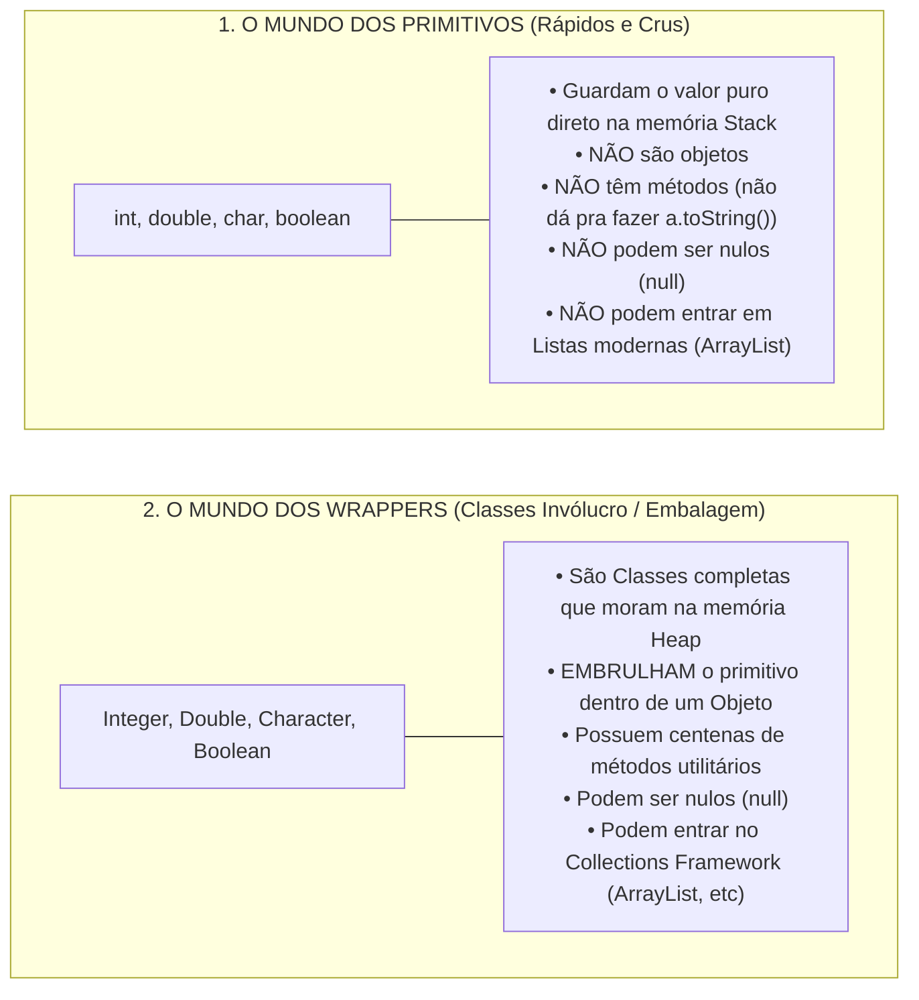

# Curso de Java — Capítulo 55 (Parte 1): Wrapper Classes 🎁
## O Que São Classes Invólucro, o Aviso de Depreciação (*Deprecated*) e os Quatro Tipos Fundamentais

---

> [!IMPORTANT]
> **Para cópia no Google Docs:** Este documento inicia o estudo do **Capítulo 55 (Wrapper Classes)** com máxima riqueza pedagógica e visual. Todas as 5 imagens capturadas do vídeo do Bro Code (a tela teórica inicial, a legenda de *Autoboxing*, a declaração com primitivo, o balão de aviso de depreciação do IntelliJ e as 4 declarações tachadas com `new`) foram completamente descritas em texto. Você pode copiar e colar este material diretamente para o seu Google Docs sem perder nenhum detalhe visual.

---

### Links Rápidos dos Arquivos do Projeto no seu Computador
* Arquivo Principal com as Wrapper Classes: [`Main.java`](file:///c:/Users/mickel%201/Downloads/JAVA%20APRENDER/Main.java)
* Pasta Raiz do Projeto: [`JAVA APRENDER`](file:///c:/Users/mickel%201/Downloads/JAVA%20APRENDER)
* Conclusão do Capítulo Anterior (Capítulo 54 - Parte 5: Composição): [`explicacao_composicao_o_fechamento_filosofico_complex_objects_e_conclusao_definitiva_capitulo54_parte5.md`](file:///C:/Users/mickel%201/.gemini/antigravity/brain/d1dae54d-8acc-4142-bb62-6703a22b9afc/explicacao_composicao_o_fechamento_filosofico_complex_objects_e_conclusao_definitiva_capitulo54_parte5.md)

---

## 1. Reconstituição Detalhada das 5 Telas da IDE IntelliJ IDEA

Abaixo está o registro cronológico exato do que aconteceu na tela do professor ao longo das 5 capturas:

```
+----------------------------------------------------------------------------------------------------+
|                                    SEQUÊNCIA DE TELAS NO VÍDEO                                      |
+----------------------------------------------------------------------------------------------------+
| IMAGEM 1: Abertura do Capítulo 55 em Main.java.                                                    |
|           • Projeto limpo: Pasta src contém apenas Main.java (Car e Engine foram removidos).       |
|           • Comentários teóricos digitados (linhas 5 a 8):                                         |
|               // Wrapper classes = Allow primitive values (int, char, double, boolean)             |
|               //                   to be used as objects. "Wrap them in an object"                 |
|               //                   Generally, don't wrap primitives unless you need an object.     |
|               //                   Allows use of Collections Framework and static Utility Methods. |
|           • Cursor na linha 5 ao final de "boolean)".                                              |
|                                                                                                    |
| IMAGEM 2: Apresentação do Termo Chave.                                                             |
|           • O professor insere uma legenda gigante na tela:                                        |
|                                       "Autoboxing"                                                 |
|           • Cursor posicionado na linha 10, preparando o aluno para o conceito.                    |
|                                                                                                    |
| IMAGEM 3: Ponto de Partida com um Tipo Primitivo (Timestamp: 8:46:17).                             |
|           • Linha 10 digitada: int a = 123;                                                        |
|           • O número "123" aparece selecionado com fundo azul.                                     |
|           • O professor lembra: "int é um tipo primitivo rápido, mas NÃO é um objeto!".            |
|                                                                                                    |
| IMAGEM 4: O Modo Antigo de Criar Wrapper e o Balão de Depreciação.                                 |
|           • O professor altera a linha para o formato antigo: Integer a = new Integer(123);        |
|           • A expressão "new Integer" aparece com texto TACHADO (riscado no meio) e sublinhado     |
|             ondulado amarelo/vermelho.                                                             |
|           • Balão de alerta do IntelliJ exibido:                                                   |
|               'Integer(int)' is deprecated since version 9 and marked for removal                  |
|               Constructs a newly allocated Integer object that represents the specified int value. |
|               Deprecated: It is rarely appropriate to use this constructor. The static factory     |
|               valueOf(int) is generally a better choice...                                         |
|                                                                                                    |
| IMAGEM 5: Os Quatro Principais Tipos Primitivos com suas Wrapper Classes (Timestamp: 8:47:37).    |
|           • Linhas 10 a 13 digitadas no formato antigo:                                            |
|               Integer a = new Integer(123);                                                        |
|               Double b = new Double(3.14);                                                         |
|               Character c = new Character('$');                                                    |
|               Boolean d = new Boolean(true);                                                       |
|           • Todas as quatro linhas aparecem riscadas no editor com aviso de depreciação.           |
|           • Contador no canto superior direito do IntelliJ exibe 4 avisos amarelos [ 4 ].          |
+----------------------------------------------------------------------------------------------------+
```

---

## 2. O Que São *Wrapper Classes* 🎁? (A Metáfora da Caixa de Presente)

No Java, existem dois mundos paralelos:



### Por que o nome é "Wrapper"?
Em inglês, o verbo **to wrap** significa *embrulhar, empacotar*.
* Uma **Wrapper Class** é literalmente uma **caixa de presente de luxo** 🎁.
* O valor primitivo (o número `123`, a letra `'$'`, o booleano `true`) é o bombom de chocolate.
* A Wrapper Class pega esse bombom e coloca dentro de uma caixinha com laço de fita para que o Java possa tratá-lo como um **Objeto**!

---

## 3. Tabela Comparativa dos 8 Primitivos e seus Wrappers

Repare na regra simples: **quase todos são apenas o mesmo nome com a primeira letra maiúscula**, com exceção de `int` (que vira `Integer`) e `char` (que vira `Character`):

| Tipo Primitivo (Simples) | Wrapper Class 🎁 (Objeto) | O que Guarda? | Exemplo de Valor |
| :---: | :---: | :--- | :---: |
| `byte` | `Byte` | Inteiro ultra-curto (8 bits) | `10` |
| `short` | `Short` | Inteiro curto (16 bits) | `500` |
| **`int`** | **`Integer`** ⭐ | Inteiro padrão (32 bits) | `123` |
| `long` | `Long` | Inteiro longo (64 bits) | `9000000000L` |
| `float` | `Float` | Decimal simples (32 bits) | `3.14f` |
| **`double`** | **`Double`** ⭐ | Decimal de precisão dupla (64 bits) | `3.14` |
| **`char`** | **`Character`** ⭐ | Um caractere isolado | `'$'` ou `'A'` |
| **`boolean`** | **`Boolean`** ⭐ | Valor lógico verdadeiro/falso | `true` ou `false` |

*(As 4 marcadas com ⭐ são as mais usadas em 99% dos programas Java no mundo real).*

---

## 4. O Grande Ensinamento das Imagens 4 e 5: O Que É o Aviso *Deprecated*?

Na **Imagem 4**, o professor escreveu:
```java
Integer a = new Integer(123);
```

E o IntelliJ IDEA imediatamente colocou um **traço no meio do código** (`new Integer`) e abriu um balão cinza dizendo:
> **`'Integer(int)' is deprecated since version 9 and marked for removal`**

```
Linha 10:  Integer a = new Integer(123);
                       ~~~~~~~~~~~ (Riscado com aviso de obsolescência)
```

### O Que Significa a Palavra *Deprecated* (Depreciado/Obsoleto)?
No desenvolvimento de software, quando algo é marcado como **deprecated**, os criadores da linguagem Java estão dizendo:
> *"Atenção programador! Esta forma antiga de escrever código ainda funciona para não quebrar programas velhos, mas ela foi considerada uma **má prática**. Nós criamos uma forma muito mais inteligente e rápida, e no futuro esse comando antigo será excluído da linguagem!"*

### Por Que `new Integer(123)` Foi Considerado uma Má Prática?
* Toda vez que você escreve a palavra **`new`**, você obriga a memória do computador a gastar energia alocando um novo pedaço de memória RAM, mesmo que o número `123` já tenha sido criado mil vezes antes!
* Por causa desse desperdício de memória, a partir do **Java 9** (lançado em 2017), usar `new` para Wrapper Classes foi proibido como boa prática!

---

## 5. A Revelação da Imagem 2: O Que É *Autoboxing*?

Na **Imagem 2**, o professor colocou a legenda em destaque: **`Autoboxing`**.

### O Que é Autoboxing? (Prévia do que vem a seguir)
Como os programadores odiavam ter que ficar digitando `new Integer(123)` ou `new Double(3.14)`, a equipe do Java inventou o **Autoboxing** (*empacotamento automático*):
* Você simplesmente escreve:
  ```java
  Integer a = 123;   // O Java moderno embrulha sozinho no automático!
  Double b = 3.14;   // Sem precisar de 'new'!
  Character c = '$';
  Boolean d = true;
  ```
* O Java pega o valor primitivo e coloca dentro da caixinha do objeto **de forma invisível, automática e muito mais rápida**!

---

## 6. Código Completo de `Main.java` no seu Computador

Aqui está o código exato que está salvo no seu arquivo [`Main.java`](file:///c:/Users/mickel%201/Downloads/JAVA%20APRENDER/Main.java):

```java
public class Main {
    public static void main(String[] args) {

        // Wrapper classes = Allow primitive values (int, char, double, boolean)
        //                   to be used as objects. "Wrap them in an object"
        //                   Generally, don't wrap primitives unless you need an object.
        //                   Allows use of Collections Framework and static Utility Methods.

        Integer a = new Integer(123);
        Double b = new Double(3.14);
        Character c = new Character('$');
        Boolean d = new Boolean(true);

    }
}
```

---

## 7. Explicação Linha por Linha de `Main.java` (Tabela Detalhada)

| Linha | Código em `Main.java` | Significado Detalhado para Iniciantes |
| :---: | :--- | :--- |
| **01** | `public class Main {` | Declaração da classe executável `Main`. |
| **02** | `    public static void main(String[] args) {` | Método principal de execução. |
| **03** | *(linha em branco)* | Organização visual. |
| **04** | `        // Wrapper classes = Allow primitive values (int, char, double, boolean)` | Comentário: Wrapper classes permitem usar primitivos como objetos. |
| **05** | `        //                   to be used as objects. "Wrap them in an object"` | Comentário: A metáfora de embrulhar o valor dentro de um objeto. |
| **06** | `        //                   Generally, don't wrap primitives unless you need an object.` | **Regra de Ouro:** Não use wrappers à toa! Primitivos puros são mais leves e rápidos. |
| **07** | `        //                   Allows use of Collections Framework and static Utility Methods.` | **Utilidade:** Permitem usar coleções (`ArrayList`) e métodos utilitários. |
| **08** | *(linha em branco)* | Organização visual. |
| **09** | `        Integer a = new Integer(123);` | Cria um objeto `Integer` embrulhando o número `123` (formato antigo/depreciado). |
| **10** | `        Double b = new Double(3.14);` | Cria um objeto `Double` embrulhando o decimal `3.14` (formato antigo/depreciado). |
| **11** | `        Character c = new Character('$');` | Cria um objeto `Character` embrulhando o caractere `'$'` (formato antigo/depreciado). |
| **12** | `        Boolean d = new Boolean(true);` | Cria um objeto `Boolean` embrulhando o valor `true` (formato antigo/depreciado). |
| **13** | *(linha em branco)* | Organização visual. |
| **14** | `    }` | Fim do método `main`. |
| **15** | `}` | Fim da classe `Main`. |

---

## 8. O Que Sai no Console Neste Momento?

### Na Compilação:
Ao compilar o arquivo com o comando que checa avisos de depreciação (`javac -Xlint:deprecation Main.java`), o compilador gera **exatamente os 4 alertas** mostrados pelo IntelliJ na Imagem 5:

```text
Main.java:9: warning: [removal] Integer(int) in Integer has been deprecated and marked for removal
        Integer a = new Integer(123);
                    ^
Main.java:10: warning: [removal] Double(double) in Double has been deprecated and marked for removal
        Double b = new Double(3.14);
                   ^
Main.java:11: warning: [removal] Character(char) in Character has been deprecated and marked for removal
        Character c = new Character('$');
                      ^
Main.java:12: warning: [removal] Boolean(boolean) in Boolean has been deprecated and marked for removal
        Boolean d = new Boolean(true);
                    ^
4 warnings
```

### Na Execução (`java Main`):
```text
(Terminal limpo / saída vazia)
```
**Por que fica vazio?**
Porque as variáveis foram criadas na memória, mas ainda não mandamos o `System.out.println` imprimir nada na tela.

---

## 9. O Que Esperar do Próximo Passo?

Agora que o professor mostrou o modo antigo com `new` e os 4 avisos amarelos:
1. Ele ensinará como escrever essas linhas do jeito moderno usando **Autoboxing** (`Integer a = 123;`), eliminando todos os avisos de depreciação!
2. Em seguida, demonstrará o caminho inverso: **Unboxing** (desembrulhar o objeto de volta para um primitivo).
3. E mostrará os métodos utilitários que só os Wrappers possuem!
