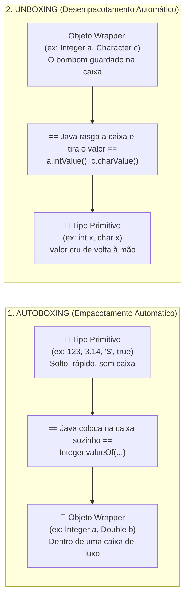

# Curso de Java — Capítulo 55 (Parte 2): Wrapper Classes 🎁
## Autoboxing, Unboxing e as Conversões Automáticas de Tipos

---

> [!IMPORTANT]
> **Para cópia no Google Docs:** Este documento dá continuidade ao estudo do **Capítulo 55 (Wrapper Classes)**. Ele analisa detalhadamente as 5 novas telas do vídeo do Bro Code (timestamps `08:47:37` até `08:49:33`), onde o professor abandona a sintaxe arcaica com `new` e demonstra os dois conceitos mais importantes do capítulo: **Autoboxing** (empacotamento automático) e **Unboxing** (desempacotamento automático). Todas as telas, cursores, lâmpadas da IDE e linhas de código foram descritas em texto para que você possa copiar tudo para o seu Google Docs sem depender de imagens.

---

### Links Rápidos dos Arquivos do Projeto no seu Computador
* Arquivo Principal em Edição: [`Main.java`](../../../src/main/java/com/mickaelgeronimo/mastery/core/concurrency/Main.java)
* Pasta Raiz do Projeto: `JAVA APRENDER`
* Parte 1 Anterior (Conceito, Primitivos vs Wrappers e Depreciação do `new`): `explicacao_wrapper_classes_definicao_os_dois_mundos_o_aviso_deprecated_e_os_4_tipos_capitulo55_parte1.md`

---

## 1. Reconstituição Detalhada das 5 Telas da IDE IntelliJ IDEA

Abaixo está o registro cronológico exato do que aconteceu na tela do professor ao longo das 5 capturas:

```
+----------------------------------------------------------------------------------------------------+
|                                    SEQUÊNCIA DE TELAS NO VÍDEO                                      |
+----------------------------------------------------------------------------------------------------+
| IMAGEM 1: A Limpeza do Código — Adeus ao "new" Obsoleto.                                           |
|           • O professor apaga todos os "new Integer(123)", "new Double(3.14)", etc.                |
|           • O código agora fica limpo e direto nas linhas 10 a 13:                                 |
|                 Integer a = 123;                                                                   |
|                 Double b = 3.14;                                                                   |
|                 Character c = '$';                                                                 |
|                 Boolean d = true;                                                                  |
|           • O texto riscado (tachado) SUMIU! Não há mais aviso de depreciação.                     |
|           • Cursor posicionado na linha 12, logo após o caractere '$';.                            |
|                                                                                                    |
| IMAGEM 2: Apresentação do "Autoboxing" e o Exemplo com String.                                     |
|           • Linha 10 recebe o comentário de identificação: // Autoboxing                           |
|           • Linha 15 adiciona uma variável de texto: String e = "Pizza";                           |
|           • O cursor seleciona a palavra "Integer" na linha 11.                                    |
|           • O contador da IDE no canto superior direito mostra [ ! 5 ^ v ]: cinco avisos amarelos  |
|             porque as variáveis a, b, c, d, e foram criadas mas ainda não foram lidas.            |
|           • O professor explica: "String já é um tipo de referência por natureza, e agora os       |
|             wrappers também podem ser criados de forma direta como as Strings!".                   |
|                                                                                                    |
| IMAGEM 3: O Conceito Oposto — "Unboxing" (Timestamp 8:49:13).                                      |
|           • A linha da String ("Pizza") é removida para focar nos 4 tipos primitivos.              |
|           • Linha 16 recebe o comentário: // Unboxing                                              |
|           • Linha 18 recebe a extração: int x = a;                                                 |
|           • Cursor piscando na linha 17 (linha em branco intermediária).                           |
|           • A palavra "Integer" na linha 11 ganha um sublinhado cinza/amarelo da IDE, pois agora   |
|             a variável 'a' está sendo usada para desempacotar o valor dentro de 'x'.               |
|                                                                                                    |
| IMAGEM 4: O Teste de Conversão Numérica (Timestamp 8:49:27).                                       |
|           • O professor altera a linha 17 para testar outro tipo: double x = a;                    |
|           • Na margem esquerda (gutter) da linha 17, aparece o ícone de uma LÂMPADA AMARELA 💡.    |
|           • Cursor posicionado logo após o sinal de igualdade na linha 17.                         |
|           • O professor demonstra que o Java desempacota o 'a' (int 123) e depois o promove        |
|             automaticamente para double (123.0).                                                   |
|                                                                                                    |
| IMAGEM 5: O Unboxing do Caractere e o Rewind de 5 Segundos (Timestamp 8:49:33).                   |
|           • Na tela do player do YouTube surge o indicador visual de retrocesso: < - 5 (5s atrás). |
|           • Linha 17 é alterada para testar o caractere: char x = c;                               |
|           • Cursor logo após a variável 'c;'.                                                      |
|           • Na linha 13, a palavra "Character" ganha destaque/sublinhado porque 'c' foi referenciado|
|             para virar primitivo.                                                                  |
+----------------------------------------------------------------------------------------------------+
```

---

## 2. A Grande Revelação: O Que São *Autoboxing* e *Unboxing*?

Se você nunca programou na vida, pense nestes dois conceitos usando a **Analogia dos Chocolates e das Caixinhas de Presente** 🍫🎁:



### O que é Autoboxing?
* **Definição Simples:** É quando você entrega um valor cru (primitivo) diretamente para uma variável de Objeto Wrapper, e o compilador do Java **empacota tudo sozinho** dentro de um objeto, sem você precisar usar a palavra `new`.
* **Como você escreve no código:**
  ```java
  Integer a = 123;
  ```
* **O que o Java faz secretamente por baixo dos panos:**
  ```java
  Integer a = Integer.valueOf(123); // O compilador faz isso por você!
  ```
  > O método `Integer.valueOf(123)` é inteligente: ele reaproveita instâncias de números pequenos em memória (*cache de inteiros* de -128 até 127), tornando o programa infinitamente mais rápido e econômico do que usar `new Integer(123)`.

---

### O que é Unboxing?
* **Definição Simples:** É o processo **inverso**. É quando você pega um Objeto Wrapper que está guardando um valor na memória e joga esse valor direto para uma variável primitiva simples.
* **Como você escreve no código:**
  ```java
  int x = a;
  ```
* **O que o Java faz secretamente por baixo dos panos:**
  ```java
  int x = a.intValue(); // O compilador chama o método que abre a caixa!
  ```
* **E se for um caractere?**
  ```java
  char x = c; // Por baixo dos panos: char x = c.charValue();
  ```
* **E se for um booleano?**
  ```java
  boolean x = d; // Por baixo dos panos: boolean x = d.booleanValue();
  ```

---

## 3. Por Que o Professor Mostrou a `String e = "Pizza";` na Imagem 2?

Na Imagem 2, surgiu a linha:
```java
String e = "Pizza";
```

Muitos iniciantes perguntam: *"Ué, a String é uma Wrapper Class?"*

> [!NOTE]
> **A resposta é NÃO!** `String` não é uma classe invólucro (pois não existe um tipo primitivo chamado `string`). 
> O professor colocou a String ali como uma **ponte didática**:
> * Desde as primeiras aulas do curso, você aprendeu a escrever `String e = "Pizza";` em vez de escrever `String e = new String("Pizza");`.
> * O Java sempre permitiu criar Strings direto com aspas duplas por pura comodidade sintática (*String Literal*).
> * O **Autoboxing** fez exatamente a mesma coisa para os números e caracteres! Graças ao Autoboxing, você pode escrever `Integer a = 123;` com a mesma naturalidade que sempre escreveu `String e = "Pizza";`.

---

## 4. O Código Completo do [`Main.java`](../../../src/main/java/com/mickaelgeronimo/mastery/core/concurrency/Main.java)

Abaixo está o arquivo exatamente como ele fica na **Imagem 5** (versão final desta etapa):

```java
public class Main {
    public static void main(String[] args) {

        // Wrapper classes = Allow primitive values (int, char, double, boolean)
        //                   to be used as objects. "Wrap them in an object"
        //                   Generally, don't wrap primitives unless you need an object.
        //                   Allows use of Collections Framework and static Utility Methods.

        // Autoboxing
        Integer a = 123;
        Double b = 3.14;
        Character c = '$';
        Boolean d = true;

        // Unboxing
        char x = c;

    }
}
```

---

## 5. Análise Detalhada Linha por Linha

| Linha | Código Exato | O que faz no computador? | Saída no Console? |
| :---: | :--- | :--- | :---: |
| **L1** | `public class Main {` | Declara a classe pública `Main`, molde onde o código reside. | *(Nenhuma)* |
| **L2** | `public static void main(String[] args) {` | Método principal; a porta de entrada da execução do programa Java. | *(Nenhuma)* |
| **L3** | *(linha em branco)* | Espaçamento visual para manter o código limpo e legível. | *(Nenhuma)* |
| **L4** | `// Wrapper classes = Allow primitive values...` | Comentário teórico explicando que Wrappers permitem usar primitivos como objetos. | *(Nenhuma)* |
| **L5** | `//                   to be used as objects...` | Continuação do comentário: "Empacote-os em um objeto". | *(Nenhuma)* |
| **L6** | `//                   Generally, don't wrap...` | Conselho prático: "Geralmente não empacote a menos que precise de um objeto". | *(Nenhuma)* |
| **L7** | `//                   Allows use of Collections...`| Explica que Wrappers desbloqueiam o uso de Coleções (`ArrayList`) e métodos utilitários. | *(Nenhuma)* |
| **L8** | *(linha em branco)* | Separa os comentários teóricos da parte prática. | *(Nenhuma)* |
| **L9** | `// Autoboxing` | Título indicando que as linhas seguintes exemplificam o empacotamento automático. | *(Nenhuma)* |
| **L10** | `Integer a = 123;` | **Autoboxing:** Converte o primitivo `123` no objeto `Integer a` via `Integer.valueOf(123)`. | *(Nenhuma)* |
| **L11** | `Double b = 3.14;` | **Autoboxing:** Converte o primitivo `3.14` no objeto `Double b` via `Double.valueOf(3.14)`. | *(Nenhuma)* |
| **L12** | `Character c = '$';` | **Autoboxing:** Converte o caractere primitivo `'$'` no objeto `Character c`. | *(Nenhuma)* |
| **L13** | `Boolean d = true;` | **Autoboxing:** Converte o booleano primitivo `true` no objeto `Boolean d`. | *(Nenhuma)* |
| **L14** | *(linha em branco)* | Espaçamento entre o bloco de Autoboxing e o bloco de Unboxing. | *(Nenhuma)* |
| **L15** | `// Unboxing` | Título indicando que as linhas abaixo demonstram o desempacotamento de volta para primitivo. | *(Nenhuma)* |
| **L16** | `char x = c;` | **Unboxing:** Retira o valor primitivo `'$'` guardado dentro do objeto `c` e o armazena na variável primitiva `x`. | *(Nenhuma)* |
| **L17** | `}` | Fecha o método `main`. | *(Nenhuma)* |
| **L18** | `}` | Fecha a classe `Main`. | *(Nenhuma)* |

---

## 6. O Que Foi o Teste da Linha 17 na Imagem 4 (`double x = a;`)?

Na Imagem 4, o professor digitou:
```java
double x = a;
```
E apareceu uma lâmpada amarela 💡 na margem esquerda.

### O que estava acontecendo ali?
1. A variável `a` é do tipo `Integer` (guarda o número inteiro `123`).
2. A variável `x` é do tipo primitivo `double` (guarda números decimais).
3. O Java realizou **dois passos automáticos consecutivos**:
   * **Passo 1 (Unboxing):** O Java desempacotou `a` e pegou o número primitivo `int` `123`.
   * **Passo 2 (Widening Primitive Conversion):** O Java converteu o `int` `123` para o `double` `123.0` (promoção automática de tipo sem perda de precisão).
4. **Por que a lâmpada 💡 apareceu?** O IntelliJ IDEA percebeu que você estava fazendo uma conversão de tipos misturados e ofereceu sugestões úteis, como mudar o tipo de `x` para `int` ou mudar a variável para `b` (`Double b = 3.14;`), que seria o par perfeito de um `double`.
5. Em seguida, na Imagem 5, o professor decidiu demonstrar o unboxing direto usando tipos compatíveis e trocou para `char x = c;`.

---

## 7. O Que Aparece no Terminal ao Compilar e Rodar?

### 1. Na Compilação (`javac Main.java`):
* **Resultado:** **ZERO erros e ZERO avisos (warnings)!**
* **Diferença crucial para a Parte 1:** Na Parte 1, o uso de `new Integer(123)` gerava 4 avisos de depreciação na tela preta. Agora, com o Autoboxing (`Integer a = 123;`), o compilador fica 100% satisfeito, pois esta é a sintaxe oficial recomendada pelos desenvolvedores do Java moderno!

### 2. Na Execução (`java Main`):
```text
(Terminal completamente vazio / silencioso)
```
* **Por que fica vazio?** Porque nenhuma linha do programa possui a instrução de impressão `System.out.println()`. Todas as operações (empacotar `123`, `3.14`, `'$'`, `true` e desempacotar `'$'` em `x`) aconteceram silenciosamente dentro dos registradores e da memória RAM do seu computador.

---

## 8. Experimento Mental: E Se Mandássemos Imprimir as Variáveis?

Se adicionássemos comandos de impressão no final do programa:

```java
System.out.println(a);
System.out.println(b);
System.out.println(c);
System.out.println(d);
System.out.println(x);
```

A saída na tela seria exatamente idêntica aos valores primitivos originais:
```text
123
3.14
$
true
$
```

> **A Mágica dos Wrappers:** Para você que está lendo a saída na tela, parece não haver nenhuma diferença entre um primitivo e um objeto wrapper. Mas, como veremos nas próximas partes do capítulo, o objeto wrapper possui centenas de métodos embutidos (como `a.toString()`, `Character.isUpperCase(c)`, etc.) que um tipo primitivo jamais conseguirá ter!
