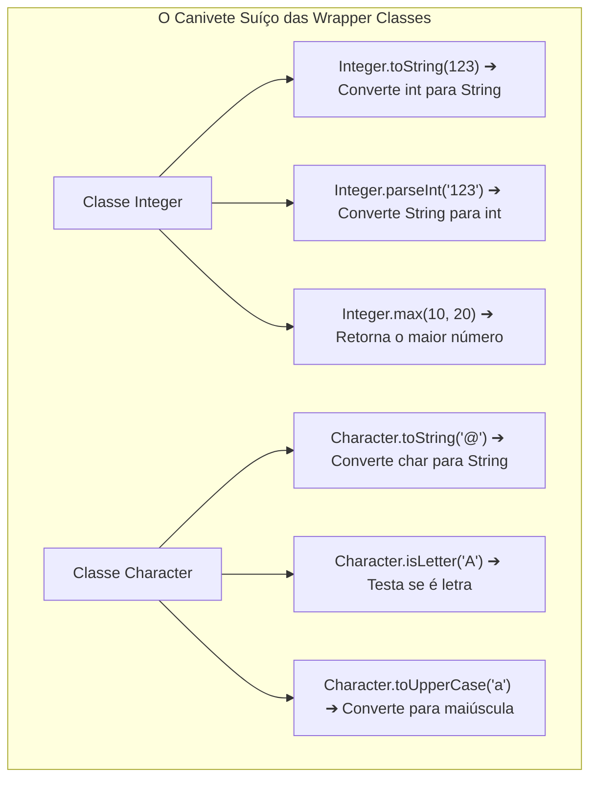
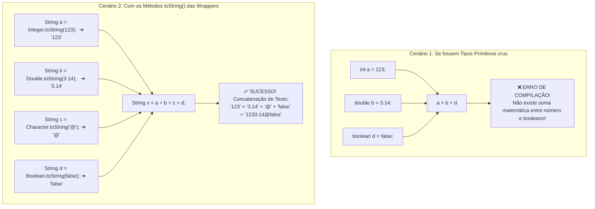

# Curso de Java — Capítulo 55 (Parte 3): Wrapper Classes 🎁
## Métodos Utilitários Estáticos (*toString*), Conversão de Tipos e Concatenação Textual

---

> [!IMPORTANT]
> **Para cópia no Google Docs:** Este documento analisa a terceira sequência de telas do **Capítulo 55 (Wrapper Classes)** do curso do Bro Code (timestamps `08:49:33` até `08:51:27`). Aqui, o professor encerra o bloco de *Autoboxing/Unboxing* e introduz a **segunda grande utilidade das Wrapper Classes**: os **Métodos Utilitários Estáticos (*Static Utility Methods*)**, mostrando na prática como converter qualquer tipo primitivo (`int`, `double`, `char`, `boolean`) em texto (`String`) através do método `toString()`. Todas as 5 imagens foram integralmente descritas em texto para que você possa copiar este material para o seu Google Docs sem perder nenhum elemento visual da IDE.

---

### Links Rápidos dos Arquivos do Projeto no seu Computador
* Arquivo Principal em Edição: [`Main.java`](../../../src/main/java/com/mickaelgeronimo/mastery/core/concurrency/Main.java)
* Pasta Raiz do Projeto: `JAVA APRENDER`
* Parte 1 (Conceito, Primitivos vs Wrappers e Depreciação do `new`): `explicacao_wrapper_classes_definicao_os_dois_mundos_o_aviso_deprecated_e_os_4_tipos_capitulo55_parte1.md`
* Parte 2 (Autoboxing, Unboxing e Promoções de Tipo): `explicacao_wrapper_classes_autoboxing_unboxing_e_as_conversoes_automaticas_capitulo55_parte2.md`

---

## 1. Reconstituição Detalhada das 5 Telas da IDE IntelliJ IDEA

Abaixo está o registro cronológico exato do que aconteceu na tela do professor ao longo das 5 capturas:

```
+----------------------------------------------------------------------------------------------------+
|                                    SEQUÊNCIA DE TELAS NO VÍDEO                                      |
+----------------------------------------------------------------------------------------------------+
| IMAGEM 1: Fechamento do Unboxing e Seleção em Massa.                                               |
|           • O professor finaliza o teste anterior com booleano na linha 17: boolean x = d;         |
|           • Em seguida, ele seleciona com o mouse as linhas 11 a 14 com fundo azul:                |
|                 Integer a = 123;                                                                   |
|                 Double b = 3.14;                                                                   |
|                 Character c = '$';                                                                 |
|                 Boolean d = true;                                                                  |
|           • O cursor do mouse está sobre o número "123". Uma lâmpada amarela 💡 surge na linha 11.|
|           • Ele se prepara para apagar este bloco e iniciar a próxima lição.                       |
|                                                                                                    |
| IMAGEM 2: A Transição e o Cartaz "*Wrapper".                                                       |
|           • Todo o código de Autoboxing e Unboxing é apagado. O método main fica limpo na linha 10.|
|           • Uma animação em letras grandes surge no centro da tela:                                |
|                                         "*Wrapper"                                                 |
|           • Linhas 5 a 8 continuam com os comentários originais, com destaque para a linha 8:      |
|             "Allows use of Collections Framework and static Utility Methods."                      |
|           • O professor começa a explicar o segundo benefício: os Métodos Utilitários Estáticos!   |
|                                                                                                    |
| IMAGEM 3: Preparando o Terreno com Quatro Strings (Timestamp 10:18).                              |
|           • O professor digita quatro variáveis do tipo String sem valor inicial (linhas 10 a 13): |
|                 String a;                                                                          |
|                 String b;                                                                          |
|                 String c;                                                                          |
|                 String d;                                                                          |
|           • O cursor pisca na linha 10 logo após o ponto e vírgula de "String a;".                 |
|           • No canto superior direito da IDE, o badge de inspeção exibe [ ! 4 ^ v ]: 4 avisos      |
|             amarelos porque as variáveis foram declaradas mas ainda não possuem atribuição.        |
|                                                                                                    |
| IMAGEM 4: A Mágica dos Métodos Utilitários: Convertendo Primitivos para Texto.                     |
|           • O professor completa cada linha chamando o método estático toString() de cada wrapper: |
|                 String a = Integer.toString(123);                                                  |
|                 String b = Double.toString(3.14);                                                  |
|                 String c = Character.toString('@');                                                |
|                 String d = Boolean.toString(false);                                                |
|           • Repare nos novos valores escolhidos: '@' para o caractere e false para o booleano.     |
|           • Cursor posicionado na linha 15 (linha vazia aguardando o próximo comando).             |
|                                                                                                    |
| IMAGEM 5: Concatenação, Execução e Saída no Console (Timestamp 8:51:27).                           |
|           • Linha 15 adicionada: String x = a + b + c + d;                                         |
|           • Linha 17 adicionada: System.out.println(x);                                            |
|           • O professor clica no botão verde Play (▶️) e o painel "Run" se abre na metade inferior.|
|           • O console exibe a linha resultante:                                                    |
|                 1233.14@false                                                                      |
|           • O professor usa o mouse e seleciona com destaque azul a parte "1233.14" da saída       |
|             para demonstrar que os números NÃO foram somados, mas sim colados como texto!          |
|           • Abaixo aparece: "Process finished with exit code 0".                                   |
+----------------------------------------------------------------------------------------------------+
```

---

## 2. O Que É um Método Utilitário Estático (*Static Utility Method*)?

Imagine que as classes Wrapper não são apenas caixas de guardar valores, mas sim **verdadeiros canivetes suíços** 🇨🇭 cheios de ferramentas prontas para o programador usar.



### Por que "Estático" (*Static*)?
Em Java, a palavra **`static`** significa que o método **pertence à Classe em si**, e não a um objeto criado com `new`.
* Você não precisa instanciar nada!
* Basta digitar o nome da Classe com **Primeira Letra Maiúscula** (`Integer.`, `Double.`, `Character.`, `Boolean.`), colocar um ponto e chamar a ferramenta que deseja usar!

### Por que o Primitivo sozinho não consegue fazer isso?
Um tipo primitivo como `int` ou `double` é apenas um punhado de bits puros gravados na memória. Se você tentar escrever:
```java
123.toString(); // ❌ ERRO TERRÍVEL DE COMPILAÇÃO!
```
O Java vai acusar erro imediatamente, porque números primitivos **não possuem métodos**. É exatamente por isso que as Wrapper Classes existem: para fornecer essas ferramentas estáticas prontas!

---

## 3. O Duelo: Soma Matemática vs Concatenação de Texto

Esta é a lição central que o professor ensinou ao selecionar a parte `1233.14` na tela do console da Imagem 5:



### O que o professor quis provar ao destacar `1233.14` com o mouse?
* Se `a` fosse número `123` e `b` fosse número `3.14`, a operação `a + b` resultaria em **`126.14`** (uma conta de somar).
* Como ambos foram convertidos para `String` através de `Integer.toString()` e `Double.toString()`, o operador `+` **deixou de fazer conta de somar** e passou a fazer **concatenação (cola de palavras)**!
* Por isso saiu na tela **`1233.14`** (o texto `"123"` colado ao lado do texto `"3.14"`), seguido do `"@"` e do `"false"`.

---

## 4. O Código Completo do [`Main.java`](../../../src/main/java/com/mickaelgeronimo/mastery/core/concurrency/Main.java)

Abaixo está o código integral exatamente como construído na Imagem 5:

```java
public class Main {
    public static void main(String[] args) {

        // Wrapper classes = Allow primitive values (int, char, double, boolean)
        //                   to be used as objects. "Wrap them in an object"
        //                   Generally, don't wrap primitives unless you need an object.
        //                   Allows use of Collections Framework and static Utility Methods.

        String a = Integer.toString(123);
        String b = Double.toString(3.14);
        String c = Character.toString('@');
        String d = Boolean.toString(false);

        String x = a + b + c + d;

        System.out.println(x);
    }
}
```

---

## 5. Análise Detalhada Linha por Linha

| Linha | Código Exato | O que faz no computador? | Saída no Console? |
| :---: | :--- | :--- | :---: |
| **L1** | `public class Main {` | Declaração da classe pública `Main`. | *(Nenhuma)* |
| **L2** | `public static void main(String[] args) {` | Ponto de entrada onde a JVM inicia a execução. | *(Nenhuma)* |
| **L3** | *(linha em branco)* | Espaçamento para organização visual do código. | *(Nenhuma)* |
| **L4** | `// Wrapper classes = Allow primitive values...` | Comentário teórico: definição de Wrapper Classes. | *(Nenhuma)* |
| **L5** | `//                   to be used as objects...` | Comentário: "Empacote-os em um objeto". | *(Nenhuma)* |
| **L6** | `//                   Generally, don't wrap...` | Comentário: "Não empacote a menos que precise". | *(Nenhuma)* |
| **L7** | `//                   Allows use of Collections...`| Comentário: "Permite usar Coleções e Métodos Utilitários Estáticos". | *(Nenhuma)* |
| **L8** | *(linha em branco)* | Espaçamento entre os comentários e o código executável. | *(Nenhuma)* |
| **L9** | *(linha em branco)* | Espaçamento visual mantido pela IDE. | *(Nenhuma)* |
| **L10** | `String a = Integer.toString(123);` | Executa o método estático `Integer.toString()`, que pega o `int` `123` e cria a `String` `"123"`, guardando-a em `a`. | *(Nenhuma)* |
| **L11** | `String b = Double.toString(3.14);` | Executa o método estático `Double.toString()`, que converte o `double` `3.14` na `String` `"3.14"`, guardando-a em `b`. | *(Nenhuma)* |
| **L12** | `String c = Character.toString('@');` | Executa o método estático `Character.toString()`, que converte o `char` `'@'` na `String` `"@"`, guardando-a em `c`. | *(Nenhuma)* |
| **L13** | `String d = Boolean.toString(false);` | Executa o método estático `Boolean.toString()`, que converte o `boolean` `false` na `String` `"false"`, guardando-a em `d`. | *(Nenhuma)* |
| **L14** | *(linha em branco)* | Separa a preparação das variáveis da operação de concatenação. | *(Nenhuma)* |
| **L15** | `String x = a + b + c + d;` | Junta as 4 strings em uma só corrente de texto: `"123"` + `"3.14"` + `"@"` + `"false"`, resultando em `"1233.14@false"`. | *(Nenhuma)* |
| **L16** | *(linha em branco)* | Espaçamento antes do comando de saída. | *(Nenhuma)* |
| **L17** | `System.out.println(x);` | Envia o texto da variável `x` para ser impresso na tela do console com uma quebra de linha. | `1233.14@false` |
| **L18** | `}` | Fecha o método `main`. | *(Nenhuma)* |
| **L19** | `}` | Fecha a classe `Main`. | *(Nenhuma)* |

---

## 6. O Que Aparece no Terminal ao Rodar o Programa?

Ao clicar em **Run ▶️** no IntelliJ IDEA (ou rodar `javac Main.java` seguido de `java Main` no terminal), o resultado exato exibido é:

```text
1233.14@false

Process finished with exit code 0
```

### Decomposição do texto impresso:
* **`123`** ➔ veio da conversão de `Integer.toString(123)`
* **`3.14`** ➔ veio da conversão de `Double.toString(3.14)`
* **`@`** ➔ veio da conversão de `Character.toString('@')`
* **`false`** ➔ veio da conversão de `Boolean.toString(false)`
* Todos colados juntos sem espaços porque não foi adicionado nenhum espaço entre as variáveis na linha 15.
