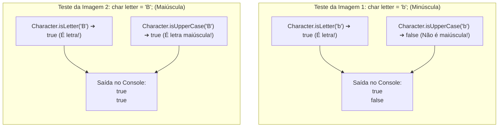
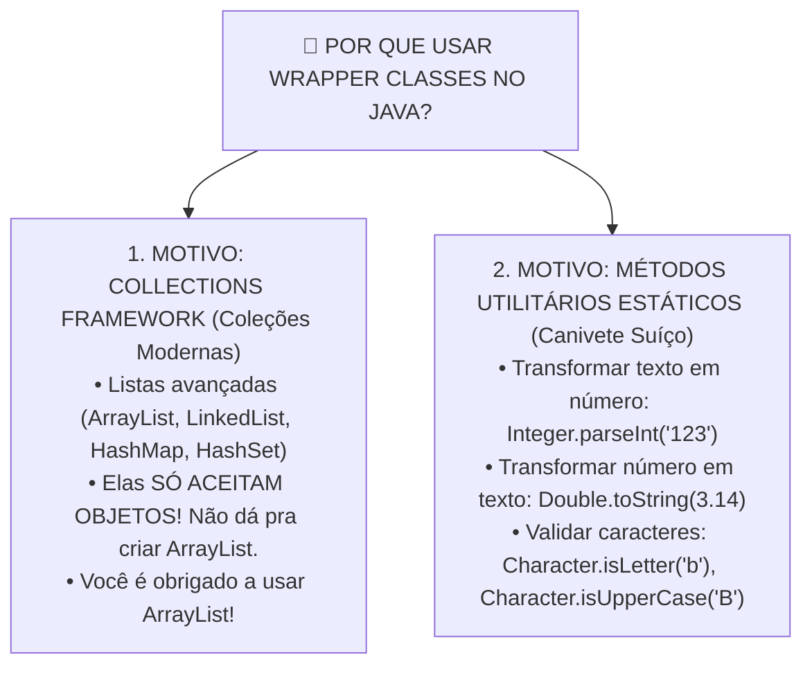

# Curso de Java — Capítulo 55 (Parte 5): Wrapper Classes 🎁
## Inspeção com *Character.isUpperCase*, o Fechamento Teórico e a Conclusão do Capítulo 55

---

> [!IMPORTANT]
> **Para cópia no Google Docs:** Este documento conclui o estudo integral do **Capítulo 55 (Wrapper Classes)** do curso do Bro Code (timestamps `08:54:40` até `08:55:48`). Aqui, o professor finaliza os testes com os métodos de inspeção da classe `Character` (`Character.isUpperCase`), demonstrando o comportamento com caracteres minúsculos (`'b'`) e maiúsculos (`'B'`). Em seguida, ele retorna ao código principal, destaca o texto *`static Utility Methods.`* na linha 8 e encerra o capítulo consolidando os dois grandes pilares das Wrapper Classes. Todas as 4 telas foram completamente descritas em texto para cópia direta no seu Google Docs.

---

### Links Rápidos dos Arquivos do Projeto no seu Computador
* Arquivo Principal no Computador: [`Main.java`](../../../src/main/java/com/mickaelgeronimo/mastery/core/concurrency/Main.java)
* Pasta Raiz do Projeto: `JAVA APRENDER`
* Parte 1 (Conceito, Primitivos vs Wrappers e Depreciação do `new`): `explicacao_wrapper_classes_definicao_os_dois_mundos_o_aviso_deprecated_e_os_4_tipos_capitulo55_parte1.md`
* Parte 2 (Autoboxing, Unboxing e Conversões Automáticas): `explicacao_wrapper_classes_autoboxing_unboxing_e_as_conversoes_automaticas_capitulo55_parte2.md`
* Parte 3 (Métodos Estáticos toString e Concatenação Textual): `explicacao_wrapper_classes_metodos_utilitarios_estaticos_tostring_e_concatenacao_capitulo55_parte3.md`
* Parte 4 (Métodos parse, Erro de Compilação e Character.isLetter): `explicacao_wrapper_classes_metodos_parse_o_erro_do_operador_e_character_isletter_capitulo55_parte4.md`

---

## 1. Reconstituição Detalhada das 4 Telas da IDE IntelliJ IDEA

Abaixo está o registro cronológico exato do que aconteceu na tela do professor ao longo das 4 capturas:

```
+----------------------------------------------------------------------------------------------------+
|                                    SEQUÊNCIA DE TELAS NO VÍDEO                                      |
+----------------------------------------------------------------------------------------------------+
| IMAGEM 1: Testando Minúscula ('b') com isLetter e isUpperCase.                                     |
|           • O professor escreve na linha 10: char letter = 'b';                                    |
|           • Linha 12: System.out.println(Character.isLetter(letter));                              |
|           • Linha 13: System.out.println(Character.isUpperCase(letter));                           |
|           • O painel "Run" abaixo exibe duas linhas em verde:                                      |
|                 true                                                                               |
|                 false                                                                              |
|           • O cursor do mouse está sobre o botão "Main" na aba Run.                                |
|           • Explicação: 'b' é letra (true), mas NÃO é maiúscula (false).                           |
|                                                                                                    |
| IMAGEM 2: Testando Maiúscula ('B') — As Duas Linhas Verdes.                                        |
|           • O professor troca a linha 10 para: char letter = 'B';                                  |
|           • Executa novamente. O console agora exibe:                                              |
|                 true                                                                               |
|                 true                                                                               |
|           • O cursor do mouse repousa no painel do terminal.                                       |
|           • Explicação: Agora 'B' é tanto uma letra (true) quanto uma letra MAIÚSCULA (true)!       |
|                                                                                                    |
| IMAGEM 3: O Retorno aos Wrappers e o Destaque em "static Utility Methods.".                        |
|           • O professor apaga o teste de caracteres e restaura o código das 4 Wrapper Classes:     |
|                 Integer a = 123;                                                                   |
|                 Double b = 3.14;                                                                   |
|                 Character c = '$';                                                                 |
|                 Boolean d = true;                                                                  |
|           • Na linha 8 do comentário, ele seleciona com fundo azul o texto:                         |
|                 "static Utility Methods."                                                          |
|           • Ele reforça aos alunos: "Tudo o que vimos (toString, parseInt, isLetter, isUpperCase)  |
|             são os métodos estáticos utilitários que as Wrapper Classes colocam nas suas mãos!".   |
|                                                                                                    |
| IMAGEM 4: O Fechamento Oficial do Capítulo 55 (Timestamp 8:55:48 / 12:00:00).                      |
|           • A barra de progresso vermelha do player do YouTube atinge a marca de 8:55:48.          |
|           • O capítulo "55.wrapper classes >" é concluído com sucesso.                             |
|           • O cursor no editor descansa na linha 5, logo no início de "// Wrapper classes".        |
|           • O código fica limpo, sem nenhum aviso e com zero erros.                                |
+----------------------------------------------------------------------------------------------------+
```

---

## 2. A Nova Ferramenta Utilitária: `Character.isUpperCase()`

O professor adicionou a linha:
```java
System.out.println(Character.isUpperCase(letter));
```

### O que essa linha faz?
* **Em português claro:** *"Dona Classe Character, verifique para mim se o caractere guardado na variável `letter` é uma letra MAIÚSCULA (Caps Lock ligado)!"*.
* **O retorno:**
  * Se for maiúscula (`'A'`, `'B'`, `'Z'`), devolve **`true`**.
  * Se for minúscula (`'a'`, `'b'`, `'z'`), devolve **`false`**.
  * Se for símbolo ou número (`'$'`, `'7'`), também devolve **`false`** (já que símbolos não possuem maiúsculas).

### Comparativo dos Dois Testes no Console:



---

## 3. Tabela Resumo das Validações com a Classe `Character`

Para você consultar sempre que precisar manipular textos e caracteres no seu dia a dia em Java:

| Método Estático | Caractere `'b'` | Caractere `'B'` | Caractere `'$'` | Caractere `'7'` | Caractere `' '` (espaço) |
| :--- | :---: | :---: | :---: | :---: | :---: |
| `Character.isLetter(c)` | `true` | `true` | `false` | `false` | `false` |
| `Character.isUpperCase(c)` | `false` | `true` | `false` | `false` | `false` |
| `Character.isLowerCase(c)` | `true` | `false` | `false` | `false` | `false` |
| `Character.isDigit(c)` | `false` | `false` | `false` | `true` | `false` |
| `Character.isWhitespace(c)`| `false` | `false` | `false` | `false` | `true` |

---

## 4. O Fechamento Teórico: O Destaque em *`static Utility Methods.`* (Imagem 3)

Na Imagem 3, o professor pegou o mouse e selecionou com fundo azul a expressão:
```java
//                   Allows use of Collections Framework and static Utility Methods.
//                                                           ^^^^^^^^^^^^^^^^^^^^^^
```

### Por que ele fez questão de destacar essa frase no encerramento?
Porque muitos iniciantes aprendem tipos primitivos (`int`, `double`, `boolean`) e pensam: *"Se primitivos são mais leves e mais rápidos, por que diabos eu usaria uma Wrapper Class?"*.

O professor amarrou todo o capítulo mostrando que você precisa das Wrapper Classes por **dois grandes motivos indispensáveis**:



---

## 5. O Código Final de Fechamento do Capítulo 55

Este é o código que o professor deixou registrado no [`Main.java`](../../../src/main/java/com/mickaelgeronimo/mastery/core/concurrency/Main.java) na marca de **8:55:48** (Imagem 4):

```java
public class Main {
    public static void main(String[] args) {

        // Wrapper classes = Allow primitive values (int, char, double, boolean)
        //                   to be used as objects. "Wrap them in an object"
        //                   Generally, don't wrap primitives unless you need an object.
        //                   Allows use of Collections Framework and static Utility Methods.

        Integer a = 123;
        Double b = 3.14;
        Character c = '$';
        Boolean d = true;

    }
}
```

---

## 6. Análise Linha por Linha da Etapa de Fechamento

### Tabela 1: Código de Teste dos Métodos de Caractere (Imagens 1 e 2)

```java
char letter = 'B';
System.out.println(Character.isLetter(letter));
System.out.println(Character.isUpperCase(letter));
```

| Linha | Código Exato | O que faz no computador? | Saída no Console |
| :---: | :--- | :--- | :---: |
| **L1** | `char letter = 'B';` | Cria a variável primitiva `letter` com o caractere maiúsculo `'B'`. | *(Nenhuma)* |
| **L2** | `System.out.println(Character.isLetter(letter));` | Pergunta se `'B'` é uma letra alfabética. Como é, imprime `true`. | `true` |
| **L3** | `System.out.println(Character.isUpperCase(letter));`| Pergunta se `'B'` é maiúscula. Como é, imprime `true`. | `true` |

*(Se `letter` fosse `'b'` minúscula, a linha L3 imprimiria `false`, como visto na Imagem 1).*

---

### Tabela 2: Código Final em [`Main.java`](../../../src/main/java/com/mickaelgeronimo/mastery/core/concurrency/Main.java) (Imagens 3 e 4)

| Linha | Código Exato | O que faz no computador? | Saída no Console |
| :---: | :--- | :--- | :---: |
| **L1** | `public class Main {` | Declaração da classe pública `Main`. | *(Nenhuma)* |
| **L2** | `public static void main(String[] args) {` | Método principal de execução. | *(Nenhuma)* |
| **L3** | *(linha em branco)* | Organização e espaçamento visual. | *(Nenhuma)* |
| **L4** | `// Wrapper classes = Allow primitive values...` | Comentário teórico: definição de Wrapper Classes. | *(Nenhuma)* |
| **L5** | `//                   to be used as objects...` | Comentário: "Empacote-os em um objeto". | *(Nenhuma)* |
| **L6** | `//                   Generally, don't wrap...` | Conselho: Não empacote a menos que precise. | *(Nenhuma)* |
| **L7** | `//                   Allows use of Collections...`| Lembra os dois grandes pilares: Coleções e Métodos Estáticos. | *(Nenhuma)* |
| **L8** | *(linha em branco)* | Espaçamento visual. | *(Nenhuma)* |
| **L9** | `Integer a = 123;` | **Autoboxing:** Cria o objeto `Integer` contendo o valor `123`. | *(Nenhuma)* |
| **L10** | `Double b = 3.14;` | **Autoboxing:** Cria o objeto `Double` contendo o valor `3.14`. | *(Nenhuma)* |
| **L11** | `Character c = '$';` | **Autoboxing:** Cria o objeto `Character` contendo `'$'`. | *(Nenhuma)* |
| **L12** | `Boolean d = true;` | **Autoboxing:** Cria o objeto `Boolean` contendo `true`. | *(Nenhuma)* |
| **L13** | *(linha em branco)* | Organização visual. | *(Nenhuma)* |
| **L14** | `}` | Fim do método `main`. | *(Nenhuma)* |
| **L15** | `}` | Fim da classe `Main`. | *(Nenhuma)* |

---

## 7. Saídas Exatas no Terminal

### Caso 1 (Imagem 1 — com `'b'`):
```text
true
false

Process finished with exit code 0
```

### Caso 2 (Imagem 2 — com `'B'`):
```text
true
true

Process finished with exit code 0
```

### Caso 3 (Imagem 4 — Código Final de Encerramento):
```text
(Terminal completamente limpo/silencioso - zero erros e zero avisos)
```

---

## 8. Mapa Mental de Conclusão do Capítulo 55

```
+----------------------------------------------------------------------------------------------------+
|                               MAPA MENTAL SUPREMO: WRAPPER CLASSES 🎁                               |
+----------------------------------------------------------------------------------------------------+
| 1. OS NOMES DAS 8 CLASSES:                                                                         |
|    • byte    ➔ Byte          • float   ➔ Float                                                    |
|    • short   ➔ Short         • double  ➔ Double                                                   |
|    • int     ➔ Integer ⭐    • char    ➔ Character ⭐                                             |
|    • long    ➔ Long          • boolean ➔ Boolean ⭐                                               |
|                                                                                                    |
| 2. AUTOBOXING vs UNBOXING:                                                                         |
|    • Autoboxing:  Integer a = 123;   (Primitivo entra na caixa do objeto sozinho)                  |
|    • Unboxing:    int x = a;         (Valor sai da caixa do objeto de volta para primitivo)        |
|    • new Integer(123) é OBSOLETO (Deprecated since Java 9) e NUNCA deve ser usado!                |
|                                                                                                    |
| 3. MÉTODOS ESTÁTICOS UTILITÁRIOS:                                                                  |
|    • toString:    Integer.toString(123) ➔ Devolve "123" (String)                                   |
|    • parse:       Integer.parseInt("123") ➔ Devolve 123 (int primitivo)                            |
|    • inspeção:    Character.isLetter('b') ➔ true                                                   |
|                   Character.isUpperCase('B') ➔ true                                                |
|                                                                                                    |
| 4. REGRA DE OURO DO BRO CODE:                                                                      |
|    "Geralmente não use Wrappers a menos que você realmente precise de um objeto ou de suas         |
|     ferramentas, pois primitivos são mais rápidos e consomem menos memória!"                       |
+----------------------------------------------------------------------------------------------------+
```
