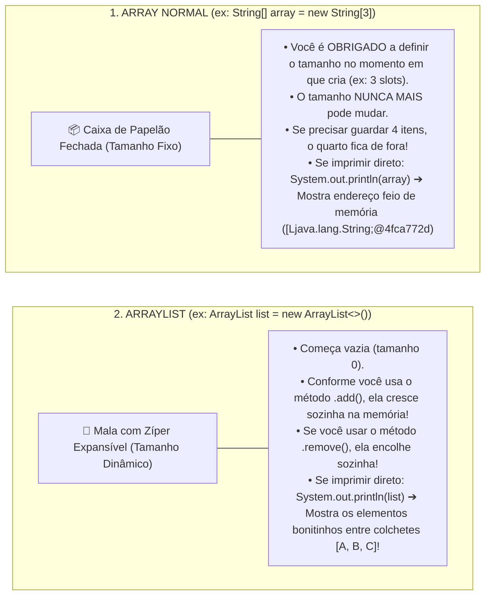

# Curso de Java — Capítulo 56 (Parte 1): ArrayLists 📃
## Introdução aos Arrays Dinâmicos, a Sintaxe de Generics (`<T>`) e o Método `.add()`

---

> [!IMPORTANT]
> **Para cópia no Google Docs:** Este documento inaugura o estudo do **Capítulo 56 (ArrayLists)** do curso do Bro Code (timestamps `08:55:48` até `08:58:21`). Aqui, o professor conecta imediatamente o conhecimento do capítulo anterior (Wrapper Classes e Autoboxing) para apresentar a estrutura de dados mais utilizada em todo o ecossistema Java: o **`ArrayList`**. Todas as 4 telas capturadas (a definição teórica, o primeiro teste com `Double`, a simulação do erro de tipos com `fruits` e a execução bem-sucedida das frutas) foram integralmente reconstruídas em texto para que você possa copiar tudo para o seu Google Docs sem perder nenhum detalhe visual.

---

### Links Rápidos dos Arquivos do Projeto no seu Computador
* Arquivo Principal em Edição: [`Main.java`](file:///c:/Users/mickel%201/Downloads/JAVA%20APRENDER/Main.java)
* Pasta Raiz do Projeto: [`JAVA APRENDER`](file:///c:/Users/mickel%201/Downloads/JAVA%20APRENDER)
* Fechamento do Capítulo Anterior (Capítulo 55 - Parte 5: Wrapper Classes): [`explicacao_wrapper_classes_character_isletter_isuppercase_e_conclusao_definitiva_capitulo55_parte5.md`](file:///C:/Users/mickel%201/.gemini/antigravity/brain/d1dae54d-8acc-4142-bb62-6703a22b9afc/explicacao_wrapper_classes_character_isletter_isuppercase_e_conclusao_definitiva_capitulo55_parte5.md)

---

## 1. Reconstituição Detalhada das 4 Telas da IDE IntelliJ IDEA

Abaixo está o registro cronológico exato do que aconteceu na tela do professor ao longo das 4 capturas:

```
+----------------------------------------------------------------------------------------------------+
|                                    SEQUÊNCIA DE TELAS NO VÍDEO                                      |
+----------------------------------------------------------------------------------------------------+
| IMAGEM 1: Abertura do Capítulo 56 e os Comentários de Definição.                                   |
|           • O projeto MyFirstProject está limpo, contendo apenas o arquivo Main.java dentro de src.|
|           • Nas linhas 5 e 6, o professor digita a teoria fundamental:                             |
|                 // ArrayList = A resizeable array that stores objects (autoboxing).                |
|                 //             Arrays are fixed in size, but ArrayLists can change.                |
|           • O cursor pisca na linha 6 após "Ar".                                                   |
|           • O professor destaca a frase "stores objects (autoboxing)" ligando com o capítulo 55.   |
|                                                                                                    |
| IMAGEM 2: O Primeiro Experimento com ArrayList de Números Decimais.                                |
|           • Linha 9: ArrayList<Double> list = new ArrayList<>();                                   |
|           • Linhas 11 a 13: Três adições de valores decimais:                                      |
|                 list.add(3.14);                                                                    |
|                 list.add(1.99);                                                                    |
|                 list.add(2.01);                                                                    |
|           • Linha 15: Impressão direta da lista: System.out.println(list);                         |
|           • O cursor e um balãozinho com exclamação (!) surgem na linha 13.                        |
|                                                                                                    |
| IMAGEM 3: O Teste de Erro de Tipo (Type Mismatch) com Frutas (Timestamp 15:34).                    |
|           • O professor adiciona no topo (linha 1): import java.util.ArrayList;                    |
|           • Na linha 9, ele troca o tipo e o nome da lista:                                        |
|                 ArrayList<String> fruits = new ArrayList<>();                                      |
|           • A palavra "fruits" aparece destacada com fundo roxo/cinza.                             |
|           • Como ele ainda NÃO alterou os números das linhas 11, 12 e 13:                          |
|                 fruits.add(3.14);                                                                  |
|                 fruits.add(1.99);                                                                  |
|                 fruits.add(2.01);                                                                  |
|             Os números ganham SUBLINHADO ONDULADO VERMELHO no editor!                              |
|           • No canto superior direito da IDE, o badge de inspeção acusa 3 ERROS [ ! 3 ^ v ].       |
|           • Explicação: Uma lista de String só aceita texto! Tentar colocar double causa erro!     |
|                                                                                                    |
| IMAGEM 4: A Lista de Frutas Corrigida e a Execução no Terminal (Timestamp 8:58:21).                |
|           • O professor substitui os números por quatro nomes de frutas entre aspas:               |
|                 fruits.add("Apple");                                                               |
|                 fruits.add("Orange");                                                              |
|                 fruits.add("Banana");                                                              |
|                 fruits.add("Coconut");                                                             |
|           • Linha 16: System.out.println(fruits);                                                  |
|           • O professor clica em Play ▶️. O painel inferior "Run" exibe a saída verde formatada:   |
|                 [Apple, Orange, Banana, Coconut]                                                   |
|           • Process finished with exit code 0.                                                     |
+----------------------------------------------------------------------------------------------------+
```

---

## 2. O Que É um `ArrayList`? (A Mala com Zíper Expansível 🧳 vs A Caixa de Papelão 📦)

Para entender `ArrayList`, você precisa compará-lo com os **Arrays Comuns** que aprendeu lá no início do curso:



---

## 3. Por Que o Capítulo 55 (Wrapper Classes) Foi Obrigatório Para Chegar Aqui?

Repare bem na sintaxe de criação de um `ArrayList`:

```java
ArrayList<Double> list = new ArrayList<>();
```

E observe o que está dentro dos sinais de menor e maior `< >` (chamados de **Generics**):

> [!CAUTION]
> **A REGRA DE OURO DAS COLEÇÕES EM JAVA:**
> O `ArrayList` **NÃO ACEITA TIPOS PRIMITIVOS DIRETOS**!
> Se você tentar escrever:
> ```java
> ArrayList<int> list = new ArrayList<>();    // ❌ ERRO GRAVE DE COMPILAÇÃO!
> ArrayList<double> list = new ArrayList<>(); // ❌ ERRO GRAVE DE COMPILAÇÃO!
> ```
> O compilador vai rejeitar na hora, dizendo que tipos primitivos não são permitidos nos Generics.

É exatamente por isso que no Capítulo 55 estudamos as **Wrapper Classes**:
* Em vez de `int`, você escreve **`<Integer>`**.
* Em vez de `double`, você escreve **`<Double>`**.
* Em vez de `char`, você escreve **`<Character>`**.
* Em vez de `boolean`, você escreve **`<Boolean>`**.
* E para textos, você usa **`<String>`** (que já é uma classe/objeto).

### E onde entra o *Autoboxing*?
Quando você chama:
```java
list.add(3.14);
```
O número `3.14` é um tipo primitivo `double` cru. Mas o Java faz o **Autoboxing automático**: ele empacota o `3.14` dentro de um objeto `Double` antes de guardá-lo na lista! Você ganha a praticidade de digitar o número direto, e o Java cuida dos objetos por baixo dos panos!

---

## 4. O Que Aconteceu na Imagem 3? (O Erro de Incompatibilidade de Tipos)

Na Imagem 3, o professor trocou a declaração da lista para:
```java
ArrayList<String> fruits = new ArrayList<>();
```
Mas manteve provisoriamente as linhas que adicionavam números:
```java
fruits.add(3.14); // ❌ ERRO: java: incompatible types: double cannot be converted to java.lang.String
fruits.add(1.99); // ❌ ERRO: java: incompatible types: double cannot be converted to java.lang.String
fruits.add(2.01); // ❌ ERRO: java: incompatible types: double cannot be converted to java.lang.String
```

### Por que a IDE sublinhou em vermelho e acusou 3 erros?
* O `ArrayList` em Java é **fortemente tipado** (*Type-Safe*).
* Ao declarar `<String>`, você colocou um segurança na porta da lista que diz: *"Aqui só entram textos entre aspas duplas!"*.
* Quando o Java viu números decimais sendo passados para o método `add`, ele impediu a compilação.
* Na Imagem 4, o professor corrigiu colocando frutas de verdade: `"Apple"`, `"Orange"`, `"Banana"`, `"Coconut"`.

---

## 5. O Código Completo do [`Main.java`](file:///c:/Users/mickel%201/Downloads/JAVA%20APRENDER/Main.java)

Abaixo está o código integral exatamente como construído na **Imagem 4**:

```java
import java.util.ArrayList;

public class Main {
    public static void main(String[] args) {

        // ArrayList = A resizeable array that stores objects (autoboxing).
        //             Arrays are fixed in size, but ArrayLists can change.

        ArrayList<String> fruits = new ArrayList<>();

        fruits.add("Apple");
        fruits.add("Orange");
        fruits.add("Banana");
        fruits.add("Coconut");

        System.out.println(fruits);
    }
}
```

---

## 6. Análise Detalhada Linha por Linha

| Linha | Código Exato | O que faz no computador? | Saída no Console? |
| :---: | :--- | :--- | :---: |
| **L1** | `import java.util.ArrayList;` | Importa a classe `ArrayList` do pacote utilitário do Java (`java.util`). Sem esta linha, o Java não reconhece a palavra `ArrayList`. | *(Nenhuma)* |
| **L2** | *(linha em branco)* | Organização e legibilidade. | *(Nenhuma)* |
| **L3** | `public class Main {` | Declaração da classe pública principal `Main`. | *(Nenhuma)* |
| **L4** | `public static void main(String[] args) {` | Método principal; ponto de entrada de execução do Java. | *(Nenhuma)* |
| **L5** | *(linha em branco)* | Organização visual. | *(Nenhuma)* |
| **L6** | `// ArrayList = A resizeable array that stores objects (autoboxing).` | Comentário teórico: define que ArrayList é um array redimensionável que guarda objetos. | *(Nenhuma)* |
| **L7** | `//             Arrays are fixed in size, but ArrayLists can change.` | Comentário teórico: reforça que arrays normais têm tamanho fixo, mas ArrayLists mudam de tamanho. | *(Nenhuma)* |
| **L8** | *(linha em branco)* | Separação visual. | *(Nenhuma)* |
| **L9** | `ArrayList<String> fruits = new ArrayList<>();` | Cria uma nova lista vazia na memória Heap pronta para armazenar objetos do tipo `String`. O operador `<>` no final é o *diamond operator*. | *(Nenhuma)* |
| **L10** | *(linha em branco)* | Espaçamento antes das inserções. | *(Nenhuma)* |
| **L11** | `fruits.add("Apple");` | Adiciona a String `"Apple"` na posição índice 0 da lista. O tamanho da lista passa de 0 para 1. | *(Nenhuma)* |
| **L12** | `fruits.add("Orange");` | Adiciona a String `"Orange"` na posição índice 1 da lista. O tamanho da lista passa para 2. | *(Nenhuma)* |
| **L13** | `fruits.add("Banana");` | Adiciona a String `"Banana"` na posição índice 2 da lista. O tamanho da lista passa para 3. | *(Nenhuma)* |
| **L14** | `fruits.add("Coconut");`| Adiciona a String `"Coconut"` na posição índice 3 da lista. O tamanho da lista passa para 4. | *(Nenhuma)* |
| **L15** | *(linha em branco)* | Espaçamento antes da exibição. | *(Nenhuma)* |
| **L16** | `System.out.println(fruits);` | Imprime a lista inteira formatada na tela do console. O `ArrayList` possui um método `toString()` interno que coloca colchetes e separa os itens por vírgula. | `[Apple, Orange, Banana, Coconut]` |
| **L17** | `}` | Fim do método `main`. | *(Nenhuma)* |
| **L18** | `}` | Fim da classe `Main`. | *(Nenhuma)* |

---

## 7. Saída Exata no Terminal

Ao rodar o programa clicando em Play ▶️ no IntelliJ IDEA (ou no terminal via `javac Main.java` e `java Main`), o resultado exibido é:

```text
[Apple, Orange, Banana, Coconut]

Process finished with exit code 0
```

### Por que a saída aparece entre colchetes `[ ... ]`?
* Diferente de um array primitivo comum (onde você precisaria de um laço `for` para imprimir item por item), a classe `ArrayList` já vem com uma formatação amigável programada de fábrica:
  1. Abre com `[`
  2. Imprime cada elemento
  3. Separa por vírgula e espaço `, `
  4. Fecha com `]`
