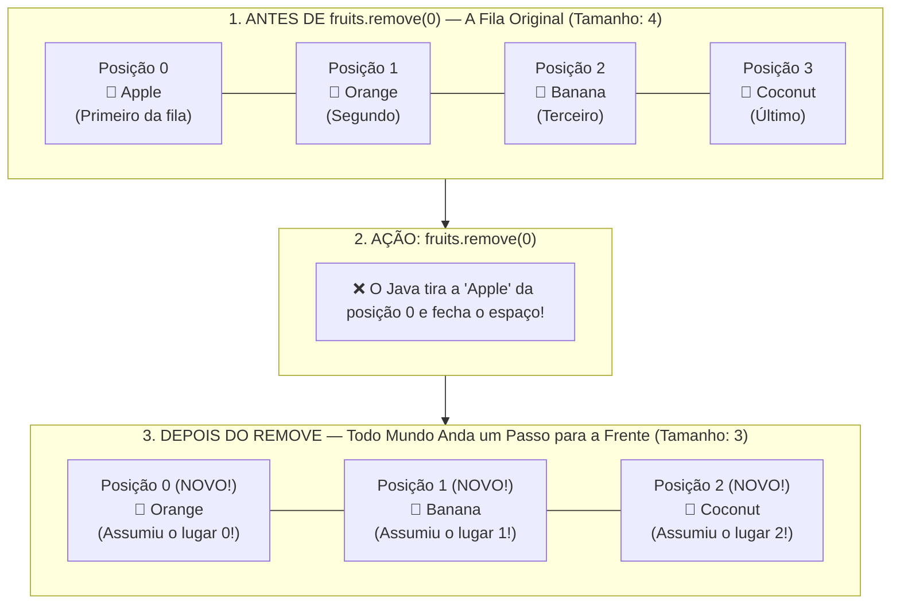

# Curso de Java — Capítulo 56 (Parte 2): ArrayLists 📃
## O Método `.remove()`, a Redução Dinâmica do Tamanho e o Deslocamento de Índices

---

> [!IMPORTANT]
> **Para cópia no Google Docs:** Este documento analisa a segunda etapa do **Capítulo 56 (ArrayLists)** do curso do Bro Code (timestamp `08:58:46`). Aqui, o professor demonstra o recurso que torna o `ArrayList` infinitamente superior aos arrays normais: a capacidade de **remover elementos e encolher dinamicamente de tamanho**, reorganizando todos os índices da lista automaticamente na memória. A tela capturada com a pausa do vídeo (`II`), a nova linha `fruits.remove(0)` e o resultado no console foram integralmente transcritos em texto para que você possa copiar tudo para o seu Google Docs sem perder nenhum elemento visual.

---

### Links Rápidos dos Arquivos do Projeto no seu Computador
* Arquivo Principal em Edição: [`Main.java`](file:///c:/Users/mickel%201/Downloads/JAVA%20APRENDER/Main.java)
* Pasta Raiz do Projeto: [`JAVA APRENDER`](file:///c:/Users/mickel%201/Downloads/JAVA%20APRENDER)
* Parte 1 Anterior (Definição, Generics e Método `.add()`): [`explicacao_arraylists_definicao_tamanho_dinamico_generics_e_metodo_add_capitulo56_parte1.md`](file:///C:/Users/mickel%201/.gemini/antigravity/brain/d1dae54d-8acc-4142-bb62-6703a22b9afc/explicacao_arraylists_definicao_tamanho_dinamico_generics_e_metodo_add_capitulo56_parte1.md)

---

## 1. Reconstituição Detalhada da Tela da IDE IntelliJ IDEA

Abaixo está o registro cronológico exato do que aconteceu na tela do professor na captura:

```
+----------------------------------------------------------------------------------------------------+
|                                    ESTADO VISUAL DA IDE NO VÍDEO                                    |
+----------------------------------------------------------------------------------------------------+
| TIMESTAMP: 8:58:46 / 12:00:00 (Capítulo: 56.arraylists >)                                          |
| ESTADO DO VÍDEO: Pausado no player do YouTube com o ícone gigante de pausa [ || ] no centro.        |
|                                                                                                    |
| EDITOR DE CÓDIGO (Main.java):                                                                      |
| • O professor manteve o código da aula anterior (adição de Apple, Orange, Banana, Coconut).        |
| • Na linha 16, ele inseriu uma nova instrução cirúrgica:                                           |
|       fruits.remove(0);                                                                            |
| • Na margem esquerda (gutter) da linha 16, surge uma lâmpada amarela 💡.                          |
| • A instrução "fruits.remove" exibe um leve sublinhado amarelo da IDE (aviso de inspeção).         |
| • Linha 18: System.out.println(fruits);                                                            |
|                                                                                                    |
| PAINEL DO TERMINAL (Aba "Run" na metade inferior da tela):                                         |
| • Linha de comando do JDK executada no topo:                                                       |
|       C:\Users\HP\.jdks\openjdk-23\bin\java.exe ...                                                |
| • Saída em verde impressa no console:                                                              |
|       [Orange, Banana, Coconut]                                                                    |
| • O cursor do mouse está repousando sobre a palavra "Coconut" na saída.                            |
| • Linha final: "Process finished with exit code 0".                                                |
+----------------------------------------------------------------------------------------------------+
```

---

## 2. A Mágica do `.remove(0)`: A Metáfora da Fila do Banco 🏦

Para você entender perfeitamente o que aconteceu com o computador, imagine uma fila de 4 pessoas no banco:



### O que o método `.remove(0)` fez?
1. **Localizou o índice `0`:** No nosso caso, quem estava guardado no índice `0` era a String `"Apple"`.
2. **Deletou a `"Apple"` da lista:** O objeto saiu da lista.
3. **Puxou todo mundo para a esquerda (*Shift Left*):**
   * A `"Orange"`, que antes morava no índice 1, **passou a ser o índice 0**!
   * A `"Banana"`, que antes morava no índice 2, **passou a ser o índice 1**!
   * O `"Coconut"`, que antes morava no índice 3, **passou a ser o índice 2**!
4. **Encolheu a lista:** O tamanho total da lista passou de **4** para **3**.

---

## 3. Por Que um Array Comum Não Consegue Fazer Isso?

Muitos iniciantes perguntam: *"Por que não fazer isso com um array normal `String[]`?"*.

Veja a diferença brutal:

| Característica | Array Comum (`String[]`) | `ArrayList` (`ArrayList<String>`) ⭐ |
| :--- | :--- | :--- |
| **Pode mudar de tamanho?** | ❌ **NUNCA!** O tamanho é fixo para sempre. | ✅ **SIM!** Cresce com `.add()` e encolhe com `.remove()`. |
| **O que acontece ao tentar apagar um item?** | Você só consegue colocar `null` no lugar (`array[0] = null;`). O buraco vazio continua existindo na posição 0 e o array continua com tamanho 4! | O item é extirpado e a lista encolhe fisicamente para tamanho 3. Não fica buraco vazio! |
| **Reorganização de índices:** | ❌ Manual (você teria que escrever um laço `for` complexo para mover cada item). | ✅ **100% Automática!** O Java reorganiza todos os índices instantaneamente. |

---

## 4. O Código Completo do [`Main.java`](file:///c:/Users/mickel%201/Downloads/JAVA%20APRENDER/Main.java)

Abaixo está o código integral exatamente como construído pelo professor na tela da captura:

```java
import java.util.ArrayList;

public class Main {
    public static void main(String[] args) {

        // ArrayList = A resizeable array that stores objects (autoboxing).
        //             Arrays are fixed in size, but ArrayLists can change.

        ArrayList<String> fruits = new ArrayList<>();

        fruits.add("Apple");
        fruits.add("Orange");
        fruits.add("Banana");
        fruits.add("Coconut");

        fruits.remove(0);

        System.out.println(fruits);
    }
}
```

---

## 5. Análise Detalhada Linha por Linha

| Linha | Código Exato | O que faz no computador? | Saída no Console? |
| :---: | :--- | :--- | :---: |
| **L1** | `import java.util.ArrayList;` | Traz a ferramenta `ArrayList` da biblioteca do Java para o nosso arquivo. | *(Nenhuma)* |
| **L2** | *(linha em branco)* | Espaçamento visual para organização. | *(Nenhuma)* |
| **L3** | `public class Main {` | Declaração da classe pública principal `Main`. | *(Nenhuma)* |
| **L4** | `public static void main(String[] args) {` | Método principal onde o Java começa a ler e executar as ordens. | *(Nenhuma)* |
| **L5** | *(linha em branco)* | Organização visual. | *(Nenhuma)* |
| **L6** | `// ArrayList = A resizeable array...` | Comentário teórico: lista redimensionável que guarda objetos. | *(Nenhuma)* |
| **L7** | `//             Arrays are fixed in size...` | Comentário: arrays comuns são fixos, mas ArrayLists mudam de tamanho. | *(Nenhuma)* |
| **L8** | *(linha em branco)* | Separação visual. | *(Nenhuma)* |
| **L9** | `ArrayList<String> fruits = new ArrayList<>();` | Cria a lista vazia `fruits` pronta para guardar objetos `String`. | *(Nenhuma)* |
| **L10** | *(linha em branco)* | Separação visual. | *(Nenhuma)* |
| **L11** | `fruits.add("Apple");` | Adiciona `"Apple"` no índice 0 (tamanho: 1). | *(Nenhuma)* |
| **L12** | `fruits.add("Orange");` | Adiciona `"Orange"` no índice 1 (tamanho: 2). | *(Nenhuma)* |
| **L13** | `fruits.add("Banana");` | Adiciona `"Banana"` no índice 2 (tamanho: 3). | *(Nenhuma)* |
| **L14** | `fruits.add("Coconut");`| Adiciona `"Coconut"` no índice 3 (tamanho: 4). | *(Nenhuma)* |
| **L15** | *(linha em branco)* | Espaçamento antes da remoção. | *(Nenhuma)* |
| **L16** | `fruits.remove(0);` | **O Comando Novo:** Deleta o elemento que estiver no índice 0 (`"Apple"`). Puxa todos os itens seguintes um índice para trás. O tamanho da lista encolhe de 4 para 3! | *(Nenhuma)* |
| **L17** | *(linha em branco)* | Espaçamento antes da exibição. | *(Nenhuma)* |
| **L18** | `System.out.println(fruits);` | Imprime a lista atualizada no console. Como a maçã foi removida, a lista começa na laranja. | `[Orange, Banana, Coconut]` |
| **L19** | `}` | Fecha o método `main`. | *(Nenhuma)* |
| **L20** | `}` | Fecha a classe `Main`. | *(Nenhuma)* |

---

## 6. Saída Exata no Terminal

Ao rodar o programa clicando em Play ▶️ no IntelliJ IDEA (ou no terminal via `javac Main.java` e `java Main`), o resultado exibido é:

```text
[Orange, Banana, Coconut]

Process finished with exit code 0
```

### O que mudou em relação à Parte 1?
* Na **Parte 1**, a saída era: `[Apple, Orange, Banana, Coconut]`.
* Na **Parte 2**, graças à linha `fruits.remove(0);`, a maçã desapareceu e a saída ficou: `[Orange, Banana, Coconut]`.

---

## 7. Curiosidade Bônus de Ouro: As Duas Formas de Usar o `.remove()`

A classe `ArrayList` possui duas versões do método `remove` que são muito úteis:

1. **Remover pelo Índice (Número da Posição):**
   ```java
   fruits.remove(0); // Remove o primeiro item, não importa qual seja.
   ```
2. **Remover pelo Próprio Valor do Objeto:**
   ```java
   fruits.remove("Apple"); // O Java procura onde está a palavra "Apple" e a deleta!
   ```
Ambas as formas chegam exatamente ao mesmo resultado no console: `[Orange, Banana, Coconut]`.
