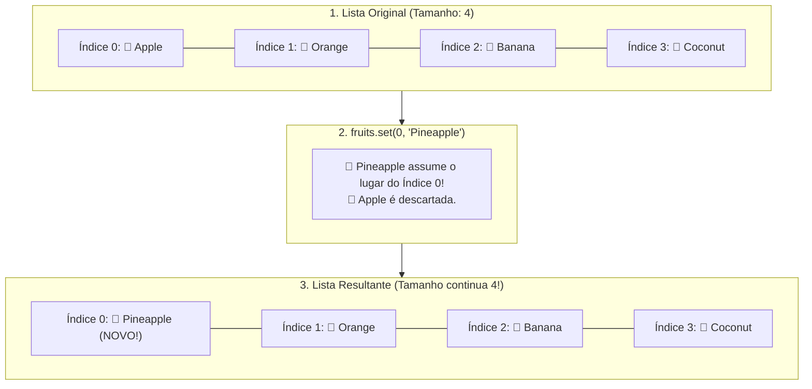

# Curso de Java — Capítulo 56 (Parte 3): ArrayLists 📃
## Os Métodos `.set()` (Substituição) e `.get()` (Acesso Individual), e o Teste de `.remove(1)`

---

> [!IMPORTANT]
> **Para cópia no Google Docs:** Este documento analisa a terceira sequência de telas do **Capítulo 56 (ArrayLists)** do curso do Bro Code (timestamps `08:58:53` até `08:59:42`). Aqui, o professor aprofunda os métodos de manipulação de listas: testa a remoção de um item intermediário (`fruits.remove(1)`), introduz o método de substituição **`.set(índice, elemento)`** e apresenta o método de consulta individual **`.get(índice)`**. Todas as 5 imagens capturadas foram reconstruídas em texto com suas respectivas saídas no terminal para que você possa copiar tudo para o seu Google Docs sem perder nenhum elemento visual.

---

### Links Rápidos dos Arquivos do Projeto no seu Computador
* Arquivo Principal em Edição: [`Main.java`](file:///c:/Users/mickel%201/Downloads/JAVA%20APRENDER/Main.java)
* Pasta Raiz do Projeto: [`JAVA APRENDER`](file:///c:/Users/mickel%201/Downloads/JAVA%20APRENDER)
* Parte 1 (Definição, Generics e Método `.add()`): [`explicacao_arraylists_definicao_tamanho_dinamico_generics_e_metodo_add_capitulo56_parte1.md`](file:///C:/Users/mickel%201/.gemini/antigravity/brain/d1dae54d-8acc-4142-bb62-6703a22b9afc/explicacao_arraylists_definicao_tamanho_dinamico_generics_e_metodo_add_capitulo56_parte1.md)
* Parte 2 (Método `.remove(0)` e Encolhimento de Índices): [`explicacao_arraylists_metodo_remove_redimensionamento_dinamico_e_reordenacao_de_indices_capitulo56_parte2.md`](file:///C:/Users/mickel%201/.gemini/antigravity/brain/d1dae54d-8acc-4142-bb62-6703a22b9afc/explicacao_arraylists_metodo_remove_redimensionamento_dinamico_e_reordenacao_de_indices_capitulo56_parte2.md)

---

## 1. Reconstituição Detalhada das 5 Telas da IDE IntelliJ IDEA

Abaixo está o registro cronológico exato do que aconteceu na tela do professor ao longo das 5 capturas:

```
+----------------------------------------------------------------------------------------------------+
|                                    SEQUÊNCIA DE TELAS NO VÍDEO                                      |
+----------------------------------------------------------------------------------------------------+
| IMAGEM 1: Removendo o Elemento do Índice 1 (Timestamp 8:58:53).                                    |
|           • Linha 16 alterada para: fruits.remove(1); (o número 1 aparece selecionado).            |
|           • Linha 18: System.out.println(fruits);                                                  |
|           • O console do terminal exibe em verde:                                                  |
|                 [Apple, Banana, Coconut]                                                           |
|           • Explicação: O índice 1 continha "Orange". A laranja foi eliminada da lista!            |
|             "Apple" (índice 0) ficou intacta, e "Banana" e "Coconut" andaram um índice para trás.  |
|                                                                                                    |
| IMAGEM 2: Apresentação do Método .set() — Substituindo no Índice 0.                                 |
|           • Linha 16 é comentada: //fruits.remove(1);                                              |
|           • Linha 17 é inserida: fruits.set(0, "Pineapple");                                       |
|           • Linha 19: System.out.println(fruits);                                                  |
|           • O console do terminal exibe:                                                           |
|                 [Pineapple, Orange, Banana, Coconut]                                               |
|           • Explicação: O método .set() NÃO muda o tamanho da lista! Ele substituiu a "Apple"      |
|             (que morava no índice 0) por "Pineapple" (Abacaxi).                                    |
|                                                                                                    |
| IMAGEM 3: O Método .set() no Índice 1 (Timestamp 8:59:20).                                         |
|           • Linha 17 alterada para: fruits.set(1, "Pineapple");                                    |
|           • O cursor do mouse no topo clica no botão Play verde ▶️.                                |
|           • O console do terminal exibe:                                                           |
|                 [Apple, Pineapple, Banana, Coconut]                                               |
|           • Explicação: Desta vez "Apple" no índice 0 permaneceu, e a "Orange" no índice 1 foi     |
|             substituída por "Pineapple".                                                           |
|                                                                                                    |
| IMAGEM 4: Acesso Individual com .get(0) (Timestamp 8:59:40).                                        |
|           • Linha 17 é comentada: //fruits.set(1, "Pineapple");                                    |
|           • Linha 19 é alterada para: System.out.println(fruits.get(0));                           |
|           • O console do terminal exibe:                                                           |
|                 Apple                                                                              |
|           • ATENÇÃO VISUAL: Os colchetes [ ] SUMIRAM! Apenas a palavra Apple solta foi impressa.  |
|                                                                                                    |
| IMAGEM 5: Acesso Individual com .get(1) (Timestamp 8:59:42).                                        |
|           • Linha 19 é alterada para: System.out.println(fruits.get(1));                           |
|           • O console do terminal exibe:                                                           |
|                 Orange                                                                             |
|           • Process finished with exit code 0.                                                     |
|           • Explicação: .get(1) busca exclusivamente o elemento no índice 1 (Orange).              |
+----------------------------------------------------------------------------------------------------+
```

---

## 2. O Método `.set(índice, novoElemento)`: A Metáfora da Substituição no Futebol ⚽

Muitos iniciantes confundem `.add()` com `.set()`. 

Veja a diferença:
* **`.add(item)`**: É como contratar um novo jogador para o time. Ele entra no final da fila e o elenco **aumenta de tamanho** (de 4 para 5).
* **`.set(índice, novoItem)`**: É como uma **substituição em campo**! O jogador que estava com a camisa número 0 sai de campo e o reserva entra exatamente no lugar dele. O tamanho do time **permanece exatamente o mesmo** (continua com 4)!



---

## 3. O Método `.get(índice)`: Acesso Cirúrgico a um Elemento

Em um array comum que você aprendeu no passado, para ver o item da primeira gaveta, você usava colchetes:
```java
String fruta = array[0]; // Sintaxe de array tradicional
```

Mas o `ArrayList` é uma **Classe de Objeto**. Em orientação a objetos moderna, não usamos colchetes para ler dados; usamos um **método *getter***:
```java
String fruta = fruits.get(0); // Sintaxe profissional de ArrayList ⭐
```

### Por Que a Saída do `.get()` NÃO Tem Colchetes `[ ]`?
Esta é uma dúvida clássica de quem está começando:

| Comando Executado | O que o Java entrega para o `println`? | O que sai no Console? |
| :--- | :--- | :---: |
| `System.out.println(fruits);` | O **Objeto ArrayList inteiro**. A lista usa seu método `toString()` interno para colocar colchetes e separar por vírgulas. | `[Apple, Orange, Banana, Coconut]` |
| `System.out.println(fruits.get(0));` | Apenas a **String individual `"Apple"`**. É um texto puro, sem lista ao redor. | `Apple` |
| `System.out.println(fruits.get(1));` | Apenas a **String individual `"Orange"`**. | `Orange` |

---

## 4. O Canivete dos 4 Métodos Principais de um `ArrayList`

Até aqui no curso, você já dominou os 4 métodos vitais de qualquer lista em Java:

```
+----------------------------------------------------------------------------------------------------+
|                                OS 4 MÉTODOS FUNDAMENTAIS DO ARRAYLIST                              |
+----------------------------------------------------------------------------------------------------+
| 1. fruits.add("Item");       ➔ INSERE no final da lista. (Aumenta o tamanho em +1)                 |
| 2. fruits.remove(índice);    ➔ APAGA o item daquele índice. (Encolhe o tamanho em -1)              |
| 3. fruits.set(índice, novo); ➔ SUBSTITUI o item daquele índice. (Mantém o mesmo tamanho)           |
| 4. fruits.get(índice);       ➔ LÊ/RETORNA o item daquele índice. (Não altera nada na lista)        |
+----------------------------------------------------------------------------------------------------+
```

---

## 5. O Código Completo do [`Main.java`](file:///c:/Users/mickel%201/Downloads/JAVA%20APRENDER/Main.java)

Abaixo está o código integral exatamente como construído pelo professor na **Imagem 5**:

```java
import java.util.ArrayList;

public class Main {
    public static void main(String[] args) {

        // ArrayList = A resizeable array that stores objects (autoboxing).
        //             Arrays are fixed in size, but ArrayLists can change.

        ArrayList<String> fruits = new ArrayList<>();

        fruits.add("Apple");
        fruits.add("Orange");
        fruits.add("Banana");
        fruits.add("Coconut");

        //fruits.remove(1);
        //fruits.set(1, "Pineapple");

        System.out.println(fruits.get(1));
    }
}
```

---

## 6. Análise Detalhada Linha por Linha

| Linha | Código Exato | O que faz no computador? | Saída no Console? |
| :---: | :--- | :--- | :---: |
| **L1** | `import java.util.ArrayList;` | Importa a biblioteca do `ArrayList`. | *(Nenhuma)* |
| **L2** | *(linha em branco)* | Espaçamento visual para organização. | *(Nenhuma)* |
| **L3** | `public class Main {` | Declaração da classe pública principal `Main`. | *(Nenhuma)* |
| **L4** | `public static void main(String[] args) {` | Método principal onde o programa começa a rodar. | *(Nenhuma)* |
| **L5** | *(linha em branco)* | Organização visual. | *(Nenhuma)* |
| **L6** | `// ArrayList = A resizeable array...` | Comentário teórico: lista redimensionável que guarda objetos. | *(Nenhuma)* |
| **L7** | `//             Arrays are fixed in size...` | Comentário: arrays comuns são fixos, ArrayLists mudam. | *(Nenhuma)* |
| **L8** | *(linha em branco)* | Separação visual. | *(Nenhuma)* |
| **L9** | `ArrayList<String> fruits = new ArrayList<>();` | Cria a lista dinâmica `fruits` vazia na memória Heap. | *(Nenhuma)* |
| **L10** | *(linha em branco)* | Separação visual. | *(Nenhuma)* |
| **L11** | `fruits.add("Apple");` | Guarda `"Apple"` no índice 0 (tamanho: 1). | *(Nenhuma)* |
| **L12** | `fruits.add("Orange");` | Guarda `"Orange"` no índice 1 (tamanho: 2). | *(Nenhuma)* |
| **L13** | `fruits.add("Banana");` | Guarda `"Banana"` no índice 2 (tamanho: 3). | *(Nenhuma)* |
| **L14** | `fruits.add("Coconut");`| Guarda `"Coconut"` no índice 3 (tamanho: 4). | *(Nenhuma)* |
| **L15** | *(linha em branco)* | Organização visual. | *(Nenhuma)* |
| **L16** | `//fruits.remove(1);` | Linha comentada (inativa): no teste da Imagem 1, ela apagava a `"Orange"`. | *(Nenhuma)* |
| **L17** | `//fruits.set(1, "Pineapple");` | Linha comentada (inativa): nos testes das Imagens 2 e 3, ela substituía por `"Pineapple"`. | *(Nenhuma)* |
| **L18** | *(linha em branco)* | Organização visual. | *(Nenhuma)* |
| **L19** | `System.out.println(fruits.get(1));` | **O Comando Novo:** Busca o elemento que está guardado no índice 1 da lista (`"Orange"`) e o imprime isolado na tela. | `Orange` |
| **L20** | `}` | Fim do método `main`. | *(Nenhuma)* |
| **L21** | `}` | Fim da classe `Main`. | *(Nenhuma)* |

---

## 7. Quadro Resumo de Todas as Saídas no Terminal ao Longo das 5 Telas

Abaixo está o histórico exato do que saiu no console em cada mudança feita pelo professor:

```text
1. Com fruits.remove(1); (Imagem 1):
   [Apple, Banana, Coconut]

2. Com fruits.set(0, "Pineapple"); (Imagem 2):
   [Pineapple, Orange, Banana, Coconut]

3. Com fruits.set(1, "Pineapple"); (Imagem 3):
   [Apple, Pineapple, Banana, Coconut]

4. Com System.out.println(fruits.get(0)); (Imagem 4):
   Apple

5. Com System.out.println(fruits.get(1)); (Imagem 5):
   Orange
```
