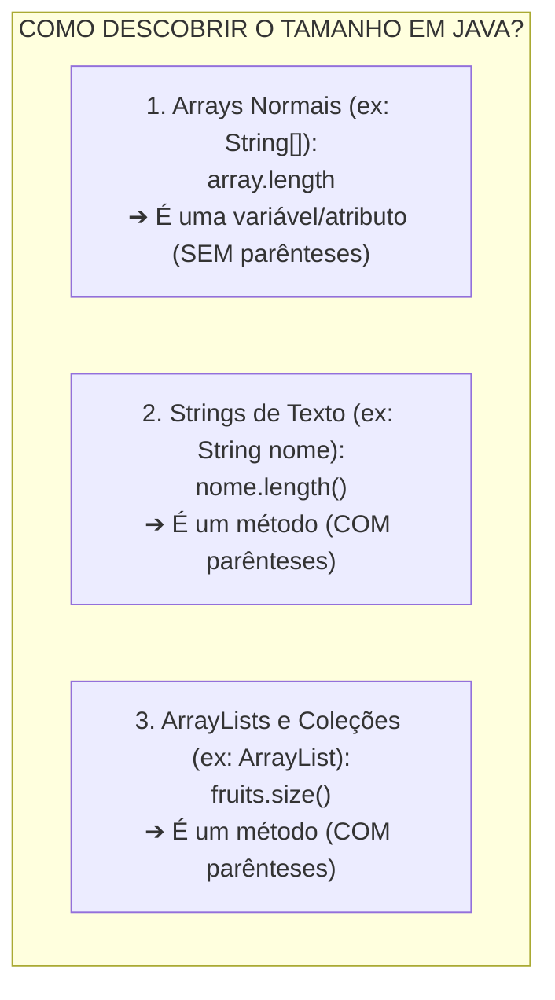
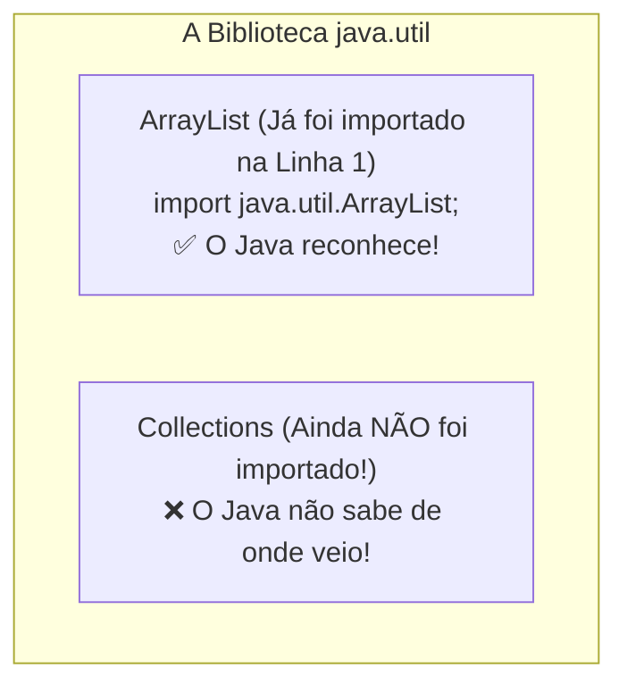

# Curso de Java — Capítulo 56 (Parte 4): ArrayLists 📃
## Varredura com `.get()`, o Método `.size()` e o Erro de Importação com `Collections.sort()`

---

> [!IMPORTANT]
> **Para cópia no Google Docs:** Este documento analisa a quarta sequência de telas do **Capítulo 56 (ArrayLists)** do curso do Bro Code (timestamps `08:59:45` até `09:00:19`). Aqui, o professor conclui a demonstração de busca por índices com `.get(2)` e `.get(3)`, ensina como descobrir o tamanho exato de uma lista dinâmica usando o método **`.size()`** (diferenciando-o de `length`), e inicia o tópico de **ordenação alfabética com `Collections.sort()`**, demonstrando o que acontece quando esquecemos de importar a classe utilitária correspondente no topo do arquivo. Todas as 5 imagens foram integralmente reconstruídas em texto para que você possa copiar este material para o seu Google Docs sem perder nenhum elemento visual da IDE.

---

### Links Rápidos dos Arquivos do Projeto no seu Computador
* Arquivo Principal em Edição: [`Main.java`](../../../src/main/java/com/mickaelgeronimo/mastery/core/concurrency/Main.java)
* Pasta Raiz do Projeto: `JAVA APRENDER`
* Parte 1 (Definição, Generics e Método `.add()`): `explicacao_arraylists_definicao_tamanho_dinamico_generics_e_metodo_add_capitulo56_parte1.md`
* Parte 2 (Método `.remove(0)` e Encolhimento de Índices): `explicacao_arraylists_metodo_remove_redimensionamento_dinamico_e_reordenacao_de_indices_capitulo56_parte2.md`
* Parte 3 (Métodos `.set()` e `.get()`): `explicacao_arraylists_metodos_set_e_get_atualizacao_e_acesso_individual_capitulo56_parte3.md`

---

## 1. Reconstituição Detalhada das 5 Telas da IDE IntelliJ IDEA

Abaixo está o registro cronológico exato do que aconteceu na tela do professor ao longo das 5 capturas:

```
+----------------------------------------------------------------------------------------------------+
|                                    SEQUÊNCIA DE TELAS NO VÍDEO                                      |
+----------------------------------------------------------------------------------------------------+
| IMAGEM 1: Acessando o Índice 2 — A Banana.                                                         |
|           • Linha 19 alterada para: System.out.println(fruits.get(2)); (o 2 aparece selecionado).  |
|           • O console do terminal exibe em verde:                                                  |
|                 Banana                                                                             |
|           • Explicação: O índice 2 guarda o terceiro elemento da lista ("Banana").                 |
|                                                                                                    |
| IMAGEM 2: Acessando o Último Índice (3) — O Coco (Timestamp 8:59:50).                              |
|           • Linha 19 alterada para: System.out.println(fruits.get(3)); (o 3 aparece selecionado).  |
|           • O console do terminal exibe:                                                           |
|                 Coconut                                                                            |
|           • Explicação: O índice 3 guarda o quarto e último elemento atual da lista ("Coconut").   |
|                                                                                                    |
| IMAGEM 3: Apresentando o Método .size() (Timestamp 9:00:01).                                       |
|           • Linha 19 é comentada: //System.out.println(fruits.get(3));                             |
|           • Linha 20 é inserida: System.out.println(fruits.size());                                |
|           • O cursor do mouse no topo se posiciona sobre o botão verde Play ▶️.                   |
|                                                                                                    |
| IMAGEM 4: Execução do .size() e o Retorno Numérico (Timestamp 9:00:03).                            |
|           • O programa roda e o console do terminal exibe em verde o número:                      |
|                 4                                                                                  |
|           • Process finished with exit code 0.                                                     |
|           • Explicação: A lista possui exatamente 4 frutas guardadas na memória.                   |
|                                                                                                    |
| IMAGEM 5: A Chegada de Collections.sort() e o Erro Vermelho de Importação (Timestamp 9:00:19).   |
|           • Linha 20 é comentada: //System.out.println(fruits.size());                             |
|           • Linha 22 é digitada: Collections.sort(fruits);                                         |
|           • A palavra "Collections" fica com TEXTO VERMELHO VIVO no editor.                        |
|           • Balão de alerta do IntelliJ IDEA aberto pelo mouse:                                    |
|                 Cannot resolve symbol 'Collections'                                                |
|                 Import class Alt+Shift+Enter                                                       |
|           • No canto superior direito da IDE, o badge de inspeção acusa 1 ERRO [ ! 1 ].            |
|           • Explicação: A classe Collections mora no pacote java.util e ainda não foi importada!  |
+----------------------------------------------------------------------------------------------------+
```

---

## 2. A Tabela Completa dos Índices de `fruits`:

Após as quatro chamadas ao método `.add()`, a lista na memória do computador ficou exatamente assim:

| Índice (`index`) | Elemento Armazenado (`String`) | Comando de Leitura | O que sai no Console? |
| :---: | :---: | :--- | :---: |
| **`0`** | `"Apple"` | `System.out.println(fruits.get(0));` | `Apple` |
| **`1`** | `"Orange"` | `System.out.println(fruits.get(1));` | `Orange` |
| **`2`** | `"Banana"` | `System.out.println(fruits.get(2));` | `Banana` |
| **`3`** | `"Coconut"` | `System.out.println(fruits.get(3));` | `Coconut` |

> [!CAUTION]
> **O que aconteceria se tentássemos `fruits.get(4)`?**
> Como a lista tem 4 elementos, os índices válidos vão de **0 até 3**.
> Se você tentar pedir o índice 4, o Java lança a exceção fatal **`IndexOutOfBoundsException`** (Índice fora dos limites da lista), que trava o programa!

---

## 3. O Método `.size()`: Quantos Itens Existem na Minha Lista?

Na Imagem 4, o professor executou:
```java
System.out.println(fruits.size()); // Imprime: 4
```

### A Confusão Clássica de Quem Começa em Java:
Iniciantes vivem misturando como descobrir o tamanho das coisas em Java. Guarde esta regra de ouro:



| Estrutura | Como mede o tamanho? | Exemplo | Saída |
| :--- | :---: | :--- | :---: |
| **Array Comum** | `.length` *(sem parênteses)* | `String[] a = new String[4]; a.length` | `4` |
| **String** | `.length()` *(com parênteses)* | `"Pizza".length()` | `5` |
| **`ArrayList`** ⭐ | **`.size()`** *(com parênteses)* | `fruits.size()` | `4` |

---

## 4. O Mistério da Imagem 5: Por Que `Collections` Ficou Vermelho?

Na Imagem 5, o professor escreveu:
```java
Collections.sort(fruits);
```
E a palavra `Collections` ficou vermelha com o aviso:
```text
Cannot resolve symbol 'Collections'
```



### O que significa "Cannot resolve symbol"?
Em termos bem simples para um iniciante:
* O Java está dizendo: *"Você escreveu a palavra `Collections`, mas eu procurei no meu vocabulário básico e não achei nenhuma classe com esse nome! De onde você tirou isso?"*.
* No topo do arquivo (linha 1), nós só escrevemos:
  ```java
  import java.util.ArrayList;
  ```
  Isso só deu permissão ao Java para conhecer a classe `ArrayList`.
* A classe **`Collections`** é outra ferramenta que mora no pacote `java.util`.
* **A Solução:** Para o erro sumir, basta adicionar o import dela no topo:
  ```java
  import java.util.Collections;
  ```
  *(Ou usar o atalho que o IntelliJ sugeriu no balão: `Alt + Shift + Enter`)*.

---

## 5. O Que Faz o Método `Collections.sort()`?

* **`Collections`** (no plural) é uma classe cheia de métodos utilitários estáticos (*Static Utility Methods* — lembra do canivete suíço do Capítulo 55?).
* O método **`.sort()`** significa **ORDENAR**.
* Ele pega qualquer `ArrayList` e organiza os seus elementos em **Ordem Natural**:
  * Para **Strings (textos)** ➔ Ordem Alfabética (`A` até `Z`).
  * Para **Números** ➔ Ordem Crescente (do menor para o maior).

### A lista original era:
`[Apple, Orange, Banana, Coconut]`

### Quando `Collections.sort(fruits)` rodar (após resolver o import):
A lista será reorganizada na ordem alfabética exata:
`[Apple, Banana, Coconut, Orange]`!
*(A maçã continua em primeiro, a banana passa para segundo, o coco para terceiro e a laranja para último!)*

---

## 6. O Código Completo do [`Main.java`](../../../src/main/java/com/mickaelgeronimo/mastery/core/concurrency/Main.java)

Abaixo está o código exatamente como está na tela do professor na **Imagem 5** (com o comando aguardando a resolução do import):

```java
import java.util.ArrayList;

public class Main {
    public static void main(String[] args) {

        ArrayList<String> fruits = new ArrayList<>();

        fruits.add("Apple");
        fruits.add("Orange");
        fruits.add("Banana");
        fruits.add("Coconut");

        //fruits.remove(1);
        //fruits.set(1, "Pineapple");

        //System.out.println(fruits.get(3));
        //System.out.println(fruits.size());

        Collections.sort(fruits);

    }
}
```

---

## 7. Análise Detalhada Linha por Linha

| Linha | Código Exato | O que faz no computador? | Saída no Console? |
| :---: | :--- | :--- | :---: |
| **L1** | `import java.util.ArrayList;` | Importa a ferramenta `ArrayList`. | *(Nenhuma)* |
| **L2** | *(linha em branco)* | Organização e legibilidade. | *(Nenhuma)* |
| **L3** | `public class Main {` | Declaração da classe principal. | *(Nenhuma)* |
| **L4** | `public static void main(String[] args) {` | Porta de entrada da execução da JVM. | *(Nenhuma)* |
| **L5** | *(linha em branco)* | Organização visual. | *(Nenhuma)* |
| **L6** | `ArrayList<String> fruits = new ArrayList<>();` | Cria a lista dinâmica `fruits` vazia na memória Heap. | *(Nenhuma)* |
| **L7** | *(linha em branco)* | Espaçamento visual. | *(Nenhuma)* |
| **L8** | `fruits.add("Apple");` | Insere `"Apple"` no índice 0 (tamanho: 1). | *(Nenhuma)* |
| **L9** | `fruits.add("Orange");` | Insere `"Orange"` no índice 1 (tamanho: 2). | *(Nenhuma)* |
| **L10** | `fruits.add("Banana");` | Insere `"Banana"` no índice 2 (tamanho: 3). | *(Nenhuma)* |
| **L11** | `fruits.add("Coconut");`| Insere `"Coconut"` no índice 3 (tamanho: 4). | *(Nenhuma)* |
| **L12** | *(linha em branco)* | Espaçamento visual. | *(Nenhuma)* |
| **L13** | `//fruits.remove(1);` | Linha comentada (inativa): teste de remoção do índice 1. | *(Nenhuma)* |
| **L14** | `//fruits.set(1, "Pineapple");` | Linha comentada (inativa): teste de substituição no índice 1. | *(Nenhuma)* |
| **L15** | *(linha em branco)* | Espaçamento visual. | *(Nenhuma)* |
| **L16** | `//System.out.println(fruits.get(3));`| Linha comentada: teste de leitura da posição 3 (`Coconut`). | *(Nenhuma)* |
| **L17** | `//System.out.println(fruits.size());` | Linha comentada: teste de medição do tamanho (`4`). | *(Nenhuma)* |
| **L18** | *(linha em branco)* | Espaçamento visual. | *(Nenhuma)* |
| **L19** | `Collections.sort(fruits);` | **O Novo Comando:** Chama a ferramenta de ordenação alfabética (gera erro enquanto `java.util.Collections` não for importado). | *(Erro de compilação sem import)* |
| **L20** | `}` | Fim do método `main`. | *(Nenhuma)* |
| **L21** | `}` | Fim da classe `Main`. | *(Nenhuma)* |

---

## 8. Resumo de Todas as Saídas no Terminal ao Longo das 5 Imagens

```text
1. Com System.out.println(fruits.get(2)); (Imagem 1):
   Banana

2. Com System.out.println(fruits.get(3)); (Imagem 2):
   Coconut

3. Com System.out.println(fruits.size()); (Imagem 4):
   4

4. Com Collections.sort(fruits); sem o import (Imagem 5):
   Main.java:19: error: cannot find symbol
           Collections.sort(fruits);
           ^
     symbol:   variable Collections
     location: class Main
   1 error
```
