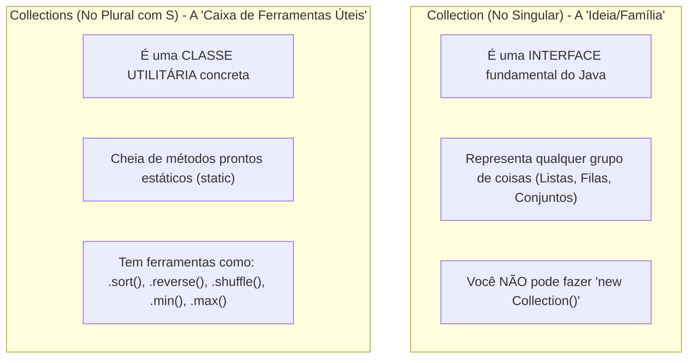
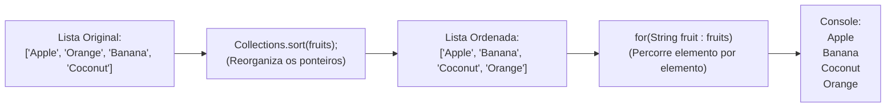

# 📃 Java — Capítulo 56: `ArrayLists` (Parte 5)
## Resolução do Import de `Collections`, Ordenação com `Collections.sort()` e Iteração com Loop `for-each`

---

### 📌 Metadados da Aula e Contexto do Vídeo
- **Curso:** *Java Full Course for free* (Canal: Bro Code)
- **Capítulo Oficial:** `56. arraylists 📃`
- **Intervalo de Tempo no Vídeo:** `09:00:19` até `09:01:05` (do total de 12:00:00)
- **Arquivo de Trabalho:** [`Main.java`](file:///c:/Users/mickel%201/Downloads/JAVA%20APRENDER/Main.java)
- **Ambiente de Desenvolvimento:** IntelliJ IDEA Community Edition (JDK 23 / OpenJDK 23)

---

## 🖼️ Reconstituição Visual Completa da Interface (Para quem vai colar no Google Docs)

Como você vai copiar este material para o **Google Docs** e não terá as imagens anexadas diretamente, esta seção descreve em detalhes cirúrgicos tudo o que aconteceu na tela do professor ao longo das 5 capturas:

```
+---------------------------------------------------------------------------------------------------------+
| [MyFirstProject] - Main.java                                                             Current File   |
+---------------------------------------------------------------------------------------------------------+
|  1 | import java.util.ArrayList;                                                                        |
|  2 | import java.util.Collections;   <-- [Inserido automaticamente após o clique em 'Import class']     |
|  3 |                                                                                                    |
|  4 | public class Main {                                                                                |
|  5 |     public static void main(String[] args) {                                                       |
|  6 |                                                                                                    |
|  7 |         // ArrayList = A resizeable array that stores objects (autoboxing).                        |
|  8 |         //             Arrays are fixed in size, but ArrayLists can change.                        |
|  9 |                                                                                                    |
| 10 |         ArrayList<String> fruits = new ArrayList<>();                                              |
| 11 |                                                                                                    |
| 12 |         fruits.add("Apple");                                                                       |
| 13 |         fruits.add("Orange");                                                                      |
| 14 |         fruits.add("Banana");                                                                      |
| 15 |         fruits.add("Coconut");                                                                     |
| 16 |                                                                                                    |
| 17 |         //fruits.remove(1);                                                                        |
| 18 |         //fruits.set(1, "Pineapple");                                                              |
| 19 |                                                                                                    |
| 20 |         //System.out.println(fruits.get(3));                                                       |
| 21 |         //System.out.println(fruits.size());                                                       |
| 22 |                                                                                                    |
| 23 |         Collections.sort(fruits);   <-- [Antes estava vermelho com erro, agora 100% resolvido!]    |
| 24 |                                                                                                    |
| 25 |         for(String fruit : fruits){                                                                |
| 26 |             System.out.println(fruit);                                                             |
| 27 |         }                                                                                          |
| 28 |     }                                                                                              |
| 29 | }                                                                                                  |
+---------------------------------------------------------------------------------------------------------+
| RUN CONSOLE (Terminal Integrado):                                                                       |
| C:\Users\HP\.jdks\openjdk-23\bin\java.exe Main                                                          |
| Apple                                                                                                   |
| Banana                                                                                                  |
| Coconut                                                                                                 |
| Orange                                                                                                  |
|                                                                                                         |
| Process finished with exit code 0                                                                       |
+---------------------------------------------------------------------------------------------------------+
```

---

### Detalhamento das 5 Imagens Passo a Passo

#### 📸 Imagem 1: O Balão de Ajuda do IntelliJ IDEA (`media_1791495205426_de1be7ee.png`)
- **O que está na tela:** O professor acabou de digitar na linha 22: `Collections.sort(fruits);`. A palavra `Collections` está pintada de **vermelho vivo**, acusando erro de compilação.
- **O Balão Flutuante (Tooltip):** O professor passou o mouse por cima da palavra vermelha e um pop-up escuro surgiu na tela com o aviso:
  > **"Cannot resolve symbol 'Collections'"** (Tradução: *Não consigo resolver/encontrar o símbolo 'Collections'*).
- **As Opções de Correção Automática:** Logo abaixo da mensagem de erro, o IntelliJ oferece dois botões clicáveis:
  1. `Import class` com o atalho `Alt+Shift+Enter` (o cursor do mouse em forma de mãozinha branca está apontando exatamente em cima de `Import class`).
  2. `More actions...` com o atalho `Alt+Enter`.

#### 📸 Imagem 2: A Correção Automática Instantânea (`media_1791495213092_f96890fb.png`)
- **O que acontece:** Ao clicar em `Import class`, o IntelliJ adiciona instantaneamente a linha 2 no cabeçalho do código:
  `import java.util.Collections;`
- **Cursor de edição:** O cursor de texto fica posicionado entre `java.` e `Collections;` logo na linha 2.
- **Timestamp do vídeo:** `9:00:22 / 12:00:00`.

#### 📸 Imagem 3: Visão Panorâmica dos Imports (`media_1791495305513_96866b4c.png`)
- **O que está na tela:** Uma visão mais ampla de todo o arquivo no editor de código.
- **Destaque:** As duas primeiras linhas agora mostram com clareza:
  - Linha 1: `import java.util.ArrayList;`
  - Linha 2: `import java.util.Collections;`
  Ambas pertencem à mesma família/pacote `java.util`.

#### 📸 Imagem 4: O Erro Vermelho Desapareceu (`media_1791495710332_6e6d0f77.png`)
- **O que está na tela:** O professor desce o arquivo de volta para a linha 23.
- **Resultado:** A palavra `Collections` na linha 23 não está mais vermelha! Ela agora está com a cor padrão do tema (texto limpo e sem sublinhado ondulado de erro).
- **Cursor:** O cursor pisca na linha 25 em branco, onde o professor vai digitar a nova estrutura de exibição.
- **Timestamp do vídeo:** `9:00:25 / 12:00:00`.

#### 📸 Imagem 5: O Loop `for-each` e a Saída no Console (`media_1791495746809_cee5ad71.png`)
- **O que foi adicionado:** Nas linhas 25 a 27, o professor escreve um loop `for-each`:
  ```java
  for(String fruit : fruits){
      System.out.println(fruit);
  }
  ```
- **Painel Inferior (Run / Console):** O programa é executado (`Shift + F10` ou botão Play verde). O console abre e imprime:
  ```text
  Apple
  Banana
  Coconut
  Orange
  ```
- **Detalhe crucial:** A lista não foi impressa na ordem em que os itens foram adicionados (`Apple`, `Orange`, `Banana`, `Coconut`). Ela foi impressa em **ordem alfabética rigorosa** (`A` de Apple, `B` de Banana, `C` de Coconut, `O` de Orange) e cada fruta em uma linha própria, sem colchetes `[` `]` e sem vírgulas!
- **Timestamp do vídeo:** `9:01:05 / 12:00:00`.

---

## 💻 Código-Fonte Completo e Rigorosamente Numerado (Linhas 1 a 29)

Aqui está o arquivo [`Main.java`](file:///c:/Users/mickel%201/Downloads/JAVA%20APRENDER/Main.java) exatamente como montado e executado no vídeo:

```java
 1: import java.util.ArrayList;
 2: import java.util.Collections;
 3: 
 4: public class Main {
 5:     public static void main(String[] args) {
 6: 
 7:         // ArrayList = A resizeable array that stores objects (autoboxing).
 8:         //             Arrays are fixed in size, but ArrayLists can change.
 9: 
10:         ArrayList<String> fruits = new ArrayList<>();
11: 
12:         fruits.add("Apple");
13:         fruits.add("Orange");
14:         fruits.add("Banana");
15:         fruits.add("Coconut");
16: 
17:         //fruits.remove(1);
18:         //fruits.set(1, "Pineapple");
19: 
20:         //System.out.println(fruits.get(3));
21:         //System.out.println(fruits.size());
22: 
23:         Collections.sort(fruits);
24: 
25:         for(String fruit : fruits){
26:             System.out.println(fruit);
27:         }
28:     }
29: }
```

---

## 🔬 Tabela Anatômica Linha por Linha: Para Iniciantes Absolutos

| Linha | Código Exato | O que significa na "Linguagem de Leigo" (Explicação Mastigada) | O que sai no Console? |
| :---: | :--- | :--- | :---: |
| **1** | `import java.util.ArrayList;` | **Importando a lista dinâmica:** Abre a gaveta do Java chamada `java.util` e pega a ferramenta `ArrayList`. Sem isso, o Java não saberia criar listas redimensionáveis. | *(Nada)* |
| **2** | `import java.util.Collections;` | **Importando o organizador de listas:** Abre a mesma gaveta `java.util` e pega a ferramenta `Collections`. É ela que tem superpoderes para ordenar, embaralhar e inverter coleções. | *(Nada)* |
| **3** | *(Linha em branco)* | Espaço para respirar e separar os imports da definição da classe. | *(Nada)* |
| **4** | `public class Main {` | Declara o nome do nosso programa principal (`Main`). Todo código em Java mora dentro de uma classe. | *(Nada)* |
| **5** | `public static void main(String[] args) {` | A porta de entrada do programa. É aqui que o Java começa a ler e executar as instruções quando você clica em "Play". | *(Nada)* |
| **6** | *(Linha em branco)* | Organização visual. | *(Nada)* |
| **7** | `// ArrayList = A resizeable array...` | **Comentário de definição:** Explica que um `ArrayList` é um array redimensionável que guarda objetos (graças ao Autoboxing). O Java ignora comentários. | *(Nada)* |
| **8** | `//             Arrays are fixed in size...` | **Comentário comparativo:** Lembra que arrays comuns `[]` têm tamanho fixo e rígido, enquanto `ArrayList` estica e encolhe conforme a necessidade. | *(Nada)* |
| **9** | *(Linha em branco)* | Organização visual. | *(Nada)* |
| **10** | `ArrayList<String> fruits = new ArrayList<>();` | **Criação da lista vazia:** Cria uma lista inteligente na memória do computador chamada `fruits` (frutas), especializada exclusivamente em guardar textos (`String`). | *(Nada)* |
| **11** | *(Linha em branco)* | Organização visual. | *(Nada)* |
| **12** | `fruits.add("Apple");` | Coloca `"Apple"` na primeira posição da lista (Índice 0). Tamanho atual: 1. | *(Nada)* |
| **13** | `fruits.add("Orange");` | Coloca `"Orange"` na segunda posição (Índice 1). Tamanho atual: 2. | *(Nada)* |
| **14** | `fruits.add("Banana");` | Coloca `"Banana"` na terceira posição (Índice 2). Tamanho atual: 3. | *(Nada)* |
| **15** | `fruits.add("Coconut");` | Coloca `"Coconut"` na quarta posição (Índice 3). Tamanho atual: 4. A lista agora é: `["Apple", "Orange", "Banana", "Coconut"]`. | *(Nada)* |
| **16** | *(Linha em branco)* | Organização visual. | *(Nada)* |
| **17** | `//fruits.remove(1);` | **Código comentado (desativado):** Nas partes anteriores serviu para remover o item do índice 1. Agora está desativado com `//`. | *(Nada)* |
| **18** | `//fruits.set(1, "Pineapple");` | **Código comentado (desativado):** Serviu para trocar quem estava no índice 1 por `"Pineapple"`. Agora está desativado com `//`. | *(Nada)* |
| **19** | *(Linha em branco)* | Organização visual. | *(Nada)* |
| **20** | `//System.out.println(fruits.get(3));` | **Código comentado (desativado):** Serviu para espiar quem estava no índice 3 (`"Coconut"`). Desativado. | *(Nada)* |
| **21** | `//System.out.println(fruits.size());` | **Código comentado (desativado):** Serviu para perguntar o tamanho total da lista (`4`). Desativado. | *(Nada)* |
| **22** | *(Linha em branco)* | Organização visual. | *(Nada)* |
| **23** | `Collections.sort(fruits);` | **A Mágica da Ordenação:** A classe utilitária `Collections` pega a lista `fruits` e reorganiza todos os seus itens em **ordem alfabética**. Quem era o índice 1 (`"Orange"`) vai para o final, e `"Banana"` e `"Coconut"` sobem posições! | *(Nada)* |
| **24** | *(Linha em branco)* | Organização visual. | *(Nada)* |
| **25** | `for(String fruit : fruits){` | **Início do loop For-Each:** Pede ao Java: *"Para cada fruta individual (`fruit`) do tipo `String` que existir dentro da lista `fruits`, repita o bloco abaixo uma vez"*. | *(Nada direto, controla o loop)* |
| **26** | `    System.out.println(fruit);` | **Impressão individual:** Imprime o nome da fruta atual da vez e pula para a linha seguinte. Repete 4 vezes, uma para cada fruta ordenada. | `Apple`<br>`Banana`<br>`Coconut`<br>`Orange` |
| **27** | `}` | **Fim do loop For-Each:** Fecha o bloco de repetição. Quando a última fruta (`"Orange"`) for impressa, o Java sai do loop. | *(Nada)* |
| **28** | `}` | Fecha o método principal `main`. | *(Nada)* |
| **29** | `}` | Fecha a classe `Main`. | *(Nada)* |

---

## 🧠 Teoria Explicada Passo a Passo (Como se você fosse um amador completo)

### 1. Por que o `Collections` deu Erro Vermelho na Imagem 1?
Imagine que o Java é um galpão gigantesco cheio de ferramentas. 
- Algumas ferramentas básicas (como `System.out.println` ou os tipos primitivos `int`, `double`) já vêm espalhadas na sua bancada de trabalho automaticamente (dentro de um pacote chamado `java.lang`).
- Porém, ferramentas mais avançadas ficam guardadas em armários específicos (chamados de **pacotes** ou **packages**).
- O `ArrayList` mora no armário `java.util`.
- A classe utilitária `Collections` **também** mora no armário `java.util`.

Quando o professor digitou `Collections.sort(fruits);` sem antes ter avisado ao Java de onde tirar essa ferramenta, o compilador reclamou:
> *"Ei, eu nunca ouvi falar de ninguém chamado `Collections`! Quem é essa criatura?"*

O IntelliJ IDEA percebe o erro imediatamente e coloca a palavra em **vermelho**. Ao passar o mouse por cima, ele oferece o atalho inteligente: **`Import class`**. Ao dar esse clique, ele escreve no topo:
```java
import java.util.Collections;
```
E pronto! A ferramenta foi requisitada do armário e o erro sumiu como mágica.

---

### 2. A Diferença Crucial entre `Collection` (singular) e `Collections` (plural)

Muitos programadores iniciantes se confundem aqui porque as palavras são quase idênticas:



> [!NOTE]
> Pense em `Collection` como o conceito de **"Veículo"**, e pense em `Collections` como uma **"Oficina Mecânica Especializada"** cheia de robôs que lavam, pintam e consertam veículos.
> Quando queremos ordenar a nossa lista, chamamos a oficina mecânica: `Collections.sort(fruits)`.

---

### 3. Como Funciona o `Collections.sort(fruits)`?

O método `.sort()` faz o que os programadores chamam de **ordenação no local** (*in-place sorting*). Isso significa que ele **não cria uma lista nova**. Ele mexe diretamente nos ponteiros internos da lista `fruits` que já existe.

Vejamos a transformação passo a passo:

#### Estado da Lista ANTES do `.sort()`:
```
Índice 0: "Apple"
Índice 1: "Orange"
Índice 2: "Banana"
Índice 3: "Coconut"
```
Ordem: Maçã, Laranja, Banana, Coco. Está na ordem cronológica em que digitamos os `.add()`.

#### Acontece a linha: `Collections.sort(fruits);`
O algoritmo do Java (baseado no algoritmo *TimSort*) compara os caracteres alfabéticos de cada palavra pelo valor na tabela Unicode/ASCII:
1. `A` de Apple vem primeiro $\rightarrow$ Fica no índice 0.
2. `B` de Banana vem em segundo $\rightarrow$ Troca de lugar e vai para o índice 1.
3. `C` de Coconut vem em terceiro $\rightarrow$ Vai para o índice 2.
4. `O` de Orange vem em quarto $\rightarrow$ Vai para o índice 3.

#### Estado da Lista DEPOIS do `.sort()`:
```
Índice 0: "Apple"
Índice 1: "Banana"     <-- Subiu!
Índice 2: "Coconut"    <-- Subiu!
Índice 3: "Orange"     <-- Foi para o fim da fila!
```

---

### 4. O Loop `for-each`: O Que É e Como Funciona?

Nas partes 1 e 2, quando queríamos imprimir a lista, usávamos:
```java
System.out.println(fruits);
```
O console mostrava:
```text
[Apple, Banana, Coconut, Orange]
```
Isso é útil para depurar (*debug*), mas é horrível para mostrar ao usuário final de um aplicativo, porque vem com colchetes e vírgulas.

Para mostrar cada item limpo, um embaixo do outro, usamos o **loop `for-each`** (também chamado de *Enhanced For Loop* ou *For Aprimorado*):

```java
for(String fruit : fruits){
    System.out.println(fruit);
}
```

#### A Metáfora do "Garçom e a Bandeja"
Imagine que a lista `fruits` é uma bandeja contendo 4 frutas.
O loop `for-each` é um garçom que vai até a bandeja:
1. **1ª Volta:** Ele pega a primeira fruta da bandeja (`"Apple"`) e a coloca na mãozinha temporária chamada `fruit`. Executa o corpo do loop: imprime `Apple`.
2. **2ª Volta:** Ele volta na bandeja, pega a próxima fruta (`"Banana"`), substitui na mãozinha `fruit` e imprime: `Banana`.
3. **3ª Volta:** Pega a terceira fruta (`"Coconut"`), substitui em `fruit` e imprime: `Coconut`.
4. **4ª Volta:** Pega a quarta fruta (`"Orange"`), substitui em `fruit` e imprime: `Orange`.
5. **Fim:** A bandeja acabou! O garçom encerra o trabalho e o código segue em frente.

#### Anatomia da Sintaxe
```
for ( String fruit  :  fruits )
      |______| |__|  | |____|
         |       |   |    |
         |       |   |    +---> A Lista inteira que queremos percorrer
         |       |   +--------> Os dois pontos lêem-se: "EM" ou "DENTRO DE"
         |       +------------> O nome que VOCÊ escolhe para a variável da vez
         +--------------------> O tipo do elemento guardado dentro da lista
```

> [!TIP]
> **Por que usar `for-each` em vez de um `for` tradicional com `int i = 0`?**
> Com o for clássico você teria que escrever:
> ```java
> for(int i = 0; i < fruits.size(); i++){
>     System.out.println(fruits.get(i));
> }
> ```
> O `for-each` faz exatamente a mesma coisa, mas sem você precisar criar contador `i`, sem chamar `.size()`, sem chamar `.get(i)` e sem o risco de errar o tamanho do índice e tomar um `IndexOutOfBoundsException`! É muito mais limpo, seguro e elegante.

---

## 🖥️ Saída Real e Oficial do Console

Quando você clica no botão Play verde (Run Main) no IntelliJ IDEA, o console integrado exibe exatamente isto:

```text
Apple
Banana
Coconut
Orange
```

Notice:
1. Não há colchetes `[` `]`.
2. Não há vírgulas separando as palavras.
3. Cada fruta ocupa sua própria linha individual graças ao `println` (o sufixo `ln` significa *line* = pula uma linha após imprimir).
4. A ordem é rigorosamente alfabética (`Apple`, `Banana`, `Coconut`, `Orange`).

---

## 🎯 Resumo Mental Definitivo para Fixação



1. **`import java.util.Collections;`**: Importa a classe utilitária do Java que contém métodos estáticos auxiliares para listas e coleções.
2. **`Collections.sort(lista);`**: Ordena a lista original em ordem natural (ordem alfabética para textos `String`, ou ordem crescente para números).
3. **`for(Tipo elemento : lista)`**: O loop *for-each* percorre cada elemento da coleção de forma automática e limpa do primeiro ao último item.
