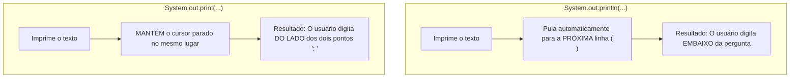
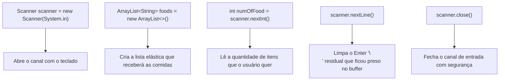

# 📃 Java — Capítulo 56: `ArrayLists` (Parte 6)
## O Início do Mini-Projeto Interativo: `Scanner`, `ArrayList<String> foods` e a Lendária Limpeza de Buffer

---

### 📌 Metadados da Aula e Contexto do Vídeo
- **Curso:** *Java Full Course for free* (Canal: Bro Code)
- **Capítulo Oficial:** `56. arraylists 📃`
- **Intervalo de Tempo no Vídeo:** `09:01:05` até `09:01:48` (do total de 12:00:00)
- **Arquivo de Trabalho:** [`Main.java`](file:///c:/Users/mickel%201/Downloads/JAVA%20APRENDER/Main.java)
- **Ambiente de Desenvolvimento:** IntelliJ IDEA Community Edition (JDK 23 / OpenJDK 23)

---

## 🖼️ Reconstituição Visual Completa da Interface (Para quem vai colar no Google Docs)

Como este documento foi preparado para ser copiado diretamente para o **Google Docs** sem depender de arquivos de imagem anexos, veja a reconstituição exata do que aconteceu na tela do professor ao longo das 5 capturas:

```
+---------------------------------------------------------------------------------------------------------+
| [MyFirstProject] - Main.java                                                             Current File   |
+---------------------------------------------------------------------------------------------------------+
|  1 | import java.util.ArrayList;                                                                        |
|  2 | import java.util.Collections;                                                                      |
|  3 | import java.util.Scanner;        <-- [Novo import adicionado para ler dados do teclado!]          |
|  4 |                                                                                                    |
|  5 | public class Main {                                                                                |
|  6 |     public static void main(String[] args) {                                                       |
|  7 |                                                                                                    |
|  8 |         Scanner scanner = new Scanner(System.in);                                                  |
|  9 |                                                                                                    |
| 10 |         ArrayList<String> foods = new ArrayList<>();                                               |
| 11 |                                                                                                    |
| 12 |         System.out.print("Enter the # of food you would like: ");                                  |
| 13 |         int numOfFood = scanner.nextInt();                                                         |
| 14 |         scanner.nextLine();      <-- [O cursor pisca aqui! Limpador crucial de buffer!]            |
| 15 |                                                                                                    |
| 16 |         scanner.close();                                                                           |
| 17 |     }                                                                                              |
| 18 | }                                                                                                  |
+---------------------------------------------------------------------------------------------------------+
| EXECUÇÃO NO CONSOLE (Aguardando o usuário):                                                             |
| Enter the # of food you would like: _  <-- [Cursor piscando na mesma linha esperando o número]          |
+---------------------------------------------------------------------------------------------------------+
```

---

### Detalhamento das 5 Imagens Passo a Passo

#### 📸 Imagem 1: Revisão do Exemplo Anterior de Frutas (`media_1791495772076_32df8b26.png`)
- **O que está na tela:** O professor encerra a demonstração do exemplo anterior com `Collections.sort(fruits);` e o loop `for-each` nas linhas 25-27.
- **Cursor:** O cursor de texto pisca na linha 26 logo após `fruit`.
- **Contexto:** Todas as operações básicas de `ArrayList` foram apresentadas (`add`, `remove`, `set`, `get`, `size`, `sort`). O professor agora se prepara para passar para a próxima etapa pedagógica: **um exercício prático do mundo real**.

#### 📸 Imagem 2: Ajuste de Zoom no Editor (`media_1791495878527_50a56130.png`)
- **O que está na tela:** O professor rola o código para cima no IntelliJ IDEA e ajusta a fonte (`Font size: 29pt`), exibindo das linhas 8 até a linha 28.
- **Destaque:** Mostra o bloco inteiro de frutas antes da limpeza.

#### 📸 Imagem 3: Limpando a Casa — Método `main` Vazio (`media_1791495888565_e3d26aee.png`)
- **O que acontece:** O professor seleciona todo o conteúdo dentro do método `main` (da linha 7 até a linha 27) e **apaga tudo** com `Delete`/`Backspace`!
- **Estado atual:** O arquivo fica com apenas 9 linhas:
  - Linhas 1 e 2 preservam os imports `ArrayList` e `Collections`.
  - Linha 5 abre o método `main`.
  - Linha 7 tem apenas o cursor piscando, pronto para começar do zero.
- **Avisos do IntelliJ:** Um ícone amarelo de aviso aparece no canto superior direito (`warning: 2`) porque `ArrayList` e `Collections` estão importados no topo, mas ainda não estão sendo usados.
- **Timestamp do vídeo:** `9:01:14 / 12:00:00`.

#### 📸 Imagem 4: Digitando o Scanner e Começando o ArrayList (`media_1791495913846_5355471d.png`)
- **O que foi adicionado:**
  1. Linha 3: `import java.util.Scanner;`
  2. Linha 8: `Scanner scanner = new Scanner(System.in);`
  3. Linha 10: O professor começa a digitar: `ArrayList list = new ArrayList` (o cursor ainda está vermelho/incompleto porque ele está no meio da digitação da linha).
- **Barra de navegação do YouTube:** Mostra timestamp `9:01:48 / 12:00:00`.

#### 📸 Imagem 5: A Base do Mini-Projeto Pronta (`media_1791495952901_2c413661.png`)
- **O que está na tela:** O professor conclui a configuração inicial da entrada de dados do usuário:
  - Renomeia a variável da lista para `foods` com Generics: `ArrayList<String> foods = new ArrayList<>();`.
  - Adiciona a pergunta: `System.out.print("Enter the # of food you would like: ");`.
  - Lê a quantidade digitada: `int numOfFood = scanner.nextInt();`.
  - Adiciona a linha mágica de limpeza de buffer: `scanner.nextLine();`.
  - Fecha o scanner: `scanner.close();`.
- **Posição do cursor:** O cursor está na linha 14, logo após `scanner.nextLine();`, preparando o terreno para escrever o laço de repetição (`for` loop) que vai pedir as comidas uma a uma!

---

## 💻 Código-Fonte Completo e Rigorosamente Numerado (Linhas 1 a 18)

Este é o código de [`Main.java`](file:///c:/Users/mickel%201/Downloads/JAVA%20APRENDER/Main.java) exatamente como montado na Imagem 5:

```java
 1: import java.util.ArrayList;
 2: import java.util.Collections;
 3: import java.util.Scanner;
 4: 
 5: public class Main {
 6:     public static void main(String[] args) {
 7: 
 8:         Scanner scanner = new Scanner(System.in);
 9: 
10:         ArrayList<String> foods = new ArrayList<>();
11: 
12:         System.out.print("Enter the # of food you would like: ");
13:         int numOfFood = scanner.nextInt();
14:         scanner.nextLine();
15: 
16:         scanner.close();
17:     }
18: }
```

---

## 🔬 Tabela Anatômica Linha por Linha: Para Iniciantes Absolutos

| Linha | Código Exato | O que significa na "Linguagem de Leigo" (Explicação Mastigada) | O que sai no Console? |
| :---: | :--- | :--- | :---: |
| **1** | `import java.util.ArrayList;` | **Importa a lista elástica:** Dá acesso à classe `ArrayList`, permitindo criar listas que aumentam de tamanho sozinhas conforme o usuário digita comidas. | *(Nada)* |
| **2** | `import java.util.Collections;` | **Importa o organizador:** Mantido no topo do arquivo porque o professor vai usar `Collections.sort()` para ordenar as comidas cadastradas pelo usuário mais adiante. | *(Nada)* |
| **3** | `import java.util.Scanner;` | **Importa o leitor do teclado:** Traz a ferramenta `Scanner` do pacote `java.util`, essencial para capturar qualquer coisa que o usuário digitar no teclado. | *(Nada)* |
| **4** | *(Linha em branco)* | Organização visual. | *(Nada)* |
| **5** | `public class Main {` | Declaração da classe principal onde o programa reside. | *(Nada)* |
| **6** | `public static void main(String[] args) {` | O ponto de partida da execução do Java. Onde a mágica começa quando você clica em "Run". | *(Nada)* |
| **7** | *(Linha em branco)* | Organização visual. | *(Nada)* |
| **8** | `Scanner scanner = new Scanner(System.in);` | **Cria o leitor do teclado:** Instancia um objeto `scanner` conectado ao fluxo `System.in` (o teclado físico do computador). É a ponte entre as teclas digitadas e o código. | *(Nada)* |
| **9** | *(Linha em branco)* | Organização visual. | *(Nada)* |
| **10** | `ArrayList<String> foods = new ArrayList<>();` | **Cria a lista de comidas vazia:** Reserva um espaço dinâmico na memória chamado `foods` (comidas) que aceita exclusivamente textos (`<String>`). Ela começa com 0 itens. | *(Nada)* |
| **11** | *(Linha em branco)* | Organização visual. | *(Nada)* |
| **12** | `System.out.print("Enter the # of food you would like: ");` | **Pergunta na tela sem pular linha:** Exibe a mensagem pedindo a quantidade de comidas desejadas. Como usa `print` (sem `ln`), o cursor permanece colado após o espaço final! | `Enter the # of food you would like: ` *(sem pular linha)* |
| **13** | `int numOfFood = scanner.nextInt();` | **Captura o número:** O programa pausa e espera o usuário digitar um número inteiro (ex: `3`) e pressionar Enter. O número é guardado na variável inteira `numOfFood`. | *(O usuário digita o número aqui, ex: 3)* |
| **14** | `scanner.nextLine();` | **A vassoura de buffer (CRUCIAL):** Consome e joga fora a quebra de linha `\n` (o Enter) que sobrou presa no teclado. Sem isso, o próximo texto lido seria pulado com erro! | *(Nada visível no console)* |
| **15** | *(Linha em branco)* | Organização visual. | *(Nada)* |
| **16** | `scanner.close();` | **Fecha o leitor do teclado:** Desliga o `Scanner` para liberar memória e recursos do sistema operacional. Boa prática fundamental. | *(Nada)* |
| **17** | `}` | Fecha o bloco do método `main`. | *(Nada)* |
| **18** | `}` | Fecha a classe `Main`. | *(Nada)* |

---

## 🧠 Teoria Explicada Passo a Passo (Como se você fosse um amador completo)

### 1. Por que o Bro Code Iniciou Esse Novo Mini-Projeto?
Até agora no capítulo 56, nós estávamos inserindo comidas manualmente no próprio código-fonte:
```java
fruits.add("Apple");
fruits.add("Orange");
fruits.add("Banana");
fruits.add("Coconut");
```
Isso é chamado de valores fixos (*hardcoded*). No mundo real, nenhum sistema funciona assim:
- Um aplicativo de entrega (Ifood, UberEats) não sabe de antemão quantas comidas o cliente quer pedir.
- Um cliente pode querer pedir 1 comida, outro quer pedir 5, outro quer pedir 10.
- **É aqui que o `ArrayList` brilha intensamente:** ele não tem tamanho fixo! Nós podemos perguntar ao usuário quantas comidas ele quer (`numOfFood`), rodar um loop e adicionar dinamicamente tudo o que ele digitar!

---

### 2. A Diferença Sutil entre `System.out.print()` e `System.out.println()`

Repare com atenção na Linha 12:
```java
System.out.print("Enter the # of food you would like: ");
```
O professor **NÃO** usou `println`. Ele usou **`print`**:



Em formulários e perguntas interativas no console, usar `print` cria uma experiência visual muito mais profissional e elegante, pois você digita a resposta logo ao lado da pergunta:
```text
Enter the # of food you would like: 3
```
Em vez de:
```text
Enter the # of food you would like: 
3
```

---

### 3. A Famosa "Pegadinha do Enter": Por que a Linha 14 (`scanner.nextLine();`) Existe?

Esta é **uma das dúvidas mais frequentes de quem aprende Java no mundo inteiro**. Se você não entender isso agora, você vai passar horas quebrando a cabeça no futuro achando que seu código está quebrado quando ele estiver apenas "engasgado com um Enter".

#### O que é o "Buffer" do Teclado?
Imagine o teclado como um tubo/cano por onde passam letras e números até chegar no programa Java:

```
[Teclado do Usuário] ----(Cano / Buffer de Entrada)----> [Programa Java]
```

Quando o programa chega na linha 13:
```java
int numOfFood = scanner.nextInt();
```
1. O usuário digita no teclado: o número `3` e depois aperta a tecla **ENTER**.
2. No cano do computador entram dois dados:
   - O caractere `'3'`
   - O caractere de nova linha `'\n'` (gerado pela tecla Enter).

3. O método **`scanner.nextInt()`** entra no cano, puxa apenas o número `3` e converte para número inteiro.
4. **Mas o que acontece com o `\n` (Enter)?**
   - O `nextInt()` é preguiçoso! Ele **deixa o `\n` esquecido dentro do cano!**

```
Cano de entrada: [ \n ] <--- Ficou preso aqui!
```

#### O Desastre que Aconteceria Sem a Linha 14:
Logo a seguir no programa, o professor vai criar um loop para pedir os nomes das comidas:
```java
String food = scanner.nextLine(); // Quer ler "Pizza", "Sushi", etc.
```
O método `scanner.nextLine()` lê tudo até encontrar um `\n`.
Se aquele `\n` antigo ainda estiver dentro do cano, o `scanner.nextLine()` vai achar que o usuário já apertou Enter sem digitar nada! 
Resultado: **ele pula a primeira comida automaticamente**, deixando ela vazia (`""`)!

#### A Solução: A Linha 14 é a "Vassoura"!
```java
scanner.nextLine(); // "Limpa o cano" / "Descarta o Enter órfão"
```
Essa linha não guarda o valor em variável nenhuma. Ela simplesmente "engole" o `\n` que sobrou e joga no lixo, deixando o cano completamente limpo para que a próxima leitura de texto funcione com 100% de perfeição.

---

### 4. Fechando o Scanner com `scanner.close()` (Linha 16)

O leitor do teclado consome recursos de entrada do sistema operacional. Quando seu programa termina de ler o que precisava, é uma regra de ouro de engenharia de software fechar o recurso chamando:
```java
scanner.close();
```
Isso evita o que os programadores chamam de *Resource Leak* (vazamento de recursos da máquina).

---

## 🖥️ Como o Programa se Comporta no Console

Quando você clica em "Run", o console exibe:

```text
Enter the # of food you would like: 
```

O programa entra em estado de espera (*waiting for user input*). O cursor fica piscando aguardando o usuário digitar um valor.

Se você digitar `3` e teclar Enter:
```text
Enter the # of food you would like: 3
```

O Java:
1. Pega o `3` e armazena em `numOfFood`.
2. Executa `scanner.nextLine()` e limpa o buffer.
3. Executa `scanner.close()` e finaliza com `Process finished with exit code 0`.

---

## 🎯 Resumo Mental Definitivo para Fixação



1. **`Scanner` + `ArrayList`**: Combinação poderosa para programas interativos dinâmicos onde o usuário decide a quantidade de itens.
2. **`System.out.print`**: Mantém a digitação do usuário colada na mesma linha da pergunta.
3. **`scanner.nextLine()` pós `nextInt()`**: A regra de ouro obrigatória em Java para limpar a tecla Enter residual do buffer antes de ler novos textos.
