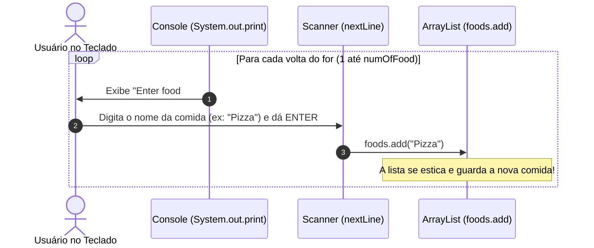

# 📃 Java — Capítulo 56: `ArrayLists` (Parte 7 - Conclusão do Capítulo)
## O Laço `for` Interativo, Adição Dinâmica com `Scanner` e o Gran Finale: `remove(0)` + `set(0)`

---

### 📌 Metadados da Aula e Contexto do Vídeo
- **Curso:** *Java Full Course for free* (Canal: Bro Code)
- **Capítulo Oficial:** `56. arraylists 📃`
- **Intervalo de Tempo no Vídeo:** `09:01:48` até `09:05:23` / 12:00:00 (Conclusão Oficial do Capítulo 56!)
- **Arquivo de Trabalho:** [`Main.java`](file:///c:/Users/mickel%201/Downloads/JAVA%20APRENDER/Main.java)
- **Ambiente de Desenvolvimento:** IntelliJ IDEA Community Edition (JDK 23 / OpenJDK 23)

---

## 🖼️ Reconstituição Visual Completa da Interface (Para quem vai colar no Google Docs)

Como você copiará este conteúdo para o **Google Docs** e não terá as imagens anexadas diretamente, veja a reconstituição detalhada de cada elemento visual exibido na tela do professor ao longo das 4 capturas:

```
+---------------------------------------------------------------------------------------------------------+
| [MyFirstProject] - Main.java                                                    Current File   [ > Run] |
+---------------------------------------------------------------------------------------------------------+
| 10 |         ArrayList<String> foods = new ArrayList<>();                                               |
| 11 |                                                                                                    |
| 12 |         System.out.print("Enter the # of food you would like: ");                                  |
| 13 |         int numOfFood = scanner.nextInt();                                                         |
| 14 |         scanner.nextLine();                                                                        |
| 15 |                                                                                                    |
| 16 |         for(int i = 1; i <= numOfFood; i++){                                                       |
| 17 |             System.out.print("Enter food #" + i + ": ");                                           |
| 18 |             String food = scanner.nextLine();                                                      |
| 19 |             foods.add(food);                                                                       |
| 20 |         }                                                                                          |
| 21 |                                                                                                    |
| 22 |         System.out.println(foods);                                                                 |
| 23 |                                                                                                    |
| 24 |         scanner.close();                                                                           |
| 25 |                                                                                                    |
| 26 |     }                                                                                              |
| 27 | }                                                                                                  |
+---------------------------------------------------------------------------------------------------------+
| RUN CONSOLE (Terminal Integrado Interativo):                                                            |
| Enter the # of food you would like: 4                                                                   |
| Enter food #1: Pizza                                                                                    |
| Enter food #2: Hotdog                                                                                   |
| Enter food #3: Hamburger                                                                                |
| Enter food #4: Taco                                                                                     |
| [Pizza, Hotdog, Hamburger, Taco]                                                                        |
|                                                                                                         |
| Process finished with exit code 0                                                                       |
+---------------------------------------------------------------------------------------------------------+
```

---

### Detalhamento das 4 Imagens Passo a Passo

#### 📸 Imagem 1: Teste Preliminar da Entrada (`media_1791495974659_6ca20c81.png`)
- **O que está na tela:** O professor testa a primeira parte do código antes de escrever o laço de repetição.
- **Painel Inferior (Run Console):**
  - O console exibiu a pergunta: `Enter the # of food you would like: `
  - O professor digitou `3` e teclou Enter.
  - O programa leu o `3`, limpou o buffer com `scanner.nextLine()`, fechou o scanner e terminou: `Process finished with exit code 0`.
- **Objetivo pedagógico:** Provar que a leitura de inteiros e a limpeza de buffer estavam funcionando 100% antes de construir o loop.

#### 📸 Imagem 2: A Criação do Loop Interativo (`media_1791496143486_2798e86d.png`)
- **O que foi adicionado:** Nas linhas 16 a 20, o professor escreve o laço `for`:
  ```java
  for(int i = 1; i <= numOfFood; i++){
      System.out.print("Enter food #" + i + ": ");
      String food = scanner.nextLine();
      foods.add(food);
  }
  ```
  E logo abaixo, na linha 22, adiciona a impressão da lista: `System.out.println(foods);`.
- **Onde está o mouse:** A seta branca do mouse está posicionada no canto superior direito da janela do IntelliJ, exatamente sobre o botão verde com ícone de triângulo (**Run / Play**), pronta para executar o programa completo.
- **Timestamp do vídeo:** `9:04:43 / 12:00:00`.

#### 📸 Imagem 3: A Execução Completa com 4 Comidas (`media_1791496155642_ca9420ce.png`)
- **O que acontece no console:**
  1. O programa pergunta a quantidade e o professor digita `4`.
  2. O loop roda 4 vezes, pedindo uma comida por vez:
     - `Enter food #1: Pizza`
     - `Enter food #2: Hotdog`
     - `Enter food #3: Hamburger`
     - `Enter food #4: Taco`
  3. Ao sair do loop, a linha 22 imprime a lista completa entre colchetes:
     `[Pizza, Hotdog, Hamburger, Taco]`
  4. Finaliza com sucesso absoluto: `Process finished with exit code 0`.

#### 📸 Imagem 4: O "Grand Finale" do Capítulo (`media_1791496173477_3c3320a9.png`)
- **O que acontece na tela:** Nos segundos finais do capítulo (timestamp `9:05:23 / 12:00:00`), o professor faz uma recapitulação rápida do comportamento de reindexação do `ArrayList`.
- **O código reexibido:**
  ```java
  fruits.remove(0);
  fruits.set(0, "Pineapple");

  for(String fruit : fruits){
      System.out.println(fruit);
  }
  ```
- **O foco do professor:** O cursor está selecionando `set` na linha 18, reforçando aos alunos a pegadinha clássica: ao remover o índice `0` (`"Apple"`), todos os itens andam uma casa para a esquerda. Logo, ao chamar `set(0, "Pineapple")`, você **não** está repondo a maçã; você está **substituindo o novo primeiro lugar** (que era a Laranja)!

---

## 💻 Código-Fonte 1: O Mini-Projeto Interativo Completo ([`Main.java`](file:///c:/Users/mickel%201/Downloads/JAVA%20APRENDER/Main.java))

```java
 1: import java.util.ArrayList;
 2: import java.util.Collections;
 3: import java.util.Scanner;
 4: 
 5: public class Main {
 6:     public static void main(String[] args) {
 7: 
 8:         Scanner scanner = new Scanner(System.in);
 9: 
10:         ArrayList<String> foods = new ArrayList<>();
11: 
12:         System.out.print("Enter the # of food you would like: ");
13:         int numOfFood = scanner.nextInt();
14:         scanner.nextLine();
15: 
16:         for(int i = 1; i <= numOfFood; i++){
17:             System.out.print("Enter food #" + i + ": ");
18:             String food = scanner.nextLine();
19:             foods.add(food);
20:         }
21: 
22:         System.out.println(foods);
23: 
24:         scanner.close();
25: 
26:     }
27: }
```

---

## 🔬 Tabela Anatômica Linha por Linha (Código Interativo)

| Linha | Código Exato | O que significa na "Linguagem de Leigo" (Explicação Mastigada) | O que sai no Console? |
| :---: | :--- | :--- | :---: |
| **1** | `import java.util.ArrayList;` | Abre a caixa de ferramentas do Java e traz a lista dinâmica `ArrayList`. | *(Nada)* |
| **2** | `import java.util.Collections;` | Traz a classe de utilitários `Collections` (para ordenações e manipulações). | *(Nada)* |
| **3** | `import java.util.Scanner;` | Traz o leitor de teclado `Scanner`. | *(Nada)* |
| **4** | *(Linha em branco)* | Organização visual. | *(Nada)* |
| **5** | `public class Main {` | Início da classe `Main`. | *(Nada)* |
| **6** | `public static void main(String[] args) {` | Início da execução do programa. | *(Nada)* |
| **7** | *(Linha em branco)* | Organização visual. | *(Nada)* |
| **8** | `Scanner scanner = new Scanner(System.in);` | Liga o aparelho receptor conectado ao teclado (`System.in`). | *(Nada)* |
| **9** | *(Linha em branco)* | Organização visual. | *(Nada)* |
| **10** | `ArrayList<String> foods = new ArrayList<>();` | **Cria a sacola elástica:** Cria uma lista vazia chamada `foods` que aceita exclusivamente palavras (`<String>`). Ela começa com 0 itens e cresce sob demanda. | *(Nada)* |
| **11** | *(Linha em branco)* | Organização visual. | *(Nada)* |
| **12** | `System.out.print("Enter the # of food you would like: ");` | Pergunta ao usuário quantas comidas ele deseja. Usa `print` para que o número seja digitado ao lado da frase. | `Enter the # of food you would like: ` |
| **13** | `int numOfFood = scanner.nextInt();` | Lê o número digitado (ex: `4`) e guarda na variável `numOfFood`. | *(Usuário digita 4)* |
| **14** | `scanner.nextLine();` | **A vassoura de buffer:** Engole o `\n` (tecla Enter) que sobrou solto no teclado. Deixa o canal 100% limpo para as próximas palavras. | *(Nada)* |
| **15** | *(Linha em branco)* | Organização visual. | *(Nada)* |
| **16** | `for(int i = 1; i <= numOfFood; i++){` | **O motor de repetição:** Inicia um contador `i` começando em 1. Enquanto `i` for menor ou igual a `numOfFood` (4), repita as linhas 17, 18 e 19, somando 1 ao contador a cada volta (`i++`). | *(Nada direto, comanda o loop)* |
| **17** | `    System.out.print("Enter food #" + i + ": ");` | Pergunta o nome da comida atual da rodada. Junta `"Enter food #"` com o número da rodada `i` (ex: `1`, `2`, `3`, `4`) e deixa o cursor na mesma linha. | `Enter food #1: `<br>`Enter food #2: `<br>`Enter food #3: `<br>`Enter food #4: ` |
| **18** | `    String food = scanner.nextLine();` | O programa pausa e espera o usuário digitar o nome da comida (ex: `"Pizza"`) e teclar Enter. Guarda o texto na variável temporária `food`. | *(Usuário digita cada comida)* |
| **19** | `    foods.add(food);` | **A mágica do ArrayList:** Pega a comida digitada e empurra para dentro da lista `foods`. A lista se expande automaticamente! | *(Nada)* |
| **20** | `}` | Fim do laço `for`. Retorna à linha 16 para a próxima volta até completar as 4 comidas. | *(Nada)* |
| **21** | *(Linha em branco)* | Organização visual. | *(Nada)* |
| **22** | `System.out.println(foods);` | Imprime a lista inteira de uma vez só no formato padrão com colchetes e vírgulas. | `[Pizza, Hotdog, Hamburger, Taco]` |
| **23** | *(Linha em branco)* | Organização visual. | *(Nada)* |
| **24** | `scanner.close();` | Desliga o receptor do teclado para liberar memória do computador. | *(Nada)* |
| **25** | *(Linha em branco)* | Organização visual. | *(Nada)* |
| **26** | `}` | Fim do método `main`. | *(Nada)* |
| **27** | `}` | Fim da classe `Main`. | *(Nada)* |

---

## 🧠 Teoria Explicada Passo a Passo (Como se você fosse um amador completo)

### 1. Por que o Loop Começa em `i = 1` e Vai Até `<= numOfFood`?

Normalmente em Java, quando estamos mexendo com índices de arrays, começamos com `i = 0`. 
Mas repare com atenção no cabeçalho escrito pelo professor na Linha 16:
```java
for(int i = 1; i <= numOfFood; i++)
```
**Por que ele fez isso?**
- Para humanos comuns, não existe "Comida número zero"! Ninguém chega numa lanchonete e diz: *"Por favor, anote a comida #0"*.
- Como essa variável `i` está sendo usada na tela na Linha 17 (`"Enter food #" + i + ": "`), começar com `i = 1` faz com que o programa fale a linguagem natural dos seres humanos:
  - Na 1ª volta: exibe `Enter food #1:`
  - Na 2ª volta: exibe `Enter food #2:`
  - Na 3ª volta: exibe `Enter food #3:`
  - Na 4ª volta: exibe `Enter food #4:`
- E ao usar a condição **`i <= numOfFood`** (menor ou igual a 4), garantimos que o loop vai rodar exatamente as 4 vezes pedidas pelo usuário (voltas: 1, 2, 3 e 4).

---

### 2. A Dança Perfeita entre `Scanner` e `ArrayList.add()`

Observe o fluxo que acontece dentro das chaves `{ }` do loop a cada rodada:



Em um array tradicional fixo (`String[]`), se o usuário digitasse 10 comidas, você teria que adivinhar o tamanho antes. Com o `ArrayList`, você não se preocupa com limites: a cada `foods.add(food)`, a lista cuida internamente de aumentar sua capacidade.

---

### 3. O Gran Finale do Bro Code (A Imagem 4 Explicada nos Mínimos Detalhes)

Na Imagem 4, o professor volta ao exemplo original de frutas para demonstrar o que acontece quando combinamos `.remove(0)` com `.set(0, "Pineapple")`. 

Esta é **a maior armadilha de lógica para iniciantes em Java**:

```java
ArrayList<String> fruits = new ArrayList<>();
fruits.add("Apple");    // Índice 0
fruits.add("Orange");   // Índice 1
fruits.add("Banana");   // Índice 2
fruits.add("Coconut");  // Índice 3

fruits.remove(0);
fruits.set(0, "Pineapple");
```

#### O que o iniciante pensa que acontece:
> *"Ele removeu o índice 0 (Apple) e depois colocou Pineapple no índice 0, então ele só trocou Apple por Pineapple!"*

#### O que REALMENTE acontece na memória:
1. **Antes de remover:**
   - `[0]`: `"Apple"`
   - `[1]`: `"Orange"`
   - `[2]`: `"Banana"`
   - `[3]`: `"Coconut"`

2. **Linha: `fruits.remove(0);`**
   - O Java remove `"Apple"`.
   - **EFEITO DOMINÓ (Fila do Banco):** Todas as frutas restantes dão um passo à frente!
   - `[0]`: agora é `"Orange"`!
   - `[1]`: agora é `"Banana"`!
   - `[2]`: agora é `"Coconut"`!

3. **Linha: `fruits.set(0, "Pineapple");`**
   - O método `set` **substitui** quem está atualmente na posição indicada.
   - Quem está na posição `0` agora? **É a Laranja (`"Orange"`)!**
   - Portanto, a `"Orange"` é jogada fora e substituída por `"Pineapple"`!

4. **Resultado final na lista:**
   ```text
   Pineapple
   Banana
   Coconut
   ```
   A Maçã foi removida pelo `.remove(0)` E a Laranja foi deletada pelo `.set(0, "Pineapple")`! Sobraram apenas 3 frutas!

---

## 🖥️ Saída Real e Oficial do Console

Ao executar o código interativo com entrada de `4` itens:

```text
Enter the # of food you would like: 4
Enter food #1: Pizza
Enter food #2: Hotdog
Enter food #3: Hamburger
Enter food #4: Taco
[Pizza, Hotdog, Hamburger, Taco]
```

---

## 🏆 Resumo Completo de Encerramento do Capítulo 56 (`ArrayLists`)

Você agora domina completamente todos os pilares de listas dinâmicas em Java:

| Método / Recurso | O Que Faz? | Exemplo Prático |
| :--- | :--- | :--- |
| **`new ArrayList<>()`** | Cria uma lista redimensionável na memória | `ArrayList<String> lista = new ArrayList<>();` |
| **`.add(elemento)`** | Adiciona um item ao final da lista | `lista.add("Pizza");` |
| **`.remove(indice)`** | Remove o item e puxa os seguintes para a esquerda | `lista.remove(0);` |
| **`.set(indice, valor)`** | Substitui o valor daquela posição específica | `lista.set(1, "Hotdog");` |
| **`.get(indice)`** | Acessa e lê o valor de uma posição específica | `String comida = lista.get(0);` |
| **`.size()`** | Retorna a quantidade total de itens na lista | `int total = lista.size();` |
| **`Collections.sort(lista)`** | Ordena a lista em ordem alfabética ou numérica | `Collections.sort(lista);` |
| **`for(Tipo item : lista)`** | Percorre a lista exibindo item por item limpo | `for(String f : lista) { ... }` |
| **`Scanner` + Loop `for`** | Permite que o usuário cadastre itens interativamente | `for(int i = 1; i <= n; i++) foods.add(...)` |
