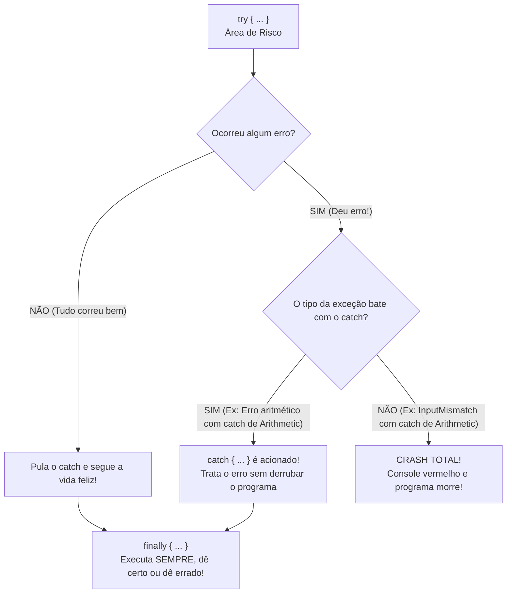
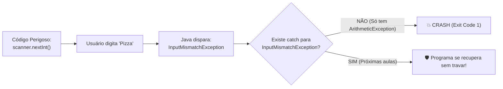

# ⚠️ Java — Capítulo 57: `Exception Handling` (Parte 1)
## Introdução ao Tratamento de Exceções: `try`, `catch`, `ArithmeticException` e o Crash com `InputMismatchException`

---

### 📌 Metadados da Aula e Contexto do Vídeo
- **Curso:** *Java Full Course for free* (Canal: Bro Code)
- **Capítulo Oficial:** `57. exception handling ⚠️` *(Capítulo Novo!)*
- **Intervalo de Tempo no Vídeo:** `09:05:23` até `09:08:53` (do total de 12:00:00)
- **Arquivo de Trabalho:** [`Main.java`](file:///c:/Users/mickel%201/Downloads/JAVA%20APRENDER/Main.java)
- **Ambiente de Desenvolvimento:** IntelliJ IDEA Community Edition (JDK 23 / OpenJDK 23)

---

## 🖼️ Reconstituição Visual Completa da Interface (Para quem vai colar no Google Docs)

Como você copiará este material diretamente para o seu **Google Docs** e não terá acesso direto às capturas de tela lá, veja a reconstituição visual completa de tudo o que foi exibido no monitor do professor ao longo das 5 imagens:

```
+---------------------------------------------------------------------------------------------------------+
| [MyFirstProject] - Main.java                                                             Current File   |
+---------------------------------------------------------------------------------------------------------+
|  1 | import java.util.Scanner;                                                                          |
|  2 |                                                                                                    |
|  3 | public class Main {                                                                                |
|  4 |     public static void main(String[] args) {                                                       |
|  5 |                                                                                                    |
|  6 |         // Exception = An event that interrupts the normal flow of a program                       |
|  7 |         //             (Dividing by zero, file not found, mismatch input type)                     |
|  8 |         //             Surround any dangerous code with a try{} block                              |
|  9 |         //             try{}, catch{}, finally{}                                                   |
| 10 |                                                                                                    |
| 11 |         Scanner scanner = new Scanner(System.in);                                                  |
| 12 |                                                                                                    |
| 13 |         try {                                                                                      |
| 14 |             System.out.print("Enter a number: ");                                                  |
| 15 |             int number = scanner.nextInt();                                                        |
| 16 |             System.out.println(number);                                                            |
| 17 |         }                                                                                          |
| 18 |         catch(ArithmeticException e){                                                              |
| 19 |             System.out.println("YOU CAN'T DIVIDE BY ZERO!");                                       |
| 20 |         }                                                                                          |
| 21 |                                                                                                    |
| 22 |         scanner.close();                                                                           |
| 23 |     }                                                                                              |
| 24 | }                                                                                                  |
+---------------------------------------------------------------------------------------------------------+
| RUN CONSOLE (O Erro Explosivo em Vermelho):                                                             |
| Enter a number: Pizza                                                                                   |
| Exception in thread "main" java.util.InputMismatchException                                             |
|     at java.base/java.util.Scanner.throwFor(Scanner.java:964)                                           |
|     at java.base/java.util.Scanner.next(Scanner.java:1619)                                              |
|     at java.base/java.util.Scanner.nextInt(Scanner.java:2284)                                           |
|     at java.base/java.util.Scanner.nextInt(Scanner.java:2238)                                           |
|     at Main.main(Main.java:15)                                                                          |
|                                                                                                         |
| Process finished with exit code 1                                                                       |
+---------------------------------------------------------------------------------------------------------+
```

---

### Detalhamento das 5 Imagens Passo a Passo

#### 📸 Imagem 1: A Definição Teórica nos Comentários (`media_1791496399490_4e4580fe.png`)
- **O que está na tela:** O professor inaugura o novo capítulo escrevendo 4 linhas de comentários no topo do método `main`:
  - `// Exception = An event that interrupts the normal flow of a program`
  - `//             (Dividing by zero, file not found, mismatch input type)`
  - `//             Surround any dangerous code with a try{} block`
  - `//             try{}, catch{}, finally{}`
- **Destaque:** Na linha 8, o professor seleciona com o mouse a palavra **`catch{}`** (que fica com fundo azul), destacando a trindade clássica do tratamento de erros em Java: `try`, `catch` e `finally`.

#### 📸 Imagem 2: O Primeiro Experimento — Divisão por Zero (`media_1791496469807_498d024f.png`)
- **O que foi escrito:**
  ```java
  try {
      System.out.println(1 / 0);
  }
  catch(ArithmeticException e){
      System.out.println("YOU CAN'T DIVIDE BY ZERO!");
  }
  ```
- **Aviso na tela:** Embaixo da expressão `1 / 0`, o IntelliJ IDEA exibe um sublinhado ondulado amarelo/laranja (aviso de inspeção de código), pois o compilador já sabe que dividir por zero matematicamente é impossível.
- **Ação:** O cursor do mouse está sobre o botão verde **Run (Play)** no topo da janela.

#### 📸 Imagem 3: Tooltip de Ajuda do IntelliJ (`media_1791496507344_c6682550.png`)
- **O que acontece:** O cursor do professor está na linha 15 (logo após a chave `}` de fechamento do bloco `catch`).
- **A janela flutuante:** Surge uma caixa de documentação rápida (*Quick Documentation*) do pacote `java.lang.System`, mostrando como o IntelliJ auxilia desenvolvedores exibindo o Javadoc das classes padrão.

#### 📸 Imagem 4: Mudando para Entrada do Usuário via Teclado (`media_1791496547773_aaf72a1d.png`)
- **A mudança no código:** O professor substitui a divisão por zero fixa por uma leitura interativa com `Scanner`:
  ```java
  System.out.print("Enter a number: ");
  int number = scanner.nextInt();
  System.out.println(number);
  ```
- **O que o console exibe:** O painel inferior abre e exibe em letras verdes brilhantes:
  `Enter a number: `
  O cursor fica piscando, aguardando o usuário digitar um valor no teclado.
- **Timestamp do vídeo:** `9:08:53 / 12:00:00`.

#### 📸 Imagem 5: A Armadilha Proposital e a Explosão do Console (`media_1791496560525_dd7f3d3c.png`)
- **O que o professor digitou:** O programa pediu um número, mas o professor digitou a palavra **`Pizza`**!
- **O resultado catastrófico:** O console cospe um bloco de erro vermelho aterrorizante (*Stack Trace*):
  ```text
  Exception in thread "main" java.util.InputMismatchException
      at Main.main(Main.java:15)
  Process finished with exit code 1
  ```
- **A grande lição:** O programa **caiu** (morreu) mesmo estando dentro de um bloco `try`! Por quê? Porque o `catch` foi configurado para capturar apenas `ArithmeticException` (erros matemáticos), mas o erro provocado pela palavra "Pizza" foi um **`InputMismatchException`** (tipo de dado incompatível)! Como ninguém capturou essa exceção, o Java abortou o programa com código de erro `1`.

---

## 💻 Código-Fonte Completo e Rigorosamente Numerado ([`Main.java`](file:///c:/Users/mickel%201/Downloads/JAVA%20APRENDER/Main.java))

Aqui está o código exato presente no editor na Imagem 5:

```java
 1: import java.util.Scanner;
 2: 
 3: public class Main {
 4:     public static void main(String[] args) {
 5: 
 6:         // Exception = An event that interrupts the normal flow of a program
 7:         //             (Dividing by zero, file not found, mismatch input type)
 8:         //             Surround any dangerous code with a try{} block
 9:         //             try{}, catch{}, finally{}
10: 
11:         Scanner scanner = new Scanner(System.in);
12: 
13:         try {
14:             System.out.print("Enter a number: ");
15:             int number = scanner.nextInt();
16:             System.out.println(number);
17:         }
18:         catch(ArithmeticException e){
19:             System.out.println("YOU CAN'T DIVIDE BY ZERO!");
20:         }
21: 
22:         scanner.close();
23:     }
24: }
```

---

## 🔬 Tabela Anatômica Linha por Linha: Para Iniciantes Absolutos

| Linha | Código Exato | O que significa na "Linguagem de Leigo" (Explicação Mastigada) | O que sai no Console? (Digitando "Pizza") |
| :---: | :--- | :--- | :---: |
| **1** | `import java.util.Scanner;` | Traz do pacote de utilitários a ferramenta `Scanner` para ler o teclado. | *(Nada)* |
| **2** | *(Linha em branco)* | Organização visual. | *(Nada)* |
| **3** | `public class Main {` | A classe principal do nosso projeto. | *(Nada)* |
| **4** | `public static void main(String[] args) {` | A porta de entrada onde a execução começa. | *(Nada)* |
| **5** | *(Linha em branco)* | Organização visual. | *(Nada)* |
| **6** | `// Exception = An event...` | **Comentário de conceito:** Uma exceção é um imprevisto/desastre que interrompe a execução normal do programa. | *(Nada)* |
| **7** | `// (Dividing by zero, file not found...)` | Exemplos comuns: tentar dividir por zero, arquivo inexistente no disco, usuário digitar texto onde esperava número. | *(Nada)* |
| **8** | `// Surround any dangerous code...` | Regra de ouro: qualquer código arriscado que possa dar erro deve ser colocado dentro de um bloco `try{}`. | *(Nada)* |
| **9** | `// try{}, catch{}, finally{}` | As três palavras-chave mágicas do tratamento de exceções. | *(Nada)* |
| **10** | *(Linha em branco)* | Organização visual. | *(Nada)* |
| **11** | `Scanner scanner = new Scanner(System.in);` | Conecta o aparelho receptor ao teclado físico (`System.in`). | *(Nada)* |
| **12** | *(Linha em branco)* | Organização visual. | *(Nada)* |
| **13** | `try {` | **A "Gaiola de Segurança":** Diz ao Java: *"Tente executar o bloco abaixo. Se acontecer algum erro catastrófico aqui dentro, NÃO trave o computador imediatamente; veja se tem um `catch` para cuidar disso"*. | *(Nada)* |
| **14** | ` System.out.print("Enter a number: ");` | Pergunta ao usuário para digitar um número, mantendo o cursor na mesma linha. | `Enter a number: ` |
| **15** | ` int number = scanner.nextInt();` | **O PONTO DO CRIME:** O Java tenta converter o que foi digitado em um número inteiro. O usuário digitou `"Pizza"`. A palavra "Pizza" NÃO é número! O Java entra em pânico e joga no ar uma bomba chamada `InputMismatchException`! A linha 16 é sumariamente cancelada! | *(Usuário digita: Pizza)* |
| **16** | ` System.out.println(number);` | Deveria imprimir o número digitado. **NUNCA É EXECUTADA** porque a linha 15 explodiu antes! | *(Ignorada)* |
| **17** | `}` | Fecha a gaiola do bloco `try`. | *(Nada)* |
| **18** | `catch(ArithmeticException e){` | **O Bombeiro Cego:** Este bloco é um socorrista treinado **APENAS** para consertar erros de matemática (`ArithmeticException`, como divisão por zero). Quando a bomba `InputMismatchException` cai aqui, ele diz: *"Não é da minha área!"* e deixa o erro passar reto! | *(Ignorado)* |
| **19** | ` System.out.println("YOU CAN'T...");` | Mensagem de erro amigável para divisão por zero. Como o erro não foi matemático, esta linha não roda! | *(Ignorada)* |
| **20** | `}` | Fecha o bloco do `catch`. | *(Nada)* |
| **21** | *(Linha em branco)* | Organização visual. | *(Nada)* |
| **22** | `scanner.close();` | Desligaria o scanner. **NUNCA É EXECUTADA**, pois o programa morreu antes de chegar aqui! | *(Ignorada)* |
| **23** | `}` | Fim do método `main`. | *(Nada)* |
| **24** | `}` | Fim da classe `Main`. | *(Nada)* |

---

## 🧠 Teoria Explicada Passo a Passo (Como se você fosse um amador completo)

### 1. O Que É uma Exceção? (A Metáfora do Pneu Furado)

Imagine que você está fazendo uma viagem de carro em uma rodovia (esse é o **fluxo normal** do programa):
- De repente, um prego fura o pneu do carro! Esse prego é a **Exceção** (*Exception*).
- **Sem tratamento de exceção (`try/catch`):** Você não tem estepe nem ferramentas. O carro capota no acostamento e a viagem termina ali mesmo em tragédia (**Crash / Programa fechou com erro**).
- **Com tratamento de exceção (`try/catch`):** Você tinha um estepe no porta-malas! Você encosta o carro com calma, troca o pneu em 10 minutos e continua sua viagem tranquilamente até o destino final (**O programa avisa o usuário do erro e continua rodando sem travar**).

---

### 2. A Trindade Fundamental: `try`, `catch` e `finally`



1. **`try` (Tente):** É o laboratório de testes perigosos. Você coloca aqui dentro qualquer linha de código que dependa de fatores externos (arquivos no disco, conexão com a internet, ou o usuário digitando coisas no teclado).
2. **`catch` (Capture / Pegue):** É a rede de segurança. Se o código do `try` falhar e jogar uma exceção, o `catch` agarra a exceção e executa uma ação de emergência (como exibir uma mensagem amigável: *"Por favor, não digite letras onde só cabem números"*).
3. **`finally` (Finalmente):** É a equipe de faxina. O código dentro do `finally` roda **SEMPRE**, não importa se o `try` deu certo ou se caiu no `catch`. É perfeito para fechar arquivos e desligar scanners.

---

### 3. A Grande Revelação da Imagem 5: Por que "Pizza" Quebrou Tudo?

Esta é a lição mais brilhante que o Bro Code ensina neste início de capítulo.

Imagine um hospital que tem dois tipos de acidentes:
- Problemas no Coração $\rightarrow$ Tratados pelo **Cardiologista** (`ArithmeticException`).
- Ossos Quebrados $\rightarrow$ Tratados pelo **Ortopedista** (`InputMismatchException`).

No nosso código na Linha 18, nós contratamos **apenas o Cardiologista**:
```java
catch(ArithmeticException e)
```

Quando o professor rodou o programa e digitou a palavra **`Pizza`**:
1. O método `scanner.nextInt()` esperava números (`0, 1, 2, 3...`).
2. Ao receber as letras de `Pizza`, o Java quebrou o osso da perna e gerou uma **`java.util.InputMismatchException`** (Exceção de Entrada Incompatível).
3. O Java procurou desesperadamente um socorrista: *"Tem algum bloco `catch(InputMismatchException)` aqui?"*
4. Ele encontrou apenas o `catch(ArithmeticException e)`. O cardiologista olhou para a perna quebrada e disse: *"Não sou eu quem cuida disso!"*.
5. Como não havia nenhum socorrista adequado para cuidar de `InputMismatchException`, o Java **não teve escolha a não ser abortar a execução e cuspir o erro vermelho no console!**

---

### 4. Decodificando o "Texto Vermelho do Terror" (Stack Trace)

Quando um iniciante vê texto vermelho no console, ele costuma se assustar. Mas o Java está sendo extremamente educado e dando pistas cirúrgicas de onde está o problema:

```text
Exception in thread "main" java.util.InputMismatchException
    at java.base/java.util.Scanner.throwFor(Scanner.java:964)
    at java.base/java.util.Scanner.next(Scanner.java:1619)
    at java.base/java.util.Scanner.nextInt(Scanner.java:2284)
    at java.base/java.util.Scanner.nextInt(Scanner.java:2238)
    at Main.main(Main.java:15)

Process finished with exit code 1
```

- **`Exception in thread "main"`:** O desastre ocorreu no fluxo principal do seu programa.
- **`java.util.InputMismatchException`:** O nome exato da classe de erro que explodiu.
- **`at Main.main(Main.java:15)`:** A linha do seu código onde o erro aconteceu! Foi na **Linha 15** do arquivo `Main.java` (exatamente onde estava `int number = scanner.nextInt();`).
- **`exit code 1`:** Código de saída 1 significa que o programa terminou com **falha/crash** (se tivesse terminado bem, seria `exit code 0`).

---

## 🖥️ Saída Real e Oficial do Console

Ao executar o código e digitar `"Pizza"`:

```text
Enter a number: Pizza
Exception in thread "main" java.util.InputMismatchException
	at java.base/java.util.Scanner.throwFor(Scanner.java:939)
	at java.base/java.util.Scanner.next(Scanner.java:1594)
	at java.base/java.util.Scanner.nextInt(Scanner.java:2258)
	at java.base/java.util.Scanner.nextInt(Scanner.java:2212)
	at Main.main(Main.java:15)

Process finished with exit code 1
```

---

## 🎯 Resumo Mental Definitivo para Fixação



1. **`try { ... }`**: Isola o código perigoso que pode falhar.
2. **`catch(Tipo e) { ... }`**: Captura **especificamente** o tipo de exceção declarado entre parênteses.
3. **Exceções diferentes exigem catches diferentes**: Não adianta colocar um `catch` para erro de matemática (`ArithmeticException`) se o erro for de digitação de texto (`InputMismatchException`).
