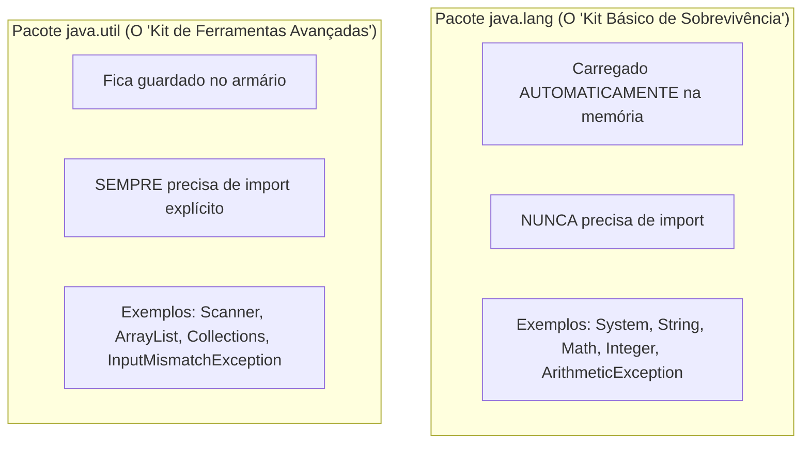
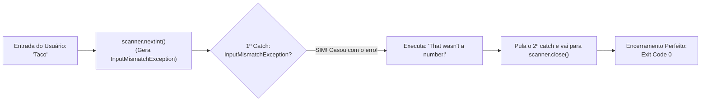

# ⚠️ Java — Capítulo 57: `Exception Handling` (Parte 2)
## Múltiplos Blocos `catch`, o Import de `InputMismatchException` e o Tratamento Gracioso de Erros

---

### 📌 Metadados da Aula e Contexto do Vídeo
- **Curso:** *Java Full Course for free* (Canal: Bro Code)
- **Capítulo Oficial:** `57. exception handling ⚠️`
- **Intervalo de Tempo no Vídeo:** `09:09:18` até `09:09:54` (do total de 12:00:00)
- **Arquivo de Trabalho:** [`Main.java`](file:///c:/Users/mickel%201/Downloads/JAVA%20APRENDER/Main.java)
- **Ambiente de Desenvolvimento:** IntelliJ IDEA Community Edition (JDK 23 / OpenJDK 23)

---

## 🖼️ Reconstituição Visual Completa da Interface (Para quem vai colar no Google Docs)

Como você copiará este material diretamente para o seu **Google Docs** e não terá acesso direto às imagens no documento, veja a reconstituição detalhada de cada etapa visual exibida na tela do professor ao longo das 5 imagens:

```
+---------------------------------------------------------------------------------------------------------+
| [MyFirstProject] - Main.java                                                             Current File   |
+---------------------------------------------------------------------------------------------------------+
|  1 | import java.util.InputMismatchException;  <-- [Inserido automaticamente após o clique no tooltip]  |
|  2 | import java.util.Scanner;                                                                          |
|  3 |                                                                                                    |
|  4 | public class Main {                                                                                |
|  5 |     public static void main(String[] args) {                                                       |
|  6 |                                                                                                    |
|  7 |         Scanner scanner = new Scanner(System.in);                                                  |
|  8 |                                                                                                    |
|  9 |         try {                                                                                      |
| 10 |             System.out.print("Enter a number: ");                                                  |
| 11 |             int number = scanner.nextInt();                                                        |
| 12 |             System.out.println(number);                                                            |
| 13 |         }                                                                                          |
| 14 |         catch(InputMismatchException e){    <-- [Novo catch capturando entrada inválida]           |
| 15 |             System.out.println("That wasn't a number!");                                           |
| 16 |         }                                                                                          |
| 17 |         catch(ArithmeticException e){       <-- [Segundo catch capturando divisão por zero]        |
| 18 |             System.out.println("YOU CAN'T DIVIDE BY ZERO!");                                       |
| 19 |         }                                                                                          |
| 20 |                                                                                                    |
| 21 |         scanner.close();                                                                           |
| 22 |     }                                                                                              |
| 23 | }                                                                                                  |
+---------------------------------------------------------------------------------------------------------+
| RUN CONSOLE (Tratamento Gracioso com Sucesso - Sem Crash!):                                             |
| Enter a number: Taco                                                                                    |
| That wasn't a number!                                                                                   |
|                                                                                                         |
| Process finished with exit code 0                                                                       |
+---------------------------------------------------------------------------------------------------------+
```

---

### Detalhamento das 5 Imagens Passo a Passo

#### 📸 Imagem 1: O Início da Digitação do Segundo `catch` (`media_1791496592013_5964235b.png`)
- **O que está na tela:** Na linha 18, o professor começa a digitar o novo bloco de proteção:
  `catch(InputMismatchException){`
- **Erros na tela (Tudo em Vermelho):**
  1. O IntelliJ marca a linha com vermelho porque **falta o nome da variável** (ex: `e`).
  2. O compilador ainda não conhece a classe `InputMismatchException` porque ela não foi importada no cabeçalho do arquivo.
- **Timestamp do vídeo:** `9:09:18 / 12:00:00`.

#### 📸 Imagem 2: Adicionando o Parâmetro `e` (`media_1791496616959_cb45bb3c.png`)
- **O que mudou:** O professor adiciona o `e`:
  `catch(InputMismatchException e){`
- **O Tooltip do IntelliJ:** Ao posicionar o cursor sobre a palavra vermelha `InputMismatchException`, surge o balão escuro de ajuda inteligente:
  > **`Cannot resolve symbol 'InputMismatchException'`**
  > `Import class Alt+Shift+Enter`
  > `More actions... Alt+Enter`

#### 📸 Imagem 3: Clicando em `Import class` (`media_1791496627464_9f6d04e3.png`)
- **Ação:** O professor move a seta do mouse (que vira uma mãozinha branca) e clica diretamente no botão azul sublinhado **`Import class`**.
- **O que o IntelliJ faz nos bastidores:** Insere na Linha 1 do arquivo:
  `import java.util.InputMismatchException;`
- **Timestamp do vídeo:** `9:09:27 / 12:00:00`.

#### 📸 Imagem 4: Bloco Completo e Sem Erros (`media_1791496645863_538b2ef5.png`)
- **O que está no editor:**
  - A palavra `InputMismatchException` agora está com a cor normal de classe (sem nenhum vermelho).
  - Dentro das chaves do novo `catch`, o professor escreve uma mensagem amigável:
    `System.out.println("That wasn't a number!");`
  - Agora temos uma estrutura com **dois blocos `catch` encadeados**: um para erro de digitação (`InputMismatchException`) e outro para erro matemático (`ArithmeticException`).
- **Ação:** O mouse está no canto superior direito sobre o botão verde **Run (Play)** para rodar o teste.

#### 📸 Imagem 5: A Vitória do Tratamento Gracioso (`media_1791496657030_d68268ec.png`)
- **A execução no console:**
  - O programa pergunta: `Enter a number: `
  - O professor digita: **`Taco`** (que claramente não é um número!).
  - **A GRANDE MUDANÇA:** Em vez daquela explosão de texto vermelho com `exit code 1` da aula passada, o Java agora intercepta o erro com elegância e imprime:
    ```text
    That wasn't a number!
    ```
  - E o programa finaliza limpamente: **`Process finished with exit code 0`**!
- **Timestamp do vídeo:** `9:09:54 / 12:00:00`.

---

## 💻 Código-Fonte Completo e Rigorosamente Numerado ([`Main.java`](file:///c:/Users/mickel%201/Downloads/JAVA%20APRENDER/Main.java))

```java
 1: import java.util.InputMismatchException;
 2: import java.util.Scanner;
 3: 
 4: public class Main {
 5:     public static void main(String[] args) {
 6: 
 7:         // Exception = An event that interrupts the normal flow of a program
 8:         //             (Dividing by zero, file not found, mismatch input type)
 9:         //             Surround any dangerous code with a try{} block
10:         //             try{}, catch{}, finally{}
11: 
12:         Scanner scanner = new Scanner(System.in);
13: 
14:         try {
15:             System.out.print("Enter a number: ");
16:             int number = scanner.nextInt();
17:             System.out.println(number);
18:         }
19:         catch(InputMismatchException e){
20:             System.out.println("That wasn't a number!");
21:         }
22:         catch(ArithmeticException e){
23:             System.out.println("YOU CAN'T DIVIDE BY ZERO!");
24:         }
25: 
26:         scanner.close();
27:     }
28: }
```

---

## 🔬 Tabela Anatômica Linha por Linha: Para Iniciantes Absolutos

| Linha | Código Exato | O que significa na "Linguagem de Leigo" (Explicação Mastigada) | O que sai no Console? (Digitando "Taco") |
| :---: | :--- | :--- | :---: |
| **1** | `import java.util.InputMismatchException;` | **Importa a classe de erro:** Avisa ao compilador de onde vem o tipo de erro que representa "o usuário digitou texto onde só cabia número". | *(Nada)* |
| **2** | `import java.util.Scanner;` | Importa o leitor de teclado. | *(Nada)* |
| **3** | *(Linha em branco)* | Organização visual. | *(Nada)* |
| **4** | `public class Main {` | Declaração da classe principal. | *(Nada)* |
| **5** | `public static void main(String[] args) {` | Ponto de partida do programa Java. | *(Nada)* |
| **6** | *(Linha em branco)* | Organização visual. | *(Nada)* |
| **7** | `// Exception = An event...` | Comentário explicativo sobre o conceito de exceções. | *(Nada)* |
| **8** | `// (Dividing by zero...)` | Comentário exemplificando erros comuns. | *(Nada)* |
| **9** | `// Surround any dangerous...` | Comentário ensinando a usar o bloco `try{}`. | *(Nada)* |
| **10** | `// try{}, catch{}, finally{}` | Comentário citando os 3 blocos de tratamento. | *(Nada)* |
| **11** | *(Linha em branco)* | Organização visual. | *(Nada)* |
| **12** | `Scanner scanner = new Scanner(System.in);` | Liga o aparelho receptor conectado ao teclado. | *(Nada)* |
| **13** | *(Linha em branco)* | Organização visual. | *(Nada)* |
| **14** | `try {` | **Abre a área de risco:** O Java tenta executar as linhas 15, 16 e 17 com monitoramento ativo contra panes. | *(Nada)* |
| **15** | `    System.out.print("Enter a number: ");` | Pergunta ao usuário na mesma linha para digitar um número. | `Enter a number: ` |
| **16** | `    int number = scanner.nextInt();` | **O DISPARO DO ERRO:** O scanner tenta converter a palavra `"Taco"` em um número inteiro. Falha imediatamente e arremessa um `InputMismatchException` no ar! A linha 17 é abortada! | *(Usuário digita: Taco)* |
| **17** | `    System.out.println(number);` | Seria a impressão do número. **NÃO É EXECUTADA** porque a linha 16 falhou antes. | *(Ignorada)* |
| **18** | `}` | Fecha a área de risco `try`. | *(Nada)* |
| **19** | `catch(InputMismatchException e){` | **O SOCORRISTA CERTO ENTRA EM AÇÃO:** O Java pergunta: *"Tem alguém para tratar InputMismatchException?"*. Este bloco responde: *"EU! Deixa comigo!"*. O erro é capturado e guardado na variável `e`. | *(Nada visível)* |
| **20** | `    System.out.println("That wasn't a number!");` | **A mensagem de resgate:** Em vez de explodir o computador, exibe educadamente ao usuário o que aconteceu de errado. | `That wasn't a number!` |
| **21** | `}` | Fecha o bloco do primeiro `catch`. Como o erro já foi tratado aqui, o Java **pula** o segundo `catch` e segue o fluxo! | *(Nada)* |
| **22** | `catch(ArithmeticException e){` | **O segundo socorrista:** Fica dormindo/em espera. Só seria chamado se houvesse divisão por zero (`1 / 0`). | *(Ignorado)* |
| **23** | `    System.out.println("YOU CAN'T DIVIDE BY ZERO!");` | Mensagem para divisão por zero. | *(Ignorada)* |
| **24** | `}` | Fecha o segundo `catch`. | *(Nada)* |
| **25** | *(Linha em branco)* | Organização visual. | *(Nada)* |
| **26** | `scanner.close();` | Desliga o scanner com segurança. Como o erro foi tratado, **o programa consegue chegar até aqui e fechar o recurso!** | *(Nada)* |
| **27** | `}` | Fecha o método `main`. | *(Nada)* |
| **28** | `}` | Fecha a classe `Main`. | *(Nada)* |

---

## 🧠 Teoria Explicada Passo a Passo (Como se você fosse um amador completo)

### 1. A Necessidade de Múltiplos Blocos `catch` (A Metáfora dos Extintores de Incêndio)

Em um prédio moderno, você não usa o mesmo extintor para todo tipo de fogo:
- Se o fogo for elétrico (fios e computadores), você usa o extintor de **Gás Carbônico (CO2)**.
- Se o fogo for em madeira ou papel, você usa o extintor de **Água**.
- Se você jogar água em um painel elétrico ligado, você causa uma explosão ainda maior!

No Java, as exceções funcionam da mesma forma:
- Se o erro for **divisão por zero**, o Java dispara um incêndio do tipo **`ArithmeticException`**.
- Se o erro for **o usuário digitou texto onde esperava número**, o Java dispara um incêndio do tipo **`InputMismatchException`**.

Ao colocar múltiplos blocos `catch` em sequência:
```java
try {
    // código perigoso
}
catch(InputMismatchException e){
    // extintor 1: cuida de texto errado
}
catch(ArithmeticException e){
    // extintor 2: cuida de matemática errada
}
```
Você está dando ao seu programa **a capacidade de reagir a múltiplos tipos de acidentes diferentes**, aplicando o remédio exato para cada situação!

---

### 2. Por que `catch(InputMismatchException)` sozinho deu Erro na Imagem 1?

Na Imagem 1, o professor escreveu:
```java
catch(InputMismatchException){ // ❌ ERRO DE SINTAXE!
```
E na Imagem 2 ele corrigiu para:
```java
catch(InputMismatchException e){ // ✅ CORRETO!
```

**Por que a letrinha `e` é obrigatória?**
Um bloco `catch` funciona exatamente como os parâmetros de um método em Java. 
- O primeiro termo é o **TIPO** do dado (`InputMismatchException`).
- O segundo termo é o **NOME DA VARIÁVEL** (`e`).

A letrinha `e` (abreviação de *exception* ou *event*) é uma variável de verdade! É nela que o Java coloca o pacote completo de informações sobre o acidente:
- A mensagem técnica do erro (`e.getMessage()`).
- O rastreamento de quais linhas de código estavam rodando na hora do impacto (`e.printStackTrace()`).
Mesmo que você não use a variável `e` no corpo do `catch`, o Java exige que você a declare para poder receber o objeto da exceção.

---

### 3. Por que `InputMismatchException` precisou de `import`, mas `ArithmeticException` NÃO precisou?

Esta é uma das perguntas mais clássicas de entrevistas e provas de certificação Java:



- **`ArithmeticException`** é considerado um erro básico de computação de baixo nível. Por isso, a equipe de engenharia do Java colocou essa classe dentro de `java.lang`. Tudo o que está dentro de `java.lang` é gratuito e está sempre disponível sem `import`.
- **`InputMismatchException`** foi criado especificamente para a classe `Scanner`, que mora no pacote utilitário `java.util`. Por morar em outro pacote, você é obrigado a escrever `import java.util.InputMismatchException;` (ou deixar o IntelliJ importar com `Alt + Shift + Enter`).

---

### 4. A Comparação Definitiva: O Desastre da Aula Passada vs A Vitória de Hoje

| Situação | O que o Usuário Digitou | O que o Código Tinha | O que Aconteceu no Console? | Código de Saída | O Programa Fechou Bem? |
| :--- | :---: | :--- | :--- | :---: | :---: |
| **Aula Passada (Parte 1)** | `"Pizza"` | Apenas `catch(ArithmeticException)` | Texto vermelho assustador (`InputMismatchException`), linhas abortadas | `exit code 1` | ❌ **NÃO! O programa crashou!** |
| **Aula Atual (Parte 2)** | `"Taco"` | Dois blocos: `InputMismatchException` e `ArithmeticException` | Mensagem limpa e amigável: `"That wasn't a number!"` | `exit code 0` | ✅ **SIM! Tratamento gracioso perfeito!** |

---

## 🖥️ Saída Real e Oficial do Console

Ao executar o código final e digitar `"Taco"`:

```text
Enter a number: Taco
That wasn't a number!

Process finished with exit code 0
```

Notice:
1. **Zero linhas vermelhas:** O console não exibiu nenhuma pilha de erro assustadora.
2. **Mensagem compreensível:** Qualquer usuário humano entende a mensagem *"That wasn't a number!"*.
3. **Exit code 0:** Indica que o sistema operacional encerrou o processo com status de **Sucesso**, e não de queda.
4. **Fechamento do Scanner:** A linha 26 (`scanner.close()`) foi executada normalmente após o término do bloco `catch`.

---

## 🎯 Resumo Mental Definitivo para Fixação



1. **`catch(Tipo e)`**: Requer tanto o tipo da exceção quanto o nome da variável receptora.
2. **Encadear múltiplos `catch`**: Permite capturar e reagir de forma customizada a cada tipo de problema.
3. **Tratamento gracioso**: Transforma travamentos catastróficos em mensagens claras, mantendo o software estável e profissional.
