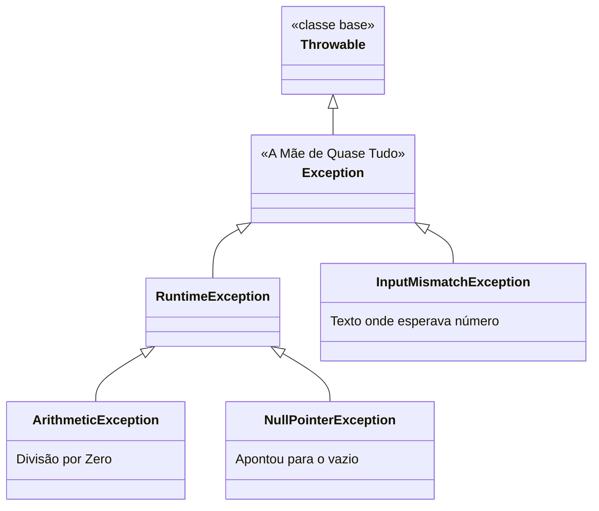
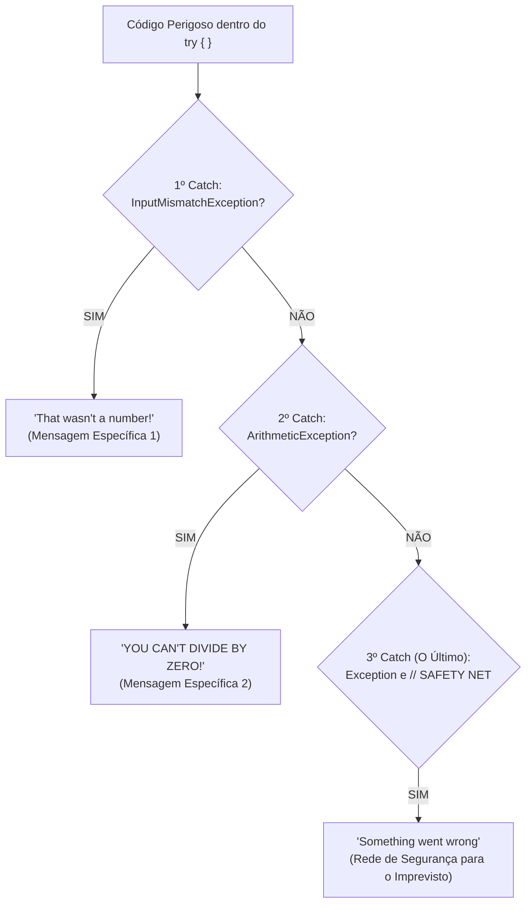

# ⚠️ Java — Capítulo 57: `Exception Handling` (Parte 3)
## O `catch(Exception e)` Genérico, o Meme da Microsoft e a Arquitetura da Rede de Segurança (`// SAFETY NET`)

---

### 📌 Metadados da Aula e Contexto do Vídeo
- **Curso:** *Java Full Course for free* (Canal: Bro Code)
- **Capítulo Oficial:** `57. exception handling ⚠️`
- **Intervalo de Tempo no Vídeo:** `09:10:28` até `09:10:57` (do total de 12:00:00)
- **Arquivo de Trabalho:** [`Main.java`](../../../src/main/java/com/mickaelgeronimo/mastery/core/concurrency/Main.java)
- **Ambiente de Desenvolvimento:** IntelliJ IDEA Community Edition (JDK 23 / OpenJDK 23)

---

## 🖼️ Reconstituição Visual Completa da Interface (Para quem vai colar no Google Docs)

Como você copiará este material diretamente para o seu **Google Docs** e não terá acesso direto às imagens no documento, veja a reconstituição detalhada de cada etapa visual exibida na tela do professor ao longo das 5 capturas:

```
+---------------------------------------------------------------------------------------------------------+
| [MyFirstProject] - Main.java                                                             Current File   |
+---------------------------------------------------------------------------------------------------------+
|  1 | import java.util.InputMismatchException;                                                           |
|  2 | import java.util.Scanner;                                                                          |
|  3 |                                                                                                    |
|  4 | public class Main {                                                                                |
|  5 |     public static void main(String[] args) {                                                       |
|  6 |                                                                                                    |
|  7 |         Scanner scanner = new Scanner(System.in);                                                  |
|  8 |                                                                                                    |
|  9 |         try {                                                                                      |
| 10 |             System.out.print("Enter a number: ");                                                  |
| 11 |             int number = scanner.nextInt();                                                        |
| 12 |             System.out.println(number);                                                            |
| 13 |         }                                                                                          |
| 14 |         catch(InputMismatchException e){                                                           |
| 15 |             System.out.println("That wasn't a number!");                                           |
| 16 |         }                                                                                          |
| 17 |         catch(ArithmeticException e){                                                              |
| 18 |             System.out.println("YOU CAN'T DIVIDE BY ZERO!");                                       |
| 19 |         }                                                                                          |
| 20 |         catch(Exception e){                  <-- [O catch genérico no final]                       |
| 21 |             // SAFETY NET                    <-- [Comentário do professor: REDE DE SEGURANÇA!]     |
| 22 |             System.out.println("Something went wrong");                                            |
| 23 |         }                                                                                          |
| 24 |                                                                                                    |
| 25 |         scanner.close();                                                                           |
| 26 |     }                                                                                              |
| 27 | }                                                                                                  |
+---------------------------------------------------------------------------------------------------------+
| RUN CONSOLE (Teste do Catch Genérico Isolado com 'hotdog'):                                             |
| Enter a number: hotdog                                                                                  |
| Something went wrong                                                                                    |
|                                                                                                         |
| Process finished with exit code 0                                                                       |
+---------------------------------------------------------------------------------------------------------+
```

---

### Detalhamento das 5 Imagens Passo a Passo

#### 📸 Imagem 1: Destacando os Catches Específicos (`media_1791496696683_1e479101.png`)
- **O que está na tela:** O professor adicionou um terceiro bloco `catch` na linha 25:
  ```java
  catch(Exception e){
      System.out.println("Something went wrong");
  }
  ```
- **Ação:** O professor seleciona com o mouse (fundo azul) as linhas 19 a 24 (os blocos `InputMismatchException` e `ArithmeticException`). Ele quer demonstrar o que acontece se apagarmos todos os catches específicos e deixarmos **apenas** o `catch(Exception e)`.
- **Timestamp do vídeo:** `9:10:28 / 12:00:00`.

#### 📸 Imagem 2: O Código com Apenas o `catch(Exception e)` (`media_1791496706885_74db1d1c.png`)
- **O que aconteceu:** O professor deletou os dois blocos específicos. O código agora tem apenas o bloco genérico:
  ```java
  try {
      System.out.print("Enter a number: ");
      int number = scanner.nextInt();
      System.out.println(number);
  }
  catch(Exception e){
      System.out.println("Something went wrong");
  }
  ```
- **Ação:** O mouse está no canto superior direito sobre o botão verde Play (Run) para rodar o teste.
- **Timestamp do vídeo:** `9:10:30 / 12:00:00`.

#### 📸 Imagem 3: Testando com "hotdog" (`media_1791496719739_bbde3e31.png`)
- **A execução no console:**
  - O programa pergunta: `Enter a number: `
  - O professor digita: **`hotdog`**
  - O console responde em verde: `Something went wrong`
  - E finaliza com: `Process finished with exit code 0`.
- **O que isso prova:** O bloco `catch(Exception e)` pegou o erro de digitação com sucesso, mesmo sem citar `InputMismatchException`!
- **Timestamp do vídeo:** `9:10:36 / 12:00:00`.

#### 📸 Imagem 4: O Meme da Janela da Microsoft (`media_1791496736953_c6a189fd.png`)
- **A piada didática do Bro Code:** O professor coloca no meio da tela a imagem clássica do pop-up do Windows circulada em vermelho:
  > **Microsoft: "Something went wrong"**
  > *We couldn't start your program. Please try starting it again... Error Code 0x426-0x0*
- **A crítica do professor:** Dizer apenas *"Something went wrong"* (Algo deu errado) é uma péssima experiência de usuário. Se o usuário digitou uma letra no lugar de número, nós devemos avisar que foi uma letra! Se dividiu por zero, devemos avisar da divisão por zero! Não devemos ser vagos como os pop-ups misteriosos da Microsoft!
- **Timestamp do vídeo:** `9:10:45 / 12:00:00`.

#### 📸 Imagem 5: A Arquitetura Profissional da "Rede de Segurança" (`media_1791496757997_738ba4b3.png`)
- **A solução definitiva montada no editor:**
  - O professor restaura os blocos específicos no topo (`InputMismatchException` e `ArithmeticException`).
  - Mantém o `catch(Exception e)` **por último**, adicionando o comentário:
    ```java
    catch(Exception e){
        // SAFETY NET
        System.out.println("Something went wrong");
    }
    ```
- **Conclusão:** Tratamos primeiro os erros conhecidos com mensagens claras, e deixamos o `catch(Exception e)` no final como uma **Rede de Segurança** (*Safety Net*) para caso aconteça algum imprevisto bizarro que não previmos!

---

## 💻 Código-Fonte Completo e Rigorosamente Numerado ([`Main.java`](../../../src/main/java/com/mickaelgeronimo/mastery/core/concurrency/Main.java))

```java
 1: import java.util.InputMismatchException;
 2: import java.util.Scanner;
 3: 
 4: public class Main {
 5:     public static void main(String[] args) {
 6: 
 7:         // Exception = An event that interrupts the normal flow of a program
 8:         //             (Dividing by zero, file not found, mismatch input type)
 9:         //             Surround any dangerous code with a try{} block
10:         //             try{}, catch{}, finally{}
11: 
12:         Scanner scanner = new Scanner(System.in);
13: 
14:         try {
15:             System.out.print("Enter a number: ");
16:             int number = scanner.nextInt();
17:             System.out.println(number);
18:         }
19:         catch(InputMismatchException e){
20:             System.out.println("That wasn't a number!");
21:         }
22:         catch(ArithmeticException e){
23:             System.out.println("YOU CAN'T DIVIDE BY ZERO!");
24:         }
25:         catch(Exception e){
26:             // SAFETY NET
27:             System.out.println("Something went wrong");
28:         }
29: 
30:         scanner.close();
31:     }
32: }
```

---

## 🔬 Tabela Anatômica Linha por Linha: Para Iniciantes Absolutos

| Linha | Código Exato | O que significa na "Linguagem de Leigo" (Explicação Mastigada) | O que sai no Console? (Digitando "hotdog") |
| :---: | :--- | :--- | :---: |
| **1** | `import java.util.InputMismatchException;` | Importa a classe específica para erro de texto onde esperava número. | *(Nada)* |
| **2** | `import java.util.Scanner;` | Importa a classe para leitura do teclado. | *(Nada)* |
| **3** | *(Linha em branco)* | Organização visual. | *(Nada)* |
| **4** | `public class Main {` | Declaração da classe principal. | *(Nada)* |
| **5** | `public static void main(String[] args) {` | Método principal onde o Java começa a rodar. | *(Nada)* |
| **6** | *(Linha em branco)* | Organização visual. | *(Nada)* |
| **7** | `// Exception = An event...` | Comentário teórico: definição de exceções. | *(Nada)* |
| **8** | `// (Dividing by zero...)` | Comentário teórico: exemplos comuns de erros. | *(Nada)* |
| **9** | `// Surround any dangerous...` | Comentário teórico: cerque código de risco com `try{}`. | *(Nada)* |
| **10** | `// try{}, catch{}, finally{}` | Comentário teórico: os blocos de tratamento. | *(Nada)* |
| **11** | *(Linha em branco)* | Organização visual. | *(Nada)* |
| **12** | `Scanner scanner = new Scanner(System.in);` | Abre a conexão com o teclado físico. | *(Nada)* |
| **13** | *(Linha em branco)* | Organização visual. | *(Nada)* |
| **14** | `try {` | Abre a gaiola de proteção para o código arriscado. | *(Nada)* |
| **15** | `    System.out.print("Enter a number: ");` | Pergunta ao usuário mantendo o cursor na mesma linha. | `Enter a number: ` |
| **16** | `    int number = scanner.nextInt();` | Tenta ler um número. O usuário digita `"hotdog"`. O Java aborta e joga no ar uma `InputMismatchException`! | *(Usuário digita: hotdog)* |
| **17** | `    System.out.println(number);` | Seria a impressão do número. Linha ignorada/pulada pelo erro. | *(Ignorada)* |
| **18** | `}` | Fecha o bloco `try`. | *(Nada)* |
| **19** | `catch(InputMismatchException e){` | **O 1º Socorrista Especialista:** Identifica que o erro é exatamente dele (`InputMismatchException`) e assume o controle! | *(Nada visível)* |
| **20** | `    System.out.println("That wasn't a number!");` | **A Mensagem Específica:** Explica com clareza cristalina para o usuário o que ele fez de errado. | `That wasn't a number!` *(no código final)* |
| **21** | `}` | Fecha o 1º catch. | *(Nada)* |
| **22** | `catch(ArithmeticException e){` | **O 2º Socorrista Especialista:** Só atua em divisão por zero. Como o 1º já tratou o erro, este fica em silêncio. | *(Ignorado)* |
| **23** | `    System.out.println("YOU CAN'T DIVIDE BY ZERO!");` | Mensagem para divisão por zero. | *(Ignorada)* |
| **24** | `}` | Fecha o 2º catch. | *(Nada)* |
| **25** | `catch(Exception e){` | **A "Mãe de Todas as Exceções" (Generalista):** Se o erro não foi nem texto errado nem divisão por zero (um erro desconhecido), este bloco captura! | *(Ignorado no código final)* |
| **26** | `    // SAFETY NET` | Comentário do professor: indica que este bloco funciona como uma "Rede de Segurança" de circo. | *(Nada)* |
| **27** | `    System.out.println("Something went wrong");` | Mensagem genérica para erros imprevistos. *(Nas Imagens 2 e 3, quando os catches específicos foram apagados, foi esta linha que rodou)*. | `Something went wrong` *(apenas no teste da Imagem 3)* |
| **28** | `}` | Fecha o 3º catch. | *(Nada)* |
| **29** | *(Linha em branco)* | Organização visual. | *(Nada)* |
| **30** | `scanner.close();` | Desliga o scanner com segurança e libera memória. | *(Nada)* |
| **31** | `}` | Fecha o método `main`. | *(Nada)* |
| **32** | `}` | Fecha a classe `Main`. | *(Nada)* |

---

## 🧠 Teoria Explicada Passo a Passo (Como se você fosse um amador completo)

### 1. Quem é a Classe `Exception`? (A "Mãe de Todas as Exceções")

No Java, todas as exceções fazem parte de uma grande família com árvore genealógica baseada em **Herança**:



Como `Exception` é a **superclasse (classe-mãe)** de todas elas, graças ao **Polimorfismo**, uma variável do tipo `Exception e` tem a capacidade de segurar **QUALQUER** tipo de exceção que herde dela!
- Se acontecer `ArithmeticException`, o `Exception` pega.
- Se acontecer `InputMismatchException`, o `Exception` pega.
- Se acabar a memória do computador, o `Exception` pega.
- Se o arquivo sumir do pendrive, o `Exception` pega.

---

### 2. A Crítica ao Meme da Microsoft: Por que NÃO Devemos Usar Apenas `catch(Exception e)`?

Se `catch(Exception e)` pega tudo, você pode pensar:
> *"Poxa, então por que eu vou perder meu tempo escrevendo vários blocos `catch` se eu posso escrever só um `catch(Exception e)` e resolver minha vida?"*

É aqui que entra a genialidade da piada do Bro Code na **Imagem 4**:

Imagine que o motor do seu carro faz um barulho estranho e para de funcionar. Você leva na oficina e o mecânico diz:
> *"Algo deu errado."*

Você pergunta: *"Mas o que deu errado? Acabou a gasolina? Furou o pneu? O motor fundiu? A bateria morreu?"*
E o mecânico repete: *"Algo deu errado. Tente ligar o carro de novo."*

Isso é exatamente o que a Microsoft faz com aquele pop-up maldito: **`Something went wrong`**. Não ajuda em nada! Não diz o que aconteceu nem como consertar!

No seu software:
- Se o usuário digitou uma palavra onde era pra ser número, diga: **`"That wasn't a number!"`** (Isso não era um número!). O usuário vai entender: *"Ah, digitei besteira, vou digitar um número agora"*.
- Se houve divisão por zero, diga: **`"YOU CAN'T DIVIDE BY ZERO!"`**.
- Seja específico e respeite quem está usando seu programa!

---

### 3. A Solução Perfeita: O Padrão da Rede de Segurança (`// SAFETY NET`)

A forma profissional de estruturar o tratamento de erros em Java é combinar o melhor dos dois mundos:



1. **Coloque primeiro os especialistas:** capture especificamente os erros que você sabe que podem acontecer com base na lógica do seu código.
2. **Deixe o generalista por último:** coloque `catch(Exception e)` no final da fila como uma rede de segurança de circo. Se o trapezista cair e nenhum dos especialistas segurar, a rede no chão evita que o programa morra na frente do usuário!

---

### 4. A Regra de Ouro Inviolável do Compilador Java: A Ordem dos `catch` Importa!

> [!CAUTION]
> **A ordem dos blocos `catch` NUNCA pode ser invertida!**

Veja o que aconteceria se você colocasse o `catch(Exception e)` no começo:

```java
// ❌ ISTO NÃO COMPILA! DÁ ERRO NO JAVA!
catch(Exception e){
    System.out.println("Something went wrong");
}
catch(InputMismatchException e){ // ❌ ERRO: Unreachable code!
    System.out.println("That wasn't a number!");
}
```

**Por que dá erro?**
Como `Exception` é a classe-mãe que engole absolutamente tudo, qualquer erro que acontecer seria interceptado logo no primeiro `catch`. 
O bloco de baixo (`InputMismatchException`) **nunca seria alcançado na história do universo**! O Java detecta isso e impede você de compilar o código (*Unreachable catch block*).

**Regra obrigatória:**
> **Do mais ESPECÍFICO (os filhos) para o mais GENÉRICO (a mãe no final)!**

---

## 🖥️ Saídas no Console Demonstradas pelo Professor

### Cenário 1: Teste com Apenas `catch(Exception e)` (Imagens 2 e 3)
```text
Enter a number: hotdog
Something went wrong

Process finished with exit code 0
```

### Cenário 2: Teste com a Estrutura Completa Final (Imagem 5)
Se o usuário digitar `"hotdog"`, o 1º bloco especialista intercepta:
```text
Enter a number: hotdog
That wasn't a number!

Process finished with exit code 0
```

Se acontecer um erro não previsto: o 3º bloco (`// SAFETY NET`) intercepta:
```text
Something went wrong
Process finished with exit code 0
```

---

## 🎯 Resumo Mental Definitivo para Fixação

1. **`catch(Exception e)`**: O coringa do Java. Captura qualquer erro, pois `Exception` é a classe-mãe de quase todas as exceções.
2. **Evite mensagens genéricas no lugar de específicas**: Dizer apenas *"Something went wrong"* é ruim para o usuário e para quem dá suporte.
3. **Padrão Safety Net**: Trate primeiro os erros específicos com mensagens personalizadas (`InputMismatchException`, `ArithmeticException`), e mantenha `catch(Exception e)` no final como rede de segurança contra panes desconhecidas.
4. **Ordem obrigatória**: Sempre do mais específico para o mais genérico. A classe-mãe `Exception` **sempre fica por último**.
