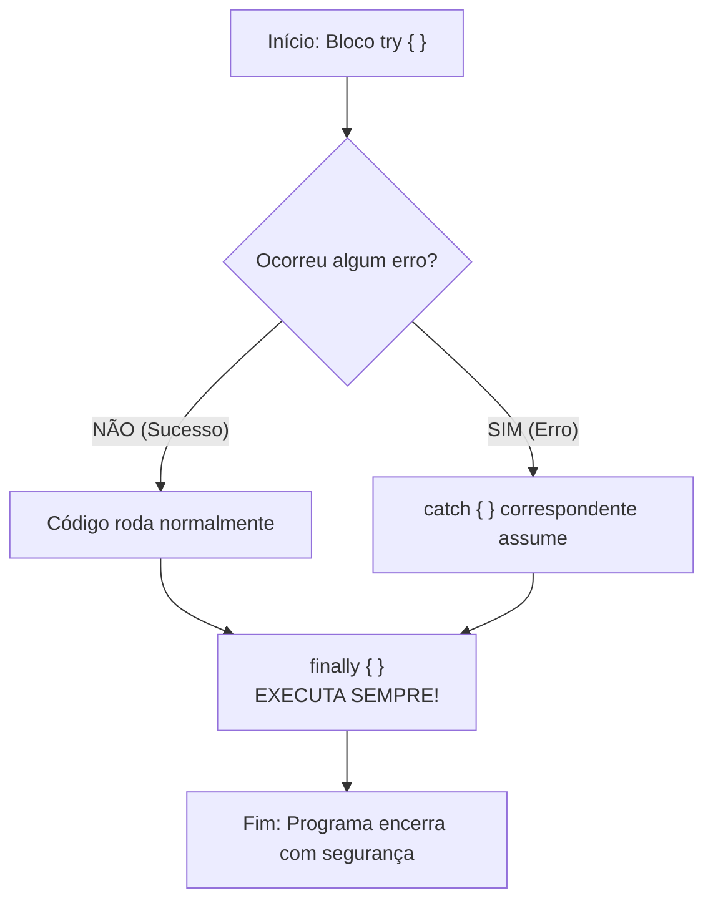
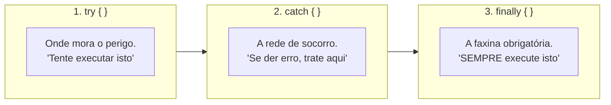

# ⚠️ Java — Capítulo 57: `Exception Handling` (Parte 4)
## O Bloco `finally`, a Limpeza de Recursos com `scanner.close()` e a Garantia do "This always executes"

---

### 📌 Metadados da Aula e Contexto do Vídeo
- **Curso:** *Java Full Course for free* (Canal: Bro Code)
- **Capítulo Oficial:** `57. exception handling ⚠️`
- **Intervalo de Tempo no Vídeo:** `09:11:54` até `09:12:06` (do total de 12:00:00)
- **Arquivo de Trabalho:** [`Main.java`](../../../src/main/java/com/mickaelgeronimo/mastery/core/concurrency/Main.java)
- **Ambiente de Desenvolvimento:** IntelliJ IDEA Community Edition (JDK 23 / OpenJDK 23)

---

## 🖼️ Reconstituição Visual Completa da Interface (Para quem vai colar no Google Docs)

Como você copiará este material diretamente para o seu **Google Docs** e não terá acesso direto às imagens no documento, veja a reconstituição detalhada de cada etapa visual exibida na tela do professor ao longo das 3 capturas:

```
+---------------------------------------------------------------------------------------------------------+
| [MyFirstProject] - Main.java                                                             Current File   |
+---------------------------------------------------------------------------------------------------------+
| 20 |             System.out.println("That wasn't a number!");                                           |
| 21 |         }                                                                                          |
| 22 |         catch(ArithmeticException e){                                                              |
| 23 |             System.out.println("YOU CAN'T DIVIDE BY ZERO!");                                       |
| 24 |         }                                                                                          |
| 25 |         catch(Exception e){                                                                        |
| 26 |             // SAFETY NET                                                                          |
| 27 |             System.out.println("Something went wrong");                                            |
| 28 |         }                                                                                          |
| 29 |         finally{                             <-- [A última peça da trindade: TRY, CATCH, FINALLY]  |
| 30 |             scanner.close();                 <-- [Fechamento seguro de recursos movido para cá]    |
| 31 |             System.out.println("This always executes");                                            |
| 32 |         }                                                                                          |
| 33 |     }                                                                                              |
| 34 | }                                                                                                  |
+---------------------------------------------------------------------------------------------------------+
| CENÁRIO 1: TESTE COM SUCESSO (Imagem 2)           | CENÁRIO 2: TESTE COM ERRO (Imagem 3)                |
| Enter a number: 123                               | Enter a number: Taco                                |
| 123                                               | That wasn't a number!                               |
| This always executes                              | This always executes                                |
|                                                   |                                                     |
| Process finished with exit code 0                 | Process finished with exit code 0                   |
+---------------------------------------------------+-----------------------------------------------------+
```

---

### Detalhamento das 3 Imagens Passo a Passo

#### 📸 Imagem 1: A Adição do Bloco `finally` (`media_1791496809386_e67241ba.png`)
- **O que foi escrito:** Logo abaixo do último bloco `catch(Exception e)`, nas linhas 29 a 32, o professor introduz a palavra-chave **`finally`**:
  ```java
  finally{
      scanner.close();
      System.out.println("This always executes");
  }
  ```
- **A mudança cirúrgica de arquitetura:** A linha `scanner.close();`, que antes ficava solta no final do método `main`, agora foi **movida para dentro do `finally`**.
- **Posição do cursor:** O cursor está na linha 31, logo após a palavra `"This always executes"`.

#### 📸 Imagem 2: Teste 1 — O Caso Perfeito (Sem Exceção) (`media_1791496822581_d0f0343e.png`)
- **O que o professor digitou:** O programa perguntou `Enter a number: ` e ele digitou o número **`123`**.
- **O que aconteceu:**
  1. O bloco `try` executou normalmente e imprimiu o número: `123`.
  2. Todos os blocos `catch` foram ignorados (já que não houve nenhum erro).
  3. O bloco `finally` executou e imprimiu: **`This always executes`**.
  4. O scanner foi fechado e o programa finalizou com `Process finished with exit code 0`.
- **Timestamp do vídeo:** `9:11:54 / 12:00:00`.

#### 📸 Imagem 3: Teste 2 — O Caso com Erro (Com Exceção) (`media_1791496838734_0d843b9b.png`)
- **O que o professor digitou:** O programa perguntou `Enter a number: ` e ele digitou a palavra **`Taco`**.
- **O que aconteceu:**
  1. A leitura no `try` falhou e disparou `InputMismatchException`.
  2. O primeiro bloco `catch` capturou o erro e imprimiu: `That wasn't a number!`.
  3. O bloco `finally` executou e imprimiu: **`This always executes`**.
  4. O scanner foi fechado com segurança e o programa finalizou com `Process finished with exit code 0`.
- **A revelação visual:** Em **AMBOS** os casos (com ou sem erro), a frase `"This always executes"` apareceu no console!
- **Timestamp do vídeo:** `9:12:06 / 12:00:00`.

---

## 💻 Código-Fonte Completo e Rigorosamente Numerado ([`Main.java`](../../../src/main/java/com/mickaelgeronimo/mastery/core/concurrency/Main.java))

```java
 1: import java.util.InputMismatchException;
 2: import java.util.Scanner;
 3: 
 4: public class Main {
 5:     public static void main(String[] args) {
 6: 
 7:         // Exception = An event that interrupts the normal flow of a program
 8:         //             (Dividing by zero, file not found, mismatch input type)
 9:         //             Surround any dangerous code with a try{} block
10:         //             try{}, catch{}, finally{}
11: 
12:         Scanner scanner = new Scanner(System.in);
13: 
14:         try {
15:             System.out.print("Enter a number: ");
16:             int number = scanner.nextInt();
17:             System.out.println(number);
18:         }
19:         catch(InputMismatchException e){
20:             System.out.println("That wasn't a number!");
21:         }
22:         catch(ArithmeticException e){
23:             System.out.println("YOU CAN'T DIVIDE BY ZERO!");
24:         }
25:         catch(Exception e){
26:             // SAFETY NET
27:             System.out.println("Something went wrong");
28:         }
29:         finally{
30:             scanner.close();
31:             System.out.println("This always executes");
32:         }
33:     }
34: }
```

---

## 🔬 Tabela Anatômica Linha por Linha: Para Iniciantes Absolutos

| Linha | Código Exato | O que significa na "Linguagem de Leigo" (Explicação Mastigada) | Saída: Entrada `123` | Saída: Entrada `Taco` |
| :---: | :--- | :--- | :---: | :---: |
| **1** | `import java.util.InputMismatchException;` | Importa a ferramenta de identificação de erro de texto indevido. | *(Nada)* | *(Nada)* |
| **2** | `import java.util.Scanner;` | Importa o receptor de teclado. | *(Nada)* | *(Nada)* |
| **3** | *(Linha em branco)* | Organização visual. | *(Nada)* | *(Nada)* |
| **4** | `public class Main {` | Declaração da classe `Main`. | *(Nada)* | *(Nada)* |
| **5** | `public static void main(String[] args) {` | O início do programa Java. | *(Nada)* | *(Nada)* |
| **6** | *(Linha em branco)* | Organização visual. | *(Nada)* | *(Nada)* |
| **7-10** | `// Comentários teóricos...` | Explicam o conceito de exceções e a trindade `try`, `catch`, `finally`. | *(Nada)* | *(Nada)* |
| **11** | *(Linha em branco)* | Organização visual. | *(Nada)* | *(Nada)* |
| **12** | `Scanner scanner = new Scanner(System.in);` | Abre o canal de comunicação com o teclado físico. | *(Nada)* | *(Nada)* |
| **13** | *(Linha em branco)* | Organização visual. | *(Nada)* | *(Nada)* |
| **14** | `try {` | **Abre a área de risco:** O Java tenta rodar as linhas 15 a 17 com rede de segurança armada. | *(Nada)* | *(Nada)* |
| **15** | `    System.out.print("Enter a number: ");` | Pergunta ao usuário mantendo o cursor colado. | `Enter a number: ` | `Enter a number: ` |
| **16** | `    int number = scanner.nextInt();` | Lê o que foi digitado: se for `123`, guarda com sucesso; se for `"Taco"`, joga a bomba `InputMismatchException` e pula para o catch! | *(Usuário digita: 123)* | *(Usuário digita: Taco)* |
| **17** | `    System.out.println(number);` | Imprime o número lido. Se houve erro, é sumariamente ignorada. | `123` | *(Ignorada)* |
| **18** | `}` | Fecha o bloco `try`. | *(Nada)* | *(Nada)* |
| **19** | `catch(InputMismatchException e){` | Socorrista para texto digitado em lugar de número. | *(Ignorado)* | *(Ativado)* |
| **20** | `    System.out.println("That wasn't a number!");` | Mensagem avisando do erro de digitação. | *(Ignorada)* | `That wasn't a number!` |
| **21** | `}` | Fecha o 1º catch. | *(Nada)* | *(Nada)* |
| **22** | `catch(ArithmeticException e){` | Socorrista para divisão por zero. | *(Ignorado)* | *(Ignorado)* |
| **23** | `    System.out.println("YOU CAN'T DIVIDE BY ZERO!");` | Mensagem para divisão por zero. | *(Ignorada)* | *(Ignorada)* |
| **24** | `}` | Fecha o 2º catch. | *(Nada)* | *(Nada)* |
| **25** | `catch(Exception e){` | Rede de segurança final para imprevistos. | *(Ignorado)* | *(Ignorado)* |
| **26** | `    // SAFETY NET` | Comentário indicando a rede de segurança. | *(Nada)* | *(Nada)* |
| **27** | `    System.out.println("Something went wrong");` | Mensagem genérica para erros desconhecidos. | *(Ignorada)* | *(Ignorada)* |
| **28** | `}` | Fecha o 3º catch. | *(Nada)* | *(Nada)* |
| **29** | `finally{` | **O BLOCO INCONDICIONAL:** Diz ao Java: *"Não me interessa se o código acima deu certo ou se pegou fogo no catch. VOCÊ É OBRIGADO a executar o bloco abaixo antes de fechar o programa!"* | *(Nada)* | *(Nada)* |
| **30** | `    scanner.close();` | **Faxina Obrigatória:** Desliga o leitor do teclado garantindo que a memória seja liberada, com ou sem erro! | *(Nada visível)* | *(Nada visível)* |
| **31** | `    System.out.println("This always executes");` | Imprime a frase comprovando visualmente que o `finally` sempre roda! | `This always executes` | `This always executes` |
| **32** | `}` | Fecha o bloco `finally`. | *(Nada)* | *(Nada)* |
| **33** | `}` | Fecha o método `main`. | *(Nada)* | *(Nada)* |
| **34** | `}` | Fecha a classe `Main`. | *(Nada)* | *(Nada)* |

---

## 🧠 Teoria Explicada Passo a Passo (Como se você fosse um amador completo)

### 1. O Que É o Bloco `finally`? (A "Mãe Inegociável")

Pense no bloco `finally` como a sua mãe quando você era criança:
- Se fez sol e você brincou no quintal $\rightarrow$ *"Vá tomar banho antes de jantar!"*
- Se choveu e você ficou jogando videogame $\rightarrow$ *"Vá tomar banho antes de jantar!"*
- Se você tirou 10 na prova $\rightarrow$ *"Vá tomar banho antes de jantar!"*
- Se você quebrou o vaso da sala e levou bronca $\rightarrow$ *"Vá tomar banho antes de jantar!"*

Não importa o que aconteceu antes: **o banho é inegociável**!

No Java:
- Se o bloco `try` correu 100% liso sem nenhum erro $\rightarrow$ **O `finally` executa!**
- Se o bloco `try` explodiu com erro e caiu no `catch` $\rightarrow$ **O `finally` executa!**
- Se o seu código tiver um comando `return` no meio $\rightarrow$ **O `finally` AINDA ASSIM executa antes de retornar!**



---

### 2. Por Que o `scanner.close()` DEVE Ficar Dentro do `finally`?

Nas aulas anteriores (Parte 1 e Parte 2), nós tínhamos colocado o `scanner.close()` solto lá embaixo, depois dos blocos de `try` e `catch`.

**Qual é o perigo mortal disso na vida real de um programador?**
Imagine que o seu código acessa um arquivo sigiloso no disco rígido ou abre uma conexão com o banco de dados da empresa:
1. Se ocorrer uma exceção que o seu `catch` **não pegou** (como aconteceu na Parte 1 quando digitamos `"Pizza"`), o programa morre no meio do caminho!
2. Se o programa morrer no meio do caminho, ele **NUNCA** vai chegar na linha `scanner.close()` que estava solta lá embaixo!
3. O canal do teclado, o arquivo no disco ou a porta do banco de dados ficam **trancados na memória do sistema operacional** (*Resource Leak / Memory Leak*). Se outros programas tentarem abrir aquele arquivo, o Windows dirá: *"Este arquivo está sendo usado por outro processo"*.

#### A Regra de Ouro da Faxina:
> **Toda operação de limpeza (fechar arquivos, encerrar conexões com banco de dados, desligar scanners) DEVE morar dentro do bloco `finally{}`!**
> Porque o Java garante que, mesmo que o seu programa caia aos pedaços por um erro terrível, a porta do armário será trancada antes de apagar as luzes!

---

### 3. A Comparação Lado a Lado: Imagem 2 vs Imagem 3

Observe o caminho percorrido pelo processador em cada um dos testes feitos pelo professor:

| Etapa | Teste 1 (Digitando `123`) | Teste 2 (Digitando `"Taco"`) |
| :--- | :--- | :--- |
| **Linha 15 (`System.out.print`)** | Executa: `Enter a number: ` | Executa: `Enter a number: ` |
| **Linha 16 (`scanner.nextInt()`)** | Lê o número `123` com sucesso | **Falha!** Dispara `InputMismatchException` |
| **Linha 17 (`System.out.println`)** | Executa: Imprime `123` | **Pulada!** Não chega a executar |
| **Linhas 19-28 (Blocos `catch`)** | **Pulados!** Não houve erro nenhum | **1º catch ativado!** Imprime: `"That wasn't a number!"` |
| **Linhas 29-32 (Bloco `finally`)** | **EXECUTA!** Fecha scanner e imprime `"This always executes"` | **EXECUTA!** Fecha scanner e imprime `"This always executes"` |
| **Status Final** | `exit code 0` (Sucesso) | `exit code 0` (Sucesso) |

---

## 🖥️ Saídas Reais e Oficiais do Console

### 1. Teste da Imagem 2 (Entrada Válida: `123`)
```text
Enter a number: 123
123
This always executes

Process finished with exit code 0
```

### 2. Teste da Imagem 3 (Entrada Inválida: `Taco`)
```text
Enter a number: Taco
That wasn't a number!
This always executes

Process finished with exit code 0
```

---

## 🎯 Resumo Mental Definitivo da Trindade do Tratamento de Exceções



1. **`try`**: Use para rodar códigos que dependem de fatores externos ou entradas imprevisíveis de usuários.
2. **`catch`**: Use para interceptar falhas específicas e orientar o usuário com mensagens compreensíveis.
3. **`finally`**: Use para garantir que recursos preciosos (como streams, scanners e conexões de rede) sejam fechados com 100% de certeza, haja o que houver.
