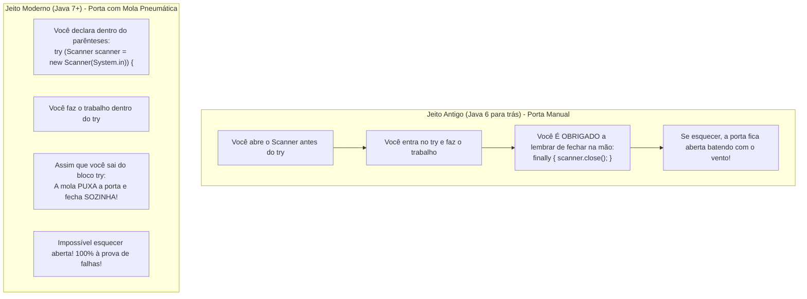

# ⚠️ Java — Capítulo 57: `Exception Handling` (Parte 5 - Conclusão)
## `try-with-resources`: O Gerenciamento Automático de Recursos e o Fim do `.close()` Manual

---

### 📌 Metadados da Aula e Contexto do Vídeo
- **Curso:** *Java Full Course for free* (Canal: Bro Code)
- **Capítulo Oficial:** `57. exception handling ⚠️` *(Conclusão Oficial do Capítulo 57!)*
- **Intervalo de Tempo no Vídeo:** `09:12:06` até `09:12:52` / 12:00:00
- **Arquivo de Trabalho:** [`Main.java`](../../../src/main/java/com/mickaelgeronimo/mastery/core/concurrency/Main.java)
- **Ambiente de Desenvolvimento:** IntelliJ IDEA Community Edition (JDK 23 / OpenJDK 23)

---

## 🖼️ Reconstituição Visual Completa da Interface (Para quem vai colar no Google Docs)

Como você copiará este material diretamente para o seu **Google Docs** e não terá acesso direto às imagens no documento, veja a reconstituição detalhada de cada etapa visual exibida na tela do professor ao longo das 4 capturas:

```
+---------------------------------------------------------------------------------------------------------+
| [MyFirstProject] - Main.java                                                             Current File   |
+---------------------------------------------------------------------------------------------------------+
| 11 |                                                                                                    |
| 12 |         try (Scanner scanner = new Scanner(System.in)) {  <-- [try-with-resources: FECHA SOZINHO!] |
| 13 |             System.out.print("Enter a number: ");                                                  |
| 14 |             int number = scanner.nextInt();                                                        |
| 15 |             System.out.println(number);                                                            |
| 16 |         } catch (InputMismatchException e) {                                                       |
| 17 |             System.out.println("That wasn't a number!");                                           |
| 18 |         } catch (ArithmeticException e) {                                                          |
| 19 |             System.out.println("YOU CAN'T DIVIDE BY ZERO!");                                       |
| 20 |         } catch (Exception e) {                                                                    |
| 21 |             // SAFETY NET                                                                          |
| 22 |             System.out.println("Something went wrong");                                            |
| 23 |         } finally {                                                                                |
| 24 |             System.out.println("This always executes");                                            |
| 25 |         }                                                                                          |
| 26 |     }                                                                                              |
| 27 | }                                                                                                  |
+---------------------------------------------------------------------------------------------------------+
| TESTE COM 123 (Imagem 3)                          | TESTE COM PIZZA (Imagem 4)                          |
| Enter a number: 123                               | Enter a number: Pizza                               |
| 123                                               | That wasn't a number!                               |
| This always executes                              | This always executes                                |
|                                                   |                                                     |
| Process finished with exit code 0                 | Process finished with exit code 0                   |
+---------------------------------------------------+-----------------------------------------------------+
```

---

### Detalhamento das 4 Imagens Passo a Passo

#### 📸 Imagem 1: O Alerta Inteligente do IntelliJ IDEA (`media_1791496884555_9287fc1c.png`)
- **O que está na tela:** Uma aproximação no editor de código sobre a palavra `try`.
- **Aviso:** A palavra `try` possui um sublinhado ondulado amarelo/alaranjado.
- **O Tooltip Flutuante:** Ao passar o mouse por cima de `try`, o IntelliJ exibe uma sugestão de modernização:
  > **`'try' can use automatic resource management`** (Tradução: *O 'try' pode usar gerenciamento automático de recursos*)
  > `Replace with 'try' with resources  Alt+Shift+Enter`
  > `More actions... Alt+Enter`
- **Ação:** O cursor do mouse em formato de mãozinha branca clica diretamente em **`Replace with 'try' with resources`**.

#### 📸 Imagem 2: A Refatoração Automática — O Java Moderno (`media_1791496894145_168aa146.png`)
- **A transformação visual no código:**
  - A declaração `Scanner scanner = new Scanner(System.in);`, que antes ficava solta fora do `try`, foi **movida para dentro de parênteses logo após a palavra `try`**:
    ```java
    try (Scanner scanner = new Scanner(System.in)) {
    ```
  - A linha `scanner.close();`, que antes precisava ser escrita manualmente dentro do `finally`, **foi totalmente removida**!
  - O bloco `finally` agora contém apenas a frase:
    ```java
    finally {
        System.out.println("This always executes");
    }
    ```
- **Significado:** O compilador Java agora fecha o `scanner` automaticamente assim que o bloco `try` termina, sem você precisar escrever `scanner.close()`!
- **Posição do cursor:** O cursor pisca na linha 12 logo sobre a palavra `scanner`.

#### 📸 Imagem 3: Testando a Nova Sintaxe com Sucesso (`media_1791496922156_edf8e7a4.png`)
- **A execução no console:**
  - Pergunta: `Enter a number: `
  - O professor digita o número: `123`
  - O `try` imprime: `123`
  - O Java fecha o `scanner` automaticamente nos bastidores!
  - O `finally` imprime: `This always executes`
  - Finaliza com: `Process finished with exit code 0`.

#### 📸 Imagem 4: Testando a Nova Sintaxe com Erro de Entrada (`media_1791496932663_1eba820a.png`)
- **A execução no console:**
  - Pergunta: `Enter a number: `
  - O professor digita o texto inválido: `Pizza`
  - O `catch(InputMismatchException e)` captura e imprime: `That wasn't a number!`
  - O Java garante que o `scanner` foi fechado automaticamente mesmo com o erro!
  - O `finally` imprime: `This always executes`
  - Finaliza com: `Process finished with exit code 0`.
- **Timestamp do vídeo:** `9:12:52 / 12:00:00` (Conclusão Oficial do Capítulo 57!).

---

## 💻 Código-Fonte Completo e Rigorosamente Numerado ([`Main.java`](../../../src/main/java/com/mickaelgeronimo/mastery/core/concurrency/Main.java))

```java
 1: import java.util.InputMismatchException;
 2: import java.util.Scanner;
 3: 
 4: public class Main {
 5:     public static void main(String[] args) {
 6: 
 7:         // Exception = An event that interrupts the normal flow of a program
 8:         //             (Dividing by zero, file not found, mismatch input type)
 9:         //             Surround any dangerous code with a try{} block
10:         //             try{}, catch{}, finally{}
11: 
12:         try (Scanner scanner = new Scanner(System.in)) {
13:             System.out.print("Enter a number: ");
14:             int number = scanner.nextInt();
15:             System.out.println(number);
16:         } catch (InputMismatchException e) {
17:             System.out.println("That wasn't a number!");
18:         } catch (ArithmeticException e) {
19:             System.out.println("YOU CAN'T DIVIDE BY ZERO!");
20:         } catch (Exception e) {
21:             // SAFETY NET
22:             System.out.println("Something went wrong");
23:         } finally {
24:             System.out.println("This always executes");
25:         }
26:     }
27: }
```

---

## 🔬 Tabela Anatômica Linha por Linha: Para Iniciantes Absolutos

| Linha | Código Exato | O que significa na "Linguagem de Leigo" (Explicação Mastigada) | Saída: Entrada `123` | Saída: Entrada `Pizza` |
| :---: | :--- | :--- | :---: | :---: |
| **1** | `import java.util.InputMismatchException;` | Importa a classe do erro de incompatibilidade de dados do teclado. | *(Nada)* | *(Nada)* |
| **2** | `import java.util.Scanner;` | Importa o leitor do teclado. | *(Nada)* | *(Nada)* |
| **3** | *(Linha em branco)* | Organização visual. | *(Nada)* | *(Nada)* |
| **4** | `public class Main {` | Declaração da classe `Main`. | *(Nada)* | *(Nada)* |
| **5** | `public static void main(String[] args) {` | Método principal onde o programa começa. | *(Nada)* | *(Nada)* |
| **6** | *(Linha em branco)* | Organização visual. | *(Nada)* | *(Nada)* |
| **7-10** | `// Comentários teóricos...` | Conceito de exceções e a trindade `try`, `catch`, `finally`. | *(Nada)* | *(Nada)* |
| **11** | *(Linha em branco)* | Organização visual. | *(Nada)* | *(Nada)* |
| **12** | `try (Scanner scanner = new Scanner(System.in)) {` | **O `try-with-resources`:** Abre o scanner dentro dos parênteses do `try`. O Java assume o compromisso solene de que fechará o scanner sozinho assim que o bloco `{}` terminar, aconteça o que acontecer! | *(Nada)* | *(Nada)* |
| **13** | `    System.out.print("Enter a number: ");` | Pergunta ao usuário mantendo o cursor na mesma linha. | `Enter a number: ` | `Enter a number: ` |
| **14** | `    int number = scanner.nextInt();` | Lê o valor digitado. Se for `123`, guarda na variável. Se for `"Pizza"`, dispara `InputMismatchException` e salta para a linha 16! | *(Usuário digita 123)* | *(Usuário digita Pizza)* |
| **15** | `    System.out.println(number);` | Imprime o número. Se houve erro, esta linha é ignorada. | `123` | *(Ignorada)* |
| **16** | `} catch (InputMismatchException e) {` | **Fim do try e 1º Catch:** Ao bater na chave `}`, o Java fecha o scanner automaticamente! Se o erro for de texto, este catch assume. | *(Ignorado)* | *(Ativado)* |
| **17** | `    System.out.println("That wasn't a number!");` | Mensagem de erro amigável para texto indevido. | *(Ignorada)* | `That wasn't a number!` |
| **18** | `} catch (ArithmeticException e) {` | Catch para erros matemáticos (divisão por zero). | *(Ignorado)* | *(Ignorado)* |
| **19** | `    System.out.println("YOU CAN'T DIVIDE BY ZERO!");` | Mensagem para divisão por zero. | *(Ignorada)* | *(Ignorada)* |
| **20** | `} catch (Exception e) {` | Catch genérico para erros imprevistos. | *(Ignorado)* | *(Ignorado)* |
| **21** | `    // SAFETY NET` | Comentário indicando a rede de segurança. | *(Nada)* | *(Nada)* |
| **22** | `    System.out.println("Something went wrong");` | Mensagem de erro genérica. | *(Ignorada)* | *(Ignorada)* |
| **23** | `} finally {` | Bloco incondicional que roda **SEMPRE**, com ou sem erro. | *(Nada)* | *(Nada)* |
| **24** | `    System.out.println("This always executes");` | Mensagem provando que o `finally` sempre roda. *(Note que `scanner.close()` não está mais aqui porque o Java já fechou na linha 16)*. | `This always executes` | `This always executes` |
| **25** | `}` | Fecha o bloco `finally`. | *(Nada)* | *(Nada)* |
| **26** | `}` | Fecha o método `main`. | *(Nada)* | *(Nada)* |
| **27** | `}` | Fecha a classe `Main`. | *(Nada)* | *(Nada)* |

---

## 🧠 Teoria Explicada Passo a Passo (Como se você fosse um amador completo)

### 1. O Que É o `try-with-resources`? (A "Porta com Mola Automática")

Pense na diferença entre duas portas:



O recurso **`try-with-resources`** (Tradução: *Tente com Recursos*) foi adicionado ao Java na versão 7 exatamente para acabar com o pesadelo de programadores esquecendo de fechar conexões, arquivos e scanners!

---

### 2. A Mágica por Baixo dos Panos: A Interface `AutoCloseable`

Você pode colocar qualquer coisa dentro dos parênteses do `try (...)`?
**NÃO!**

O Java só aceita dentro de `try(...)` objetos que implementam a interface oficial:
```java
java.lang.AutoCloseable
```
Todas as classes que consomem recursos do sistema operacional — como `Scanner`, `FileReader`, `FileInputStream`, conexões de banco de dados (`Connection`, `Statement`) — implementam essa interface.

O que essa interface tem? Ela tem um método obrigatório:
```java
void close() throws Exception;
```
Quando você coloca `try (Scanner scanner = ...)`, o Java faz uma promessa sagrada:
> *"Não importa se o código dentro do bloco `{}` funcionar com perfeição, se ele der erro ou se ele explodir: eu, Compilador Java, prometo invocar o método `.close()` desse objeto assim que o bloco terminar!"*

---

### 3. Por Que o Bloco `finally` Continua no Código se o Scanner já Foi Fechado?

Repare que na Imagem 2 o professor manteve o bloco `finally`:
```java
finally {
    System.out.println("This always executes");
}
```
- O `finally` **não é mais obrigado** a fazer o `scanner.close()`, porque o `try-with-resources` já fez isso de graça.
- Mas o `finally` continua sendo uma ferramenta valiosa para qualquer outra tarefa final que você queira garantir que aconteça (como gerar logs, avisar o usuário que a rotina encerrou, atualizar uma barra de progresso, etc.).

---

### 4. Comparação Lado a Lado: Jeito Antigo vs Jeito Moderno

| Característica | Jeito Tradicional (Parte 4) | Jeito Moderno: `try-with-resources` (Parte 5) |
| :--- | :--- | :--- |
| **Onde declara o Scanner?** | Solto antes do `try` | Dentro dos parênteses: `try (Scanner s = ...)` |
| **Onde fecha o Scanner?** | Na mão dentro do `finally { s.close(); }` | **Automático pelo Java!** |
| **Risco de esquecer aberto?** | Alto (se esquecer o `close`, vaza memória) | **Zero!** Impossível vazar memória |
| **Legibilidade do código?** | Código mais longo e poluído | Código limpo, elegante e profissional |

---

## 🖥️ Saídas Reais e Oficiais do Console

### 1. Teste da Imagem 3 (Entrada Válida: `123`)
```text
Enter a number: 123
123
This always executes

Process finished with exit code 0
```

### 2. Teste da Imagem 4 (Entrada Inválida: `Pizza`)
```text
Enter a number: Pizza
That wasn't a number!
This always executes

Process finished with exit code 0
```

---

## 🏆 Resumo Completo de Encerramento do Capítulo 57 (`Exception Handling`)

Você agora domina completamente todo o ciclo de vida do tratamento de erros em Java:

| Recurso | O Que Faz? | Sintaxe / Exemplo |
| :--- | :--- | :--- |
| **`try { ... }`** | Isola a área de código arriscado que pode falhar | `try { ... }` |
| **`catch (Tipo e) { ... }`** | Captura e trata uma exceção específica com mensagem amigável | `catch(InputMismatchException e)` |
| **Múltiplos Catches** | Permite tratar diferentes tipos de erros de formas diferentes | `catch(InputMismatch) ... catch(Arithmetic)` |
| **`catch (Exception e)`** | **Rede de Segurança (`// SAFETY NET`)** para erros imprevistos | Fica **sempre por último** |
| **`finally { ... }`** | Bloco incondicional que roda **SEMPRE**, dê certo ou dê errado | `finally { System.out.println(...); }` |
| **`try-with-resources`** | Fecha recursos automaticamente sem precisar de `.close()` manual | `try (Scanner s = new Scanner(System.in)) { ... }` |
