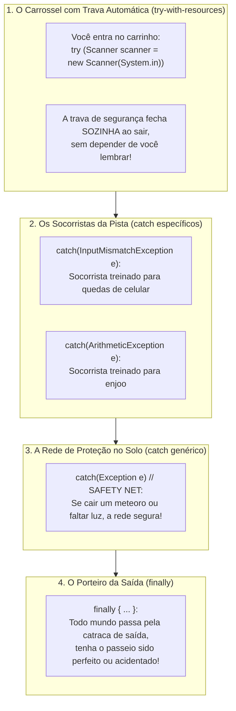

# ⚠️ Java — Capítulo 57: `Exception Handling` (Conclusão Oficial e Definitiva)
## O Grande Resumo de Encerramento: Arquitetura Completa de Tratamento de Exceções em Java

---

### 📌 Metadados da Aula e Contexto do Vídeo
- **Curso:** *Java Full Course for free* (Canal: Bro Code)
- **Capítulo Oficial:** `57. exception handling ⚠️` *(Encerramento Oficial do Capítulo!)*
- **Timestamp Exato no Vídeo:** `09:13:26 / 12:00:00`
- **Arquivo de Trabalho:** [`Main.java`](file:///c:/Users/mickel%201/Downloads/JAVA%20APRENDER/Main.java)
- **Ambiente de Desenvolvimento:** IntelliJ IDEA Community Edition (JDK 23 / OpenJDK 23)

---

## 🖼️ Reconstituição Visual Completa da Interface (Para quem vai colar no Google Docs)

Como você vai copiar este material para o seu **Google Docs** e não terá a imagem anexada lá, veja a reconstituição fiel e milimétrica de tudo o que está visível no monitor do professor no exato último segundo do capítulo (`9:13:26`):

```
+---------------------------------------------------------------------------------------------------------+
| [MyFirstProject] - Main.java                                                             Current File   |
+---------------------------------------------------------------------------------------------------------+
|  1 | import java.util.InputMismatchException;                                                           |
|  2 | import java.util.Scanner;                                                                          |
|  3 |                                                                                                    |
|  4 | public class Main {                                                                                |
|  5 |     public static void main(String[] args) {                                                       |
|  6 |                                                                                                    |
|  7 |         // [Exception] = An event that interrupts the normal flow of a program                     |
|    |            ^^^^^^^^^^^ <-- [A palavra 'Exception' está SELECIONADA EM AZUL pelo professor!]        |
|  8 |         //             (Dividing by zero, file not found, mismatch input type)                     |
|  9 |         //             Surround any dangerous code with a try{} block                              |
| 10 |         //             try{}, catch{}, finally{}                                                   |
| 11 |                                                                                                    |
| 12 |         try (Scanner scanner = new Scanner(System.in)) {                                           |
| 13 |             System.out.print("Enter a number: ");                                                  |
| 14 |             int number = scanner.nextInt();                                                        |
| 15 |             System.out.println(number);                                                            |
| 16 |         } catch (InputMismatchException e) {                                                       |
| 17 |             System.out.println("That wasn't a number!");                                           |
| 18 |         } catch (ArithmeticException e) {                                                          |
| 19 |             System.out.println("YOU CAN'T DIVIDE BY ZERO!");                                       |
| 20 |         } catch (Exception e) {                                                                    |
| 21 |             // SAFETY NET                                                                          |
| 22 |             System.out.println("Something went wrong");                                            |
| 23 |         } finally {                                                                                |
| 24 |             System.out.println("This always executes");                                            |
| 25 |         }                                                                                          |
| 26 |     }                                                                                              |
| 27 | }                                                                                                  |
+---------------------------------------------------------------------------------------------------------+
| BARRA DE PROGRESSO DO YOUTUBE:                                                                          |
| [==============================================🔴] 9:13:26 / 12:00:00   Capítulo: 57.exception handling |
+---------------------------------------------------------------------------------------------------------+
```

---

### O Que o Autor Explica Neste Último Segundo (`media_1791496972373_198e70c7.png`)

No fechamento do vídeo, o professor Bro Code passa o mouse e **seleciona a palavra `Exception` em azul na Linha 7**. Ele faz isso para bater o martelo e fixar na mente do aluno o resumo de ouro do capítulo:

1. **O que é uma Exceção (`Exception`):** Um imprevisto que quebra o fluxo natural do código.
2. **Os 3 Exemplos Clássicos:**
   - *Dividing by zero* (Divisão por zero $\rightarrow$ `ArithmeticException`).
   - *File not found* (Arquivo inexistente no disco $\rightarrow$ `FileNotFoundException`).
   - *Mismatch input type* (Usuário digita letras onde o Java espera números $\rightarrow$ `InputMismatchException`).
3. **A Estrutura Completa de Defesa:**
   - Cerque o código perigoso com `try`.
   - Gerencie recursos automaticamente com parênteses: `try (Scanner scanner = new Scanner(System.in))`.
   - Trate primeiro os erros conhecidos com mensagens específicas (`catch (InputMismatchException e)` e `catch (ArithmeticException e)`).
   - Mantenha uma **Rede de Segurança** genérica no final (`catch (Exception e) // SAFETY NET`).
   - Execute a faxina ou o encerramento incondicional com `finally { ... }`.

---

## 💻 Código-Fonte Completo e Rigorosamente Numerado ([`Main.java`](file:///c:/Users/mickel%201/Downloads/JAVA%20APRENDER/Main.java))

```java
 1: import java.util.InputMismatchException;
 2: import java.util.Scanner;
 3: 
 4: public class Main {
 5:     public static void main(String[] args) {
 6: 
 7:         // Exception = An event that interrupts the normal flow of a program
 8:         //             (Dividing by zero, file not found, mismatch input type)
 9:         //             Surround any dangerous code with a try{} block
10:         //             try{}, catch{}, finally{}
11: 
12:         try (Scanner scanner = new Scanner(System.in)) {
13:             System.out.print("Enter a number: ");
14:             int number = scanner.nextInt();
15:             System.out.println(number);
16:         } catch (InputMismatchException e) {
17:             System.out.println("That wasn't a number!");
18:         } catch (ArithmeticException e) {
19:             System.out.println("YOU CAN'T DIVIDE BY ZERO!");
20:         } catch (Exception e) {
21:             // SAFETY NET
22:             System.out.println("Something went wrong");
23:         } finally {
24:             System.out.println("This always executes");
25:         }
26:     }
27: }
```

---

## 🔬 Tabela Anatômica Linha por Linha: Para Iniciantes Absolutos

Esta tabela disseca o código linha por linha, explicando em linguagem simples de leigo e prevendo exatamente o que sai no console em **cada linha** dependendo do que o usuário fizer:

| Linha | Código Exato | O que significa na "Linguagem de Leigo" (Explicação Mastigada) | Cenário A: Usuário digita `50` (Sucesso) | Cenário B: Usuário digita `Pizza` (Texto Inválido) |
| :---: | :--- | :--- | :---: | :---: |
| **1** | `import java.util.InputMismatchException;` | Pede emprestado ao armário `java.util` a ferramenta que reconhece o erro de "texto onde era pra ser número". | *(Nada)* | *(Nada)* |
| **2** | `import java.util.Scanner;` | Pede emprestado o leitor do teclado `Scanner`. | *(Nada)* | *(Nada)* |
| **3** | *(Linha em branco)* | Organização visual. | *(Nada)* | *(Nada)* |
| **4** | `public class Main {` | Declara o nome do nosso programa principal (`Main`). | *(Nada)* | *(Nada)* |
| **5** | `public static void main(String[] args) {` | A porta de entrada do Java. É por aqui que a execução começa. | *(Nada)* | *(Nada)* |
| **6** | *(Linha em branco)* | Organização visual. | *(Nada)* | *(Nada)* |
| **7** | `// Exception = An event...` | **Comentário de Definição:** Lembra que uma exceção é um acidente que interrompe o programa. *(Selecionado em azul na imagem)*. | *(Nada)* | *(Nada)* |
| **8** | `// (Dividing by zero...)` | Exemplos clássicos de acidentes de percurso. | *(Nada)* | *(Nada)* |
| **9** | `// Surround any dangerous...` | Regra de sobrevivência: cerque código de risco com `try{}`. | *(Nada)* | *(Nada)* |
| **10** | `// try{}, catch{}, finally{}` | Os 3 guardiões do tratamento de erros. | *(Nada)* | *(Nada)* |
| **11** | *(Linha em branco)* | Organização visual. | *(Nada)* | *(Nada)* |
| **12** | `try (Scanner scanner = new Scanner(System.in)) {` | **`try-with-resources`:** Conecta o receptor ao teclado físico. Como está dentro dos parênteses do `try`, o Java **garante que vai desligar o scanner sozinho** no final! | *(Nada)* | *(Nada)* |
| **13** | `    System.out.print("Enter a number: ");` | Imprime a pergunta na tela sem quebrar a linha, deixando o cursor coladinho. | `Enter a number: ` | `Enter a number: ` |
| **14** | `    int number = scanner.nextInt();` | **A Linha Crítica:** Tenta ler um número inteiro. Se o usuário digitar `50`, guarda com sucesso. Se digitar `"Pizza"`, o Java dispara a exceção e aborta a linha 15 na mesma hora! | *(Usuário digita 50)* | *(Usuário digita Pizza)* |
| **15** | `    System.out.println(number);` | Imprime o número que foi lido com sucesso. Se houve erro antes, esta linha é ignorada. | `50` | *(Ignorada)* |
| **16** | `} catch (InputMismatchException e) {` | **Fim do try:** O Java desliga o scanner nos bastidores. Se houve erro de texto, este bloco de socorro entra em ação! | *(Ignorado)* | *(Ativado pelo erro)* |
| **17** | `    System.out.println("That wasn't a number!");` | Mensagem educada avisando que a entrada não era um número. | *(Ignorada)* | `That wasn't a number!` |
| **18** | `} catch (ArithmeticException e) {` | Socorrista para erros matemáticos (divisão por zero). | *(Ignorado)* | *(Ignorado)* |
| **19** | `    System.out.println("YOU CAN'T DIVIDE BY ZERO!");` | Mensagem para divisão por zero. | *(Ignorada)* | *(Ignorada)* |
| **20** | `} catch (Exception e) {` | **A Grande Mãe de Todas as Exceções:** Fica de vigia para pegar qualquer outro erro bizarro não previsto. | *(Ignorado)* | *(Ignorado)* |
| **21** | `    // SAFETY NET` | Comentário do professor: indica que este bloco é a "Rede de Segurança". | *(Nada)* | *(Nada)* |
| **22** | `    System.out.println("Something went wrong");` | Mensagem genérica da rede de segurança. | *(Ignorada)* | *(Ignorada)* |
| **23** | `} finally {` | **O Bloco Inegociável:** Roda sempre, aconteça o que acontecer! | *(Nada)* | *(Nada)* |
| **24** | `    System.out.println("This always executes");` | Imprime a frase provando que o `finally` nunca deixa de rodar. | `This always executes` | `This always executes` |
| **25** | `}` | Fecha o bloco `finally`. | *(Nada)* | *(Nada)* |
| **26** | `}` | Fecha o método `main`. | *(Nada)* | *(Nada)* |
| **27** | `}` | Fecha a classe `Main`. | *(Nada)* | *(Nada)* |

---

## 🧠 Teoria Explicada Passo a Passo (Como se você fosse um amador completo)

### 1. A Metáfora Definitiva: O Parque de Diversões e os Seguranças

Imagine que o seu programa Java é um brinquedo radical de montanha-russa:



1. **`try-with-resources` (`Scanner` nos parênteses):** É o carrinho com trava automática. Ao terminar a volta, a trava destrava e desliga o scanner sem você precisar se preocupar com `scanner.close()`.
2. **`catch` Específicos:** São os paramédicos treinados para acidentes conhecidos. Eles explicam com exatidão o que aconteceu (`"That wasn't a number!"`).
3. **`catch (Exception e) // SAFETY NET`:** É o airbag geral. Se acontecer um problema que ninguém imaginou, o programa não morre na cara do cliente.
4. **`finally`:** É o porteiro do parque. Ele sempre diz *"Tchau, volte sempre"* (`"This always executes"`), não importa o que rolou no brinquedo.

---

### 2. Por Que a Ordem dos Blocos `catch` Salva Vidas de Programadores?

Pense nos blocos `catch` como um **Filtro de Peneiras**:

```
[ Acontece o Erro: "Pizza" -> InputMismatchException ]
                       │
                       ▼
    ┌──────────────────────────────────────┐
    │ 1ª Peneira Fina:                     │  <-- CASOU! O erro fica aqui!
    │ catch (InputMismatchException e)     │      Imprime: "That wasn't a number!"
    └──────────────────────────────────────┘
                       │ (se não fosse InputMismatch, desceria)
                       ▼
    ┌──────────────────────────────────────┐
    │ 2ª Peneira Média:                    │  <-- Só para divisão por zero
    │ catch (ArithmeticException e)        │      Imprime: "YOU CAN'T DIVIDE BY ZERO!"
    └──────────────────────────────────────┘
                       │ (se não fosse Arithmetic, desceria)
                       ▼
    ┌──────────────────────────────────────┐
    │ 3ª Peneira Grossa (Rede de Chão):    │  <-- Engole absolutamente qualquer coisa!
    │ catch (Exception e)                  │      Imprime: "Something went wrong"
    └──────────────────────────────────────┘
```

> [!IMPORTANT]
> **A regra inviolável:** A peneira grossa (`catch (Exception e)`) **SEMPRE** fica por último! Se você colocar a peneira grossa no topo, ela pegaria todas as pedras grandes e pequenas, e as peneiras finas embaixo ficariam inúteis e vazias. O compilador Java não permite isso e dá erro de código inalcançável (*Unreachable code*).

---

## 🖥️ Os 4 Cenários de Saída no Console

Veja como este código final se comporta diante de qualquer situação do mundo real:

### Cenário 1: Entrada Correta (ex: `50`)
```text
Enter a number: 50
50
This always executes

Process finished with exit code 0
```

### Cenário 2: Usuário Digita Letras (ex: `Pizza` ou `Taco`)
```text
Enter a number: Pizza
That wasn't a number!
This always executes

Process finished with exit code 0
```

### Cenário 3: Divisão por Zero (se o código fizesse `1 / 0`)
```text
YOU CAN'T DIVIDE BY ZERO!
This always executes

Process finished with exit code 0
```

### Cenário 4: Um Erro Misterioso Inesperado (Cai na Rede de Segurança)
```text
Something went wrong
This always executes

Process finished with exit code 0
```

---

## 🏆 Quadro Resumo Definitivo para Fixar no Google Docs

| Palavra-Chave | Onde Fica? | Função Principal | Analogia Didática |
| :--- | :--- | :--- | :--- |
| **`try`** | No início | Delimita o código de risco | O laboratório blindado |
| **`try (...)`** | Parênteses do `try` | Fecha recursos `AutoCloseable` sozinho | A porta com mola automática |
| **`catch (Específico e)`** | Logo após o `try` | Trata erros conhecidos com mensagens claras | O médico especialista |
| **`catch (Exception e)`** | O último `catch` | Captura imprevistos (Rede de Segurança) | A rede de proteção do circo |
| **`finally`** | No encerramento | Executa **SEMPRE**, com ou sem erro | A mãe inegociável que manda tomar banho |
