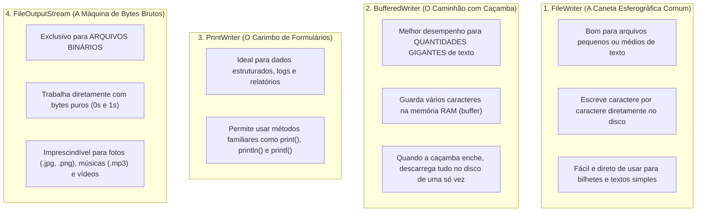
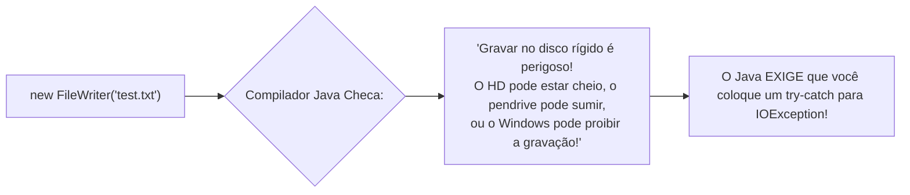

# ✍ Java — Capítulo 58: `Write Files` (Parte 1)
## As 4 Opções Populares de Escrita, a Classe `FileWriter` e o Conceito de *Checked Exception* (`IOException`)

---

### 📌 Metadados da Aula e Contexto do Vídeo
- **Curso:** *Java Full Course for free* (Canal: Bro Code)
- **Capítulo Oficial:** `58. write files ✍` *(Capítulo Novo!)*
- **Intervalo de Tempo no Vídeo:** `09:13:36` até `09:15:23` (do total de 12:00:00)
- **Arquivo de Trabalho:** [`Main.java`](file:///c:/Users/mickel%201/Downloads/JAVA%20APRENDER/Main.java)
- **Ambiente de Desenvolvimento:** IntelliJ IDEA Community Edition (JDK 23 / OpenJDK 23)

---

## 🖼️ Reconstituição Visual Completa da Interface (Para quem vai colar no Google Docs)

Como você copiará este material diretamente para o seu **Google Docs** e não terá acesso direto às imagens no documento, veja a reconstituição detalhada de cada etapa visual exibida na tela do professor ao longo das 5 capturas:

```
+---------------------------------------------------------------------------------------------------------+
| [MyFirstProject] - Main.java                                                             Current File   |
+---------------------------------------------------------------------------------------------------------+
|  1 | import java.io.FileWriter;                                                                         |
|  2 |                                                                                                    |
|  3 | public class Main {                                                                                |
|  4 |     public static void main(String[] args) {                                                       |
|  5 |                                                                                                    |
|  6 |         // How to write a file using Java (4 popular options)                                      |
|  7 |                                                                                                    |
|  8 |                                                                                                    |
|  9 |         try(FileWriter writer = new FileWriter("test.txt")){                                       |
|    |                                 ^^^^^^^^^^^^^^^^^^^^^^^^^^                                         |
|    |               [Sublinhado ondulado vermelho: Unhandled exception: java.io.IOException]             |
| 10 |                                                                                                    |
| 11 |         }                                                                                          |
| 12 |         catch(IOException ){                                                                       |
|    |               ^^^^^^^^^^^ <-- [Texto em vermelho: falta o parâmetro 'e' e o import!]               |
| 13 |                                                                                                    |
| 14 |         }                                                                                          |
| 15 |                                                                                                    |
| 16 |     }                                                                                              |
| 17 | }                                                                                                  |
+---------------------------------------------------------------------------------------------------------+
| TOOLTIP DO INTELLIJ (Imagem 4):                                                                         |
| Unhandled exception: java.io.IOException                                                                |
| Add 'catch' clause(s) Alt+Shift+Enter   More actions... Alt+Enter                                       |
|                                                                                                         |
| public FileWriter(@NotNull String fileName) throws java.io.IOException                                  |
| Constructs a FileWriter given a file name, using the default charset                                    |
+---------------------------------------------------------------------------------------------------------+
```

---

### Detalhamento das 5 Imagens Passo a Passo

#### 📸 Imagem 1: Introdução Teórica — As 4 Opções Populares (`media_1791497474177_98bb1a59.png`)
- **O que está na tela:** O professor inicia o novo capítulo escrevendo comentários no método `main`:
  - `// How to write a file using Java (4 popular options)`
  - `// FileWriter = Good for small or medium-sized text files`
  - `// BufferedWriter = Better performance for large amounts of text`
  - `// PrintWriter = Best for structured data, like reports or logs`
  - `// FileOutputStream = Best for binary files (e.g., images, audio files)`
- **Destaque:** O professor seleciona com o mouse as palavras **`4 popular options`** em azul na Linha 5 para destacar que o Java oferece múltiplas ferramentas dependendo do tipo e do tamanho do arquivo que você quer criar.
- **Timestamp do vídeo:** `9:13:36 / 12:00:00`.

#### 📸 Imagem 2: Destaque para Arquivos Binários (`media_1791497485637_536e0d61.png`)
- **O que mudou:** O professor move a seleção do mouse para a Linha 10, destacando a expressão **`binary files`** (arquivos binários).
- **Explicação do autor:** As 3 primeiras opções (`FileWriter`, `BufferedWriter`, `PrintWriter`) são feitas para textos legíveis por humanos (letras, palavras e números). A quarta opção (`FileOutputStream`) é para dados brutos em bytes (fotos, músicas, vídeos).
- **Timestamp do vídeo:** `9:14:00 / 12:00:00`.

#### 📸 Imagem 3: Iniciando o Código com `FileWriter` (`media_1791497560037_07696dcd.png`)
- **O que foi escrito:**
  - Linha 1: `import java.io.FileWriter;` (do pacote de entrada e saída `java.io`).
  - Linha 9: O professor já usa o moderno `try-with-resources` que aprendemos no final do capítulo anterior:
    `try(FileWriter writer = new FileWriter("test.txt")){`
  - Linha 12: Escreve o início do catch: `catch(){`.
- **Avisos em vermelho:** A expressão `new FileWriter("test.txt")` na linha 9 está com um sublinhado ondulado vermelho acusando erro de compilação.
- **Timestamp do vídeo:** `9:15:23 / 12:00:00`.

#### 📸 Imagem 4: O Pop-up do Erro Obrigatório (`media_1791497573356_1dbc2a70.png`)
- **O que acontece:** O professor passa o mouse sobre `new FileWriter("test.txt")`. O IntelliJ exibe uma caixa escura detalhada:
  > **`Unhandled exception: java.io.IOException`** (Tradução: *Exceção não tratada: java.io.IOException*)
  > Opção de correção: `Add 'catch' clause(s) Alt+Shift+Enter`
- **A documentação Javadoc:** O balão mostra que o construtor do `FileWriter` possui a declaração:
  `public FileWriter(String fileName) throws java.io.IOException`.
- **A grande lição:** O Java **não permite compilar** uma operação de disco sem que você proteja o código com um `try-catch` para `IOException`!

#### 📸 Imagem 5: Digitando o `catch(IOException )` (`media_1791497582244_b2df17f9.png`)
- **O que está na tela:** Na Linha 12, o professor começa a digitar:
  `catch(IOException ){`
- **Por que ainda está vermelho?**
  1. Falta declarar o nome da variável de erro (o parâmetro `e`, ficando `catch(IOException e)`).
  2. Falta importar a classe `IOException` (`import java.io.IOException;`).
  3. Assim que essas duas coisas forem feitas, o sublinhado vermelho da Linha 9 sumirá na hora!

---

## 💻 Código-Fonte Completo da Tela na Imagem 5 ([`Main.java`](file:///c:/Users/mickel%201/Downloads/JAVA%20APRENDER/Main.java))

```java
 1: import java.io.FileWriter;
 2: 
 3: public class Main {
 4:     public static void main(String[] args) {
 5: 
 6:         // How to write a file using Java (4 popular options)
 7: 
 8: 
 9:         try(FileWriter writer = new FileWriter("test.txt")){
10: 
11:         }
12:         catch(IOException ){
13: 
14:         }
15: 
16:     }
17: }
```

---

## 🔬 Tabela Anatômica Linha por Linha: Para Iniciantes Absolutos

| Linha | Código Exato | O que significa na "Linguagem de Leigo" (Explicação Mastigada) | O que sai no Console? |
| :---: | :--- | :--- | :---: |
| **1** | `import java.io.FileWriter;` | **Importa o escritor de arquivos:** Pega a ferramenta `FileWriter` da gaveta `java.io` (onde *io* significa *Input/Output*, ou seja, Entrada e Saída de dados). | *(Nada)* |
| **2** | *(Linha em branco)* | Organização visual. | *(Nada)* |
| **3** | `public class Main {` | Declaração da classe principal. | *(Nada)* |
| **4** | `public static void main(String[] args) {` | Ponto de partida da execução do Java. | *(Nada)* |
| **5** | *(Linha em branco)* | Organização visual. | *(Nada)* |
| **6** | `// How to write a file using Java...` | Comentário do professor anunciando as 4 opções populares de gravação de arquivos. | *(Nada)* |
| **7** | *(Linha em branco)* | Organização visual. | *(Nada)* |
| **8** | *(Linha em branco)* | Organização visual. | *(Nada)* |
| **9** | `try(FileWriter writer = new FileWriter("test.txt")){` | **Abre o arquivo com fechamento automático:** Tenta criar um canal de gravação apontando para o arquivo `"test.txt"` na pasta do projeto. Graças ao `try(...)`, o Java promete fechar o arquivo sozinho quando terminar! | *(Nada)* |
| **10** | *(Linha em branco)* | Onde o professor vai escrever os comandos de escrita (ex: `writer.write(...)`). | *(Nada)* |
| **11** | `}` | Fecha o bloco `try` e dispara o fechamento automático do arquivo. | *(Nada)* |
| **12** | `catch(IOException ){` | **Início da rede de proteção:** Prepara o bloco de resgate para caso aconteça uma falha de disco (`IOException`). Está vermelho temporariamente porque falta o `e` e o import. | *(Nada)* |
| **13** | *(Linha em branco)* | Onde ficará a mensagem de erro para o usuário se a gravação falhar. | *(Nada)* |
| **14** | `}` | Fecha o bloco `catch`. | *(Nada)* |
| **15** | *(Linha em branco)* | Organização visual. | *(Nada)* |
| **16** | `}` | Fecha o método `main`. | *(Nada)* |
| **17** | `}` | Fecha a classe `Main`. | *(Nada)* |

---

## 🧠 Teoria Explicada Passo a Passo (Como se você fosse um amador completo)

### 1. As 4 Formas de Escrever Arquivos em Java (A Metáfora da Papelaria e da Gráfica)

O Bro Code lista no início da aula 4 classes fundamentais. Cada uma existe por uma razão específica de desempenho e utilidade:



---

### 2. Texto Legível vs Arquivo Binário: Qual a Diferença?

- **Arquivo de Texto (`.txt`, `.csv`, `.json`):** É composto por caracteres compreensíveis por humanos (letras do alfabeto, números, pontuação). Se você abrir no Bloco de Notas do Windows, você consegue ler tudo perfeitamente.
- **Arquivo Binário (`.jpg`, `.mp3`, `.exe`, `.pdf`):** É uma sequência crua de bytes (`0` e `1`). Se você tentar forçar a abertura de uma foto `.png` no Bloco de Notas, você verá apenas uma sopa de símbolos malucos e caracteres indecifráveis (`PNG... %PDF-1.4...`).

Neste capítulo 58, o professor focará no **`FileWriter`**, que é a forma mais direta de criar arquivos de texto!

---

### 3. A Grande Revelação da Imagem 4: O Que É uma *Checked Exception*?

No capítulo anterior (57), nós vimos erros como:
- `ArithmeticException` (divisão por zero: `1 / 0`).
- `InputMismatchException` (digitar `"Pizza"` no `scanner.nextInt()`).

Esses erros são chamados de **Unchecked Exceptions (Exceções Não-Checadas)**: o compilador do Java deixa você escrever o código sem `try-catch`, e o erro só explode se alguém fizer bobagem na hora em que o programa estiver rodando.

**Mas na Imagem 4 acontece algo totalmente novo:**
Assim que o professor escreveu `new FileWriter("test.txt")`, a linha ficou **vermelha imediatamente** antes mesmo de rodar o programa!



- **`IOException` é uma CHECKED EXCEPTION (Exceção Checada):**
  - O Java obriga você a prever a possibilidade de falha de disco em tempo de compilação.
  - Se você não colocar dentro de um `try` com `catch(IOException e)` (ou declarar `throws IOException` no método), o programa **NEM SEQUER COMPILA**!

---

### 4. Por Que o Professor Já Começou com `try-with-resources`?

Repare com atenção na Linha 9:
```java
try(FileWriter writer = new FileWriter("test.txt")){
```
Ele colocou a criação do `FileWriter` **dentro dos parênteses do `try`**!
- No Java antigo, você precisava abrir o arquivo, escrever o que queria e depois lembrar de chamar `writer.close()` no `finally`.
- Se você esquecesse o `writer.close()`, o Windows mantinha o arquivo trancado e nada do que você escreveu era salvo no disco!
- Como a classe `FileWriter` implementa a interface `AutoCloseable`, usar `try(...)` garante que o Java vai **salvar as alterações e fechar o arquivo automaticamente** assim que o bloco terminar!

---

## 🖥️ Saída no Console

Nesta fase inicial de montagem da estrutura:
```text
(Nenhuma saída no console ainda - O professor está preparando a estrutura de escrita)
```

Assim que o código for finalizado (nas próximas telas), ele criará fisicamente o arquivo `test.txt` no computador!

---

## 🎯 Resumo Mental Definitivo para Fixação

1. **`java.io.FileWriter`**: Classe padrão do Java para criar e escrever em arquivos de texto pequenos e médios.
2. **`IOException` (Input/Output Exception)**: A mãe de todos os erros de leitura e gravação em disco. É uma *Checked Exception* obrigatória de ser tratada.
3. **`try(FileWriter writer = ...)`**: O jeito moderno e seguro de manipular arquivos, garantindo que o arquivo seja salvo e fechado sozinho.
