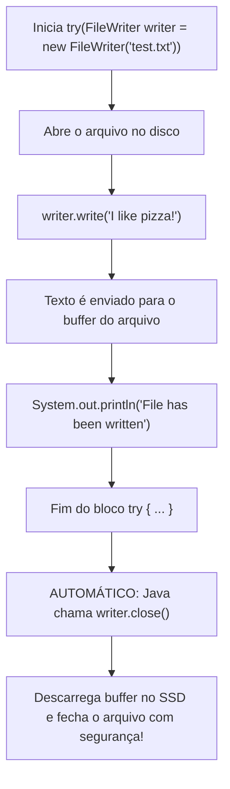

# ✍️ Java — Capítulo 58: `Write Files` (Parte 2)
## Resolvendo o `IOException`, Escrevendo em Disco com `FileWriter.write()` e Executando o Programa

---

### 📌 Metadados da Aula e Contexto do Vídeo
- **Curso:** *Java Full Course for free* (Canal: Bro Code)
- **Capítulo Oficial:** `58. write files ✍️`
- **Intervalo de Tempo no Vídeo:** `09:15:23` até `09:17:15` (do total de 12:00:00)
- **Arquivo Principal de Trabalho:** [`Main.java`](file:///c:/Users/mickel%201/Downloads/JAVA%20APRENDER/Main.java)
- **Arquivo Criado/Gerado em Disco:** [`test.txt`](file:///c:/Users/mickel%201/Downloads/JAVA%20APRENDER/test.txt)
- **Ambiente de Desenvolvimento (IDE):** IntelliJ IDEA Community Edition (OpenJDK 23)

---

## 📸 Reconstituição Visual Completa da Interface (Para quem vai colar no Google Docs)

Como você copiará este material diretamente para o seu **Google Docs** (onde as imagens originais não estarão incorporadas), abaixo está a **reconstituição textual e visual exata** do que acontece em cada uma das 5 imagens da tela do professor:

```
===================================================================================================
IMAGEM 1 (09:15:30) — O ERRO DE COMPILAÇÃO NO CATCH E O POPUP DE IMPORTAÇÃO DO INTELLIJ
===================================================================================================
Na tela do IntelliJ, o professor digita o parâmetro "e" no catch: "catch(IOException e)".
Porém, "IOException" fica em VERMELHO com sublinhado ondulado vermelho (erro de compilação!).
O cursor do mouse passa por cima de IOException e a IDE abre uma caixinha preta flutuante (tooltip):

 12 |         catch(IOException e){
                    ~~~~~~~~~~~
                    ┌────────────────────────────────────────────────────────┐
                    │ Cannot resolve symbol 'IOException'                    │
                    │ [Import class  Alt+Shift+Enter]  More actions... Alt+Enter │
                    └────────────────────────────────────────────────────────┘

* Nota: A linha 9 (FileWriter) também tem sublinhado vermelho porque o Java não reconhece
        que o IOException está sendo capturado até que a classe seja importada.

===================================================================================================
IMAGEM 2 (09:15:42) — O CLIQUE EM "IMPORT CLASS" RESOLVE TUDO AUTOMATICAMENTE
===================================================================================================
Ao clicar em "Import class", o IntelliJ insere automaticamente a linha 2 no topo do arquivo:
"import java.io.IOException;".
Instantaneamente, todos os sublinhados vermelhos SOMEM! O código fica 100% limpo e válido.

 1 | import java.io.FileWriter;
 2 | import java.io.IOException;     <-- [INSERIDO AUTOMATICAMENTE PELO INTELLIJ!]
 3 | 
 4 | public class Main {
 ...
 13 |         catch(IOException e){   <-- [AGORA RECONHECIDO, SEM NENHUM ERRO!]

===================================================================================================
IMAGEM 3 (09:16:37) — DIGITANDO A ESCRITA NO ARQUIVO E A MENSAGEM DE ERRO NO CATCH
===================================================================================================
O professor entra dentro do bloco try e digita a ordem de escrita:
"writer.write("I like pizza!");"
E dentro do bloco catch, digita uma mensagem amigável caso a escrita falhe:
"System.out.println("Could not write file");"

 9  |         try(FileWriter writer = new FileWriter("test.txt")){
 10 |             writer.write("I like pizza!");
 11 | 
 12 |         }
 13 |         catch(IOException e){
 14 |             System.out.println("Could not write file");
 15 |         }

===================================================================================================
IMAGEM 4 (09:16:50) — ADICIONANDO A CONFIRMAÇÃO DE SUCESSO NO CONSOLE
===================================================================================================
Na linha 11 (logo após o writer.write), o professor adiciona um aviso para avisar ao programador
que o arquivo foi gravado com sucesso no disco:
"System.out.println("File has been written");"

 9  |         try(FileWriter writer = new FileWriter("test.txt")){
 10 |             writer.write("I like pizza!");
 11 |             System.out.println("File has been written");
 12 |         }
 13 |         catch(IOException e){
 14 |             System.out.println("Could not write file");
 15 |         }

===================================================================================================
IMAGEM 5 (09:17:15) — CLIQUE NO BOTÃO PLAY (RUN) E O RESULTADO FINAL NO CONSOLE E NO DISCO
===================================================================================================
O professor clica na seta verde (Play) no topo direito da IDE.
A aba inferior "Run" abre na parte de baixo da tela exibindo:

+-------------------------------------------------------------------------------------------------+
| Run:  Main x                                                                                    |
+-------------------------------------------------------------------------------------------------+
| C:\Users\HP\.jdks\openjdk-23\bin\java.exe "-javaagent:..." Main                                 |
| File has been written                                                                           |
|                                                                                                 |
| Process finished with exit code 0                                                               |
+-------------------------------------------------------------------------------------------------+

E na árvore de arquivos do projeto (barra lateral esquerda), surge um novo arquivo:
📁 MyFirstProject
  ├── 📁 .idea
  ├── 📁 out
  ├── 📁 src
  │    └── ☕ Main.java
  ├── 📄 .gitignore
  ├── 📄 MyFirstProject.iml
  └── 📄 test.txt           <--- [ARQUIVO CRIADO COM O CONTEÚDO: "I like pizza!"]
===================================================================================================
```

---

## 🍕 O Código Completo do Arquivo [`Main.java`](file:///c:/Users/mickel%201/Downloads/JAVA%20APRENDER/Main.java)

Aqui está exatamente o código que ficou no editor do professor e que está salvo no seu projeto:

```java
1: import java.io.FileWriter;
2: import java.io.IOException;
3: 
4: public class Main {
5:     public static void main(String[] args) {
6: 
7:         // How to write a file using Java (4 popular options)
8: 
9:         try(FileWriter writer = new FileWriter("test.txt")){
10:             writer.write("I like pizza!");
11:             System.out.println("File has been written");
12:         }
13:         catch(IOException e){
14:             System.out.println("Could not write file");
15:         }
16: 
17:     }
18: }
```

---

## 🔍 Anatomia Linha por Linha Para Iniciantes Amadores ("Passo a Passo de Leigo")

Abaixo está o raio-X detalhado de cada linha, explicando **o que ela faz**, **por que ela existe**, e **o que sai ou não sai no console**:

| Linha | Código Exato | O que essa linha faz na prática? | O que aparece no Console? |
| :---: | :--- | :--- | :---: |
| **1** | `import java.io.FileWriter;` | Pede licença ao Java para trazer a ferramenta `FileWriter` do pacote `java.io`. É a nossa "caneta" que sabe escrever caracteres em arquivos de texto no disco. | *(Nada)* |
| **2** | `import java.io.IOException;` | Traz o relatório de pane do pacote `java.io`. Avisa o compilador sobre qual tipo específico de erro de Entrada/Saída (`Input/Output Exception`) estamos prontos para tratar. | *(Nada)* |
| **3** | *(Linha em branco)* | Espaço visual para deixar o código legível e organizado. | *(Nada)* |
| **4** | `public class Main {` | Define a classe principal do programa chamada `Main`. Todo código Java precisa morar dentro de uma classe. | *(Nada)* |
| **5** | `public static void main(String[] args) {` | A porta de entrada oficial do Java. Quando clicamos no botão verde de Play, o computador começa a ler as ordens a partir daqui. | *(Nada)* |
| **6** | *(Linha em branco)* | Organização e respiro visual. | *(Nada)* |
| **7** | `// How to write a file using Java (4 popular options)` | Comentário explicativo. O compilador ignora completamente; serve apenas para nós humanos lermos. | *(Nada)* |
| **8** | *(Linha em branco)* | Organização e respiro visual. | *(Nada)* |
| **9** | `try(FileWriter writer = new FileWriter("test.txt")){` | **A Mágica do Try-With-Resources:** Abre o cofre seguro `try`. Entre os parênteses `(...)`, cria e abre a caneta `writer` apontada para um arquivo chamado `"test.txt"`. Se o arquivo não existir, o Java o cria no mesmo instante na raiz da pasta! Se o bloco terminar ou der erro, o Java fecha a caneta sozinho. | *(Nada)* |
| **10** | `    writer.write("I like pizza!");` | **A Escrita no Disco:** A caneta `writer` pega o texto `"I like pizza!"` e joga dentro do arquivo `"test.txt"` no SSD/HD. **Atenção:** Isso NÃO imprime nada na tela preta do terminal, vai direto para o arquivo! | *(Nada)* |
| **11** | `    System.out.println("File has been written");` | **A Confirmação na Tela:** Manda uma mensagem de texto para a saída padrão (`System.out`), que é a janelinha do console, avisando o usuário: *"O arquivo foi gravado com sucesso"*. | `File has been written` |
| **12** | `}` | Fecha o bloco `try`. Neste exato milissegundo, como usamos *try-with-resources*, o Java executa automaticamente `writer.close()`, descarregando todo o texto da memória para o disco rígido e liberando o arquivo no Windows! | *(Nada)* |
| **13** | `catch(IOException e){` | O "colchão de proteção". Se o Windows bloquear o arquivo (ex.: disco cheio, pasta protegida como `C:\Windows\System32`), o erro é amortecido aqui e guardado na variável `e`. | *(Nada no caso de sucesso)* |
| **14** | `    System.out.println("Could not write file");` | Mensagem de socorro. Só é executada se algo der errado durante a linha 9 ou 10. Como correu tudo bem, essa linha é completamente pulada. | *(Pulada — nada)* |
| **15** | `}` | Fecha o bloco `catch`. | *(Nada)* |
| **16** | *(Linha em branco)* | Organização e respiro visual. | *(Nada)* |
| **17** | `}` | Fecha o método `main`. O programa conclui sua execução com sucesso (`exit code 0`). | *(Nada)* |
| **18** | `}` | Fecha a classe `Main`. | *(Nada)* |

---

## 🖥️ Previsão Exata do Console e do Arquivo Físico

### 1. O que sai no Console (Aba "Run" do IntelliJ):
```text
File has been written

Process finished with exit code 0
```

### 2. O que foi gerado no Disco Rígido ([`test.txt`](file:///c:/Users/mickel%201/Downloads/JAVA%20APRENDER/test.txt)):
```text
I like pizza!
```

> [!NOTE]
> **Diferença Crucial para Iniciantes:**
> - `writer.write(...)` escreve **SILENCIOSAMENTE** no arquivo guardado no seu computador. Não emite nenhum som e não mostra nenhuma letra na tela preta.
> - `System.out.println(...)` escreve **VISIVELMENTE** na tela do console para os olhos humanos verem.
> - Por isso o professor colocou as duas coisas: a linha 10 faz o trabalho pesado nos bastidores (disco) e a linha 11 nos tranquiliza dizendo que o trabalho acabou!

---

## 🧠 Os 4 Conceitos Fundamentais Ensinados Nesta Lição

### 1. Por que o `catch(IOException e)` deu erro na Imagem 1 e como foi resolvido na Imagem 2?
No Java existem milhares de classes. O Java básico só conhece de cabeça o pacote `java.lang` (onde moram o `String`, o `System`, o `Math`, etc.).
A classe `IOException` mora em outro bairro: no pacote `java.io`.
- Na **Imagem 1**, o professor digitou `catch(IOException e)`, mas o Java reclamou: *"Não conheço ninguém chamado IOException nesta vizinhança!"* (`Cannot resolve symbol 'IOException'`).
- O IntelliJ é uma IDE inteligente: ao colocar o mouse em cima, ele ofereceu o atalho **`Import class`**.
- Na **Imagem 2**, ao clicar na opção, o IntelliJ adicionou a linha 2: `import java.io.IOException;`. Com esse endereço oficial fornecido, o compilador entendeu tudo e todos os sublinhados vermelhos sumiram.

### 2. Aonde fica o arquivo `"test.txt"`?
Quando passamos apenas o nome do arquivo entre aspas:
```java
new FileWriter("test.txt")
```
Estamos usando um **caminho relativo** (*relative path*). O Java cria o arquivo na pasta raiz do projeto (no mesmo nível da pasta `src/`, e não dentro de `src/`).
- No computador do professor: `C:\Users\HP\IdeaProjects\MyFirstProject\test.txt`
- No seu computador: [`c:\Users\mickel 1\Downloads\JAVA APRENDER\test.txt`](file:///c:/Users/mickel%201/Downloads/JAVA%20APRENDER/test.txt)

Se você quisesse salvá-lo em outro lugar específico (como na Área de Trabalho), teria que fornecer o caminho absoluto (*absolute path*), como `"C:\\Users\\mickel 1\\Desktop\\test.txt"`.

### 3. A Mágica do `try-with-resources` e o Fechamento Automático (`.close()`)
No Java antigo (antes do Java 7), se você abrisse um arquivo com `FileWriter`, era **obrigatório** chamar `writer.close()` no final. Se você esquecesse, o Windows travava o arquivo e o texto muitas vezes ficava preso no buffer da memória sem nunca ser gravado de verdade no disco!

Com a sintaxe moderna de **try-with-resources** (declarar a variável dentro dos parênteses do `try(...)`):

Você nunca mais precisa se preocupar em lembrar de dar `.close()`. O Java cuida de fechar a torneira para você!

### 4. O Comportamento Padrão de Sobrescrita (*Overwrite*)
Por padrão, quando usamos `new FileWriter("test.txt")`:
- Se o arquivo **não existir**, o Java cria um arquivo novo zerado.
- Se o arquivo **já existir**, o Java apaga todo o conteúdo antigo e escreve o novo por cima (substituição total).
*(Nas próximas partes do capítulo, o professor ensinará o modo de acréscimo / append).*

---

## 💡 Analogia do Carteiro e da Gaveta (Para Leigos e Amadores)

Imagine a seguinte cena da vida real:

1. **A Gaveta (`"test.txt"`):** É uma gaveta física no seu armário chamada "test". Se ela não existir, você pega uma caixa de papelão e cria uma gaveta com essa etiqueta.
2. **A Caneta Oficial (`FileWriter writer`):** É uma caneta especial que só tem autorização de escrever em gavetas de texto.
3. **A Escrevente (`writer.write("I like pizza!")`):** A mão vai até a gaveta e escreve na folha de papel: *"I like pizza!"*. Mas a gaveta ainda está entreaberta.
4. **O Fechamento Automático (`try (...)`):** Quando você sai da sala (fim do bloco `try`), uma mola automática bate a gaveta e tranca com chave (`close`). Agora a folha está guardada e seca para sempre.
5. **O Interfone (`System.out.println`):** Você aperta o botão do interfone da casa e avisa a família: *"Pessoal, já guardei o recado na gaveta!"* (`File has been written`).
6. **O Guarda-Costas (`catch(IOException e)`):** Se a gaveta estivesse emperrada com ferrugem ou trancada com cadeado do síndico, o guarda-costas seguraria o susto e avisaria no interfone: *"Não consegui abrir a gaveta!"* (`Could not write file`), impedindo que a casa explodisse de erro.

---

## 📊 Tabela Comparativa Resumida das Duas Ações Principais

| Ação | Comando Java | Onde acontece? | Quem vê? |
| :--- | :--- | :--- | :--- |
| **Escrever no Arquivo** | `writer.write("I like pizza!");` | No disco rígido / SSD do computador ([`test.txt`](file:///c:/Users/mickel%201/Downloads/JAVA%20APRENDER/test.txt)) | Quem abrir o arquivo `.txt` pelo Bloco de Notas ou pela IDE |
| **Escrever na Tela** | `System.out.println("File has been written");` | Na saída padrão do terminal / console do IntelliJ | O programador ou operador que está olhando para a tela enquanto o programa roda |

---

## 🎯 Conclusão da Parte 2
Com essas 5 imagens, você completou o primeiro ciclo real de manipulação de arquivos em Java:
1. Importou as classes necessárias (`FileWriter` e `IOException`).
2. Protegeu a operação contra erros usando `try-with-resources` e `catch`.
3. Gravou dados em disco com sucesso.
4. Forneceu feedback no console para o usuário.
5. Verificou a criação física do arquivo [`test.txt`](file:///c:/Users/mickel%201/Downloads/JAVA%20APRENDER/test.txt) no seu sistema!
