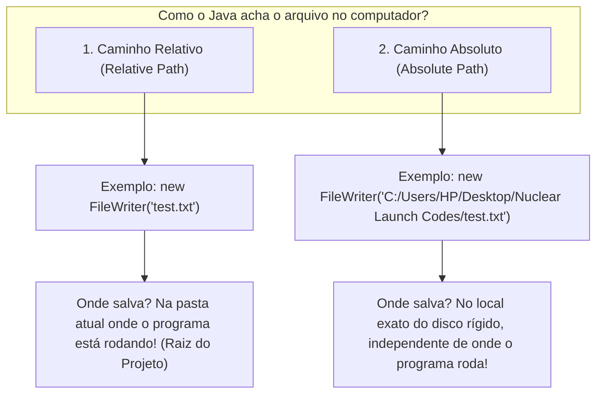

# ✍️ Java — Capítulo 58: `Write Files` (Parte 3)
## Verificando o Arquivo Criado, a Transição para o Desktop e a Diferença Crucial entre Caminho Relativo e Caminho Absoluto

---

### 📌 Metadados da Aula e Contexto do Vídeo
- **Curso:** *Java Full Course for free* (Canal: Bro Code)
- **Capítulo Oficial:** `58. write files ✍️`
- **Intervalo de Tempo no Vídeo:** `09:16:55` até `09:17:35` (do total de 12:00:00)
- **Arquivo Principal de Trabalho:** [`Main.java`](file:///c:/Users/mickel%201/Downloads/JAVA%20APRENDER/Main.java)
- **Arquivo de Texto Criado no Projeto:** [`test.txt`](file:///c:/Users/mickel%201/Downloads/JAVA%20APRENDER/test.txt)
- **Pasta Alvo de Exemplo no Windows Desktop:** Pasta `"Nuclear Launch Codes"` (Códigos de Lançamento Nuclear)
- **Ambiente de Desenvolvimento (IDE):** IntelliJ IDEA Community Edition rodando no Windows 10/11

---

## 📸 Reconstituição Visual Completa da Interface (Para quem vai colar no Google Docs)

Como você copiará este material diretamente para o seu **Google Docs** (onde as imagens originais não estarão incorporadas), veja abaixo a reconstituição visual exata do que é exibido na tela do professor em cada uma das 5 imagens:

```
===================================================================================================
IMAGEM 1 (09:16:55) — SELEÇÃO DA MENSAGEM NO CONSOLE E O ARQUIVO TEST.TXT NA ÁRVORE
===================================================================================================
Na tela do IntelliJ, logo após rodar o código, a mensagem verde do console é selecionada pelo mouse:
"File has been written" (com fundo azul de seleção).
Na barra lateral esquerda (Project Explorer), vemos a árvore de arquivos com o novo arquivo recém-nascido:

📁 MyFirstProject
  ├── 📁 .idea
  ├── 📁 out
  └── 📁 src
       └── ☕ Main
  ├── 📄 .gitignore
  ├── 📄 MyFirstProject.iml
  └── 📄 test.txt         <-- [O ARQUIVO FOI CRIADO AQUI NA RAIZ DO PROJETO!]

Abaixo, no painel Run:
[File has been written] (selecionado com o cursor)
Process finished with exit code 0

===================================================================================================
IMAGEM 2 (09:17:03) — O CLIQUE DO MOUSE SOBRE O ARQUIVO TEST.TXT
===================================================================================================
O professor move o cursor do mouse até a barra lateral esquerda e clica duas vezes
diretamente em cima do arquivo "test.txt":

  ├── 📄 .gitignore
  ├── 📄 MyFirstProject.iml
  └── 📄 test.txt  <-- 🖱️ [CURSOR DO MOUSE CLICANDO DUAS VEZES AQUI]

===================================================================================================
IMAGEM 3 (09:17:05) — O ARQUIVO TEST.TXT ABERTO NO EDITOR COM A FRASE GRAVADA
===================================================================================================
O IntelliJ abre uma nova aba no topo do editor de código ao lado de Main.java:
[☕ Main.java]  [📄 test.txt (ativa)]

Dentro do arquivo test.txt, na linha 1, está o texto que enviamos pelo writer.write():
 1 | I like pizza!

Barra de status inferior: "MyFirstProject > test.txt" | "1:1  CRLF  UTF-8  4 spaces"
Isso comprova que o Java realmente foi até o disco rígido e escreveu a frase física no arquivo!

===================================================================================================
IMAGEM 4 (09:17:20) — REDIMENSIONANDO O INTELLIJ E REVELANDO O DESKTOP DO WINDOWS
===================================================================================================
O professor desmaximiza/diminui a janela do IntelliJ para o lado direito da tela.
O lado esquerdo revela a sua Área de Trabalho (Windows Desktop) com vários ícones:
- Lixeira (Recycle Bin), Discord
- Microsoft Edge, Steam
- OBS Studio, Adobe Premiere Pro, paint.net, PyCharm, Visual Studio Code
- Uma pasta amarela chamada: "Nuclear Launch Codes"

No editor do IntelliJ (lado direito), o cursor do teclado pisca dentro do try na linha 9:
 9 |         try(FileWriter writer = new FileWriter("test.txt")){
                                                    |
                                            [CURSOR PISCANDO AQUI]

O professor diz em áudio: "Mas e se você não quiser salvar o arquivo na pasta do projeto?
E se você quiser salvar em uma pasta específica do computador, como na sua Área de Trabalho?"

===================================================================================================
IMAGEM 5 (09:17:25) — CLIQUE COM BOTÃO DIREITO NA PASTA DO DESKTOP E MENU DE PROPRIEDADES
===================================================================================================
O professor vai até a pasta amarela "Nuclear Launch Codes" na Área de Trabalho e clica
com o BOTÃO DIREITO DO MOUSE.
Aparece o clássico menu de contexto do Windows:
┌────────────────────────────────────────┐
│ Open                                   │
│ Pin to Quick access                    │
│ 🛡️ Scan with Microsoft Defender...     │
│ -------------------------------------- │
│ Give access to >                       │
│ Restore previous versions              │
│ Include in library >                   │
│ Pin to Start                           │
│ -------------------------------------- │
│ Send to >                              │
│ -------------------------------------- │
│ Cut                                    │
│ Copy                                   │
│ Paste                                  │
│ -------------------------------------- │
│ Create shortcut                        │
│ Delete                                 │
│ Rename                                 │
│ Properties        <-- 🖱️ [MOUSE SOBRE "PROPERTIES" (PROPRIEDADES)]
└────────────────────────────────────────┘

Objetivo: Obter o CAMINHO ABSOLUTO (Absolute Path) dessa pasta no computador!
===================================================================================================
```

---

## 🍕 O Código do Arquivo [`Main.java`](file:///c:/Users/mickel%201/Downloads/JAVA%20APRENDER/Main.java) Nesta Etapa

O código em execução neste trecho é o mesmo da etapa anterior, mas agora o professor o analisa sob a ótica de **onde** o arquivo foi parar:

```java
1: import java.io.FileWriter;
2: import java.io.IOException;
3: 
4: public class Main {
5:     public static void main(String[] args) {
6: 
7:         // How to write a file using Java (4 popular options)
8: 
9:         try(FileWriter writer = new FileWriter("test.txt")){
10:             writer.write("I like pizza!");
11:             System.out.println("File has been written");
12:         }
13:         catch(IOException e){
14:             System.out.println("Could not write file");
15:         }
16: 
17:     }
18: }
```

---

## 🔍 Anatomia Linha por Linha Para Iniciantes Amadores ("Passo a Passo de Leigo")

Abaixo está a análise anatômica de cada linha, destacando o que acontece nos bastidores do sistema operacional e o que aparece na tela:

| Linha | Código Exato | O que essa linha faz nos bastidores? | O que aparece no Console? |
| :---: | :--- | :--- | :---: |
| **1** | `import java.io.FileWriter;` | Traz a ferramenta de escrita de arquivos em disco para dentro do nosso programa. | *(Nada)* |
| **2** | `import java.io.IOException;` | Traz a classe oficial de erro para falhas de leitura/escrita no computador. | *(Nada)* |
| **3** | *(Linha em branco)* | Espaço para organização visual. | *(Nada)* |
| **4** | `public class Main {` | Declara o contêiner principal da nossa aplicação chamado `Main`. | *(Nada)* |
| **5** | `public static void main(String[] args) {` | Ponto de partida oficial da execução. O computador começa a ler as ordens aqui. | *(Nada)* |
| **6** | *(Linha em branco)* | Espaço para organização visual. | *(Nada)* |
| **7** | `// How to write a file using Java (4 popular options)` | Comentário explicativo para humanos; o compilador pula. | *(Nada)* |
| **8** | *(Linha em branco)* | Espaço para organização visual. | *(Nada)* |
| **9** | `try(FileWriter writer = new FileWriter("test.txt")){` | **A Chave do Capítulo:** Aqui usamos apenas o nome `"test.txt"`. Isso é um **Caminho Relativo** (*Relative Path*). O Java pergunta: *"Onde estou rodando agora?"*. A resposta é a pasta do projeto (`MyFirstProject`). Portanto, ele cria o arquivo `test.txt` **ali dentro**, ao lado de `.gitignore` e `src/`! Se o bloco falhar ou terminar, ele fecha a caneta sozinho. | *(Nada)* |
| **10** | `    writer.write("I like pizza!");` | Grava silenciosamente os caracteres `I`, ` `, `l`, `i`, `k`, `e`, ` `, `p`, `i`, `z`, `z`, `a`, `!` dentro do arquivo `test.txt` no disco rígido. Nada sai na tela. | *(Nada)* |
| **11** | `    System.out.println("File has been written");` | Imprime no console a mensagem de aviso avisando que a gravação ocorreu com sucesso. | `File has been written` |
| **12** | `}` | Fim do bloco `try`. O Java executa automaticamente `writer.close()`, forçando qualquer caractere que estivesse no buffer da memória a ser descarregado no SSD/HD e liberando o arquivo no Windows. | *(Nada)* |
| **13** | `catch(IOException e){` | O amortecedor de quedas. Caso o Windows impeça a gravação (permissão negada, disco cheio), o erro cai aqui. | *(Nada no caso de sucesso)* |
| **14** | `    System.out.println("Could not write file");` | Mensagem de erro caso a escrita falhe. Como deu certo, é pulada. | *(Pulada — nada)* |
| **15** | `}` | Fim do bloco `catch`. | *(Nada)* |
| **16** | *(Linha em branco)* | Espaço para organização visual. | *(Nada)* |
| **17** | `}` | Fim do método `main`. | *(Nada)* |
| **18** | `}` | Fim da classe `Main`. | *(Nada)* |

---

## 🖥️ Previsão Exata do Console e do Arquivo Aberto

### 1. O que saiu no Console (Aba "Run" do IntelliJ — Imagem 1):
```text
File has been written

Process finished with exit code 0
```

### 2. O que tem dentro da aba [`test.txt`](file:///c:/Users/mickel%201/Downloads/JAVA%20APRENDER/test.txt) no IntelliJ (Imagem 3):
```text
I like pizza!
```

---

## 🧠 A Grande Lição Deste Bloco: Caminho Relativo vs Caminho Absoluto

Nas Imagens 4 e 5, o professor faz uma pausa estratégica para ensinar um dos conceitos mais importantes de qualquer programador que lida com arquivos: **Como o computador localiza onde salvar as coisas?**

Existem duas maneiras de dar um endereço a um arquivo:



---

### 1. O Caminho Relativo (*Relative Path*)
- **O que é:** É quando você dá apenas o nome do arquivo, como `"test.txt"`, ou um subdiretório relativo como `"meus_arquivos/test.txt"`.
- **Como o Java pensa:** *"Eu vou procurar ou criar esse arquivo **a partir de onde eu estou trabalhando agora**"*.
- **Vantagem:** Se você enviar o seu projeto ZIP para um amigo ou para o professor, o código vai funcionar no computador dele sem dar erro, porque o arquivo será criado na pasta do projeto dele.
- **Desvantagem:** Se você queria salvar na Área de Trabalho (Desktop), ele não vai para o Desktop; ele fica guardado no meio dos arquivos do projeto.

---

### 2. O Caminho Absoluto (*Absolute Path*)
- **O que é:** É o endereço postal completo, desde o início do disco rígido (`C:\`), passando por cada pasta, até chegar no arquivo.
- **Exemplo no computador do professor:**
  ```text
  C:\Users\HP\Desktop\Nuclear Launch Codes\test.txt
  ```
- **Exemplo no seu computador:**
  ```text
  c:\Users\mickel 1\Desktop\test.txt
  ```
- **Como o Java pensa:** *"Não importa onde o programa está rodando; vá diretamente até o disco C:, entre na pasta Users, entre em HP, entre em Desktop, entre em Nuclear Launch Codes e salve lá!"*.
- **Vantagem:** O arquivo é salvo exatamente onde o usuário ou o sistema deseja (por exemplo, na Área de Trabalho para o usuário achar fácil).
- **Desvantagem:** Se você passar o código para outra pessoa, vai dar erro se ela não tiver uma pasta com o mesmo nome de usuário no computador dela.

---

### 3. Por que o Professor Clicou em "Properties" da Pasta na Imagem 5?

No Windows, muitos iniciantes não sabem qual é o caminho absoluto de uma pasta ou arquivo na Área de Trabalho.
O professor ensina o truque universal do Windows:

1. Clique com o **botão direito** na pasta ou arquivo desejado (como ele fez na pasta `"Nuclear Launch Codes"`).
2. Clique na última opção: **Properties** (Propriedades).
3. Na janela que abre, na aba **General** (Geral), existe um campo chamado **Location** (Local).
   - Lá estará escrito exatamente o caminho, por exemplo: `C:\Users\HP\Desktop`.
4. Copiando esse local e juntando com o nome da pasta e do arquivo, você tem o **Caminho Absoluto Perfeito** para colar no seu código Java!

---

## ⚠️ Cuidado Fundamental com a Barra Invertida (`\`) no Java!

No Windows, os caminhos de pastas usam a barra invertida (`\`):
```text
C:\Users\HP\Desktop\Nuclear Launch Codes\test.txt
```

Porém, dentro de uma `String` Java, a barra invertida `\` é um **caractere de escape** (usado para `\n` que pula linha, `\t` que dá tabulação, `\"` para aspas).
Se você colar `C:\Users\...` diretamente no Java, o compilador vai chiar com erro de compilação!

Existem **duas formas corretas** de escrever caminhos absolutos no Java:

### Opção A: Dobrar as barras invertidas (`\\`)
```java
FileWriter writer = new FileWriter("C:\\Users\\HP\\Desktop\\Nuclear Launch Codes\\test.txt");
```

### Opção B: Usar barras normais (`/`) — *MUITO RECOMENDADO!*
O Java é inteligente e o Windows moderno aceita perfeitamente barras normais para a direita:
```java
FileWriter writer = new FileWriter("C:/Users/HP/Desktop/Nuclear Launch Codes/test.txt");
```

*(Nas próximas imagens do vídeo, o professor demonstrará exatamente como ele copia esse caminho e cola no código!)*

---

## 💡 Analogia do Amador: A Pizzaria e a Entrega

Para entender de vez Caminho Relativo vs Caminho Absoluto:

1. **Caminho Relativo (`"test.txt"`):**
   - Você está dentro do seu quarto e grita para o seu irmão: *"Deixa o prato na mesa!"*.
   - Seu irmão sabe que é a mesa do quarto, porque vocês já estão dentro do quarto. Ninguém precisa dizer a latitude e a longitude da mesa.
   - Isso é o caminho relativo: o Java cria o arquivo na mesa do quarto onde ele já está (pasta do projeto).

2. **Caminho Absoluto (`"C:/Users/.../Desktop/Nuclear Launch Codes/test.txt"`):**
   - Você liga para uma pizzaria do outro lado da cidade e diz: *"Deixa a pizza na mesa!"*.
   - O entregador vai perguntar: *"Que mesa, amigo? Qual a cidade, o bairro, a rua e o número da sua casa?"*.
   - Você precisa dar o endereço completo: *Brasil, São Paulo, Rua das Flores nº 123, Bloco B, Apto 42*.
   - Isso é o caminho absoluto: não importa de onde a moto da pizzaria saiu, ela vai parar exatamente na sua porta!

---

## 🎯 Resumo da Parte 3
Neste conjunto de 5 imagens:
1. Confirmamos a mensagem `File has been written` no console.
2. Vimos o arquivo físico `test.txt` ser aberto dentro do editor do IntelliJ, contendo a frase gravada `"I like pizza!"`.
3. Entendemos que `new FileWriter("test.txt")` usou um **caminho relativo**, criando o arquivo na raiz do projeto.
4. Vimos o professor redimensionar a IDE e mostrar a Área de Trabalho do Windows.
5. Vimos o professor clicar com o botão direito na pasta `"Nuclear Launch Codes"` e abrir as **Properties** para nos ensinar como descobrir o **caminho absoluto** para gravar arquivos em qualquer lugar do computador!
