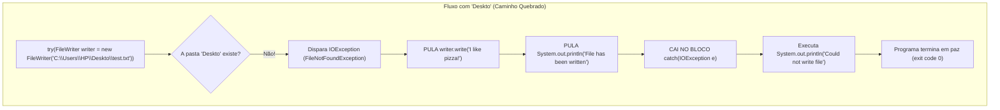

# ✍️ Java — Capítulo 58: `Write Files` (Parte 4)
## Gravando na Área de Trabalho com Caminho Absoluto, a Barra Dupla `\\` e o Teste do Erro no `catch` com `Deskto`

---

### 📌 Metadados da Aula e Contexto do Vídeo
- **Curso:** *Java Full Course for free* (Canal: Bro Code)
- **Capítulo Oficial:** `58. write files ✍️`
- **Intervalo de Tempo no Vídeo:** `09:17:34` até `09:18:15` (do total de 12:00:00)
- **Arquivo Principal de Trabalho:** [`Main.java`](file:///c:/Users/mickel%201/Downloads/JAVA%20APRENDER/Main.java)
- **Arquivo Criado na Área de Trabalho:** `C:\Users\HP\Desktop\test.txt` (aberto pelo Windows Notepad / Bloco de Notas)
- **Ambiente de Desenvolvimento (IDE):** IntelliJ IDEA Community Edition + Sistema Operacional Windows

---

## 📸 Reconstituição Visual Completa da Interface (Para quem vai colar no Google Docs)

Como você copiará este material diretamente para o seu **Google Docs** (onde as imagens originais não estarão incorporadas), veja abaixo a reconstituição visual exata do que acontece em cada uma das 5 imagens da tela do professor:

```
===================================================================================================
IMAGEM 1 (09:17:30) — JANELA DE PROPRIEDADES DO WINDOWS DA PASTA "NUCLEAR LAUNCH CODES"
===================================================================================================
Na Área de Trabalho do Windows, o professor abriu a janela de Propriedades da pasta.
A aba "General" (Geral) está ativa, exibindo os dados da pasta:

┌────────────────────────────────────────────────────────────────────────┐
│ 📁 Nuclear Launch Codes Properties                                  ✕ │
├────────────────────────────────────────────────────────────────────────┤
│ [General]  Sharing   Security   Previous Versions   Customize          │
│                                                                        │
│  📁  [ Nuclear Launch Codes                                          ] │
│  --------------------------------------------------------------------- │
│  Type:        File folder                                              │
│  Location:    [C:\Users\HP\Desktop]  <-- 🖱️ [SELECIONADO EM AZUL / COPIADO]
│  Size:        41.2 GB (44,323,484,832 bytes)                           │
│  Size on disk:41.2 GB (44,335,226,880 bytes)                           │
│  Contains:    6,381 Files, 450 Folders                                 │
│  Created:     Friday, March 4, 2022, 12:20:23 PM                       │
│  Attributes:  [■] Read-only (Only applies to files in folder)          │
│               [ ] Hidden                   [ Advanced... ]             │
│  --------------------------------------------------------------------- │
│                                 [  OK  ]   [ Cancel ]   [ Apply ]      │
└────────────────────────────────────────────────────────────────────────┘
* O professor clica e copia (Ctrl + C) o texto do campo Location: "C:\Users\HP\Desktop".

===================================================================================================
IMAGEM 2 (09:17:34) — COLANDO NO INTELLIJ: AS BARRAS DUPLAS E O ERRO DO "DESKTOPTEST.TXT"
===================================================================================================
O professor volta ao IntelliJ e cola o caminho dentro das aspas do FileWriter.
O IntelliJ automaticamente dobra as barras invertidas para não quebrar a String:
"C:\\Users\\HP\\Desktop"

PORÉM, como "test.txt" já estava lá sem barra antes dele colar, o caminho ficou grudado:
 9 | try(FileWriter writer = new FileWriter("C:\\Users\\HP\\Desktoptest.txt")){
                                                           ~~~~~~~~~~~~~~~
                                                  [SUB-LINHADO ONDULADO AMARELO]

* Note: "Desktoptest.txt" não existe como pasta! Faltou uma barra separadora "\\" entre
  a pasta "Desktop" e o arquivo "test.txt".

===================================================================================================
IMAGEM 3 (09:17:40) — CORREÇÃO COM "\\" E EXECUÇÃO COM SUCESSO NO CONSOLE
===================================================================================================
O professor insere a barra invertida dupla "\\" entre "Desktop" e "test.txt":
"C:\\Users\\HP\\Desktop\\test.txt"

O código compila perfeitamente. O professor clica no botão Play (Run).
No painel inferior "Run", o console confirma o sucesso:
+-------------------------------------------------------------------------------------------------+
| Run:  Main x                                                                                    |
+-------------------------------------------------------------------------------------------------+
| C:\Users\HP\.jdks\openjdk-23\bin\java.exe "-javaagent:..." Main                                 |
| File has been written                                                                           |
|                                                                                                 |
| Process finished with exit code 0                                                               |
+-------------------------------------------------------------------------------------------------+

===================================================================================================
IMAGEM 4 (09:17:50) — A PROVA FÍSICA NO DESKTOP E O BLOCO DE NOTAS ABERTO
===================================================================================================
O professor minimiza parcialmente as janelas para mostrar o Windows Desktop:
- Na Área de Trabalho, logo abaixo do ícone do paint.net, surgiu um NOVO ÍCONE DE ARQUIVO:
  📄 test  <-- 🖱️ [CURSOR DO MOUSE APONTANDO PARA O ARQUIVO NO DESKTOP]

- O professor clica duas vezes no arquivo "test" do Desktop.
- O Windows abre o BLOCO DE NOTAS (Notepad) na metade direita da tela:
  ┌────────────────────────────────────────────────────────────────────────┐
  │ test - Notepad                                                       ✕ │
  ├────────────────────────────────────────────────────────────────────────┤
  │ File  Edit  Format  View  Help                                         │
  │ I like pizza!                                                          │
  │                                                                        │
  └────────────────────────────────────────────────────────────────────────┘

Atrás do Bloco de Notas ainda vemos o console do IntelliJ exibindo "File has been written".
Isso prova 100% que o Java saiu da sua própria pasta e gravou o arquivo diretamente no Desktop!

===================================================================================================
IMAGEM 5 (09:18:10) — O TESTE DO ERRO: APAGANDO A LETRA "P" E TRANSFORMANDO EM "DESKTO"
===================================================================================================
O professor volta ao código e faz um teste proposital para demonstrar o bloco CATCH em ação!
Na linha 9, ele apaga a letra 'p' da palavra "Desktop", deixando apenas "Deskto":

 9  | try(FileWriter writer = new FileWriter("C:\\Users\\HP\\Deskto\\test.txt")){
                                                            ~~~~~~
                                                      [SEM A LETRA 'P'!]
 10 |     writer.write("I like pizza!");
 11 |     System.out.println("File has been written");
 12 | }
 13 | catch(IOException e){
 14 |     System.out.println("Could not write file");
 15 | }

Pergunta do professor: "O que acontece se a pasta não existir no seu computador?"
Como a pasta "C:\Users\HP\Deskto" NÃO EXISTE, o Java não consegue criar o arquivo lá dentro!
Ele dispara um erro (FileNotFoundException / IOException), pula as linhas 10 e 11,
e cai diretamente na linha 14 do catch: "Could not write file"!
===================================================================================================
```

---

## 🍕 O Código do Arquivo [`Main.java`](file:///c:/Users/mickel%201/Downloads/JAVA%20APRENDER/Main.java)

Aqui estão as duas versões de código demonstradas pelo professor nestas 5 imagens:

### Versão A (Imagens 3 e 4 — Caminho Absoluto Correto no Desktop):
```java
1: import java.io.FileWriter;
2: import java.io.IOException;
3: 
4: public class Main {
5:     public static void main(String[] args) {
6: 
7:         // How to write a file using Java (4 popular options)
8: 
9:         try(FileWriter writer = new FileWriter("C:\\Users\\HP\\Desktop\\test.txt")){
10:             writer.write("I like pizza!");
11:             System.out.println("File has been written");
12:         }
13:         catch(IOException e){
14:             System.out.println("Could not write file");
15:         }
16: 
17:     }
18: }
```

### Versão B (Imagem 5 — O Teste do Caminho Inválido com `"Deskto"`):
```java
9:         try(FileWriter writer = new FileWriter("C:\\Users\\HP\\Deskto\\test.txt")){
10:             writer.write("I like pizza!");
11:             System.out.println("File has been written");
12:         }
13:         catch(IOException e){
14:             System.out.println("Could not write file");
15:         }
```

---

## 🔍 Anatomia Linha por Linha Para Iniciantes Amadores ("Passo a Passo de Leigo")

Abaixo está o raio-X detalhado de cada linha, mostrando o que acontece quando o caminho está **correto** versus quando o caminho está **errado**:

| Linha | Código Exato | O que faz quando o caminho está CERTO (`Desktop`) | O que faz quando o caminho está ERRADO (`Deskto`) | Saída no Console |
| :---: | :--- | :--- | :--- | :---: |
| **1** | `import java.io.FileWriter;` | Importa a caneta de escrita de arquivos. | Importa a caneta de escrita de arquivos. | *(Nada)* |
| **2** | `import java.io.IOException;` | Importa o kit de tratamento de panes de E/S. | Importa o kit de tratamento de panes de E/S. | *(Nada)* |
| **3** | *(Linha em branco)* | Espaço visual. | Espaço visual. | *(Nada)* |
| **4** | `public class Main {` | Declaração da classe `Main`. | Declaração da classe `Main`. | *(Nada)* |
| **5** | `public static void main(String[] args) {` | Início oficial do programa. | Início oficial do programa. | *(Nada)* |
| **6** | *(Linha em branco)* | Espaço visual. | Espaço visual. | *(Nada)* |
| **7** | `// How to write a file using Java (4 popular options)` | Comentário explicativo; ignorado pelo Java. | Comentário explicativo; ignorado pelo Java. | *(Nada)* |
| **8** | *(Linha em branco)* | Espaço visual. | Espaço visual. | *(Nada)* |
| **9** | `try(FileWriter writer = new FileWriter(...)){` | **Sucesso:** Encontra a pasta `Desktop` e cria o arquivo `test.txt` lá dentro. Prepara a caneta `writer`. | **Falha Crítica:** Tenta achar a pasta `Deskto`. A pasta não existe! O Windows dá erro e o Java cospe uma `FileNotFoundException`. O bloco `try` é abortado IMEDIATAMENTE! | *(Nada)* |
| **10** | `    writer.write("I like pizza!");` | Grava silenciosamente o texto no arquivo da Área de Trabalho. | **NUNCA É EXECUTADA!** Como a linha 9 falhou, esta linha é pulada. | *(Nada)* |
| **11** | `    System.out.println("File has been written");` | Imprime a mensagem de vitória na tela. | **NUNCA É EXECUTADA!** Também é pulada devido ao erro. | Se certo: `File has been written` |
| **12** | `}` | Fecha o arquivo automaticamente (`.close()`). | O Java nem chegou a abrir nada, então nada é fechado. | *(Nada)* |
| **13** | `catch(IOException e){` | O erro não aconteceu, então este bloco é completamente ignorado e pulado. | **O Amortecedor Entra em Ação:** Captura a falha da linha 9 com segurança, impedindo o programa de travar. | *(Nada)* |
| **14** | `    System.out.println("Could not write file");` | Pulada (não houve erro). | **Executa:** Avisa o usuário na tela de forma educada que não foi possível gravar o arquivo. | Se errado: `Could not write file` |
| **15** | `}` | Fecha o bloco `catch`. | Fecha o bloco `catch`. | *(Nada)* |
| **16** | *(Linha em branco)* | Espaço visual. | Espaço visual. | *(Nada)* |
| **17** | `}` | Fecha o método `main`. | Fecha o método `main`. | *(Nada)* |
| **18** | `}` | Fecha a classe `Main`. | Fecha a classe `Main`. | *(Nada)* |

---

## 🖥️ Previsão Exata do Console nos Dois Cenários

### Cenário 1: Com o Caminho Correto (`"C:\\Users\\HP\\Desktop\\test.txt"`) — Imagem 3:
```text
File has been written

Process finished with exit code 0
```
*E o arquivo surge fisicamente na Área de Trabalho com o conteúdo `"I like pizza!"` (Imagem 4).*

---

### Cenário 2: Com o Caminho Errado (`"C:\\Users\\HP\\Deskto\\test.txt"`) — Imagem 5:
```text
Could not write file

Process finished with exit code 0
```
*Nenhum arquivo é criado, a linha 10 e a linha 11 são puladas, e o bloco catch salva o programa exibindo a mensagem amigável.*

---

## 🧠 Os 5 Conceitos Vitais Ensinados Pelo Professor Nestas Imagens

### 1. A Regra de Ouro da Barra Dupla (`\\`) em Strings no Java
Na **Imagem 1**, o Windows mostrou o caminho:
```text
C:\Users\HP\Desktop
```
Ao colar isso dentro de uma `String` Java, a barra invertida `\` tem um significado especial chamado **caractere de escape** (ex.: `\n` pula linha, `\t` dá tab, `\"` coloca aspas).
Se você deixar apenas uma barra `\`, o Java tenta interpretar `\U` ou `\H`, o que causa **erro de compilação imediato**!
- Por isso, em Java no Windows, **uma barra invertida deve ser escrita como DUAS barras invertidas (`\\`)**:
  ```java
  "C:\\Users\\HP\\Desktop\\test.txt"
  ```
- *Dica Moderna:* Você também pode usar a barra normal inclinada para a direita (`/`):
  ```java
  "C:/Users/HP/Desktop/test.txt"
  ```
  O Java e o Windows moderno entendem perfeitamente a barra `/` sem precisar dobrar nada!

---

### 2. O Erro Comum do Iniciante: `Desktoptest.txt` (Imagem 2)
Quando o professor colou `C:\Users\HP\Desktop` na frente de `test.txt`, o resultado ficou:
```text
"C:\\Users\\HP\\Desktoptest.txt"
```
Veja que faltou a barra entre `Desktop` e `test.txt`!
O computador não adivinha que `Desktop` é uma pasta e `test.txt` é um arquivo. Sem a barra separadora, o Windows procuraria um arquivo chamado `Desktoptest.txt` dentro da pasta `C:\Users\HP`.
Por isso o professor consertou na **Imagem 3** adicionando `\\` antes de `test.txt`.

---

### 3. A Prova Física Fora da IDE (Imagem 4)
Muitos iniciantes pensam que o que o Java faz só existe dentro do IntelliJ.
A Imagem 4 é fundamental para desmistificar isso:
- O professor minimizou o IntelliJ.
- Mostrou o arquivo real `test.txt` com o ícone do Bloco de Notas na Área de Trabalho do Windows.
- Abriu o arquivo pelo próprio Windows e mostrou a frase `"I like pizza!"`.
Isso prova que o Java tem o poder de manipular o sistema operacional, criar documentos reais, relatórios e registros em qualquer pasta do computador!

---

### 4. Por Que o Teste com `"Deskto"` é Tão Genial? (Imagem 5)
Na Imagem 5, o professor apagou a letra `p` de propósito:
```java
new FileWriter("C:\\Users\\HP\\Deskto\\test.txt")
```
Por que ele fez isso?
Para responder à pergunta que todo aluno faz: *"Professor, para que serve mesmo esse tal de try-catch que você colocou aí?"*.
- Se o código não tivesse `try-catch`, o programa travaria feio, com uma explosão de letras vermelhas na tela (`java.io.FileNotFoundException`).
- Com o `try-catch`, o Java tenta abrir a pasta. Como `Deskto` não existe, ele cancela a tentativa na hora, pula o `writer.write`, pula a mensagem de sucesso e cai suavemente no `catch`, exibindo com elegância:
  `Could not write file`.



---

## 💡 Analogia do Amador: A Carta e o Bairro Que Não Existe

Pense na entrega de uma carta pelo carteiro:

1. **Caminho Certo (`C:\Users\HP\Desktop\test.txt`):**
   - O envelope diz: *Cidade: Windows, Bairro: HP, Rua: Desktop, Casa: test.txt*.
   - O carteiro vai até o bairro Desktop, bate na porta e entrega a caixa de pizza (`I like pizza!`).
   - Ele volta para a central e confirma: *"A entrega foi concluída com sucesso!"* (`File has been written`).

2. **Caminho Errado (`C:\Users\HP\Deskto\test.txt`):**
   - O envelope diz: *Bairro: Deskto*.
   - O carteiro chega na cidade e procura o bairro `Deskto`. O GPS diz: *"Esse bairro não existe!"*.
   - O carteiro não joga a encomenda no chão nem bate o carro na parede. Ele simplesmente carimba o pacote com: *"Não foi possível entregar"* (`Could not write file`) e volta para a base em segurança.
   - Isso é o `catch(IOException e)`: a garantia de que o carteiro não vai surtar quando o endereço estiver errado!

---

## 🎯 Conclusão da Parte 4
Com estas 5 imagens, você dominou:
1. Como obter o **caminho absoluto** de qualquer pasta no Windows pelas Propriedades.
2. Como tratar as **barras invertidas** no Java usando `\\` (ou barras simples `/`).
3. Como evitar o erro de colar o caminho sem a barra separadora final.
4. A verificação do arquivo criado e aberto diretamente no **Bloco de Notas do Windows**.
5. Como simular um erro com `"Deskto"` para comprovar o funcionamento protetor do bloco `catch(IOException e)`!
