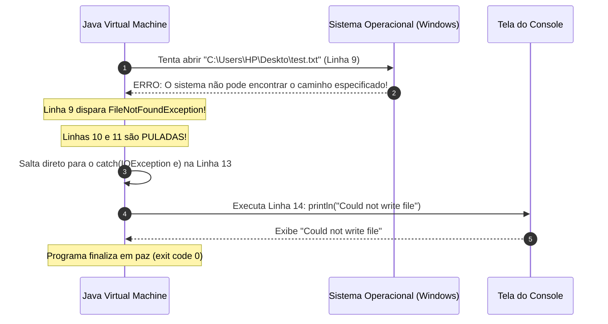

# ✍️ Java — Capítulo 58: `Write Files` (Parte 5)
## A Execução Real com Caminho Quebrado (`Deskto`), o Disparo do `catch`, a Saída `Could not write file` e o Significado do `exit code 0`

---

### 📌 Metadados da Aula e Contexto do Vídeo
- **Curso:** *Java Full Course for free* (Canal: Bro Code)
- **Capítulo Oficial:** `58. write files ✍️` *(Fechamento do primeiro grande bloco com FileWriter e Caminhos)*
- **Intervalo de Tempo no Vídeo:** `09:18:11` até `09:18:15` (do total de 12:00:00)
- **Arquivo Principal de Trabalho:** [`Main.java`](../../../src/main/java/com/mickaelgeronimo/mastery/core/concurrency/Main.java)
- **Ambiente de Desenvolvimento (IDE):** IntelliJ IDEA Community Edition rodando com JDK 23

---

## 📸 Reconstituição Visual Completa da Interface (Para quem vai colar no Google Docs)

Como você copiará este material diretamente para o seu **Google Docs** (onde as imagens originais não estarão incorporadas), veja abaixo a reconstituição visual e textual exata do que acontece nas 2 imagens exibidas na tela do professor:

```
===================================================================================================
IMAGEM 1 (09:18:15) — EXECUÇÃO NO CONSOLE: O "COULD NOT WRITE FILE" E O EXIT CODE 0
===================================================================================================
O professor clica no botão Play (Run) com o código contendo "Deskto" (sem a letra "p").
A janela inferior "Run" abre e exibe a mensagem VERDE de erro tratada:

+-------------------------------------------------------------------------------------------------+
| Run:  Main x                                                                                    |
+-------------------------------------------------------------------------------------------------+
| C:\Users\HP\.jdks\openjdk-23\bin\java.exe "-javaagent:..." Main                                 |
| Could not write file |  <-- 🖱️ [CURSOR DO TECLADO PISCANDO LOGO APÓS A FRASE]                    |
|                                                                                                 |
| Process finished with exit code 0                                                               |
+-------------------------------------------------------------------------------------------------+

OBSERVAÇÃO CRUCIAL:
1. A frase "File has been written" NÃO APARECEU! (Foi completamente pulada).
2. O texto "Could not write file" foi impresso no lugar.
3. Mesmo com a falha de pasta inexistente, o Java terminou com: "exit code 0"!
   Isso prova que o programa NÃO quebrou, NÃO travou e NÃO explodiu na cara do usuário.

===================================================================================================
IMAGEM 2 (09:18:11) — TELA PAUSADA COM O CÓDIGO FONTE COMPLETO E A LÂMPADA NA LINHA 9
===================================================================================================
O vídeo é pausado com o ícone gigante de pausa "❚❚" no centro do editor.
Na tela, vemos a anatomia completa do código com a IDE indicando detalhes visuais:

 3  | public class Main {
 4  |     public static void main(String[] args) {
 5  | 
 6  |         // How to write a file using Java (4 popular options)
 7  | 
 8  | 
 9  | 💡     try(FileWriter writer = new FileWriter("C:\\Users\\HP\\Deskto\\test.txt")){
                                                                    ~~~~~~
 10 |             writer.write("I like pizza!");
 11 |             System.out.println("File has been written");
 12 |         }
 13 |         catch(IOException e){
 14 |             System.out.println("Could not write file");
 15 |         }
 16 | 
 17 |     }
 18 | }

DETALHES VISUAIS DA IDE:
- Linha 9: Na calha esquerda (gutter), aparece o ícone de uma lâmpada amarela (💡) oferecendo
  dicas de inspeção do IntelliJ.
- A palavra "Deskto" possui um sublinhado ondulado de alerta (warning), avisando que a IDE
  fez uma varredura no Windows e não encontrou nenhum diretório com esse nome no computador.
- Na parte inferior direita do IntelliJ: "9:70  LF  UTF-8  4 spaces".
===================================================================================================
```

---

## 🍕 O Código Exato Executado Neste Momento

Este é o código que o professor rodou para gerar a saída da Imagem 1:

```java
1: import java.io.FileWriter;
2: import java.io.IOException;
3: 
4: public class Main {
5:     public static void main(String[] args) {
6: 
7:         // How to write a file using Java (4 popular options)
8: 
9:         try(FileWriter writer = new FileWriter("C:\\Users\\HP\\Deskto\\test.txt")){
10:             writer.write("I like pizza!");
11:             System.out.println("File has been written");
12:         }
13:         catch(IOException e){
14:             System.out.println("Could not write file");
15:         }
16: 
17:     }
18: }
```

---

## 🔍 Anatomia Linha por Linha Para Iniciantes Amadores ("Passo a Passo de Leigo")

Abaixo está o rastreamento exato da execução passo a passo no computador do professor (e no seu):

| Linha | Código Exato | O que acontece no computador durante a execução? | O que aparece no Console? |
| :---: | :--- | :--- | :---: |
| **1** | `import java.io.FileWriter;` | Carrega na memória a classe `FileWriter`. | *(Nada)* |
| **2** | `import java.io.IOException;` | Carrega na memória a classe de erro `IOException`. | *(Nada)* |
| **3** | *(Linha em branco)* | Organização visual. | *(Nada)* |
| **4** | `public class Main {` | Declaração da classe `Main`. | *(Nada)* |
| **5** | `public static void main(String[] args) {` | A CPU começa a executar as instruções do método principal aqui. | *(Nada)* |
| **6** | *(Linha em branco)* | Organização visual. | *(Nada)* |
| **7** | `// How to write a file using Java (4 popular options)` | Comentário; ignorado pelo computador. | *(Nada)* |
| **8** | *(Linha em branco)* | Organização visual. | *(Nada)* |
| **9** | `try(FileWriter writer = new FileWriter("C:\\Users\\HP\\Deskto\\test.txt")){` | **💥 A PANE ACONTECE AQUI:** O Java bate na porta do Windows e pede: *"Abra a pasta C:\Users\HP\Deskto"*. O Windows responde: *"Erro! Não existe nenhuma pasta chamada Deskto!"*. Imediatamente, o Java cria um objeto `FileNotFoundException` (que é um tipo de `IOException`) e **ABORTA O BLOCO TRY NA HORA!** | *(Nada)* |
| **10** | `    writer.write("I like pizza!");` | **⏭️ PULADA!** Como a linha 9 falhou, o programa nem chega perto desta linha. Nenhuma letra é escrita em lugar nenhum. | *(Nada)* |
| **11** | `    System.out.println("File has been written");` | **⏭️ PULADA!** O programa também pula a mensagem de vitória, pois o arquivo NÃO foi gravado. | *(Nada)* |
| **12** | `}` | **⏭️ PULADA!** O fechamento do try é ignorado porque o arquivo nunca chegou a ser aberto com sucesso. | *(Nada)* |
| **13** | `catch(IOException e){` | **🛡️ O SALTO DE RESGATE:** O fluxo do programa pula direto da linha 9 para cá! O Java pergunta: *"O erro que aconteceu é um IOException?"*. A resposta é **SIM!** Então o erro é capturado e guardado na variável `e`. | *(Nada)* |
| **14** | `    System.out.println("Could not write file");` | **📢 A EXECUÇÃO DO SOCORRO:** O Java executa esta linha com tranquilidade, enviando para a tela a mensagem que avisa amigavelmente o usuário sobre o problema. | `Could not write file` |
| **15** | `}` | Fecha o bloco `catch`. O erro foi 100% resolvido e neutralizado. | *(Nada)* |
| **16** | *(Linha em branco)* | Organização visual. | *(Nada)* |
| **17** | `}` | Fim do método `main`. | *(Nada)* |
| **18** | `}` | Fim da classe `Main`. O programa encerra sua missão com louvor. | *(Nada)* |

---

## 🖥️ Previsão Exata do Console (Imagem 1)

```text
Could not write file

Process finished with exit code 0
```

---

## 🧠 Por Que Esse Momento é Tão Importante? 4 Lições Críticas

### 1. O Salto Instantâneo da Linha 9 para a Linha 13
Muitos iniciantes pensam que o computador lê código linha por linha sem nunca pular nada.
Este exemplo prova visualmente a regra fundamental das **Exceções**:
> **Regra de Ouro:** No momento exato em que uma linha dentro do bloco `try` gera um erro, a execução daquele bloco é **interrompida imediatamente**. Todas as linhas seguintes do `try` são sumariamente ignoradas, e a execução pula em um milissegundo para o primeiro `catch` compatível.



---

### 2. O Que Significa `Process finished with exit code 0`?
Repare no finalzinho do console na Imagem 1:
```text
Process finished with exit code 0
```
Em sistemas operacionais (Windows, Linux, macOS):
- **`exit code 0` (Código de Saída Zero):** Significa que o programa chegou ao final do seu ciclo de vida de forma **controlada e bem-sucedida**, sem travar nem explodir.
- **`exit code 1` (ou qualquer número diferente de zero):** Significa que o programa **capotou** por causa de um erro fatal não tratado (*crash*).

Mesmo tendo acontecido um erro feio de pasta inexistente, o console marcou **`exit code 0`**!
Por que? Porque você colocou o `catch(IOException e)`.
Você assumiu a responsabilidade pelo erro, tratou a falha com dignidade, exibiu uma mensagem amigável e deixou o Java terminar o seu trabalho em paz!

---

### 3. A Lâmpada Amarela (💡) na Calha da Imagem 2
Na calha lateral esquerda da Imagem 2, na altura da linha 9, há uma lâmpada amarela (💡).
O que ela significa no IntelliJ IDEA?
O IntelliJ possui analisadores estáticos de código que rodam em segundo plano. Quando ele detecta algo no seu código que merece atenção (como uma pasta que não existe no caminho fixo, ou uma sugestão de melhoria de sintaxe), ele acende uma lâmpada amarela.
Ao clicar na lâmpada ou pressionar `Alt + Enter`, a IDE sugere correções automáticas para você.

---

### 4. Por Que o Java Obriga o Uso de `try-catch` com Arquivos (*Checked Exception*)?
Observe que você não precisou colocar `try-catch` quando fez `int x = 10 + 20;`.
Por que com `new FileWriter(...)` o compilador nos **obrigou** a colocar `try-catch`?

Porque o seu código Java não vive isolado do mundo:
1. O usuário pode digitar o nome de uma pasta que não existe (como `"Deskto"`).
2. O usuário pode desconectar o pendrive bem no meio da gravação.
3. O disco rígido ou SSD pode estar 100% lotado.
4. O Windows pode negar a permissão de escrita (ex.: salvar dentro da pasta do sistema `C:\Windows\System32`).

Como qualquer uma dessas coisas pode acontecer na vida real e está **fora do controle do Java**, o compilador impõe uma **Checked Exception** (`IOException`). Ele te diz:
> *"Você quer mexer no disco rígido? Tudo bem, mas você é OBRIGADO a me mostrar agora mesmo o que o seu programa vai fazer se a gravação der errado!"*.

E a resposta que demos foi:
```java
catch(IOException e){
    System.out.println("Could not write file");
}
```

---

## 💡 Analogia do Amador: A Encomenda com Endereço Errado

Para fixar de vez na cabeça:

- **O que tentamos fazer (Linha 9):** Você foi aos Correios enviar um presente de aniversário e escreveu na caixa: `Rua Deskto, nº 10`.
- **A Checagem do Carteiro (Linha 9):** O carteiro consulta o mapa da cidade. A rua `Deskto` não existe.
- **Sem Try-Catch (Desastre):** O carteiro joga a caixa no chão, quebra o presente e fecha a agência dos Correios para sempre (`crash` / `exit code 1`).
- **Com Try-Catch (Profissionalismo):** O carteiro carimba no pacote: *"Endereço não localizado"* (`Could not write file`), devolve o pacote para a prateleira em segurança e continua atendendo as outras pessoas da fila normalmente (`exit code 0`).

---

## 🎯 Conclusão da Parte 5
Nestas duas imagens de fechamento:
1. Vimos a execução real da falha proposital com `"Deskto"`.
2. Confirmamos que `writer.write` e `System.out.println("File has been written")` foram 100% ignoradas devido ao erro.
3. Vimos a mensagem de proteção `Could not write file` ser exibida na tela.
4. Compreendemos a importância do `exit code 0` como prova de que o bloco `catch` cumpriu com maestria o seu papel de amortecedor.
