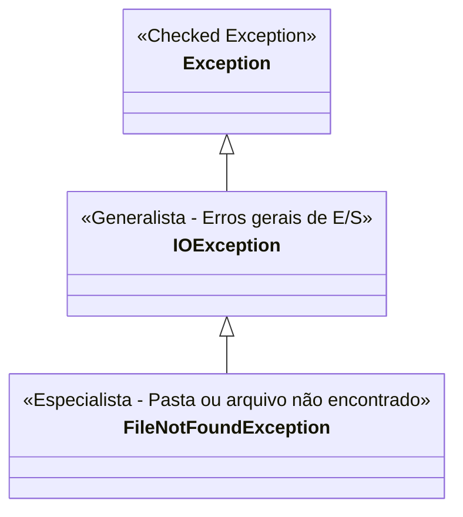

# ✍️ Java — Capítulo 58: `Write Files` (Parte 6)
## Multi-Catch com `FileNotFoundException`, Quebra de Linha com `\n` e Refatoração Profissional do Código

---

### 📌 Metadados da Aula e Contexto do Vídeo
- **Curso:** *Java Full Course for free* (Canal: Bro Code)
- **Capítulo Oficial:** `58. write files ✍️`
- **Intervalo de Tempo no Vídeo:** `09:19:11` até `09:20:10` (do total de 12:00:00)
- **Arquivo Principal de Trabalho:** [`Main.java`](../../../src/main/java/com/mickaelgeronimo/mastery/core/concurrency/Main.java)
- **Arquivo Gerado com Múltiplas Linhas:** [`test.txt`](../../../src/main/resources/test.txt) (ou no Desktop)
- **Ambiente de Desenvolvimento (IDE):** IntelliJ IDEA Community Edition + Windows Notepad (Bloco de Notas)

---

## 📸 Reconstituição Visual Completa da Interface (Para quem vai colar no Google Docs)

Como você copiará este material diretamente para o seu **Google Docs** (onde as imagens originais não estarão incorporadas), veja abaixo a reconstituição visual exata do que acontece em cada uma das 5 imagens da tela do professor:

```
===================================================================================================
IMAGEM 1 (09:19:11) — O RESULTADO DO TESTE COM "DESKTO": MENSAGEM ESPECÍFICA NO CONSOLE!
===================================================================================================
O professor executa o código com o caminho quebrado "C:\\Users\\HP\\Deskto\\test.txt".
Na janela inferior "Run", aparece uma nova mensagem de socorro muito mais específica:

+-------------------------------------------------------------------------------------------------+
| Run:  Main x                                                                                    |
+-------------------------------------------------------------------------------------------------+
| C:\Users\HP\.jdks\openjdk-23\bin\java.exe "-javaagent:..." Main                                 |
| Could not locate file location |  <-- 🖱️ [NOVO TEXTO ESPECÍFICO DE ARQUIVO/PASTA NÃO ACHADA!]    |
|                                                                                                 |
| Process finished with exit code 0                                                               |
+-------------------------------------------------------------------------------------------------+

* Por que mudou de "Could not write file" para "Could not locate file location"?
  Porque o professor adicionou um novo bloco catch especializado em FileNotFoundException!

===================================================================================================
IMAGEM 2 (09:19:25) — O CÓDIGO COM O NOVO CATCH E A QUEBRA DE LINHA "\n"
===================================================================================================
O editor do IntelliJ exibe o código com duas grandes novidades:
1. O caminho foi restaurado para "Desktop" (correto).
2. O texto de escrita agora possui uma quebra de linha: "I like pizza!\nIt's really good!".
3. Existem DOIS blocos catch empilhados (um específico e um geral):

 10 | try(FileWriter writer = new FileWriter("C:\\Users\\HP\\Desktop\\test.txt")){
 11 |     writer.write("I like pizza!\nIt's really good!");
 12 |     System.out.println("File has been written");
 13 | }
 14 | catch(FileNotFoundException e){
 15 |     System.out.println("Could not locate file location");
 16 | }
 17 | catch(IOException e){
 18 |     System.out.println("Could not write file");
 19 | }

===================================================================================================
IMAGEM 3 (09:19:37) — A PROVA NO BLOCO DE NOTAS: DUAS LINHAS SEPARADAS GRAVADAS NO DISCO!
===================================================================================================
O professor roda o programa com o caminho corrigido.
O console do IntelliJ marca: "File has been written".
Ele abre o arquivo "test" gerado na Área de Trabalho com o Bloco de Notas do Windows (Notepad):

┌────────────────────────────────────────────────────────────────────────┐
│ test - Notepad                                                       ✕ │
├────────────────────────────────────────────────────────────────────────┤
│ File  Edit  Format  View  Help                                         │
│ I like pizza!                                                          │
│ It's really good!                                                      │
│                                                                        │
└────────────────────────────────────────────────────────────────────────┘

* O caractere "\n" não apareceu escrito! Em vez disso, ele empurrou o texto
  "It's really good!" exatamente para a LINHA 2!

===================================================================================================
IMAGEM 4 (09:19:51) — INICIANDO A REFATORAÇÃO: EXTRAINDO PARA VARIÁVEIS
===================================================================================================
O professor volta ao código e decide fazer uma limpeza profissional (refatoração):
- No topo (linhas 1 a 3), os imports estão organizados:
  1 | import java.io.FileNotFoundException;
  2 | import java.io.FileWriter;
  3 | import java.io.IOException;

- Na linha 10, antes do try, ele começa a declarar uma variável String:
  10 |         String filePath = "";|  <-- 🖱️ [DIGITANDO A VARIÁVEL DO CAMINHO]

Objetivo: Não deixar caminhos compridos e textos gigantes misturados dentro dos parênteses do try!

===================================================================================================
IMAGEM 5 (09:20:10) — A REFATORAÇÃO COMPLETA: CÓDIGO LIMPO, ELEGANTE E ROBUSTO
===================================================================================================
O professor termina de estruturar as duas variáveis e o código fica impecável:

 10 |         String filePath = "C:\\Users\\HP\\Desktop\\test.txt";
 11 |         String textContent = "I like pizza!\nIt's really good!\nBuy me pizza!";
 12 | 
 13 |         try(FileWriter writer = new FileWriter(filePath)){
 14 |             writer.write(textContent);
 15 |             System.out.println("File has been written");
 16 |         }
 17 |         catch(FileNotFoundException e){
 18 |             System.out.println("Could not locate file location");
 19 |         }
 20 |         catch(IOException e){
 21 |             System.out.println("Could not write file");
 22 |         }

O cursor do mouse move-se até o botão Play verde no topo direito para rodar o código final!
===================================================================================================
```

---

## 🍕 O Código Completo do Arquivo [`Main.java`](../../../src/main/java/com/mickaelgeronimo/mastery/core/concurrency/Main.java)

Aqui está o código exato da Imagem 5 que está sincronizado no seu computador:

```java
1: import java.io.FileNotFoundException;
2: import java.io.FileWriter;
3: import java.io.IOException;
4: 
5: public class Main {
6:     public static void main(String[] args) {
7: 
8:         // How to write a file using Java (4 popular options)
9: 
10:         String filePath = "C:\\Users\\HP\\Desktop\\test.txt";
11:         String textContent = "I like pizza!\nIt's really good!\nBuy me pizza!";
12: 
13:         try(FileWriter writer = new FileWriter(filePath)){
14:             writer.write(textContent);
15:             System.out.println("File has been written");
16:         }
17:         catch(FileNotFoundException e){
18:             System.out.println("Could not locate file location");
19:         }
20:         catch(IOException e){
21:             System.out.println("Could not write file");
22:         }
23: 
24:     }
25: }
```

---

## 🔍 Anatomia Linha por Linha Para Iniciantes Amadores ("Passo a Passo de Leigo")

Abaixo está o raio-X minucioso de cada linha do código final:

| Linha | Código Exato | O que essa linha faz na prática? | O que aparece no Console? |
| :---: | :--- | :--- | :---: |
| **1** | `import java.io.FileNotFoundException;` | Traz o relatório de pane específico para *"Arquivo ou Pasta não encontrada no disco"*. | *(Nada)* |
| **2** | `import java.io.FileWriter;` | Traz a nossa caneta de gravação de arquivos de texto. | *(Nada)* |
| **3** | `import java.io.IOException;` | Traz a rede de segurança genérica para qualquer outro erro de E/S. | *(Nada)* |
| **4** | *(Linha em branco)* | Espaço visual. | *(Nada)* |
| **5** | `public class Main {` | Declaração da classe principal `Main`. | *(Nada)* |
| **6** | `public static void main(String[] args) {` | Ponto de partida oficial da execução. | *(Nada)* |
| **7** | *(Linha em branco)* | Espaço visual. | *(Nada)* |
| **8** | `// How to write a file using Java (4 popular options)` | Comentário explicativo; ignorado pelo computador. | *(Nada)* |
| **9** | *(Linha em branco)* | Espaço visual. | *(Nada)* |
| **10** | `String filePath = "C:\\Users\\HP\\Desktop\\test.txt";` | **Refatoração do Caminho:** Guarda o endereço postal do arquivo em uma variável limpa chamada `filePath`. Se quisermos mudar para outro lugar, só alteramos aqui! | *(Nada)* |
| **11** | `String textContent = "I like pizza!\nIt's really good!\nBuy me pizza!";` | **Refatoração do Conteúdo com `\n`:** Cria a variável `textContent` com 3 frases separadas por `\n`. Cada `\n` é uma ordem secreta para pular para a próxima linha! | *(Nada)* |
| **12** | *(Linha em branco)* | Espaço visual. | *(Nada)* |
| **13** | `try(FileWriter writer = new FileWriter(filePath)){` | **Abertura Segura:** Abre a caneta `writer` apontada para o caminho guardado em `filePath`. Se o caminho for válido, cria/abre o arquivo. Se a pasta não existir (ex: `Deskto`), aborta aqui mesmo e lança `FileNotFoundException`. | *(Nada)* |
| **14** | `    writer.write(textContent);` | **Gravação em Disco:** Despeja todo o texto de `textContent` dentro do arquivo no disco. As 3 frases são gravadas em 3 linhas físicas. | *(Nada)* |
| **15** | `    System.out.println("File has been written");` | **Mensagem de Vitória:** Avisa na tela do console que a gravação terminou com sucesso. | Se caminho certo: `File has been written` |
| **16** | `}` | Fim do `try`: O Java chama `writer.close()` automaticamente, gravando em definitivo os dados no SSD/HD e liberando o arquivo no Windows. | *(Nada)* |
| **17** | `catch(FileNotFoundException e){` | **Amortecedor Especialista:** Captura especificamente erros onde o Windows não achou o caminho/pasta. Só é acionado se a linha 13 falhar por pasta inexistente! | *(Nada)* |
| **18** | `    System.out.println("Could not locate file location");` | Mensagem de erro sob medida para quando o caminho está errado. | Se caminho errado: `Could not locate file location` |
| **19** | `}` | Fecha o primeiro `catch`. | *(Nada)* |
| **20** | `catch(IOException e){` | **Amortecedor Geral:** Se acontecer qualquer outro erro que NÃO seja pasta inexistente (ex.: disco rígido com defeito, pendrive ejetado à força, sem espaço em disco), este bloco acolhe o problema. | *(Nada)* |
| **21** | `    System.out.println("Could not write file");` | Mensagem de socorro genérica. | Se outro erro ocorrer: `Could not write file` |
| **22** | `}` | Fecha o segundo `catch`. | *(Nada)* |
| **23** | *(Linha em branco)* | Espaço visual. | *(Nada)* |
| **24** | `}` | Fim do método `main`. | *(Nada)* |
| **25** | `}` | Fim da classe `Main`. | *(Nada)* |

---

## 🖥️ Previsão Exata do Console e do Arquivo Físico

### 1. Se o Caminho Estiver Correto (Imagem 3 e 5):
- **No Console:**
  ```text
  File has been written

  Process finished with exit code 0
  ```
- **Dentro do Arquivo [`test.txt`](../../../src/main/resources/test.txt) no Disco:**
  ```text
  I like pizza!
  It's really good!
  Buy me pizza!
  ```

---

### 2. Se o Caminho Tiver Erro de Pasta (Imagem 1 com `"Deskto"`):
- **No Console:**
  ```text
  Could not locate file location

  Process finished with exit code 0
  ```
- **No Disco:**
  *Nenhum arquivo é criado. As linhas 14 e 15 são puladas e o programa não trava.*

---

## 🧠 Os 3 Grandes Conceitos Ensinados Pelo Professor

### 1. A Hierarquia das Exceções: O Especialista Vem Antes do Generalista!
No Capítulo 57 (`Exception Handling`), aprendemos sobre classes filhas e mães.
Veja a árvore genealógica dessas duas exceções:



> [!IMPORTANT]
> **A Regra de Ouro do Multi-Catch:**
> A classe **mais específica** (`FileNotFoundException`) **SEMPRE** deve ficar em cima da classe **mais genérica** (`IOException`).
> - Se você colocasse o `catch(IOException e)` primeiro, ele engoliria absolutamente tudo (já que `FileNotFoundException` É um tipo de `IOException`).
> - O `catch(FileNotFoundException e)` embaixo ficaria completamente inútil e o compilador do Java daria um erro vermelho de **Unreachable code** (código inatingível)!

---

### 2. O Caractere de Escape `\n` (Como Pular Linhas em Arquivos)
Se você tentar dar "Enter" no teclado no meio de uma String do Java:
```java
// ERRO DE COMPILAÇÃO! O Java não aceita quebras literais de linha dentro de aspas duplas!
String texto = "Linha 1
Linha 2";
```
Para dizer ao computador: *"Grave isso e pule para a linha de baixo"*, usamos a sequência de escape **`\n`** (*newline*):
```java
"I like pizza!\nIt's really good!\nBuy me pizza!"
```
Quando o Windows Notepad lê o arquivo, ao encontrar o `\n`, ele empurra o cursor para baixo, criando o parágrafo perfeitamente (como vimos na Imagem 3)!

---

### 3. Refatoração (*Clean Code*): Variáveis Separadas vs Código Misturado
Compare os dois jeitos:

```java
// JEITO BRUTO (Difícil de ler e manter):
try(FileWriter writer = new FileWriter("C:\\Users\\HP\\Desktop\\test.txt")){
    writer.write("I like pizza!\nIt's really good!\nBuy me pizza!");
    ...
}

// JEITO PROFISSIONAL / REFATORADO (Limpo e elegante):
String filePath = "C:\\Users\\HP\\Desktop\\test.txt";
String textContent = "I like pizza!\nIt's really good!\nBuy me pizza!";

try(FileWriter writer = new FileWriter(filePath)){
    writer.write(textContent);
    ...
}
```
**Por que o jeito profissional é infinitamente melhor?**
1. **Facilidade de Troca:** Se você quiser mudar o arquivo para `"dados.csv"`, só precisa mudar a linha 10. Você não precisa fuçar dentro do `try`.
2. **Organização Mental:** Você primeiro prepara os ingredientes (`filePath`, `textContent`) e depois liga o fogão (`try-with-resources`).

---

## 💡 Analogia do Amador: A Triagem no Hospital

Para fixar a ordem dos dois blocos `catch`:

1. **A Recepção do Hospital (`try`):** O paciente tenta entrar para ser atendido. Se tudo der certo, ele é atendido e vai embora feliz (`File has been written`).
2. **O Especialista em Ossos (`catch (FileNotFoundException e)`):** Se o paciente quebrou um osso específico (a pasta do arquivo não existe), o ortopedista corre primeiro, engessa e avisa com precisão médica: *"Localize a fratura!"* (`Could not locate file location`).
3. **O Médico Clínico Geral (`catch (IOException e)`):** Se o paciente teve qualquer outro mal-estar misterioso (pressão baixa, disco cheio, erro elétrico), o clínico geral acolhe o caso e diz: *"Não foi possível tratar"* (`Could not write file`).

Se o clínico geral ficasse na porta pegando todo mundo antes do ortopedista, o ortopedista nunca trabalharia! Por isso o especialista fica sempre na frente!

---

## 🎯 Conclusão da Parte 6
Com estas 5 imagens, você aprendeu:
1. Como empilhar múltiplos blocos `catch` respeitando a hierarquia da mais específica (`FileNotFoundException`) para a mais genérica (`IOException`).
2. Como usar `\n` para criar arquivos de texto com várias linhas formatadas.
3. Como comprovar a quebra de linha visualmente pelo Bloco de Notas (Notepad).
4. Como refatorar seu código declarando `filePath` e `textContent` como variáveis independentes, tornando seu código profissional e legível!
