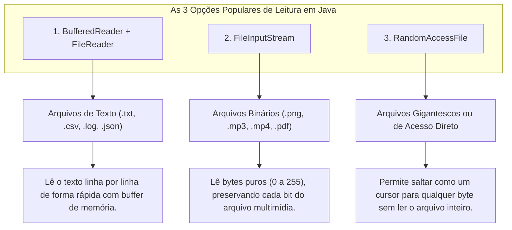

# 📖 Java — Capítulo 59: `Read Files` (Parte 1)
## As 3 Opções Populares de Leitura em Java e a Preparação do Arquivo no Desktop

---

### 📌 Metadados da Aula e Contexto do Vídeo
- **Curso:** *Java Full Course for free* (Canal: Bro Code)
- **Capítulo Oficial:** `59. read files 📖` *(Novo Capítulo!)*
- **Intervalo de Tempo no Vídeo:** `09:22:05` até `09:22:45` (do total de 12:00:00)
- **Arquivo Principal de Trabalho:** [`Main.java`](../../../src/main/java/com/mickaelgeronimo/mastery/core/concurrency/Main.java)
- **Arquivo Preparado no Desktop:** [`test.txt`](../../../src/main/resources/test.txt) (criado manualmente no Windows)
- **Ambiente de Desenvolvimento (IDE):** IntelliJ IDEA Community Edition + Windows Desktop

---

## 📸 Reconstituição Visual Completa da Interface (Para quem vai colar no Google Docs)

Como você copiará este material diretamente para o seu **Google Docs** (onde as imagens originais não estarão incorporadas), veja abaixo a reconstituição visual e textual exata do que acontece em cada uma das 5 imagens exibidas na tela do professor:

```
===================================================================================================
IMAGEM 1 (09:22:05) — ABERTURA DO CAPÍTULO 59 E AS 3 OPÇÕES DE LEITURA COMENTADAS
===================================================================================================
A barra inferior do YouTube muda oficialmente de capítulo: "59.read files >".
No editor do IntelliJ, o código começa limpo, com um cabeçalho explicativo de comentários.
O professor usa o mouse para selecionar o trecho "(3 popular options)" na linha 5:

 1 | 
 2 | public class Main {
 3 |     public static void main(String[] args) {
 4 | 
 5 |         // How to read a file using Java [ (3 popular options) ] <-- [SELECIONADO EM AZUL]
 6 | 
 7 |         // BufferedReader + FileReader: Best for reading text files line-by-line
 8 |         // FileInputStream: Best for binary files (e.g., images, audio files)
 9 |         // RandomAccessFile: Best for read/write specific portions of a large file
10 | 
11 |     }
12 | }

===================================================================================================
IMAGEM 2 (09:22:05) — NAVEGAÇÃO DA TIMELINE E FOCO NOS COMENTÁRIOS
===================================================================================================
A tela continua focada no código de introdução enquanto o professor introduz oralmente
o objetivo do capítulo: "No capítulo anterior aprendemos a escrever arquivos.
Agora vamos aprender como abrir um arquivo existente e ler seu conteúdo para dentro do Java!".

===================================================================================================
IMAGEM 3 (09:22:20) — CRIANDO O ARQUIVO NO WINDOWS DESKTOP: BOTÃO DIREITO -> NEW -> TEXT DOCUMENT
===================================================================================================
O professor vai até a sua Área de Trabalho (Windows Desktop) para criar um arquivo que servirá
de cobaia para o programa ler.
Ele clica com o BOTÃO DIREITO DO MOUSE em um espaço vazio do Desktop:

┌───────────────────────────────────────┐
│ View >                                │
│ Sort by >                             │
│ Refresh                               │
│ ------------------------------------- │
│ Paste                                 │
│ Paste shortcut                        │
│ Undo Delete                    Ctrl+Z │
│ ------------------------------------- │
│ AMD Software: Adrenalin Edition       │
│ NVIDIA Control Panel                  │
│ ------------------------------------- │
│ New >               -----------------------> ┌───────────────────────────────┐
│ -------------------------------------        │ 📁 Folder                     │
│ Display settings                             │ 🔗 Shortcut                   │
│ Personalize                                  │ ----------------------------- │
└───────────────────────────────────────┘      │ 🖼️ Bitmap image               │
                                               │ 📄 Rich Text Document         │
                                               │ 📄 Text Document  <-- 🖱️ [CLIQUE AQUI]
                                               │ 🗜️ Compressed Folder          │
                                               └───────────────────────────────┘

===================================================================================================
IMAGEM 4 (09:22:25) — O NOVO ARQUIVO "NEW TEXT DOCUMENT" NA ÁREA DE TRABALHO
===================================================================================================
Na Área de Trabalho, logo abaixo do ícone do paint.net, surge o novo arquivo de texto:
📄 [New Text Document]  <-- [TEXTO DESTACADO EM AZUL PARA RENOMEAR]

O professor renomeia o arquivo para: "test.txt".

===================================================================================================
IMAGEM 5 (09:22:40) — DIGITANDO O POEMA NO BLOCO DE NOTAS E FECHANDO O ARQUIVO
===================================================================================================
O professor clica duas vezes no arquivo recém-criado.
A janela do BLOCO DE NOTAS (Notepad) se abre na frente do IntelliJ:

┌────────────────────────────────────────────────────────────────────────┐
│ test - Notepad                                                    [✕]  │ <-- 🖱️ [CLICANDO NO X]
├────────────────────────────────────────────────────────────────────────┤
│ File  Edit  Format  View  Help                                         │
│ Roses are Red                                                          │
│ Violets are Blue                                                       │
│ BOOTY BOOTY BOOTY                                                      │
│ ROCKIN' EVERYWHERE!                                                    │
│                                                                        │
└────────────────────────────────────────────────────────────────────────┘

O professor digita os 4 versos do famoso poema cômico do Bro Code.
Em seguida, ele clica no "X" vermelho no canto superior direito para salvar e fechar a janela.
O cenário está 100% pronto no computador: existe um arquivo real no Desktop com texto
pronto para ser lido pelo nosso futuro código Java!
===================================================================================================
```

---

## 🍕 O Código do Arquivo [`Main.java`](../../../src/main/java/com/mickaelgeronimo/mastery/core/concurrency/Main.java) Nesta Etapa

Aqui está o código exato que está no editor do IntelliJ:

```java
1: public class Main {
2:     public static void main(String[] args) {
3: 
4:         // How to read a file using Java (3 popular options)
5: 
6:         // BufferedReader + FileReader: Best for reading text files line-by-line
7:         // FileInputStream: Best for binary files (e.g., images, audio files)
8:         // RandomAccessFile: Best for read/write specific portions of a large file
9: 
10:     }
11: }
```

---

## 🔍 Anatomia Linha por Linha Para Iniciantes Amadores ("Passo a Passo de Leigo")

Abaixo está o raio-X detalhado de cada linha desta introdução:

| Linha | Código Exato | O que essa linha faz na prática? | O que aparece no Console? |
| :---: | :--- | :--- | :---: |
| **1** | `public class Main {` | Declara o contêiner principal da aplicação chamado `Main`. | *(Nada)* |
| **2** | `public static void main(String[] args) {` | Ponto de entrada onde a execução começa quando clicamos no Play. | *(Nada)* |
| **3** | *(Linha em branco)* | Espaço visual para organização. | *(Nada)* |
| **4** | `// How to read a file using Java (3 popular options)` | **Comentário Título:** Avisa que o Java possui 3 maneiras populares de ler arquivos. Ignorado pelo computador. | *(Nada)* |
| **5** | *(Linha em branco)* | Espaço visual para organização. | *(Nada)* |
| **6** | `// BufferedReader + FileReader: Best for reading text files line-by-line` | **Opção 1 (Texto):** A melhor opção para arquivos de texto comuns lidos linha por linha. Ignorado pelo computador. | *(Nada)* |
| **7** | `// FileInputStream: Best for binary files (e.g., images, audio files)` | **Opção 2 (Binário):** A melhor opção para arquivos que não são texto (fotos, músicas, vídeos). Ignorado pelo computador. | *(Nada)* |
| **8** | `// RandomAccessFile: Best for read/write specific portions of a large file` | **Opção 3 (Acesso Direto):** Para pular para qualquer pedaço de arquivos grandes sem ler tudo. Ignorado pelo computador. | *(Nada)* |
| **9** | *(Linha em branco)* | Espaço visual para organização. | *(Nada)* |
| **10** | `}` | Fecha o método `main`. | *(Nada)* |
| **11** | `}` | Fecha a classe `Main`. | *(Nada)* |

---

## 🖥️ Previsão Exata do Console

Como o programa contém apenas comentários explicativos dentro do método `main`, ao ser executado:
```text
(Nenhuma saída é exibida no console)

Process finished with exit code 0
```

---

## 🧠 Os 3 Métodos de Leitura Explicados para Iniciantes Amadores

No Capítulo 58 (`Write Files`), vimos 4 classes de escrita.
Agora, no **Capítulo 59 (`Read Files`)**, o Java nos apresenta 3 opções consagradas para ler arquivos do computador. Veja as diferenças fundamentais:



---

### 1. `BufferedReader + FileReader` (A Estrela do Capítulo!)
- **O que faz:** É a combinação perfeita para quem quer ler arquivos que seres humanos conseguem ler no Bloco de Notas (`.txt`, `.csv`, relatórios, etc.).
- **Por que é o melhor?** Porque ele lê **uma linha inteira de cada vez** com o método `.readLine()`. Ele não engasga o computador e consome pouquíssima memória.

### 2. `FileInputStream` (Para Arquivos Binários)
- **O que faz:** Se você tentar abrir uma foto de cachorro (`dog.png`) ou uma música (`musica.mp3`) com o `FileReader`, o programa vai ler caracteres sem sentido cheios de interrogações e símbolos estranhos.
- **Por que?** Porque fotos e músicas são **arquivos binários** (cadeias de bytes puros).
- Para ler fotos e áudios sem corromper os dados, usamos `FileInputStream`.

### 3. `RandomAccessFile` (O Acesso Aleatório / Direto)
- **O que faz:** Imagine um livro com 5.000 páginas. Com o `BufferedReader`, para ler a página 4.000 você precisa ler as primeiras 3.999 páginas uma a uma.
- O `RandomAccessFile` funciona como abrir o livro diretamente no índice e pular com o dedo na página 4.000! Ele permite ler e escrever em qualquer posição arbitrária do arquivo.

---

## 💡 Analogia do Amador: Os 3 Tipos de Leitores na Vida Real

1. **`BufferedReader + FileReader` (O Leitor de Livros):** É uma pessoa lendo um livro frase por frase, respeitando os parágrafos até chegar na última página.
2. **`FileInputStream` (O Scanner Médico de Raio-X):** Não sabe o que é uma letra ou palavra. Ele analisa molécula por molécula (byte por byte) para capturar a imagem exata sem distorções.
3. **`RandomAccessFile` (O DJ com Toca-Discos de Vinil):** O DJ pega a agulha com a mão e solta exatamente no minuto 3:45 da música, sem precisar ouvir os primeiros 3 minutos!

---

## 📄 O Arquivo de Teste Criado no Desktop ([`test.txt`](../../../src/main/resources/test.txt))

Na Imagem 5, o professor preparou o arquivo `test.txt` com o seguinte conteúdo exato:

```text
Roses are Red
Violets are Blue
BOOTY BOOTY BOOTY
ROCKIN' EVERYWHERE!
```

Nas próximas partes deste capítulo, escreveremos o código Java para fazer o computador abrir este arquivo no Desktop e ler verso por verso!

---

## 🎯 Conclusão da Parte 1
Neste pontapé inicial do Capítulo 59:
1. Conhecemos as **3 opções populares** para ler arquivos em Java.
2. Entendemos por que `BufferedReader + FileReader` é a melhor escolha para ler texto linha por linha.
3. Acompanhamos a criação manual do arquivo cobaia `test.txt` na Área de Trabalho com o poema de 4 linhas.
4. O ambiente está 100% pronto para iniciarmos a programação do leitor de arquivos na próxima aula!
