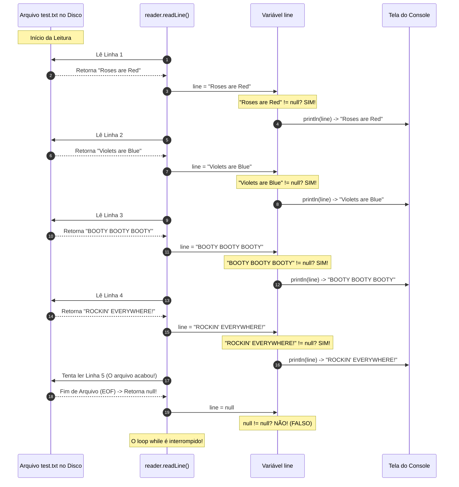

# 📖 Java — Capítulo 59: `Read Files` (Parte 4)
## O Loop `while((line = reader.readLine()) != null)` e a Leitura Completa do Poema Linha por Linha

---

### 📌 Metadados da Aula e Contexto do Vídeo
- **Curso:** *Java Full Course for free* (Canal: Bro Code)
- **Capítulo Oficial:** `59. read files 📖` *(Fechamento do bloco BufferedReader + FileReader)*
- **Intervalo de Tempo no Vídeo:** `09:26:58` até `09:28:40` (do total de 12:00:00)
- **Arquivo Principal de Trabalho:** [`Main.java`](../../../src/main/java/com/mickaelgeronimo/mastery/core/concurrency/Main.java)
- **Arquivo de Texto Lido no Desktop:** [`test.txt`](../../../src/main/resources/test.txt)
- **Ambiente de Desenvolvimento (IDE):** IntelliJ IDEA Community Edition + JDK 23

---

## 📸 Reconstituição Visual Completa da Interface (Para quem vai colar no Google Docs)

Como você copiará este material diretamente para o seu **Google Docs** (onde as imagens originais não estarão incorporadas), veja abaixo a reconstituição visual e textual exata do que acontece em cada uma das 5 imagens exibidas na tela do professor:

```
===================================================================================================
IMAGEM 1 (09:26:58) — O TESTE DO CAMINHO QUEBRADO: "COULD NOT LOCATE FILE"
===================================================================================================
Antes de ler o poema, o professor testa se a proteção funciona na leitura:
Ele altera o caminho na linha 15 para: "C:\\Users\\HP\\Deskto\\test.txt" (sem a letra "p").
Ao rodar, a janela "Run" confirma que a falha foi capturada com elegância:

+-------------------------------------------------------------------------------------------------+
| Run:  Main x                                                                                    |
+-------------------------------------------------------------------------------------------------+
| C:\Users\HP\.jdks\openjdk-23\bin\java.exe "-javaagent:..." Main                                 |
| Could not locate file                                                                           |
|                                                                                                 |
| Process finished with exit code 0                                                               |
+-------------------------------------------------------------------------------------------------+
* Como a pasta "Deskto" não existe, o FileReader disparou FileNotFoundException e o catch exibiu
  "Could not locate file", sem travar o computador!

===================================================================================================
IMAGEM 2 (09:27:30) — DIGITANDO A LÓGICA DE LEITURA: WHILE E READLINE()
===================================================================================================
O professor restaura o caminho para "Desktop" (correto).
Em seguida, ele substitui o teste "That file exists" pelo loop oficial de leitura:

 17 |         try(BufferedReader reader = new BufferedReader(new FileReader(filePath))){
 18 | 
 19 |             String line;
 20 |             while((line = reader.readLine()) != null){
 21 |                 System.out.println(line);
 22 |             }
 23 |         }

O professor posiciona o cursor do mouse sobre a setinha verde Play (Run) ▶️ no topo direito.

===================================================================================================
IMAGEM 3 (09:28:10) — A EXECUÇÃO VITORIOSA: O POEMA COMPLETO IMPRESSO NO CONSOLE!
===================================================================================================
O professor clica no Play.
O leitor do Java abre o arquivo físico "test.txt" na Área de Trabalho e lê linha por linha.
A janela "Run" imprime as 4 estrofes com perfeição absoluta:

+-------------------------------------------------------------------------------------------------+
| Run:  Main x                                                                                    |
+-------------------------------------------------------------------------------------------------+
| C:\Users\HP\.jdks\openjdk-23\bin\java.exe "-javaagent:..." Main                                 |
| Roses are Red                                                                                   |
| Violets are Blue                                                                                |
| BOOTY BOOTY BOOTY                                                                               |
| ROCKIN' EVERYWHERE!                                                                             |
|                                                                                                 |
| Process finished with exit code 0                                                               |
+-------------------------------------------------------------------------------------------------+

===================================================================================================
IMAGEM 4 (09:28:32) — AULA PAUSADA COM A EXPLICAÇÃO DO CONCEITO DE "NULL" E EOF
===================================================================================================
O professor pausa o vídeo (ícone "❚❚" no centro).
Ele explica didaticamente:
- A variável "line" recebe o texto de cada linha lida pelo reader.readLine().
- O while repete enquanto a linha for diferente de null (!= null).
- Quando o arquivo chega ao final (EOF - End of File), readLine() retorna null.
- Ao receber null, o while para e o try-with-resources fecha o arquivo automaticamente!

===================================================================================================
IMAGEM 5 (09:28:36) — CONCLUSÃO DA OPÇÃO 1: "BUFFEREDREADER + FILEREADER"
===================================================================================================
O professor seleciona com o mouse o termo "FileReader" na linha 11:
 11 |         // BufferedReader + [ FileReader ]: Best for reading text files line-by-line

Ele conclui: "Esta é a melhor maneira e a mais popular para ler arquivos de texto comuns
no Java, pois lê linha por linha de forma limpa, sem sobrecarregar a memória do computador!".
===================================================================================================
```

---

## 🍕 O Código Completo do Arquivo [`Main.java`](../../../src/main/java/com/mickaelgeronimo/mastery/core/concurrency/Main.java)

Aqui está o código final do Capítulo 59 que está salvo e funcionando no seu computador:

```java
1: import java.io.BufferedReader;
2: import java.io.FileNotFoundException;
3: import java.io.FileReader;
4: import java.io.IOException;
5: 
6: public class Main {
7:     public static void main(String[] args) {
8: 
9:         // How to read a file using Java (3 popular options)
10: 
11:         // BufferedReader + FileReader: Best for reading text files line-by-line
12:         // FileInputStream: Best for binary files (e.g., images, audio files)
13:         // RandomAccessFile: Best for read/write specific portions of a large file
14: 
15:         String filePath = "C:\\Users\\HP\\Desktop\\test.txt";
16: 
17:         try(BufferedReader reader = new BufferedReader(new FileReader(filePath))){
18: 
19:             String line;
20:             while((line = reader.readLine()) != null){
21:                 System.out.println(line);
22:             }
23: 
24:         }
25:         catch(FileNotFoundException e){
26:             System.out.println("Could not locate file");
27:         }
28:         catch(IOException e){
29:             System.out.println("Something went wrong");
30:         }
31: 
32:     }
33: }
```

---

## 🔍 Anatomia Linha por Linha Para Iniciantes Amadores ("Passo a Passo de Leigo")

Abaixo está o raio-X detalhado de cada linha durante a execução vitoriosa:

| Linha | Código Exato | O que essa linha faz nos bastidores? | O que aparece no Console? |
| :---: | :--- | :--- | :---: |
| **1** | `import java.io.BufferedReader;` | Traz o leitor inteligente com buffer de memória rápida. | *(Nada)* |
| **2** | `import java.io.FileNotFoundException;` | Traz o relatório de pane para arquivo/pasta inexistente. | *(Nada)* |
| **3** | `import java.io.FileReader;` | Traz o leitor físico de caracteres conectado ao disco rígido. | *(Nada)* |
| **4** | `import java.io.IOException;` | Traz a proteção geral para falhas de entrada e saída. | *(Nada)* |
| **5** | *(Linha em branco)* | Espaço visual. | *(Nada)* |
| **6** | `public class Main {` | Declaração da classe `Main`. | *(Nada)* |
| **7** | `public static void main(String[] args) {` | Ponto de partida da execução. | *(Nada)* |
| **8-14**| `// Comentários...` | Cabeçalho explicativo com as 3 opções de leitura. | *(Nada)* |
| **15**| `String filePath = "...";` | Guarda o caminho do arquivo `test.txt` no Desktop. | *(Nada)* |
| **16**| *(Linha em branco)* | Espaço visual. | *(Nada)* |
| **17**| `try(BufferedReader reader = new BufferedReader(new FileReader(filePath))){` | **Abertura:** O `FileReader` abre o arquivo no Desktop e o `BufferedReader` carrega um lote de dados na memória RAM para leitura ágil. | *(Nada)* |
| **18**| *(Linha em branco)* | Espaço visual. | *(Nada)* |
| **19**| `    String line;` | Cria a caixinha vazia `line` na memória. Ela vai receber o texto de cada linha individual lida do arquivo. | *(Nada)* |
| **20**| `    while((line = reader.readLine()) != null){` | **O Motor de Leitura:** Lê a próxima linha do arquivo, guarda em `line` e testa se ela é diferente de `null`. Roda 4 vezes (uma para cada verso) e para na 5ª vez ao encontrar o fim do arquivo (`null`). | *(Nada)* |
| **21**| `        System.out.println(line);` | **Impressão:** Exibe a linha atual na tela do console. | **1ª volta:** `Roses are Red`<br>**2ª volta:** `Violets are Blue`<br>**3ª volta:** `BOOTY BOOTY BOOTY`<br>**4ª volta:** `ROCKIN' EVERYWHERE!` |
| **22**| `    }` | Fim do bloco `while`. O Java volta para a linha 20 para tentar ler a próxima linha. | *(Nada)* |
| **23**| *(Linha em branco)* | Espaço visual. | *(Nada)* |
| **24**| `}` | **Fim do Try:** O Java chama `reader.close()` automaticamente nos bastidores, fechando o arquivo com segurança. | *(Nada)* |
| **25-30**| `catch(...)` | As redes de proteção contra erros. Como não houve erro, ambos são pulados! | *(Pulados)* |
| **31-33**| `}` | Fechamento do método `main` e da classe `Main`. | *(Nada)* |

---

## 🖥️ Previsão Exata do Console (Imagem 3)

```text
Roses are Red
Violets are Blue
BOOTY BOOTY BOOTY
ROCKIN' EVERYWHERE!

Process finished with exit code 0
```

---

## 🧠 Desmistificando a Linha Mais Famosa do Java: `while((line = reader.readLine()) != null)`

Essa linha é um clássico que todo programador Java usa diariamente. Vamos vê-la em **câmera ultra lenta**:



---

### Por Que Essa Sintaxe Existe?
Em Java, a expressão:
```java
(line = reader.readLine())
```
Faz duas coisas em um único golpe:
1. Executa a leitura da linha e guarda o resultado em `line`.
2. O resultado da atribuição é entregue para a comparação `!= null`.
Isso economiza código e evita ter que escrever `line = reader.readLine()` duas vezes (uma antes do loop e outra dentro do loop)!

---

## 💡 Analogia do Amador: A Esteira de Malas do Aeroporto

Pense na leitura de um arquivo como pegar suas malas na esteira do aeroporto:

1. **O Arquivo no Disco (`test.txt`):** É o avião que trouxe as 4 malas.
2. **O `BufferedReader`:** É a esteira rolante que traz as malas para a sala de desembarque.
3. **O Método `reader.readLine()`:** É a sua mão pegando a próxima mala que passa na esteira.
4. **O Teste `!= null`:** Enquanto tiver mala saindo pela portinha da esteira, você pega a mala e coloca no carrinho (`System.out.println(line)`).
5. **O Valor `null`:** A esteira para de rodar e a luz apaga. Não tem mais mala nenhuma (`null`). Você sabe que acabou, fecha o carrinho e vai para casa feliz (`Process finished with exit code 0`)!

---

## 🎯 Conclusão da Parte 4
Com este conjunto de imagens, você dominou com perfeição:
1. Como o `catch(FileNotFoundException e)` protege o programa se o arquivo não for encontrado (teste com `"Deskto"`).
2. Como funciona o método `.readLine()` para ler uma linha inteira de texto.
3. Como estruturar o loop clássico `while((line = reader.readLine()) != null)` para ler arquivos de qualquer tamanho (de 4 linhas a 1 milhão de linhas!).
4. Como o valor `null` é usado pelo Java para sinalizar o fim de um arquivo (*End of File*).
5. O encerramento definitivo e triunfal da Opção 1: **`BufferedReader + FileReader`**!
