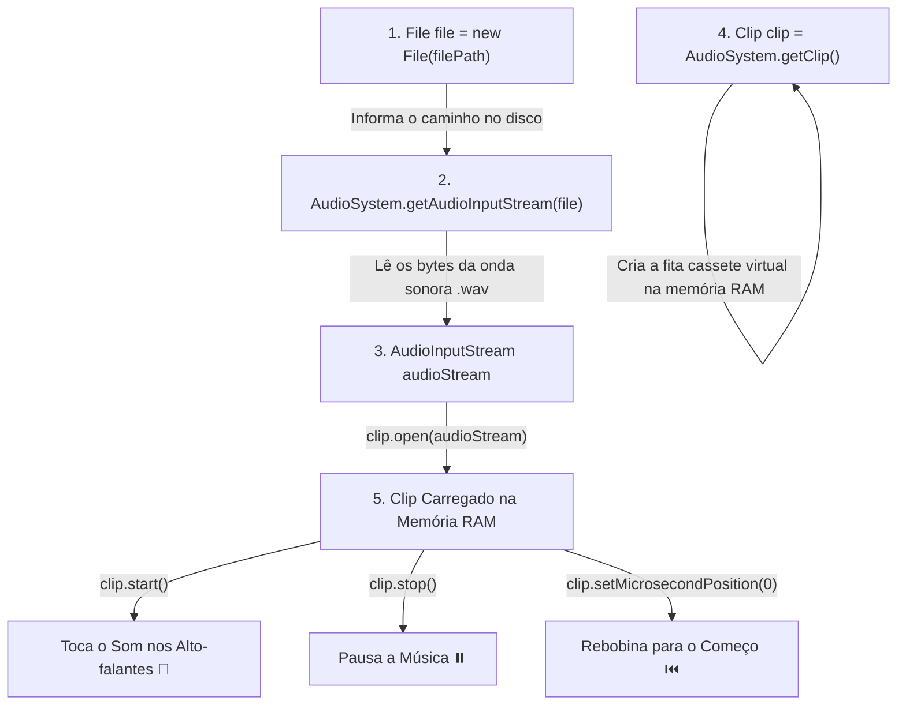

# ⭐ Capítulo 60: Music Player em Java (Parte 1) — Formatos de Áudio (.wav vs .mp3), Conversão e Estrutura Base

> **Curso:** Java Full Course (Bro Code) — Capítulo 60: `music player`  
> **Timestamp:** `[9:28:53 - 9:29:45]`  
> **Arquivo do Workspace:** [`Main.java`](../../../src/main/java/com/mickaelgeronimo/mastery/core/concurrency/Main.java)  
> **Objetivo:** Compreender por que o Java puro não toca arquivos `.mp3` nativamente, como obter músicas livres de direitos e convertê-las para `.wav`, e como funciona a arquitetura de áudio da biblioteca padrão `javax.sound.sampled` (`File`, `AudioInputStream`, `AudioSystem` e `Clip`) com um menu interativo no console.

---

## 📸 Reconstituição Visual do Vídeo (Para Consulta e Cópia no Google Docs)

Nesta aula introdutória ao projeto prático do **Player de Música**, o autor Bro Code exibe 5 telas fundamentais. Como este documento serve de referência completa sem a necessidade de ver as imagens, cada tela está descrita textualmente com máxima precisão:

---

### 1. Imagem 1 (`media_1791500292722_1ba70f0c.png`): O Teaser do Código no IntelliJ IDEA
* **Barra lateral de projetos (`Project Explorer`):**
  * `MyFirstProject`
    * `.idea/`
    * `out/`
    * `src/`
      * 🎵 `A Caring Friend.wav` *(o arquivo de áudio WAV colocado diretamente dentro da pasta `src`)*
      * 📄 `Main` *(o arquivo Java aberto no editor)*
    * `.gitignore`
    * `MyFirstProject.iml`
* **Editor de Código:** O autor mostra o esboço completo do programa:
  ```java
  public class Main {
      public static void main(String[] args) {

          // How to PLAY AUDIO with Java (.wav, .au, .aiff)

          String filePath = "src\\A Caring Friend.wav";
          File file = new File(filePath);

          try(Scanner scanner = new Scanner(System.in);
              AudioInputStream audioStream = AudioSystem.getAudioInputStream(file)){

              Clip clip = AudioSystem.getClip();
              clip.open(audioStream);

              String response = "";

              while(!response.equals("Q")){

                  System.out.println("P = Play");
                  System.out.println("S = Stop");
  ```
  *(O cursor está piscando na linha 22, preparando a demonstração interativa).*

---

### 2. Imagem 2 (`media_1791500301514_99d72883.png`): O Menu Interativo Rodando no Console
* **Timestamp do vídeo:** `9:28:53 / 12:00:00` | Título no player: `60.music player >`.
* **Aba de Execução (`Run - Main`):**
  O console do IntelliJ exibe o menu verde com as quatro opções disponíveis:
  ```text
  P = Play
  S = Stop
  R = Reset
  Q = Quit
  Enter your choice: 
  ```
  O terminal fica parado aguardando o usuário digitar um comando.

---

### 3. Imagem 3 (`media_1791500321151_8b3d826f.png`): Demonstração ao Vivo do Player Funcionando
* **Timestamp do vídeo:** `9:28:58 / 12:00:00`.
* **Aba de Execução (`Run - Main`):**
  1. O usuário digitou `p` (em minúsculo):
     ```text
     Enter your choice: p
     ```
  2. Imediatamente a música começou a tocar nos alto-falantes do computador!
  3. O loop `while` rodou novamente e reexibiu o menu para permitir novo controle enquanto o som toca:
     ```text
     P = Play
     S = Stop
     R = Reset
     Q = Quit
     Enter your choice: q
     ```
  4. O usuário digitou `q` para sair. O programa respondeu:
     ```text
     Bye!

     Process finished with exit code 0
     ```
  O programa parou a música, liberou a memória e encerrou com sucesso absoluto (`exit code 0`).

---

### 4. Imagem 4 (`media_1791500349498_2ce2b19c.png`): Onde Encontrar Músicas Livres no YouTube Studio
* **Timestamp do vídeo:** `9:29:31 / 12:00:00`.
* **Navegador Web:** Bro Code abre a biblioteca oficial de áudio do YouTube Studio:
  * URL: `https://studio.youtube.com/channel/UC4SVo0Ue36XCfOyb5Lh1vIQ/music`
  * Título: `Audio library` (músicas gratuitas e sem royalties para criadores de conteúdo).
  * Faixa selecionada: **"Silent Night"** pelo artista **The Soundlings** (Gênero: R&B & Soul, Humor: Calm, Duração: 2:54, Adicionada em Nov 2024).
  * Popup de Downloads do navegador Edge:
    * Baixando: `Silent Night - The Soundlings.mp3` (2.6 MB).
* **O Problema Imediato:** O arquivo baixado é um **`.mp3`**.

---

### 5. Imagem 5 (`media_1791500371477_bbef21a2.png`): A Conversão Obrigatória no CloudConvert
* **Navegador Web:** Bro Code navega até a ferramenta online gratuita:
  * URL: `https://cloudconvert.com/mp3-to-wav`
  * Título: `MP3 to WAV Converter - CloudConvert`
  * Descrição: *"CloudConvert converts your audio files online. Amongst many others, we support MP3, M4A, WAV and WMA."*
  * Arquivo selecionado no painel: `A Caring Friend.mp3`
  * Ação configurada: `Convert to WAV`
  * Botão vermelho clicado: `Convert`
* No fundo da área de trabalho do Windows, podemos ver o atalho do arquivo original `A Caring Friend` pronto para ser substituído pela versão convertida em `.wav`.

---

## ❓ Por que o Java Puro NÃO Toca Arquivos `.mp3`? (A Explicação para Leigos)

Se você é iniciante em programação, sua primeira reação deve ser:  
*"Mas todo celular, computador e site toca MP3 desde os anos 90! Por que o Java não toca MP3 direto?!"*

Aqui está o segredo dos bastidores:

```
+-------------------------------------------------------------------------------+
|                       O QUE É UM ARQUIVO MP3?                                 |
|                                                                               |
| Um MP3 é um áudio hiper comprimido usando algoritmos matemáticos complexos    |
| (MPEG-1 Audio Layer III). Ele joga fora frequências que o ouvido humano quase |
| não ouve para fazer uma música de 50 Megabytes caber em míseros 4 Megabytes. |
| Para tocar MP3, o computador precisa de um "decodificador" pesado e com       |
| patentes históricas.                                                          |
+-------------------------------------------------------------------------------+
                                      vs
+-------------------------------------------------------------------------------+
|                       O QUE É UM ARQUIVO .WAV?                                |
|                                                                               |
| O .WAV (Waveform Audio File Format) guarda o som "cru" (formato PCM puro),    |
| onda sonora real segundo a segundo, sem compressão destrutiva.                |
| O arquivo é maior, mas qualquer placa de som ou sistema lê diretamente        |
| lendo byte por byte sem precisar de decodificadores complexos.                |
+-------------------------------------------------------------------------------+
```

### O que acontece no Java Padrão (`javax.sound.sampled`):
1. A biblioteca de som oficial do Java Standard Edition (JDK) foi criada com foco em áudio sem perdas e áudio bruto para sistemas e jogos simples.
2. Formatos aceitos nativamente pelo Java sem instalar nada externo:
   * **`.wav`** *(Waveform Audio — o padrão mundial da Microsoft e IBM)*;
   * **`.au`** *(formato de áudio da antiga Sun Microsystems / Unix)*;
   * **`.aiff`** *(Audio Interchange File Format — padrão da Apple)*.
3. Se você passar um arquivo `.mp3` para o comando `AudioSystem.getAudioInputStream(file)`, o Java não sabe descompactar o MP3 e dispara imediatamente uma exceção na sua cara:
   ```text
   javax.sound.sampled.UnsupportedAudioFileException: could not get audio input stream from input file
   ```
4. **A solução ensinada pelo Bro Code:** Em vez de instalar bibliotecas externas complicadas de terceiros (como JLayer ou JavaZoom), a forma mais limpa, didática e 100% nativa é simplesmente converter qualquer música `.mp3` para `.wav` usando um conversor gratuito como o [CloudConvert](https://cloudconvert.com/mp3-to-wav).

---

## 🧱 A Arquitetura das 4 Peças do Java Sound API

Para criar um reprodutor de música em Java, trabalhamos com 4 peças que se conectam como blocos de Lego:



1. **[`File`](../../../src/main/java/com/mickaelgeronimo/mastery/core/concurrency/Main.java):** É apenas o "endereço postal" do arquivo no seu HD ou SSD.
2. **`AudioSystem`:** É a "fábrica" do Java que conversa com a placa de som do seu computador.
3. **`AudioInputStream`:** É o canudo que lê as ondas de áudio do arquivo `.wav` e as decodifica.
4. **`Clip`:** É a nossa vitrola / toca-fitas virtual! Diferente de uma leitura comum que lê e descarta os dados, o `Clip` guarda a música inteira na memória RAM. Isso permite você dar play, pausar, voltar pro início ou tocar em loop instantaneamente!

---

## 🔍 Anatomia Linha por Linha do Código do Teaser

Abaixo está a análise minuciosa de cada linha exibida na **Imagem 1**, explicando o que cada comando faz no computador e o que ele produz no console:

```java
 1: import javax.sound.sampled.AudioInputStream;
 2: import javax.sound.sampled.AudioSystem;
 3: import javax.sound.sampled.Clip;
 4: import javax.sound.sampled.LineUnavailableException;
 5: import javax.sound.sampled.UnsupportedAudioFileException;
 6: import java.io.File;
 7: import java.io.FileNotFoundException;
 8: import java.io.IOException;
 9: import java.util.Scanner;
10: 
11: public class Main {
12: 
13:     public static void main(String[] args) {
14: 
15:         // How to PLAY AUDIO with Java (.wav, .au, .aiff)
16: 
17:         String filePath = "src\\A Caring Friend.wav";
18:         File file = new File(filePath);
19: 
20:         try(Scanner scanner = new Scanner(System.in);
21:             AudioInputStream audioStream = AudioSystem.getAudioInputStream(file)){
22: 
23:             Clip clip = AudioSystem.getClip();
24:             clip.open(audioStream);
25: 
26:             String response = "";
27: 
28:             while(!response.equals("Q")){
29: 
30:                 System.out.println("P = Play");
31:                 System.out.println("S = Stop");
32:                 System.out.println("R = Reset");
33:                 System.out.println("Q = Quit");
34:                 System.out.print("Enter your choice: ");
35: 
36:                 response = scanner.next().toUpperCase();
37: 
38:                 switch(response){
39:                     case "P" -> clip.start();
40:                     case "S" -> clip.stop();
41:                     case "R" -> clip.setMicrosecondPosition(0);
42:                     case "Q" -> clip.close();
43:                     default -> System.out.println("Invalid choice");
44:                 }
45:             }
46:             System.out.println("Bye!");
47:         }
48:         catch(FileNotFoundException e){
49:             System.out.println("Could not locate file");
50:         }
51:         catch(UnsupportedAudioFileException e){
52:             System.out.println("Audio file is not supported");
53:         }
54:         catch(LineUnavailableException e){
55:             System.out.println("Unable to access audio resource");
56:         }
57:         catch(IOException e){
58:             System.out.println("Something went wrong");
59:         }
60: 
61:     }
62: }
```

---

### Detalhamento Linha a Linha

#### Linhas 1 a 9 — Importação dos Pacotes de Áudio e Entrada
* **Linhas 1 a 5 (`import javax.sound.sampled.*`):**
  * `AudioInputStream`: O fluxo que recebe os bytes do arquivo de áudio.
  * `AudioSystem`: A classe utilitária do Java que conecta o código aos recursos de áudio do sistema operacional.
  * `Clip`: A interface que representa o clipe de áudio em memória.
  * `LineUnavailableException`: Exceção disparada caso a placa de som do computador esteja ocupada ou inacessível.
  * `UnsupportedAudioFileException`: Exceção disparada se alguém tentar abrir um `.mp3` ou um arquivo corrompido que o Java não entenda.
* **Linhas 6 a 9 (`import java.io.*` e `java.util.Scanner`):**
  * `File`, `FileNotFoundException`, `IOException`: Classes necessárias para manipular o arquivo no disco e tratar erros de arquivo inexistente.
  * `Scanner`: Usado para ler os comandos digitados pelo usuário no teclado (`P`, `S`, `R`, `Q`).
* **Saída no console:** Nenhuma.

---

#### Linha 11 — Declaração da Classe `Main`
* `public class Main {`
* Define a classe principal pública do programa.
* **Saída no console:** Nenhuma.

---

#### Linha 13 — O Ponto de Entrada `main`
* `public static void main(String[] args) {`
* O método onde a máquina virtual Java (JVM) começa a execução do programa.
* **Saída no console:** Nenhuma.

---

#### Linha 15 — Comentário Educacional
* `// How to PLAY AUDIO with Java (.wav, .au, .aiff)`
* Lembrança fundamental do autor listando os 3 formatos que funcionam no Java nativo.
* **Saída no console:** Nenhuma.

---

#### Linha 17 — Definição do Caminho do Arquivo
* `String filePath = "src\\A Caring Friend.wav";`
* Cria a variável `filePath` contendo o caminho relativo até a pasta de código-fonte `src`.
* **Atenção ao detalhe das duas barras `\\`:** No Windows, o separador de pastas é a barra invertida `\`. Mas como em Java a barra invertida é um caractere de escape (como `\n` para pular linha), precisamos escrever duas barras invertidas `\\` para que o Java entenda que é uma barra real!
* **Saída no console:** Nenhuma.

---

#### Linha 18 — Criação do Objeto `File`
* `File file = new File(filePath);`
* O Java cria um objeto `File` que aponta para o arquivo `src\A Caring Friend.wav`.
* Se o arquivo existir ou não, esta linha não dá erro aqui; ela só cria a referência na memória.
* **Saída no console:** Nenhuma.

---

#### Linhas 20 e 21 — O `try-with-resources` Duplo
* `try(Scanner scanner = new Scanner(System.in);`
* `    AudioInputStream audioStream = AudioSystem.getAudioInputStream(file)){`
* **O que é isso?** É a estrutura de segurança moderna do Java (introduzida no Java 7).
* Ao colocar o `Scanner` e o `AudioInputStream` dentro dos parênteses do `try`, o Java garante que **ambos serão fechados automaticamente** quando o bloco terminar, mesmo se ocorrer um erro ou quando o usuário sair do player.
* O comando `AudioSystem.getAudioInputStream(file)` abre o arquivo `.wav`, lê o cabeçalho e prepara o fluxo de áudio decodificado.
* **Saída no console:** Nenhuma.

---

#### Linha 23 — Obtenção do `Clip`
* `Clip clip = AudioSystem.getClip();`
* Pede à placa de som do sistema operacional uma linha de áudio em memória (um `Clip`).
* Pense nisso como ligar o toca-fitas da sua mesa.
* **Saída no console:** Nenhuma.

---

#### Linha 24 — Carregamento do Áudio no `Clip`
* `clip.open(audioStream);`
* Pega os dados que estão fluindo do `audioStream` e copia tudo para dentro da memória RAM do `Clip`.
* Agora o som está 100% carregado e pronto para disparar no milissegundo em que você mandar!
* **Saída no console:** Nenhuma.

---

#### Linha 26 — Variável de Resposta do Menu
* `String response = "";`
* Cria uma String vazia para guardar o que o usuário vai digitar no teclado.
* Inicializamos com aspas vazias para que o loop `while` possa iniciar com segurança.
* **Saída no console:** Nenhuma.

---

#### Linha 28 — O Loop Interativo do Menu
* `while(!response.equals("Q")){`
* Lê-se: *"Enquanto a resposta do usuário NÃO for igual a "Q", continue repetindo o bloco abaixo."*
* Como `response` começa como `""`, a condição `!response.equals("Q")` é verdadeira (`true`), então o Java entra no loop.
* **Saída no console:** Nenhuma.

---

#### Linhas 30 a 34 — Impressão do Menu no Console
* `System.out.println("P = Play");`
* `System.out.println("S = Stop");`
* `System.out.println("R = Reset");`
* `System.out.println("Q = Quit");`
* `System.out.print("Enter your choice: ");`
* Exibe a lista de opções para o usuário. Note que a linha 34 usa `print` (sem o `ln`), para que o cursor do teclado fique piscando na mesma linha após os dois pontos e o espaço!
* **Saída no console (Imagens 2 e 3):**
  ```text
  P = Play
  S = Stop
  R = Reset
  Q = Quit
  Enter your choice: 
  ```

---

#### Linha 36 — Leitura do Teclado com `.toUpperCase()`
* `response = scanner.next().toUpperCase();`
* `scanner.next()`: Captura a próxima palavra ou letra que o usuário digitar e apertar Enter.
* `.toUpperCase()`: **Pulo do gato!** Se o usuário digitar um `p` minúsculo, o método converte automaticamente para `"P"` maiúsculo. Isso evita que o programa ignore o comando só porque o Caps Lock estava desligado.
* **No Console (Imagem 3):** O usuário digitou `p` e deu Enter:
  ```text
  Enter your choice: p
  ```

---

#### Linhas 38 a 44 — O `switch` dos Comandos de Áudio
* `switch(response){`
  * `case "P" -> clip.start();`
    * Se for `"P"`, chama `clip.start()`. O `Clip` começa a reproduzir a música!
    * **Magia do Multithreading:** O `clip.start()` roda em uma **thread separada de áudio em segundo plano**. Ou seja, a música toca e o seu programa Java **não fica congelado**; ele continua rodando o loop e permitindo que você aperte stop ou quit a qualquer momento!
  * `case "S" -> clip.stop();`
    * Se for `"S"`, chama `clip.stop()`. Pausa a música na posição exata em que ela estava. Se você apertar `"P"` depois, ela continua de onde parou.
  * `case "R" -> clip.setMicrosecondPosition(0);`
    * Se for `"R"`, reseta o ponteiro de reprodução para `0` microssegundos (o início absoluto da música).
  * `case "Q" -> clip.close();`
    * Se for `"Q"`, fecha o clipe de áudio e desocupa a placa de som.
  * `default -> System.out.println("Invalid choice");`
    * Se o usuário digitar qualquer outra coisa (como `"X"` ou `"banana"`), avisa que a opção é inválida sem travar o programa.

---

#### Linha 46 — Mensagem de Despedida
* `System.out.println("Bye!");`
* Esta linha fica **fora** do loop `while`. Ela só é executada quando o usuário digita `"Q"`, fazendo o loop encerrar.
* **Saída no console (Imagem 3):**
  ```text
  Bye!
  ```

---

#### Linhas 48 a 59 — Tratamento Robusto de Exceções (`catch`)
* Como trabalhar com arquivos e áudio envolve o hardware da máquina, o Java nos obriga a capturar 4 possíveis problemas:
  1. `FileNotFoundException`: Se o arquivo `.wav` não estiver na pasta `src/` ou o nome estiver escrito errado (`"Could not locate file"`).
  2. `UnsupportedAudioFileException`: Se você colocou um `.mp3` ou um arquivo de formato não reconhecido (`"Audio file is not supported"`).
  3. `LineUnavailableException`: Se a placa de som estiver travada por outro aplicativo ou sem portas de áudio livres (`"Unable to access audio resource"`).
  4. `IOException`: Para qualquer outro erro genérico de entrada/saída no disco (`"Something went wrong"`).

---

## 💻 Simulação Completa do Console (Exatamente como nas Imagens 2 e 3)

```text
P = Play
S = Stop
R = Reset
Q = Quit
Enter your choice: p
P = Play
S = Stop
R = Reset
Q = Quit
Enter your choice: q
Bye!

Process finished with exit code 0
```

---

## 🧠 Perguntas Frequentes do Aluno Iniciante

### 1. Onde coloco o arquivo de áudio no IntelliJ?
O autor colocou o arquivo `A Caring Friend.wav` diretamente dentro da pasta `src/` do projeto. Por isso o caminho no código é:
```java
String filePath = "src\\A Caring Friend.wav";
```
Se você colocasse o arquivo na raiz do projeto (fora da pasta `src`), o caminho seria apenas `"A Caring Friend.wav"`.

### 2. Por que o `scanner.next().toUpperCase()` é tão útil?
Sem o `.toUpperCase()`, se o usuário digitasse `p`, o programa não encontraria o `case "P"` e diria `"Invalid choice"`. Ao transformar qualquer letra em maiúscula, aceitamos tanto `p` quanto `P`, e tanto `q` quanto `Q`.

### 3. O que acontece se a música acabar enquanto o programa estiver aberto?
O `Clip` simplesmente para de tocar ao atingir o final da trilha. Se o usuário digitar `R` (reset) e depois `P` (play), ele voltará a tocar desde o início.

---

## 📌 Resumo Prático dos Métodos do `Clip`

| Método | O que ele faz? | Exemplo no Código |
| :--- | :--- | :--- |
| `clip.open(audioStream)` | Carrega a música inteira para a memória RAM | `clip.open(audioStream);` |
| `clip.start()` | Começa a tocar o áudio em background | `case "P" -> clip.start();` |
| `clip.stop()` | Pausa a música onde ela estiver | `case "S" -> clip.stop();` |
| `clip.setMicrosecondPosition(0)` | Volta a agulha para o início (0 microssegundos) | `case "R" -> clip.setMicrosecondPosition(0);` |
| `clip.close()` | Libera a memória e a placa de som | `case "Q" -> clip.close();` |
