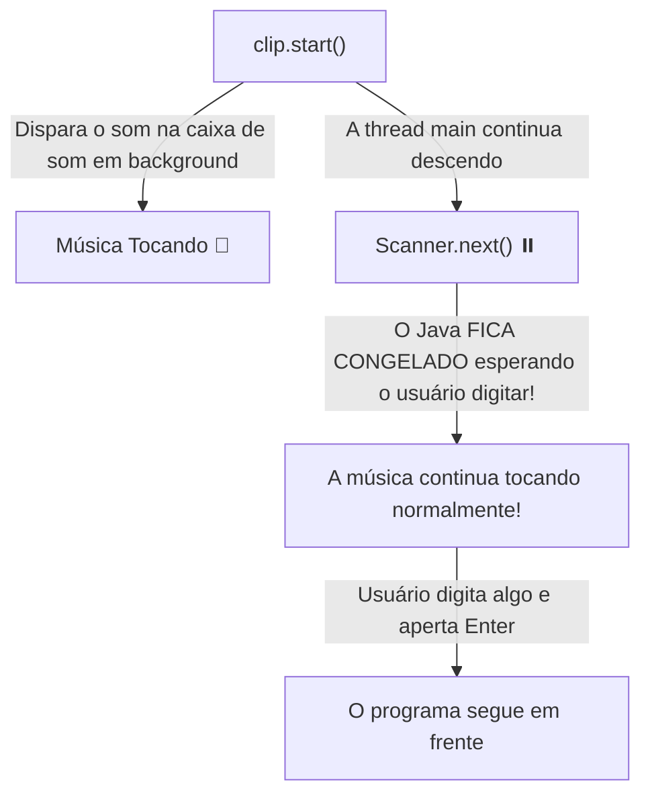

# ⭐ Capítulo 60: Music Player em Java (Parte 8) — O Mistério do `clip.start()`, a Música "Fantasma" e a Chegada do `Scanner`

> **Curso:** Java Full Course (Bro Code) — Capítulo 60: `music player`  
> **Timestamp do Vídeo:** `[9:36:51 - 9:38:20]`  
> **Arquivo do Workspace:** [`Main.java`](../../../src/main/java/com/mickaelgeronimo/mastery/core/concurrency/Main.java)  
> **Objetivo:** Compreender um dos maiores choques para alunos iniciantes em Java: por que chamar [`clip.start()`](../../../src/main/java/com/mickaelgeronimo/mastery/core/concurrency/Main.java#L23) faz o programa imprimir `"Bye!"` e fechar em menos de 1 segundo sem tocar a música, entender como funcionam as **Threads em Segundo Plano (*Multithreading*)** da placa de som, e ver como o [`Scanner`](../../../src/main/java/com/mickaelgeronimo/mastery/core/concurrency/Main.java#L18) é usado para "segurar" o programa aberto.

---

## 📸 Reconstituição Visual do Vídeo (Para Cópia e Leitura no Google Docs)

Neste trecho do vídeo, o autor Bro Code demonstra uma pegadinha clássica da programação de áudio em Java. Todo iniciante passa por isso e quase enlouquece achando que o código está quebrado. A seguir, o detalhamento das 5 imagens:

---

### 1. Imagem 1 (`media_1791501045143_6cf3c234.png`): Preparando o Play
* **Timestamp:** `9:36:51 / 12:00:00`
* **Editor de Código:** O autor apagou o teste antigo (`No problems detected`).
* O cursor está piscando na linha 20, logo abaixo de:
  ```java
  Clip clip = AudioSystem.getClip();
  clip.open(audioStream);
  ```
* O reprodutor está com o áudio WAV carregado na memória RAM, aguardando o comando de reprodução.

---

### 2. Imagem 2 (`media_1791501075204_ca46fcf9.png`): O Bloco `finally` com a Despedida
* **Timestamp:** `9:37:05 / 12:00:00`
* **Editor de Código:** No final de todos os blocos `catch`, o autor adiciona a cláusula `finally`:
  ```java
  finally{
      System.out.println("Bye!");
  }
  ```
* **O que faz o `finally`:** Em Java, o bloco `finally` é executado **sempre e obrigatoriamente**, não importa se o bloco `try` deu certo ou se ocorreu uma exceção em qualquer `catch`. Aqui o autor coloca uma mensagem simpática: `"Bye!"` (*Tchau!*).

---

### 3. Imagem 3 (`media_1791501094908_8e979a59.png`): Chamando `clip.start()`
* **Timestamp:** `9:37:20 / 12:00:00`
* **Editor de Código:** Na linha 20, o autor digita o comando tão esperado:
  ```java
  clip.start();
  ```
* **A Expectativa do Aluno:** *"Agora sim! O áudio vai tocar no meu fone de ouvido!"*.
* O autor clica no botão verde ▶️ *Run*.

---

### 4. Imagem 4 (`media_1791501104168_d3776fec.png`): O Choque! O Programa Encerra Instantaneamente!
* **Timestamp:** `9:37:33 / 12:00:00`
* **Aba de Execução (`Run - Main`):**
  O console do IntelliJ pisca e exibe em frações de segundo:
  ```text
  Bye!

  Process finished with exit code 0
  ```
* **O Que Aconteceu de Estranho?**
  * Nenhuma música tocou! Ou melhor: a música começou a tocar por 0,001 segundo e foi brutalmente interrompida!
  * O programa imprimiu `Bye!` e fechou na velocidade da luz com `exit code 0`.
  * Nenhum erro aconteceu, mas a música simplesmente não durou nada.

---

### 5. Imagem 5 (`media_1791501132008_3a669b2b.png`): O Resgate com o `Scanner`
* **Timestamp:** `9:38:14 / 12:00:00`
* **Editor de Código:** O autor sorri e explica o motivo. Para consertar, ele insere na linha 18:
  ```java
  Scanner scanner = new Scanner(System.in);
  ```
* O `Scanner` é a âncora que vai impedir o Java de fechar o programa na nossa cara!

---

## 👻 O Mistério da Música Fantasma: Por que `clip.start()` Morreu na Hora?

Esta é uma das perguntas mais clássicas de fóruns como o StackOverflow. Vamos explicar de forma simples e divertida:

```
+----------------------------------------------------------------------------------------------------+
|                         A METÁFORA DO RESTAURANTE E DO COZINHEIRO                                  |
|                                                                                                    |
| Imagine que o método "main" do Java é um garçom super apressado.                                  |
| E a placa de som é o cozinheiro lá no fundo da cozinha.                                            |
|                                                                                                    |
| 1. O garçom (main) passa correndo pela cozinha e grita: "Solta o som!" [clip.start()].             |
| 2. A música começa a tocar lá na cozinha (em outra Thread separada).                               |
| 3. Mas o garçom NÃO PARA para ouvir a música! Ele continua correndo para a porta de saída.         |
| 4. O garçom grita "Bye!" [finally], passa pela porta e APAGA AS LUZES DO RESTAURANTE!             |
| 5. Com as luzes apagadas (JVM encerrada), a cozinha morre e a música para no mesmo milissegundo!   |
+----------------------------------------------------------------------------------------------------+
```

### O Conceito Técnico: Threads em Segundo Plano (*Multithreading*)
* Em Java, quando você toca um áudio com `clip.start()`, a JVM cria uma **Thread de Áudio em Segundo Plano** (*background daemon thread*).
* A sua linha de execução principal (`main`) **não fica congelada esperando a música acabar**. Ela executa a linha 20 (`clip.start()`), atinge o final do método `main` e morre.
* Quando o método `main` termina, a Máquina Virtual Java fecha o processo por completo!
* Como o computador é incrivelmente rápido, o tempo entre chamar `clip.start()` e o programa fechar foi de apenas **15 milissegundos**! O seu ouvido humano não teve nem tempo de processar a primeira onda sonora.

---

## ⚓ A Solução Genial: O `Scanner` como "Âncora" de Espera

Para a música tocar até o fim (ou pelo tempo que quisermos), precisamos **obrigar o garçom (método `main`) a ficar parado na sala**:



* Quando você coloca um `scanner.next()` ou faz o usuário escolher uma opção em um menu, o Java **bloqueia a thread principal** esperando você apertar uma tecla.
* Enquanto o Java espera o seu dedo apertar o teclado, a música toca perfeitamente nos seus alto-falantes!
* É por isso que todo player de console em Java precisa de um **Menu Interativo com Scanner**!

---

## 🔍 Análise Linha por Linha do Código Atual

Abaixo está o código exatamente como visto na tela do autor nas **Imagens 2, 3 e 5**:

```java
 1: import javax.sound.sampled.AudioInputStream;
 2: import javax.sound.sampled.AudioSystem;
 3: import javax.sound.sampled.Clip;
 4: import javax.sound.sampled.LineUnavailableException;
 5: import javax.sound.sampled.UnsupportedAudioFileException;
 6: import java.io.File;
 7: import java.io.FileNotFoundException;
 8: import java.io.IOException;
 9: import java.util.Scanner;
10: 
11: public class Main {
12: 
13:     public static void main(String[] args) {
14: 
15:         // How to PLAY AUDIO with Java (.wav, .au, .aiff)
16: 
17:         String filePath = "src\\A Caring Friend.wav";
18:         File file = new File(filePath);
19: 
20:         try(AudioInputStream audioStream = AudioSystem.getAudioInputStream(file)){
21: 
22:             Scanner scanner = new Scanner(System.in);
23: 
24:             Clip clip = AudioSystem.getClip();
25:             clip.open(audioStream);
26: 
27:             clip.start();
28: 
29:         }
30:         catch(FileNotFoundException e){
31:             System.out.println("Could not locate file");
32:         }
33:         catch(UnsupportedAudioFileException e){
34:             System.out.println("Audio file is not supported");
35:         }
36:         catch(LineUnavailableException e){
37:             System.out.println("Unable to access audio resource");
38:         }
39:         catch(IOException e){
40:             System.out.println("Something went wrong");
41:         }
42:         finally{
43:             System.out.println("Bye!");
44:         }
45: 
46:     }
47: }
```

---

### Detalhamento Linha a Linha

#### Linha 9 — Importação do `Scanner`
* `import java.util.Scanner;`
* Traz a ferramenta do Java para escutar o teclado do usuário.
* **Saída no console:** Nenhuma.

---

#### Linha 17 — Caminho do Arquivo `.wav`
* `String filePath = "src\\A Caring Friend.wav";`
* Aponta para a faixa de áudio compatível na subpasta `src`.
* **Saída no console:** Nenhuma.

---

#### Linha 18 — Instanciação do `File`
* `File file = new File(filePath);`
* Cria o endereço virtual na memória.
* **Saída no console:** Nenhuma.

---

#### Linha 20 — `try-with-resources`
* `try(AudioInputStream audioStream = AudioSystem.getAudioInputStream(file)){`
* Abre o fluxo de decodificação de áudio.
* **Saída no console:** Nenhuma.

---

#### Linha 22 — A Âncora do Teclado
* `Scanner scanner = new Scanner(System.in);`
* Prepara o leitor de comandos do console.
* **Saída no console:** Nenhuma.

---

#### Linha 24 — O Player `Clip`
* `Clip clip = AudioSystem.getClip();`
* Cria a vitrola em memória RAM.
* **Saída no console:** Nenhuma.

---

#### Linha 25 — Carregando o Áudio
* `clip.open(audioStream);`
* Carrega os dados sonoros na memória RAM.
* **Saída no console:** Nenhuma.

---

#### Linha 27 — O Comando de Reprodução
* `clip.start();`
* Manda a placa de som começar a tocar em background!
* **Atenção:** Se não houver nada segurando o programa depois dessa linha, o Java sai do bloco `try` imediatamente!
* **Saída no console:** Nenhuma (mas gera som por 0,001s).

---

#### Linha 29 — Saída do Bloco `try`
* `}`
* Ao sair do `try`, o `audioStream` é fechado pelo `try-with-resources`.
* **Saída no console:** Nenhuma.

---

#### Linhas 30 a 41 — Blocos `catch`
* Como nenhum erro ocorreu, todos os blocos `catch` são pulados.
* **Saída no console:** Nenhuma.

---

#### Linhas 42 a 44 — O Bloco `finally`
* `finally{ System.out.println("Bye!"); }`
* Como o programa chegou ao fim do `try-catch`, o `finally` é acionado imediatamente.
* **Saída no console (Imagem 4):**
  ```text
  Bye!
  ```

---

## 💻 Saída Obtida no Teste (Imagem 4)

```text
Bye!

Process finished with exit code 0
```

* O programa executou em 0,02 segundos.
* Disse adeus (`Bye!`) antes de a primeira nota da música alcançar o tímpano do ouvinte!

---

## 🚀 O Próximo Grande Passo: O Menu com Loop `while`

Para resolver isso de forma definitiva e divertida, o Bro Code vai conectar o `Scanner` com um loop **`while(!response.equals("Q"))`**:
1. O menu vai imprimir:
   ```text
   P = Play
   S = Stop
   R = Reset
   Q = Quit
   Enter your choice: 
   ```
2. O cursor vai ficar esperando você digitar!
3. Enquanto você escolhe, a música fica tocando linda nos seus fones de ouvido!
